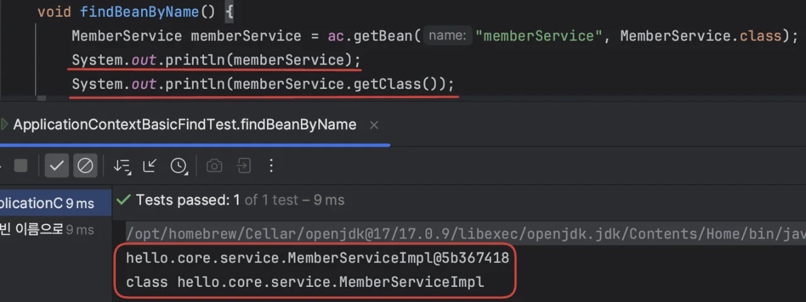

<details>
<summary>빈 검증</summary>

> 가져오는 빈, 올바른지 출략값으로 검증



</details>

<a id="1c3eda9b0fe18148a0b2e89a43758b86"></a>

# 스프링 빈 조회(<code>getBean()</code>)

---

<a id="1c3eda9b0fe18198be7fc07519cd6376"></a>

### 이름으로 조회

> <code>ac&#46;getBean(</code><strong><code>&#34;memberService&#34;</code></strong><code>, MemberService&#46;class);</code>

<a id="1c3eda9b0fe1811eb400c38b4f4b1044"></a>

```java
@DisplayName("빈 이름으로 조 회")
@Test
void findBeanByName() {
    MemberService memberService = ac.getBean("memberService", MemberService.class);
    assertThat(memberService).isInstanceOf(MemberServiceImpl.class);
}
```

<a id="1c3eda9b0fe18191af1cdd8c88d98b80"></a>

###  타입으로 조회

> <code>ac&#46;getBean(</code><strong><code>MemberService&#46;class</code></strong><code>)</code>

<a id="1c3eda9b0fe181378eecd5243b569597"></a>

```java
@DisplayName("이름 없이 타입으로만 조회")
@Test
void findBeanByType() {
    MemberService memberService = ac.getBean(MemberService.class);
    assertThat(memberService).isInstanceOf(MemberServiceImpl.class);
}
```

<a id="1c3eda9b0fe181c09da5d16d2c72b38f"></a>

### 구현 타입으로 조회( 안 좋은 방법)

> <strong>역할 과 구현은 구분해야한다&#46; 항상 역할에 의존해야 한다&#46; (다형성, DIP)</strong>

<a id="1c3eda9b0fe1816a8a51d434fa69e537"></a>

구체 타입 조회 → &#91; <strong>유연성 ↓</strong>, <strong>다형성 X &#93;</strong>   →<strong> 좋은 방법 아님</strong>

<a id="1c3eda9b0fe181159da2d6c58969e32e"></a>

그러나 항상 모든게 이상적으로 돌아갈 순 없다&#46; (써먹을 순간이 존재할 수도…)

> <strong><code>MemberServiceImpl</code></strong><code> memberService = ac&#46;getBean(&#34;memberService&#34;, </code><strong><code>MemberServiceImpl</code></strong><code>&#46;class);</code>

<a id="1c3eda9b0fe181f2b5f5eaae1541d8b3"></a>

```java
@DisplayName("구체 타입으로 조회")
@Test
void findBeanByName2() {
    MemberServiceImpl memberService = ac.getBean("memberService", MemberServiceImpl.class);
    assertThat(memberService).isInstanceOf(MemberServiceImpl.class);
}
```

<a id="1c3eda9b0fe181e4bb59fdfd2ff8f323"></a>

### 실패 케이스 테스트

> <strong>항상 테스트는 실패 테스트를 만들어야 한다&#46;</strong>

> 테스트 에러 발생<br>→ <strong>NoSuchBeanDefinitionException&#58; No bean named &#39;xxxxx&#39; available</strong>

<a id="1c3eda9b0fe181978cd5dd9139d8713d"></a>

```java
 // 실패 케이스
    @DisplayName("빈 이름으로 조회 X")
    @Test
    void findBeanByNameX() {
        // ac.getBean("xxxxx", MemberService.class);
        assertThrows(NoSuchBeanDefinitionException.class, () ->
                ac.getBean("xxxxx", MemberService.class));
    }
```

<details>
<summary>전체 코드</summary>

<a id="1c3eda9b0fe18171a703cce14ef39b2f"></a>

```java
package hello.core.beanfind;

import hello.core.AppConfig;
import hello.core.service.MemberService;
import hello.core.service.MemberServiceImpl;
import org.junit.jupiter.api.DisplayName;
import org.junit.jupiter.api.Test;
import org.springframework.beans.factory.NoSuchBeanDefinitionException;
import org.springframework.context.annotation.AnnotationConfigApplicationContext;

import static org.assertj.core.api.Assertions.*;
import static org.junit.jupiter.api.Assertions.*;

public class ApplicationContextBasicFindTest {
    AnnotationConfigApplicationContext ac = new AnnotationConfigApplicationContext(AppConfig.class);

    @DisplayName("빈 이름으로 조회")
    @Test
    void findBeanByName() {
        MemberService memberService = ac.getBean("memberService", MemberService.class);
        assertThat(memberService).isInstanceOf(MemberServiceImpl.class);
    }


    @DisplayName("이름 없이 타입으로만 조회")
    @Test
    void findBeanByType() {
        MemberService memberService = ac.getBean(MemberService.class);
        assertThat(memberService).isInstanceOf(MemberServiceImpl.class);
    }


    @DisplayName("구체 타입으로 조회")
    @Test
    void findBeanByName2() {
        MemberServiceImpl memberService = ac.getBean("memberService", MemberServiceImpl.class);
        assertThat(memberService).isInstanceOf(MemberServiceImpl.class);
    }

    // 실패 케이스
    @DisplayName("빈 이름으로 조회 X")
    @Test
    void findBeanByNameX() {
        // ac.getBean("xxxxx", MemberService.class);
        assertThrows(NoSuchBeanDefinitionException.class, () ->
                ac.getBean("xxxxx", MemberService.class));
    }
}
```

</details>
