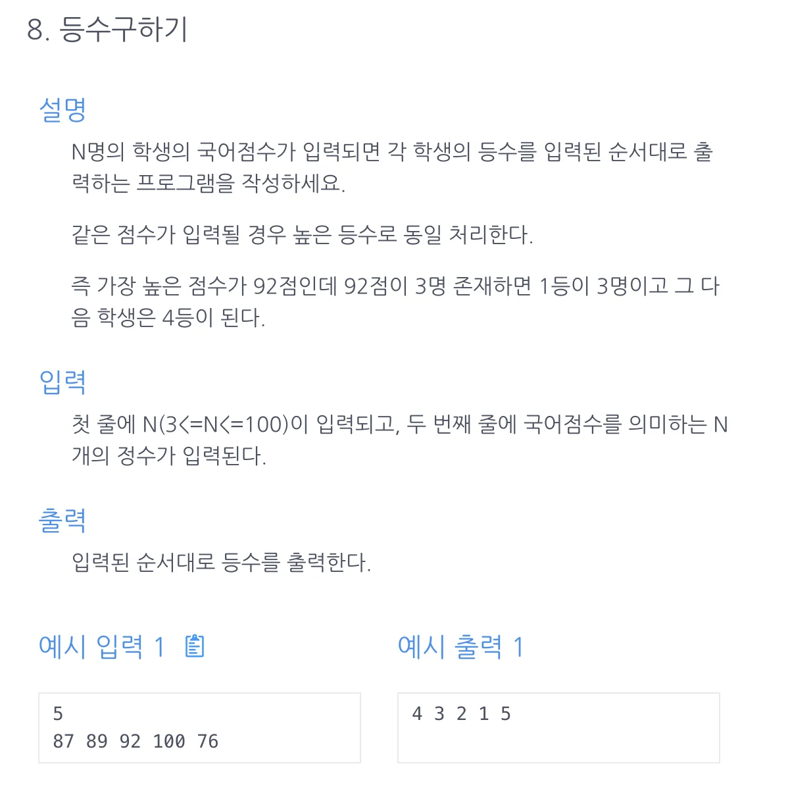

<a id="1c3eda9b0fe1813d8d50c7a84300d90d"></a>

## 문제)



<a id="1c3eda9b0fe181eb998ecf14ce4eae6f"></a>

## 풀이)

<a id="1c3eda9b0fe1813fb4f3e89689405e93"></a>

### 풀이1) 시간복잡도&#58; O(n^2) 

<a id="1c3eda9b0fe181cb95c5cdcc1bfa1f1c"></a>

```java
import java.util.Scanner;

public class Main {
    public int[] solution(int n, int[] arr) {
        int[] answer = new int[n];
        for(int i=0; i<n; i++){
            int target = arr[i], cnt=1;
            for(int x: arr){
                if (x > target) cnt++;
            }
            answer[i] = cnt;
        }

        return answer;
    }
    public static void main (String[]args){
        Main m = new Main();
        Scanner sc = new Scanner(System.in);
        int n = sc.nextInt();
        int[] arr = new int[n];
        for(int i=0; i<n; i++){
            arr[i] = sc.nextInt();
        }
        for(int x : m.solution(n, arr)) System.out.print(x+" ");
    }

}
```

<a id="1c3eda9b0fe18138b3bed5e6b331e0bb"></a>

### 풀이2)

<a id="1c3eda9b0fe1811ba485e1f261462802"></a>

```java
import java.util.*;
public class Main {
    public int[] solution(int n, int[] arr) {
        int[] answer=new int[n];
        for(int i=0; i<n; i++) {
            int num=1;
            for(int j=0; j<n; j++){
                if(i==j) continue;
                if(arr[i]<arr[j]) num++;
            }
            answer[i]=num;
        }
        return answer;
    }

    public static void main (String[] args){
        Main T = new Main();
        Scanner sc = new Scanner(System.in);
        int n=sc.nextInt();
        int[] arr=new int[n];
        for(int i=0; i<n; i++){
            arr[i]=sc.nextInt();
        }
        for(int x:T.solution(n, arr)){
            System.out.print(x+" ");
        }
    }
}
```

<a id="1c3eda9b0fe18189b962f534f5704017"></a>

### 풀이3) 정렬 &#43; 등수&#58; (indexof) = index &#43; 1
