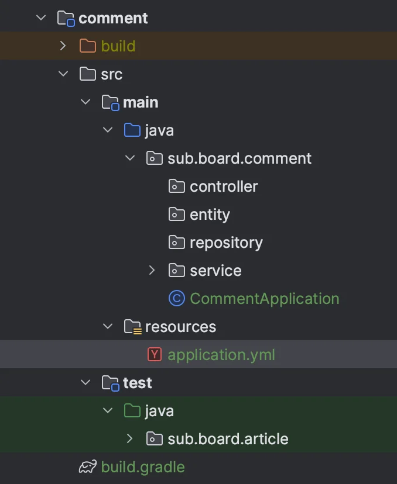
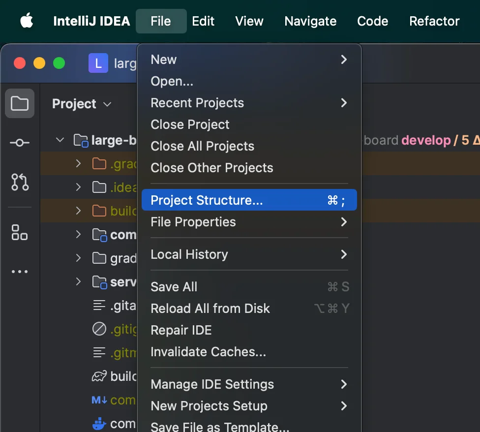
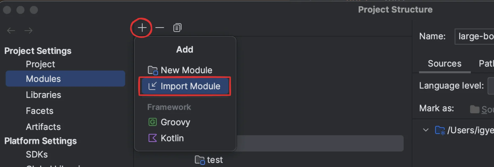
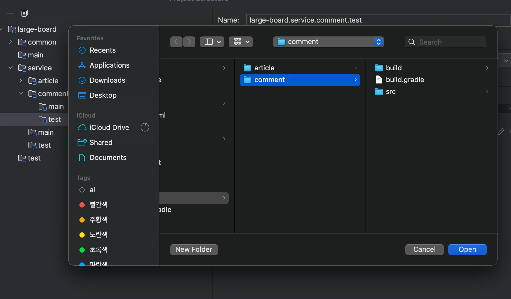
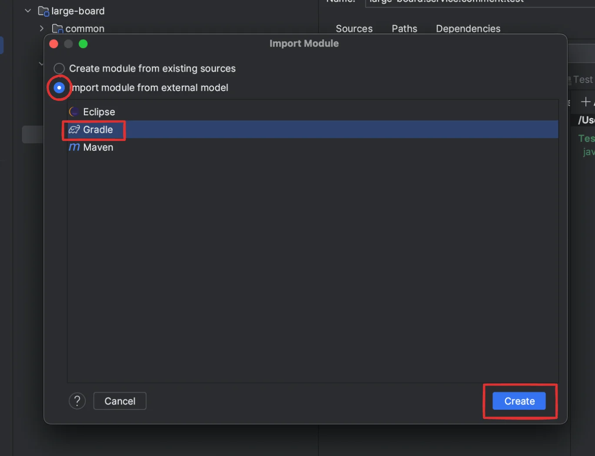
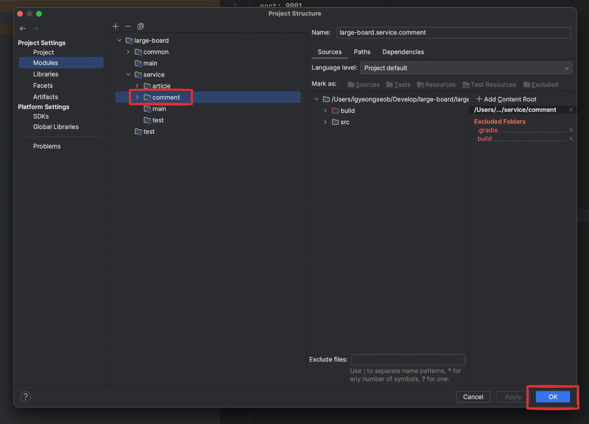
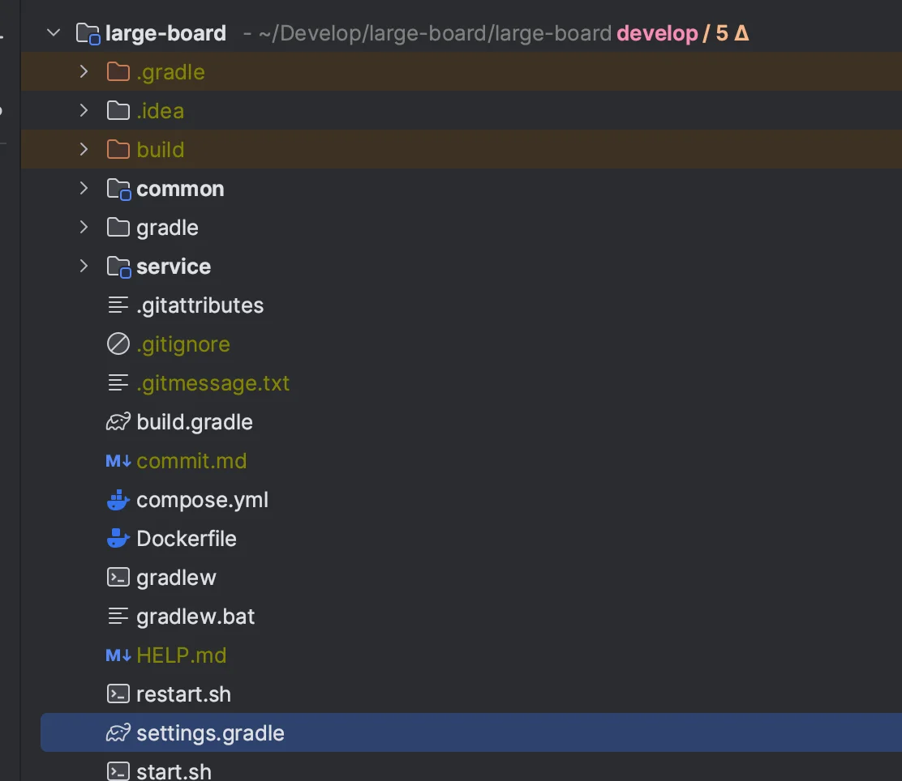
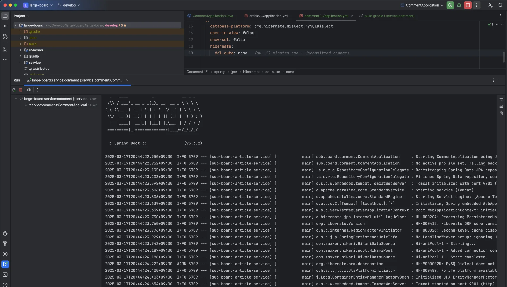

<a id="1c3eda9b0fe18141b756eacff9b99dda"></a>

### 1&#46; 기본 폴더 생성

- service &#45; comment 모듈 및 기본 폴더 생성
    

    <details>
    <summary>1&#46; <code>build&#46;gradle</code> </summary>

    <a id="1c3eda9b0fe18162b4e5da8a96084f6e"></a>

    ```groovy
    dependencies {
        implementation 'org.springframework.boot:spring-boot-starter-web'
        implementation 'org.springframework.boot:spring-boot-starter-data-jpa'
        runtimeOnly 'com.mysql:mysql-connector-j'
        implementation project(':common:snowflake')
    }
    ```

    </details>

    <details>
    <summary>2&#46; main&#46;java&#46;sub&#46;board&#46;comment&#46;<code>CommentApplication</code> 파일 정의</summary>

    <a id="1c3eda9b0fe18120b01de0f25a1dd062"></a>

    ```java
    package sub.board.comment;

    import org.springframework.boot.SpringApplication;
    import org.springframework.boot.autoconfigure.SpringBootApplication;
    import org.springframework.context.annotation.ComponentScan;
    import org.springframework.data.jpa.repository.config.EnableJpaRepositories;

    @ComponentScan(basePackages = "sub.board")
    @EnableJpaRepositories(basePackages = "sub.board")
    @SpringBootApplication
    public class CommentApplication {
        public static void main(String[] args) {
            SpringApplication.run(CommentApplication.class, args);
        }
    }
    ```

    </details>

    <details>
    <summary>3&#46; resources&#46;<code>application&#46;yml</code> 파일 정의</summary>

    <a id="1c3eda9b0fe18194908df4e809915786"></a>

    ```yaml
    server:
      port: 9001

    spring:
      application:
        name: sub-board-article-service

      datasource:
        driver-class-name: com.mysql.cj.jdbc.Driver
        url: jdbc:mysql://localhost:3306/mydb
        username: ${MYSQL_USERNAME}
        password: ${MYSQL_PASSWORD}

      jpa:
        database-platform: org.hibernate.dialect.MySQLDialect
        open-in-view: false
        show-sql: false
        hibernate:
          ddl-auto: none
    ```

    </details>

<a id="1c3eda9b0fe181ef8cb5f834e2f85b39"></a>

### 2&#46; 모듈 등록

1. File &#45; Project Structure
    

1. 모듈 import
    

1. 추가하려는 폴더(모듈) 선택
    

1. import module from external model &#45; Gradle &#45; Create 클릭
    

1. 모듈 등록 확인 후, <code>OK</code> 클릭
    

<a id="1c3eda9b0fe181b5b4e5f1748f54ce9f"></a>

### 3&#46; <code>gradle</code> 에 해당 모듈 등록

- root &#45; <code>settings&#46;gradle</code> 파일에 새로 생성한 모듈(comment) 등록
    

    <a id="1c3eda9b0fe1815b90e8c3a1fcfd5d6a"></a>

    <strong>settings&#46;gradle</strong> 

    <a id="1c3eda9b0fe181e0b573d0d960f6c5e5"></a>

    ```groovy
    rootProject.name = 'large-board'

    include 'common'
    include 'common:snowflake'
    include 'service'
    include 'service:article'
    include 'service:comment'
    ```

<a id="1c3eda9b0fe1812aa506fdcb2982fcda"></a>

해당 모듈 boot 실행을 통해 정상 동작 확인하기



- boot 실행을 통해 정상 동작 확인함
