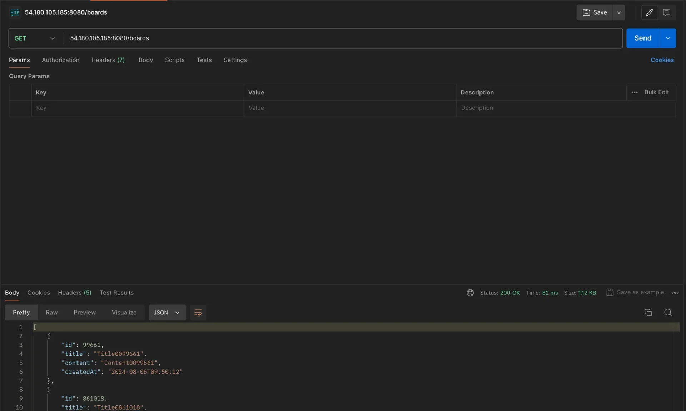

<a id="1c3eda9b0fe181dabdaec02e8fe2f1fd"></a>

### Spring Boot에 ElastiCache 연결

---

<details>
<summary><strong>1&#46; application&#46;yml &#45; redis 엔드포인트 수정</strong></summary>

<a id="1c3eda9b0fe181929f6de30f64a78f30"></a>

```bash
# local 환경
spring:
  profiles:
    default: local
  datasource:
    url: jdbc:mysql://host.docker.internal:3306/mydb
    username: root
    password: password
    driver-class-name: com.mysql.cj.jdbc.Driver
  jpa:
    hibernate:
      ddl-auto: update
    show-sql: true
  data:
    redis:
      host: cache-server
      port: 6379

logging:
  level:
    org.springframework.cache: trace


---
# prod 환경
spring:
  config:
    activate:
      on-profile: prod
  datasource:
    url: jdbc:mysql://instagram-db.coseefawhrzc.ap-northeast-2.rds.amazonaws.com:3306/mydb
    username: admin
    password: password
  data:
    redis:
      host: {ElastiCache 엔드포인트}
      port: 6379
```

</details>

- 2&#46; <strong>Github Repository에 Push</strong>

<details>
<summary>3&#46; <strong>EC2에서 Git Pull </strong></summary>

<a id="1c3eda9b0fe181cbbdbaeafdd4d430e9"></a>

```bash
cd {프로젝트 경로 }
git pull origin main
```

</details>

<details>
<summary>4&#46; <strong>기존 서버 종료</strong></summary>

<a id="1c3eda9b0fe18163bd18e74fa493c59c"></a>

```bash
docker compose down # 이전 실습에서 실행시켰던 컨테이너 종료시키기
docker ps # 종료됐는 지 확인
```

</details>

<details>
<summary>5&#46; <strong>Spring Boot 프로젝트 실행</strong></summary>

<a id="1c3eda9b0fe1817e9363c532beb1cc8b"></a>

```bash
./gradlew clean build -x test

cd build/libs

java -jar -Dspring.profiles.active=prod {빌드된 jar 파일명}
```

</details>

<details>
<summary>6&#46; Postman으로 테스트</summary>



</details>

<details>
<summary>7&#46; <strong>실제 ElastiCache에 캐시가 저장되고 있는 지 확인</strong></summary>

<a id="1c3eda9b0fe1811682c4ff6b721ba295"></a>

```bash
redis-cli -h {ElastiCache의 기본 엔드포인트}

keys *

get getBoards::boards:page:1:size:10

ttl getBoards::boards:page:2:size:10
```

- 새로운 EC2 창 열어서 위 명령어를 통해 ElastiCache에 접속 및 저장된 캐싱 데이터 확인

</details>
