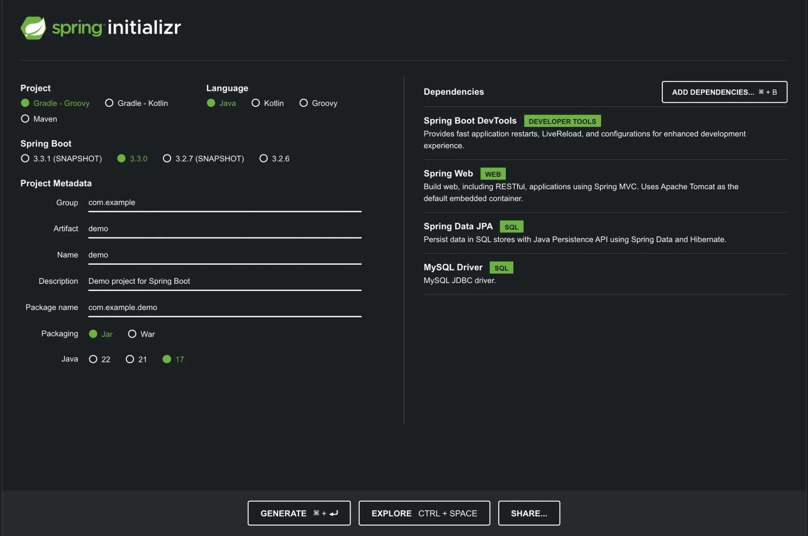
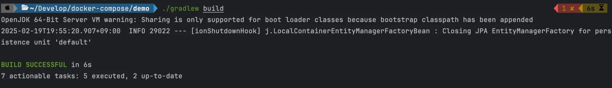
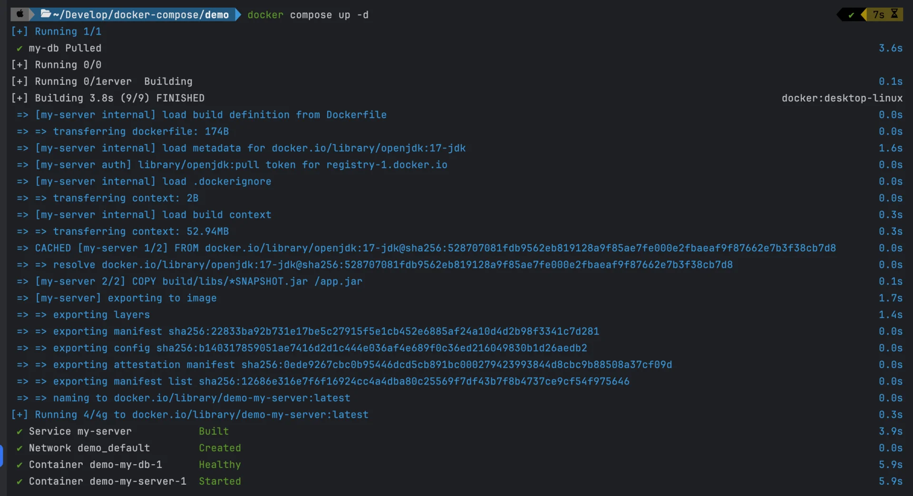
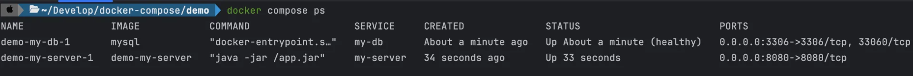
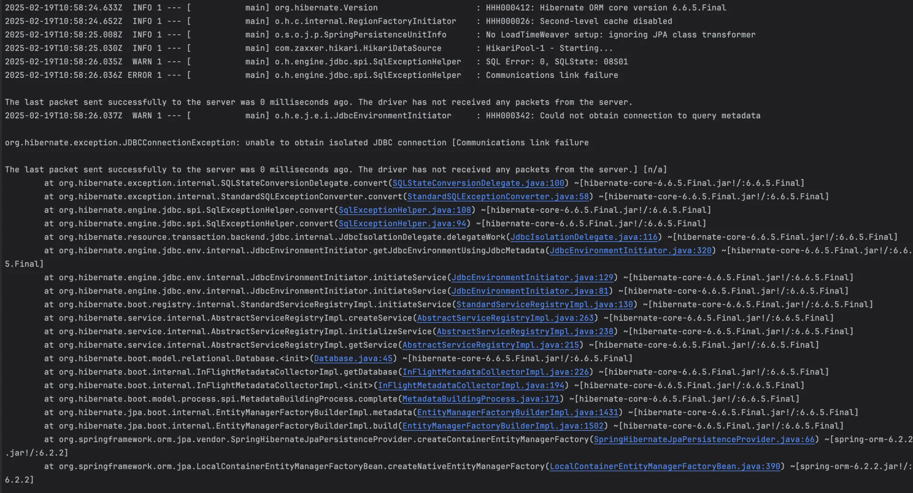
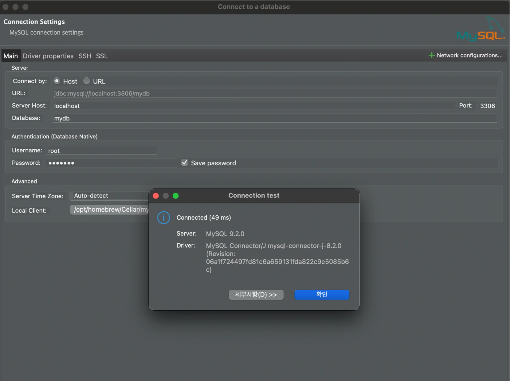

<a id="1c3eda9b0fe181c29813d58de33fd24b"></a>

## &#91; 실습 &#93; Spring Boot, MySQL

---

<details>
<summary>1&#46; <strong>Spring Boot 프로젝트 셋팅</strong></summary>

[start&#46;spring&#46;io]()



- Java&#58; <code>Java17</code>

- Dependencies
    - <code>Spring Boot DevTools</code>

    - <code>Spring Web</code>

    - <code>Spring Data JPA</code>

    - <code>MySQL Driver</code>

- 간단한 controller
    <a id="1c3eda9b0fe18117acb1c39847653af0"></a>

    ```java
    @RestController
    public class AppController {
      @GetMapping("/")
      public String home() {
        return "Hello, World!";
      }
    }
    ```

- <code>application&#46;yml</code>  &#45; DB 연결 정보 작성
    <a id="1c3eda9b0fe1811c87c6d6ec3be65bae"></a>

    ```yaml
    spring:
      datasource:
        url: jdbc:mysql://localhost:3306/mydb
        username: root
        password: pwd1234
      jpa:
        properties:
          hibernate:
            dialect: org.hibernate.dialect.MySQL8Dialect
    ```

</details>

<details>
<summary>2&#46; <code>Dockerfile</code>, <code>compose&#46;yml</code> 작성</summary>

- <code>Dockerfile</code>
    <a id="1c3eda9b0fe1811c9ac3f5941a7bcb3f"></a>

    ```docker
    FROM openjdk:17-jdk

    COPY build/libs/*SNAPSHOT.jar /app.jar

    ENTRYPOINT ["java", "-jar", "/app.jar"]
    ```

- <code>compose&#46;yml</code>
    <a id="1c3eda9b0fe181aca3e2f9d4e52bea2b"></a>

    ```yaml
    services:
      my-server:
        build: .
        ports:
          - 8080:8080
    		# my-db의 컨테이너가 생성되고 healthy 하다고 판단 될 때, 해당 컨테이너를 생성한다. 
        depends_on:
          my-db:
            condition: service_healthy
      my-db:
        image: mysql
        environment:
          MYSQL_ROOT_PASSWORD: pwd1234
          MYSQL_DATABASE: mydb # MySQL 최초 실행 시 mydb라는 데이터베이스를 생성해준다.
        volumes:
          - ~/Develop/docker-mysql/mysql_data:/var/lib/mysql
        ports:
          - 3306:3306
        healthcheck:
          test: [ "CMD", "mysqladmin", "ping" ] # MySQL이 healthy 한 지 판단할 수 있는 명령어
          interval: 5s # 5초 간격으로 체크
          retries: 10 # 10번까지 재시도
    ```

    - <code>depends&#95;on</code>,<code> healthcheck</code>
        - <strong>컨테이너 간의 의존성을 설정</strong>

        - <strong>특정 컨테이너가 정상적으로 실행되었을 때만 다른 컨테이너를 시작</strong>
            - Dockerfile로 정의한 <code>spring boot (jdk17)</code> 정상 실행 → <code>mysql</code> 실행

</details>

<details>
<summary>3&#46; <strong>Spring Boot 프로젝트 빌드 및 compose 파일 실행</strong></summary>

- <strong>Spring Boot 프로젝트 빌드</strong>
    <a id="1c3eda9b0fe181bf877ae8b0da880d5d"></a>

    ```bash
    ./gradlew clean build
    ```

    

- <strong>compose 파일 실행</strong>
    <a id="1c3eda9b0fe181c98d7ee487d69ebaf3"></a>

    ```bash
    docker compose up -d --build
    ```

    

</details>

<details>
<summary><strong>4&#46; compose 실행 현황 확인</strong></summary>

<a id="1c3eda9b0fe1811ea1dcc17ffc1cdd14"></a>

```bash
docker compose ps
docker ps
```



- <strong>&#91; 🤬 오류 &#93; </strong>DB 연결 ❌
    <a id="1c3eda9b0fe181738175dbc5369c094c"></a>

    <strong>Spring Boot 컨테이너의 로그 확인</strong>

    <a id="1c3eda9b0fe181a88c26ff7274ef50d3"></a>

    ```bash
    docker compose logs

    # 권장 
    # docker ps
    docker logs [컨테이너 ID]
    ```

    - 오류&#58; DB와 연결이 제대로 이루어지지 않았다&#46;
        

<a id="1c3eda9b0fe181a7866ff504406307cc"></a>

 

- DB GUI 툴(ex&#46; Workbench, Datagrip, DBeaver 등)로 DB 연결<br>아래와 같이  정상적으로 연결된다&#46; 
    

> ❓ 
> 
> <a id="1c3eda9b0fe18127b316f913936574b5"></a>
> 
> 그렇다면 Spring Boot 와 MySLQ이 연결되지 않는 원인은 무엇인가?<br>→ <a href="#/post/1c3eda9b-0fe1-8110-80da-dd0dc1e70fca">페이지</a> 

</details>
