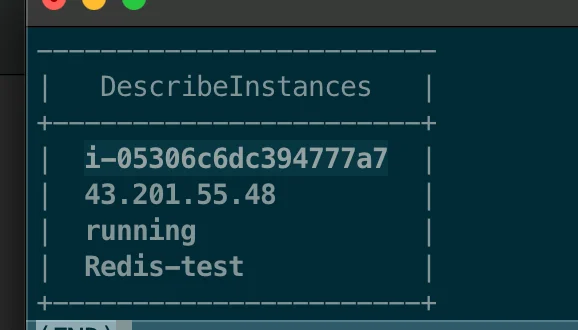

> ☝🏻 
> 
> <a id="1c3eda9b0fe1810b89e6c410b7972f0d"></a>
> 
> <strong>SSH 접속이 불가능할 경우</strong>, <u>보안 그룹 설정</u>에서 <strong>포트 22(SSH)</strong>가 열려 있는지 확인

1. <strong>AWS CLI가 설치 확인</strong>
    <a id="1c3eda9b0fe181f38bdbc9c140478ce6"></a>

    ```bash
    aws --version
    ```

    - 미설치 시, 아래 docs 참고
        <a id="1c3eda9b0fe181a385d8d5a382ca511c"></a>

        ‣

1. <strong>AWS 자격 증명 설정</strong>
    > IAM 계정 생성 후, 아래 명령어를 통해 aws 자격 증명 설정 진행

    <a id="1c3eda9b0fe181808287fb6c81773dda"></a>

    ```bash
    aws configure

    # --- 아래 정보 차례대로 입력 ---
    # AWS Access Key ID
    # AWS Secret Access Key
    # Default region name (예: ap-northeast-2 for 서울)
    # Default output format (일반적으로 json)
    ```

    - 해당 설정이 완료 되면 <code>&#126;/&#46;aws/credentials</code> 및 <code>&#126;/&#46;aws/config</code> 파일에 정보가 저장됨

1. <strong>EC2 인스턴스 목록 확인</strong>
    <a id="1c3eda9b0fe181a29c78de6e2d0e12e8"></a>

    ```bash
    aws ec2 describe-instances --query 'Reservations[*].Instances[*].[InstanceId,PublicIpAddress,State.Name,Tags[?Key==`Name`].Value[]]' --output table
    ```

    

    - EC2 인스턴스 ID

    - 퍼블릭 주소

    - 인스턴스 상태 ( running&#58; 실행중 )

    - 인스턴스 이름

1. <strong>SSH를 이용하여 EC2 인스턴스 접속</strong>
    > EC2에 접속하려면 <strong>인스턴스에 연결할 수 있는 SSH 키 파일 (&#46;pem)</strong> 이 있어야 한다&#46;

    <a id="1c3eda9b0fe181aa9230c17fb97f17a8"></a>

    ```bash
    ssh -i {SSH 키 파일 경로} ec2-user@{인스턴스 퍼블릭 주소}

    # ex) ssh -i ~/.ssh/my-key.pem ec2-user@54.180.100.10
    ```

    > ☝🏻 
    > 
    > <a id="1c3eda9b0fe181d4aff8e8865cdac983"></a>
    > 
    > <strong>참고) OS 환경에 따라 사용자 계정이 다르다&#46;</strong>
    > 
    > - <strong>Amazon Linux</strong>&#58; ec2&#45;user
    > 
    > - <strong>Ubuntu&#58;</strong> ubuntu
    > 
    > - <strong>RHEL</strong>&#58; ec2&#45;user
    > 
    > - <strong>Windows (RDP 접속)</strong>&#58; Administrator

<a id="1c3eda9b0fe181469626d6ea8cf3dd2d"></a>

### 추가 정리

---

<details>
<summary><strong>EC2 인스턴스에 시스템 콘솔(Serial Console) 접속</strong></summary>

1. <strong> AWS Systems Manager (SSM) 활성화 확인</strong>
    <a id="1c3eda9b0fe181819371f40f3ea331c3"></a>

    ```bash
    aws ssm describe-instance-information
    ```

1. <strong>AWS CLI로 SSM을 이용해 EC2 콘솔 접속</strong>
    <a id="1c3eda9b0fe181188839ceb9c89562bb"></a>

    ```bash
    aws ssm start-session --target i-1234567890abcdef0
    ```

</details>

<details>
<summary><strong>Windows EC2에 원격 데스크톱(RDP)으로 접속</strong></summary>

> Windows 인스턴스에 접속하려면, RDP를 사용해야 한다&#46;

1. Windows EC2의 Administrator 계정 암호 복호화
    <a id="1c3eda9b0fe18116a717e1ca78b7c530"></a>

    ```bash
    aws ec2 get-password-data --instance-id i-1234567890abcdef0 --priv-key-file my-key.pem
    ```

1. Remote Desktop을 열고 Public IP 주소를 입력 후 접속

</details>

<details>
<summary><strong>특정 EC2에 바로 SSH 접속하는 Bash Script (자동화)</strong></summary>

> 자주 사용하는 EC2에 바로 SSH 접속할 수 있도록 <strong>Bash 스크립트 </strong>생성

<a id="1c3eda9b0fe181acbaafc0bb88e6e532"></a>

```shell
#!/bin/bash

INSTANCE_ID="i-1234567890abcdef0"
KEY_PATH="~/.ssh/my-key.pem"

IP=$(aws ec2 describe-instances --instance-ids $INSTANCE_ID --query "Reservations[*].Instances[*].PublicIpAddress" --output text)

if [ -z "$IP" ]; then
  echo "Instance is not running or no public IP assigned"
  exit 1
fi

echo "Connecting to $IP..."
ssh -i $KEY_PATH ec2-user@$IP
```

- 실행 권한 부여
    <a id="1c3eda9b0fe181e3a7c1e8930234c178"></a>

    ```shell
    chmod +x connect-ec2.sh
    ```

- 스크립트 실행
    <a id="1c3eda9b0fe18196b013c18bf6c71b01"></a>

    ```shell
    ./connect-ec2.sh
    ```

</details>
