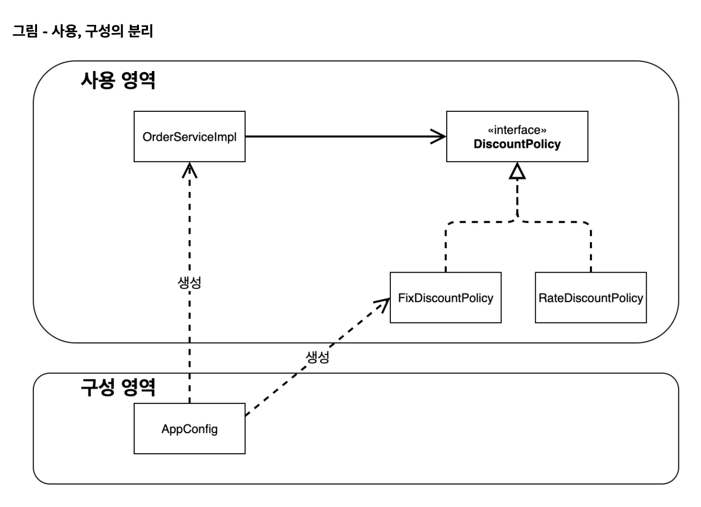

> 👉🏻 처음으로 돌아가 <strong>‘정액 할인 정책</strong>’을 <strong>‘정률(%) 할인 정책’</strong>으로 변경<br><code>FixDiscountPolicy</code> → <code>RateDiscountPolicy</code>




> <code>AppConfig</code>를 통해서, <strong>사용 영역 </strong>과 <strong>구성 영역</strong>이 완전히 분리되었다&#46;<br>요구사항(할인 정책 등&#46;&#46;) 변경 시, 이제 <code>AppConfig</code>에서 <strong><u>구현체만 갈아</u></strong>끼우면 된다<br>→ 구성 영역이 변경 되어도, 사용 영역(클라이언트)는 영향을 받지 않는다&#46; <code>DIP, OCP 만족</code>

<a id="1c3eda9b0fe181a8ad4ad1298218cf11"></a>

```java
package hello.core;

import hello.core.discount.DiscountPolicy;
import hello.core.discount.FixDiscountPolicy;
import hello.core.discount.RateDiscountPolicy;
import hello.core.service.MemberService;
import hello.core.service.MemberServiceImpl;
import hello.core.order.OrderService;
import hello.core.order.OrderServiceImpl;
import hello.core.repository.MemoryMemberRepository;

public class AppConfig {
    public MemberService memberService() {
        return new MemberServiceImpl(MemberRepository());
    }

    private static MemoryMemberRepository MemberRepository() {
        return new MemoryMemberRepository();
    }

    public OrderService orderService() {
        return new OrderServiceImpl(MemberRepository(), discountPolicy());
    }

    public DiscountPolicy discountPolicy() {
//        return new FixDiscountPolicy();
        return new RateDiscountPolicy();
    }
}
```
