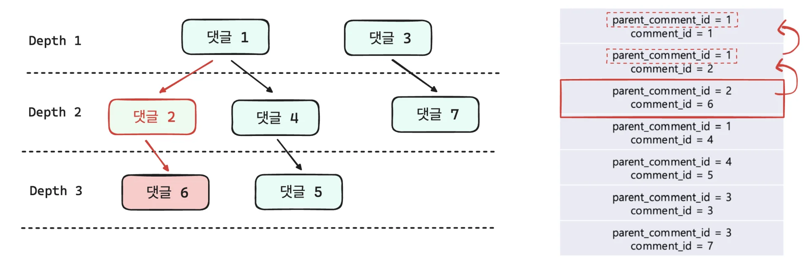
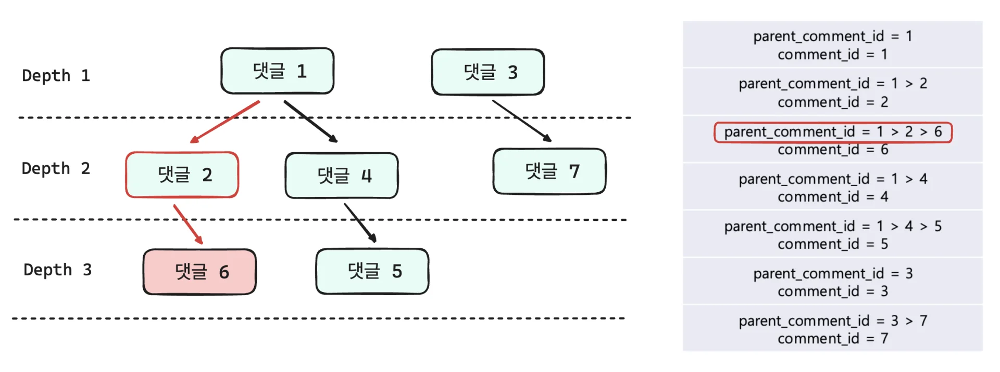
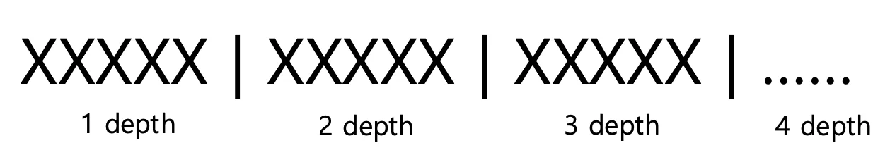
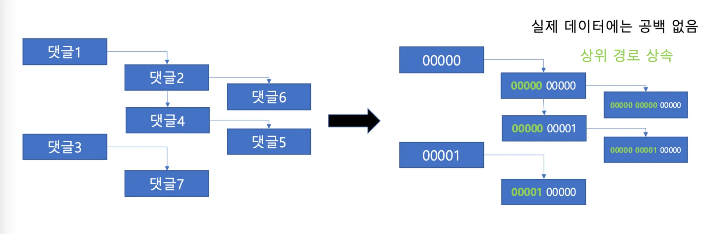
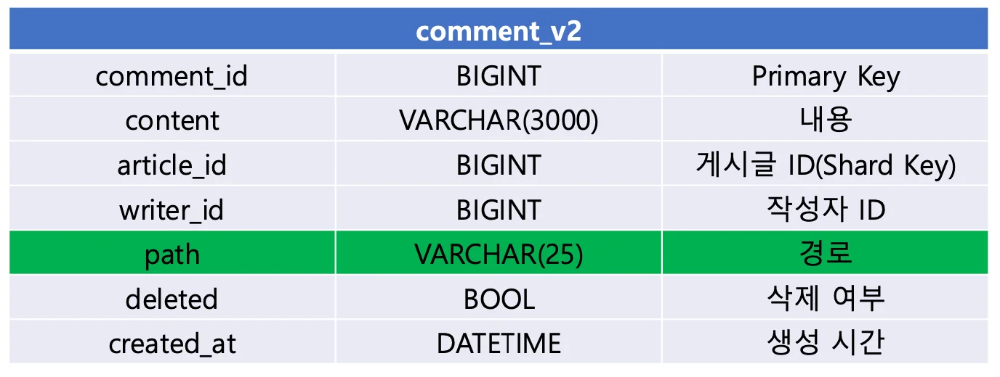

depth가 <code>무한</code>인 경우, 상 • 하위 댓글이 재귀적으로 무한할 수 있다&#46;

이를 이전 <code>&#91;depth&#58; 2&#93;</code> 의 방식으로 댓글을 설계하는 경우, 하위 댓글의 정렬 정보를 알기 위해서는<strong> 모든 상위 댓글의 정보가 필요할 수 있</strong>다&#46; 

- 해당하는 하위 댓글에서 상위 댓글의 <code>parent&#95;comment&#95;id</code>를 재귀적으로 가져와야 댓글의 계층 구조를 판단할 수있다&#46;

무한 depth를 가지는 경우, 이론상으로 댓글 계층이 무한하다&#46; 

따라서 <strong><u>계속해서 </u></strong><strong><u>재귀</u></strong><strong><u>적으로 호출</u></strong>하여 최상의 노드까지 조회를 해야한다&#46; 

또한 이후, 정렬에 대한 연산까지 이뤄져야 한다&#46; 

매 조회마다 이러한 연산이 발생되면 이는 비용이 너무 크며, 데이커가 많아질 수록  병목 지점이 된다&#46;

이를, 위와 같이 모든 계층 구조를 저장한다면 <strong><u>한번에 계층 구조를 판단</u></strong>할 수 있다&#46;

그렇다면 이러한 계층 구조를 어떻게 구현하는가? 

위와 같이 각 depth 별로 5개의 문자열로 경로 정보를 저장한다&#46;

<strong>이를 통해, 문자열 개수</strong><em> </em>에 따라 해당 <strong><u>댓글의 depth</u></strong>를 알 수 있으며 <strong><u>5개의 문자</u></strong>를 잘라서 <strong><u>각 계층의 상위 노드를 구분</u></strong>할 수 있다&#46;

ex)

- depth&#58; <code>1</code>  → 문자열&#58; <code>5</code>

- depth&#58; <code>2</code>  → 문자열&#58; <code>10</code> 

- depth&#58; <code>3</code>  → 문자열&#58; <code>15</code>
    

    &#46; &#46; &#46;

- depth&#58; <code>n</code> &#45;&#62;  문자열&#58; <code class="language-math">5 &#42; n</code>

 

여기서 표현 데이터를 어떻게 구성해야 할지를 고민할 필요가 있는데,

만약 각 문자 표현 범위를 알파벳 대소문자 구분없이로 정한다면 총 26개의 범위를 가지며 이를 5자리 문자열로 표현하는 경우 가질 수 있는 경우의 수는 <code>11,881,376 </code>개이다&#46;

- <code class="language-math">26^5</code> = 11,881,376

약 1100만의 개수는 식별자로 사용하기에는 매우 작은 숫자이다&#46;

 따라서 표현 요소들를 어떻게 구성해야 할지 

- 해당 예시는 <code>&#91; depth&#58; 5 &#93;</code>까지만 표현을 했다&#46; → <code>VARCHAR(25)</code>
