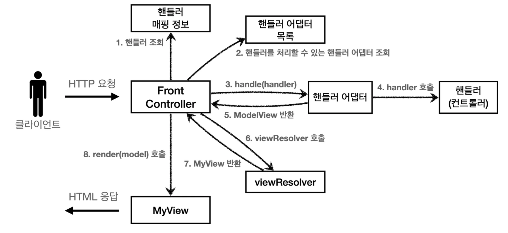
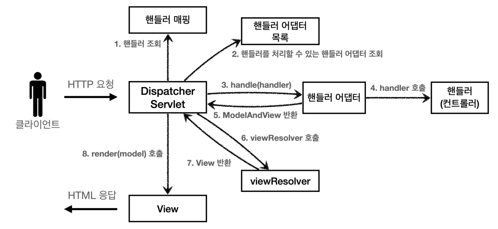
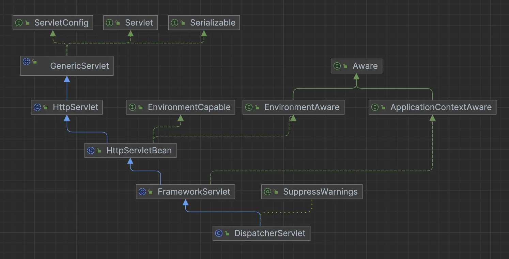
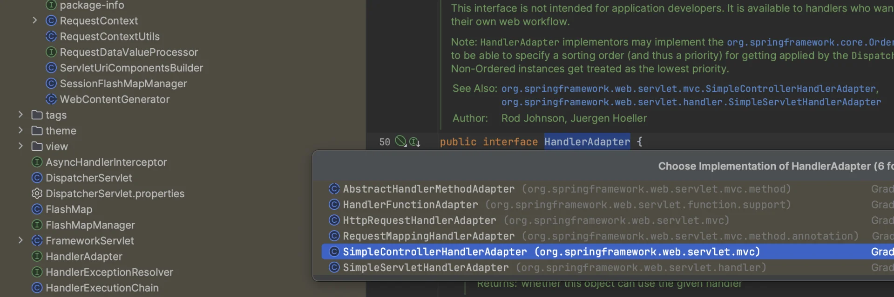
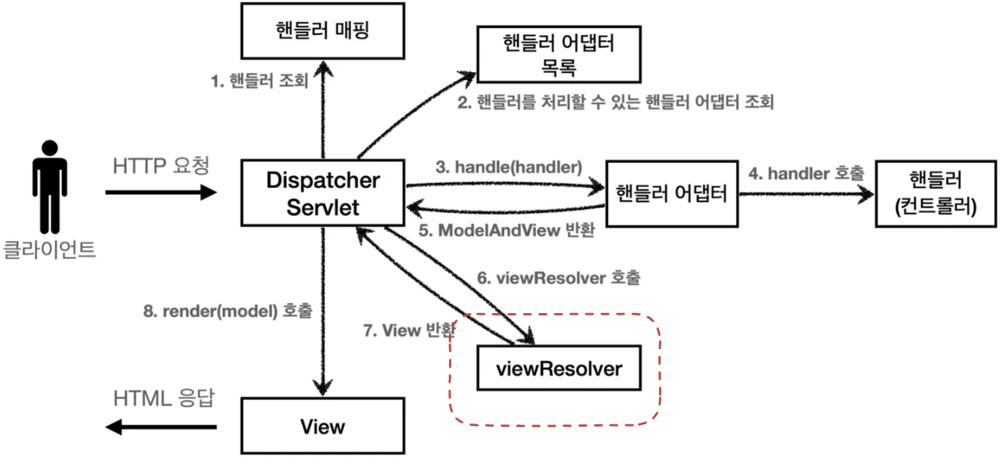
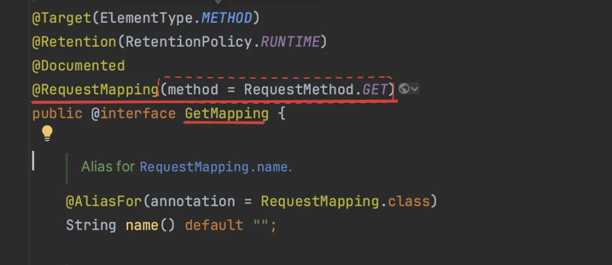
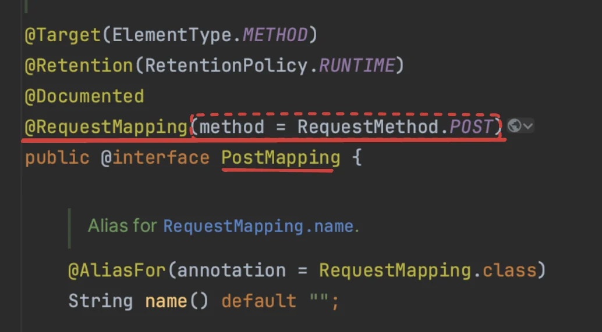
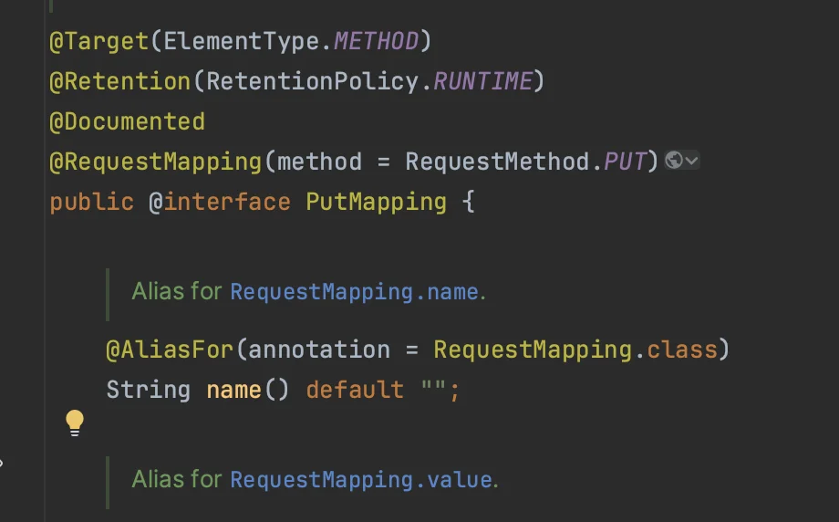
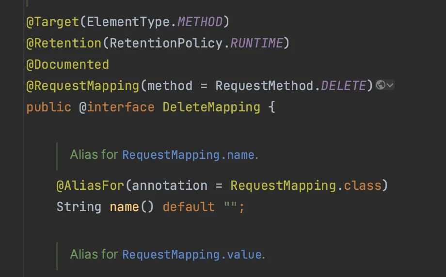
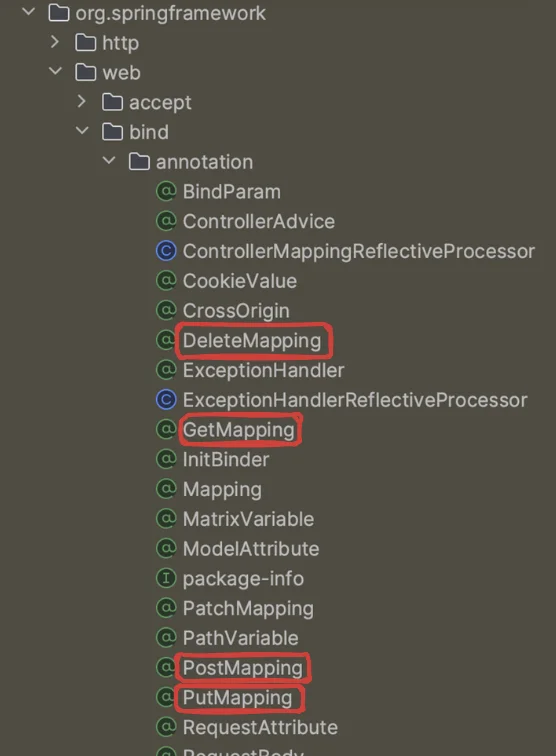

<a id="1c3eda9b0fe18130bca8e00a2e0ddc74"></a>

## 스프링 MVC 전체 구조

<a id="1c3eda9b0fe18111a489d2ddd804e6d8"></a>

### 직접 만든 MVC(ch3) 와 스프링 MVC 구조 비교

- <strong>직접 만든 MVC 프레임워크 구조</strong>
    

- <strong>Spring MVC 구조</strong>
    

> 스프링MVC의 주요 인터페이스는 모두 <code>org&#46;springframework&#46;web&#46;servlet</code> 에 존재

- FrontController → <strong>DispatcherServlet</strong>  

- handlerMappingMap → <strong>HandlerMapping</strong> 

- MyHandlerAdapter → <strong>HandlerAdapter</strong> 

- ModelView → <strong>ModelAndView</strong> 

- viewResolver → <strong>ViewResolver </strong>

- MyView → <strong>View <br></strong>

<a id="1c3eda9b0fe18181b0cffa68b6e65811"></a>

### DispatcherServlet 구조 살펴보기

<details>
<summary><strong><code>org&#46;springframework&#46;web&#46;servlet&#46;</code></strong><strong><u><code>DispatcherServlet</code></u></strong></summary>

- <em><strong>프론트 컨트롤러 패턴</strong></em><em><strong> </strong></em>으로 구현
    - 이전 챕터에서의 <strong>FrontControllerServletV&#42;</strong>

- <strong><u>스프링 MVC의 핵심 로직</u></strong>

</details>

<details>
<summary><strong>클래스 다이어 그램</strong></summary>

- DispatcherServlet도 부모 클래스에서 HttpServlet을 상속 받아, 서블릿으로 동작한다&#46;
    - DispatcherServlet → FrameworkServlet → HttpServletBean → HttpServlet
        

- 스프링 부트는 DispatcherServlet 을 서블릿으로 자동 등록하면서 <strong><u>모든 경로</u></strong><u>( </u><u><code>urlPatterns=&#34;/&#34;</code></u><u>)</u>에 대해서 매핑한다&#46;
    - 더 자세한 경로가 우선순위가 높다&#46; 따라서 기존에 등록한 서블릿도 함께 동작함

</details>

<details>
<summary><strong>요청 흐름</strong></summary>

- 서블릿 호출 → <code>HttpServlet&#46;service()</code> 호출
    - 스프링 MVC는 <code>DispatcherServlet</code> 의 부모인 <code>FrameworkServlet</code> 에서 <code>service()</code> 를 오버라이드함

- <code>FrameworkServlet&#46;service()</code>  →  …&#46;   → <code>DispatcherServlet&#46;doDispatch()</code>호출

</details>

<a id="1c3eda9b0fe18112bda9ffd43c001ac9"></a>

### DispatcherServlet&#46;<u>doDistpatch()</u>

<details>
<summary>🧐 전체코드 </summary>

<a id="1c3eda9b0fe181c0b923e24dd1894f76"></a>

```java
protected void doDispatch(HttpServletRequest request, HttpServletResponse response) throws Exception {
		HttpServletRequest processedRequest = request;
		HandlerExecutionChain mappedHandler = null;
		boolean multipartRequestParsed = false;

		WebAsyncManager asyncManager = WebAsyncUtils.getAsyncManager(request);

		try {
			ModelAndView mv = null;
			Exception dispatchException = null;

			try {
				processedRequest = checkMultipart(request);
				multipartRequestParsed = (processedRequest != request);

				// Determine handler for the current request.
				mappedHandler = getHandler(processedRequest);
				if (mappedHandler == null) {
					noHandlerFound(processedRequest, response);
					return;
				}

				// Determine handler adapter for the current request.
				HandlerAdapter ha = getHandlerAdapter(mappedHandler.getHandler());

				// Process last-modified header, if supported by the handler.
				String method = request.getMethod();
				boolean isGet = HttpMethod.GET.matches(method);
				if (isGet || HttpMethod.HEAD.matches(method)) {
					long lastModified = ha.getLastModified(request, mappedHandler.getHandler());
					if (new ServletWebRequest(request, response).checkNotModified(lastModified) && isGet) {
						return;
					}
				}

				if (!mappedHandler.applyPreHandle(processedRequest, response)) {
					return;
				}

				// Actually invoke the handler.
				mv = ha.handle(processedRequest, response, mappedHandler.getHandler());

				if (asyncManager.isConcurrentHandlingStarted()) {
					return;
				}

				applyDefaultViewName(processedRequest, mv);
				mappedHandler.applyPostHandle(processedRequest, response, mv);
			}
			catch (Exception ex) {
				dispatchException = ex;
			}
			catch (Throwable err) {
				// As of 4.3, we're processing Errors thrown from handler methods as well,
				// making them available for @ExceptionHandler methods and other scenarios.
				dispatchException = new ServletException("Handler dispatch failed: " + err, err);
			}
			processDispatchResult(processedRequest, response, mappedHandler, mv, dispatchException);
		}
		catch (Exception ex) {
			triggerAfterCompletion(processedRequest, response, mappedHandler, ex);
		}
		catch (Throwable err) {
			triggerAfterCompletion(processedRequest, response, mappedHandler,
					new ServletException("Handler processing failed: " + err, err));
		}
		finally {
			if (asyncManager.isConcurrentHandlingStarted()) {
				// Instead of postHandle and afterCompletion
				if (mappedHandler != null) {
					mappedHandler.applyAfterConcurrentHandlingStarted(processedRequest, response);
				}
			}
			else {
				// Clean up any resources used by a multipart request.
				if (multipartRequestParsed) {
					cleanupMultipart(processedRequest);
				}
			}
		}
	}
```

</details>

- <strong>DispatcherServlet의 핵심 로직</strong>
    - 예외처리, 인터셉터 기능을 제외한 핵심 로직만 아래 간단하게 구현

<details>
<summary><strong>동작 순서 </strong></summary>


<details>
<summary><strong>1&#46; 핸들러 조회</strong></summary>

- 핸들러 매핑을 통해 <code>요청 URL</code>에 <strong><u>매핑된 핸들러(컨틀롤러)를 조회</u></strong>한다&#46;

<a id="1c3eda9b0fe1812d9a26d0ad3a75b256"></a>

```java
// 1. 핸들러 조회
mappedHandler = getHandler(processedRequest); 
if (mappedHandler == null) {
    noHandlerFound(processedRequest, response);
    return;
}
```

<details>
<summary>CH3&#58; v5 &#45; getHandler</summary>

<a id="1c3eda9b0fe18139b9a1d93d795e6996"></a>

```java
private Object getHandler(HttpServletRequest request) {
    String requestURI = request.getRequestURI();
    return handlerMappingMap.get(requestURI);
}
```

</details>

<details>
<summary>DispatcherServlet &#45; getHandler</summary>

<details>
<summary>🧐  <code>mapping&#46;getHandler(request);</code></summary>

<a id="1c3eda9b0fe181b3b69dde5a644a3bba"></a>

찾아보니 interface 만 나오고 구현체는 못찾음…

</details>

<a id="1c3eda9b0fe18193b00ed9dbbc29bdcc"></a>

```java
@Nullable
protected HandlerExecutionChain getHandler(HttpServletRequest request) throws Exception {
	if (this.handlerMappings != null) {
		for (HandlerMapping mapping : this.handlerMappings) {
			HandlerExecutionChain handler = mapping.getHandler(request);
			if (handler != null) {
				return handler;
			}
		}
	}
	return null;
}
```

</details>

</details>

<details>
<summary><strong>2&#46; 핸들러 어뎁터 조회</strong></summary>

- 핸들러를 실행할 수 있는 핸들러 어댑터 조회

<a id="1c3eda9b0fe181d78ebdf68a2f9ec58c"></a>

```java
핸들러 어댑터 조회
HandlerAdapter ha = getHandlerAdapter(mappedHandler.getHandler());
```

<details>
<summary>CH3&#58; <strong>v5</strong> &#45; <code>getHandlerAdapter()</code></summary>

<a id="1c3eda9b0fe181c6a424fc8fb31d2335"></a>

```java
private MyHandlerAdapter getHandlerAdapter(Object handler) {
    for (MyHandlerAdapter adapter : handlerAdapters) {
        if (adapter.supports(handler)) {
            return adapter;
        }
    }
    throw new IllegalArgumentException("handler adapter를 찾을 수 없습니다. handler=" + handler);
}
```

</details>

<details>
<summary>DispatcherServlet&#45;<code>getHandlerAdapter()</code></summary>

<a id="1c3eda9b0fe18160b5cfc11b18c401de"></a>

```java
protected HandlerAdapter getHandlerAdapter(Object handler) throws ServletException{
		if (this.handlerAdapters != null) {
			for (HandlerAdapter adapter : this.handlerAdapters) {
				if (adapter.supports(handler)) {
					return adapter;
				}
			}
		}
		throw new ServletException("No adapter for handler [" + handler +
				"]: The DispatcherServlet configuration needs to include a HandlerAdapter that supports this handler");
	}
```

</details>

</details>

<details>
<summary><strong>3&#46; 핸들러 어뎁터 실행, <br>4&#46; 핸들러 실행, <br>5&#46; ModelAndView 반환</strong></summary>

<details>
<summary>🧐 ha 구현 코드 못찾음… handler&#46;process → ModelAndView 도 못찾음</summary>

- 직접 라이브러리 뒤져보기
    

- 구현체 목록 확인&#58; <code>cmd</code> &#43; <code>opt</code> &#43; <code>b</code>

</details>

- 3&#46; 핸들러 어댑터 실행

- 4&#46;  핸들러 어댑터 → 실제 핸들러 실행

- 5&#46; 핸들러 어댑터는 핸들러가 반환하는 정보를 ModelAndView로 <strong>변환</strong>해서 반환

<a id="1c3eda9b0fe181cc9377fcfce13f3ce6"></a>

```java
// 3. 핸들러 어댑터 실행 -> 4. 핸들러 어댑터를 통해 핸들러 실행 -> 5. ModelAndView 반환 
mv = ha.handle(processedRequest, response, mappedHandler.getHandler())
```

<details>
<summary>&#60;interface&#62; <strong>HandlerAdapter</strong></summary>

<a id="1c3eda9b0fe181d3a8afdaec7b235ac4"></a>

```java
public interface HandlerAdapter {

		boolean supports(Object handler);
		
		@Nullable
		ModelAndView handle(HttpServletRequest request, HttpServletResponse response, Object handler) throws Exception;
		
		@Deprecated
		long getLastModified(HttpServletRequest request, Object handler);

}
```

</details>

<details>
<summary>CH3&#58; <strong>v5 </strong></summary>

<details>
<summary><strong>ControllerV3HandlerAdapter</strong><strong><code>&#46;handle()</code></strong></summary>

<a id="1c3eda9b0fe18157ad4ccfd605d94ad2"></a>

```java
@Override
public ModelView handle(HttpServletRequest request, HttpServletResponse response, Object handler) throws ServletException, IOException {

    // supports를 통해 이미 검증을 한 상태이기 때문에 그냥 캐스팅(형변환)해서 사용하면 됨
    ControllerV3 controller = (ControllerV3) handler;
    
    Map<String, String> paramMap = createParamMap(request);
    ModelView mv = controller.process(paramMap);
    return mv;
}
```

</details>

<details>
<summary><strong>ControllerV4HandlerAdapter</strong><strong><code>&#46;handle()</code></strong></summary>

<a id="1c3eda9b0fe18199ac75ce2f20d77970"></a>

```java
@Override
public ModelView handle(HttpServletRequest request, HttpServletResponse response, Object handler) throws ServletException, IOException {

    ControllerV4 controller = (ControllerV4) handler;

    Map<String, String> paramMap = createParamMap(request);
    Map<String, Object> model = new HashMap<>();

    String viewName = controller.process(paramMap, model);

    ModelView mv = new ModelView(viewName);
    mv.setModel(model);

    return mv;
}
```

</details>

</details>

</details>

<details>
<summary><strong>6&#46; viewResolver 호출,   <br>7&#46; View 반환</strong></summary>

- 6&#46; 뷰 리졸버 찾고 실행
    - JSP의 경우&#58; <code>InternalResourceViewResolver</code> 가 자동 등록되고, 사용됨

- 7&#46;  뷰 리졸버는 뷰의 논리 이름을 물리 이름으로 바꾸고, 렌더링하는 역할을 담당하는 뷰 객체 반환

<a id="1c3eda9b0fe181bb93a9f34762837c99"></a>

```java
/ 6. 뷰 리졸버를 통해서 뷰 찾기, 7. View 반환
view = resolveViewName(viewName, mv.getModelInternal(), locale, request)
```

</details>

<details>
<summary><strong>8&#46; 뷰 렌더링</strong></summary>

- 뷰를 통해서 뷰를 렌더링 한다&#46;

<a id="1c3eda9b0fe18168aeb9c3d3603c97b1"></a>

```java
// 8. 뷰 렌더링
view.render(mv.getModelInternal(), request, response);
```

</details>

</details>

<a id="1c3eda9b0fe181b29592f6bc5d068d5e"></a>

```java
protected void doDispatch(HttpServletRequest request, HttpServleResponse response) throws Exception {
    HttpServletRequest processedRequest = request;
    HandlerExecutionChain mappedHandler = null;
    ModelAndView mv = null;

    // 1. 핸들러 조회
    mappedHandler = getHandler(processedRequest); 
    if (mappedHandler == null) {
        noHandlerFound(processedRequest, response);
        return;
    }

    // 2. 핸들러 어댑터 조회 - 핸들러를 처리할 수 있는 어댑터
    HandlerAdapter ha = getHandlerAdapter(mappedHandler.getHandler());

    // 3. 핸들러 어댑터 실행 -> 4. 핸들러 어댑터를 통해 핸들러 실행 -> 5. ModelAndView 반환 
    mv = ha.handle(processedRequest, response, mappedHandler.getHandler());
    
    processDispatchResult(processedRequest, response, mappedHandler, mv, dispatchException);
}
```

<a id="1c3eda9b0fe181b6b8fcda3bc555e083"></a>

```java

private void processDispatchResult(HttpServletRequest request, HttpServletResponse response, HandlerExecutionChain mappedHandler, ModelAndView mv, Exception exception) throws Exception {   // handler, exception 로직 제외

    // 뷰 렌더링 호출
    render(mv, request, response);
}
```

<a id="1c3eda9b0fe181d08426d8992059da01"></a>

```java
protected void render(ModelAndView mv, HttpServletRequest request, HttpServletResponse response) throws Exception {
 
    View view;
    String viewName = mv.getViewName();
    
		// 6. 뷰 리졸버를 통해서 뷰 찾기, 7. View 반환
    view = resolveViewName(viewName, mv.getModelInternal(), locale, request);
    
		// 8. 뷰 렌더링
    view.render(mv.getModelInternal(), request, response);
}
```

<a id="1c3eda9b0fe181ffa757c3acbc3ee506"></a>

## 핸들러 매핑과 핸들러 어댑터

<details>
<summary><strong>핸들러 매핑과 핸들러 어댑터 사용 이해를 위한 </strong><strong><code>예시1</code></strong><strong> (실제는 </strong><strong><code>&#64;RequestMapping</code></strong><strong> 사용)</strong></summary>

<details>
<summary>&#60;interface&#62; <strong>Controller</strong> (<code>org&#46;springframework&#46;web&#46;servlet&#46;mvc&#46;Controller</code>)</summary>

<a id="1c3eda9b0fe181e78d29dcbddccfe9d0"></a>

```java
@FunctionalInterface
public interface Controller {

		@Nullable
		ModelAndView handleRequest(HttpServletRequest request, HttpServletResponse response) throws Exception;
		
}
```

</details>

<details>
<summary><strong>OldController</strong></summary>

<a id="1c3eda9b0fe181e8b426d9d5448a1b4f"></a>

```java
package com.example.springmvc1.web.springmvc.old;

import jakarta.servlet.http.HttpServletRequest;
import jakarta.servlet.http.HttpServletResponse;
import org.springframework.stereotype.Component;
import org.springframework.web.servlet.ModelAndView;
import org.springframework.web.servlet.mvc.Controller;

@Component("/spring/old-controller")
public class OldController implements Controller {

    @Override
    public ModelAndView handleRequest(HttpServletRequest request, HttpServletResponse response) throws Exception {
        System.out.println("OldController.handleRequest");
        return null;
    }
}

```

</details>

> 📎 <strong>실행</strong>
> 
> - http&#58;//localhost&#58;8080<u>/springmvc/old&#45;controller</u>
> 
> - 콘솔 출력&#58; <code>OldController&#46;handleRequest</code>

</details>

<a id="1c3eda9b0fe181e4b9fedc3b9020e2e1"></a>

### 🧐 <strong>해당하는 컨트롤러는 어떻게 호출되는가, </strong><strong><code>예시1</code></strong><strong>?</strong>

<a id="1c3eda9b0fe181559f2ef13472f7ec89"></a>

<strong>스프링 MVC 구조</strong>


<a id="1c3eda9b0fe181b38376eb477f00bc04"></a>

클라이언트에서 받아오는 HTTP 요청에 따라 해당하는 컨트롤러가 호출되려면 아래의 2가지가 필요하다&#46;

- <strong>HandlerMapping(핸들러 매핑)</strong>
    - 핸들러 매핑에서 해당하는 컨트롤러를 찾을 수 있어야 한다&#46; 

    - ex) 스프링 빈의 이름으로 핸들러를 찾을 수 있는 핸들러 매핑 필요

- <strong>HandlerAdapter(핸들러 어댑터)</strong>
    - 핸들러 매핑을 통해서 찾은 핸들러를 실행 할 수 있는 핸들러 어댑터

    - ex) Controller 인터페이스를 실행할 수 있는 핸들러 어댑터를 찾고 실행 해야한다&#46; 

> ☝🏻 스프링은 이미 필요한 핸들러 매핑과 핸들러 어댑터를 대부분 구현해두었다&#46; <br>개발자가 직접 핸들러 매핑과 핸들러 어댑터를 만드는 일은 거의 없다&#46;<br>⇒ <strong>대부분 다 존재</strong>함, 그냥 <strong><u>잘 가져다 쓰면됨</u></strong>&#46;

<a id="1c3eda9b0fe1814aaf74c3cafdf7deb5"></a>

### 호출 순서

<details>
<summary><strong>스프링부트가 </strong><strong><u>자동으로 등록</u></strong><strong>하는 </strong><strong><code>핸들러 매핑</code></strong><strong>과 </strong><strong><code>핸들러 어댑터</code></strong><strong> 우선순위</strong></summary>

<details>
<summary><strong>HandlerMapping</strong></summary>

- 0&#46; <code>RequestMappingHandlerMapping</code> 
    -  애노테이션 기반의 컨트롤러인 &#64;RequestMapping에서 사용

- 1&#46; <code>BeanNameUrlHandlerMapping</code>
    -  스프링 빈의 이름으로 핸들러를 찾는다&#46; 

</details>

<details>
<summary><strong>HandlerAdapter</strong></summary>

- 0&#46; <code>RequestMappingHandlerAdapter</code>
    - 애노테이션 기반으 컨트롤러인 &#64;RequestMapping에서 사용

- 1&#46; <code>HttpRequestHandlerAdapter</code>
    - 스프링 빈의 이름으로 핸들러를 찾는다

- 2&#46;<code> SimpleControllerHandlerAdapter</code>
    - Controller 인터페이스(애노테이션X, 과거에 사용) 처리

</details>

- <code>0</code>이 우선순위가 가장 높다&#46; 즉, 애노테이션 기반인  <code>&#64;RequestMapping</code>을 가장 먼저 찾고, 없으면 다음 순서로 넘어간다&#46; 

-  해당 예시는 애노테이션을 사용하지 않는 구식 방법을 사용하였다&#46; (인터페이스)
    - <strong>HandlerMapping&#58; </strong>BeanNameUrlHandlerMapping

    - <strong>HandlerAdapter&#58; </strong>HttpRequestHandlerAdapter, SimpleControllerHandlerAdapter<br>

</details>

---

<details>
<summary><strong>1&#46; 핸들러 매핑으로 핸들러 조회</strong></summary>

- <strong>HandlerMapping</strong>
    <a id="1c3eda9b0fe18150a635db911d464b28"></a>

    ```java
    0 = RequestMappingHandlerMapping   : 애노테이션 기반으 컨트롤러인 @RequestMapping에서 사용
    1 = BeanNameUrlHandlerMapping.     : 스프링 빈의 이름으로 핸들러를 찾는다. 
    ```

- <code>HandlerMapping</code>을 순서대로 실행해서, 핸들러를 찾는다&#46;

- 해당 예시는 Anotation이 아닌 interface를 사용하는 구식 방법이기 때문에 <br><code>BeanNameUrlHandlerMapping</code> 가 실행에 성공하고 핸들러인 <code>OldController</code> 를 반환한다&#46;
    -  해당 클래스를 스프링 컨테이너에 빈으로 등록 해야함, <code>&#64;Component</code> 

</details>

<details>
<summary><strong>2&#46; 핸들러 어댑터 조회</strong></summary>

- <strong>HandlerAdapter</strong>
    <a id="1c3eda9b0fe1811cb4f0f254b4affe65"></a>

    ```java
    0 = RequestMappingHandlerAdapter   : 애노테이션 기반으 컨트롤러인 @RequestMapping에서 사용
    1 = HttpRequestHandlerAdapter      : 스프링 빈의 이름으로 핸들러를 찾는다. 
    2 = SimpleControllerHandlerAdapter : Controller 인터페이스(애노테이션X, 과거에 사용) 처리
    ```

- <code>HandlerAdapter</code> 의 <code>supports()</code> 를 순서대로 호출한다&#46;
    <details>
    <summary><strong>HandlerAdapter</strong></summary>

    <a id="1c3eda9b0fe181628966f003e8466445"></a>

    ```java
    package org.springframework.web.servlet;

    import jakarta.servlet.http.HttpServletRequest;
    import jakarta.servlet.http.HttpServletResponse;

    import org.springframework.lang.Nullable;


    public interface HandlerAdapter {

    	boolean supports(Object handler);

    	@Nullable
    	ModelAndView handle(HttpServletRequest request, HttpServletResponse response, Object handler) throws Exception;

    	@Deprecated
    	long getLastModified(HttpServletRequest request, Object handler);
    }
    ```

    </details>

- <code>SimpleControllerHandlerAdapter</code> 가 <code>Controller</code> 인터페이스를 지원하므로 대상이 된다&#46;

</details>

<details>
<summary><strong>3&#46; 핸들러 어댑터 실행</strong></summary>

- <code>DispatcherServlet</code>이 조회한 <code>SimpleControllerHandlerAdapter</code> 를 실행하면서 핸들러 정보도 함께 넘겨준<br>다&#46;

- <code>SimpleControllerHandlerAdapter</code> 는 핸들러인 <code>OldController</code> 를 내부에서 실행하고, 그 결과를 반<br>환한다&#46;

</details>

<a id="1c3eda9b0fe18124a0d5f6e5a112256d"></a>

## 뷰 리졸버

<details>
<summary>🧐<strong> view 반환 오류</strong></summary>

> 프로젝트 시작 시, Thymeleaf 의존성을 추가하여 Thymeleaf가 계속 예외를 던짐

<a id="1c3eda9b0fe181e19e1afbdc00e6a5a8"></a>

```java
[THYMELEAF][http-nio-8080-exec-1] Exception processing template "new-form": Error resolving template [new-form], template might not exist or might not be accessible by any of the configured Template Resolvers
```

- <strong>Thymeleaf 의존성 제거</strong>
    <a id="1c3eda9b0fe1818c9577e7c4ebdb4256"></a>

    ```java
    dependencies {
        // implementation 'org.springframework.boot:spring-boot-starter-thymeleaf' 
    ```

- <strong>프로젝트 클린 및 리빌드</strong>
    <a id="1c3eda9b0fe181bf82e7d2ea9af5bee6"></a>

    ```java
    ./gradlew clean build
    ```

</details>

<details>
<summary><strong>OldController &#45; View 조회할 수 있도록 변경</strong></summary>

- <code>return new ModelAndView(&#34;new&#45;form&#34;);</code>

<a id="1c3eda9b0fe18151a842fac124f1d3a2"></a>

```java
package com.example.springmvc1.web.springmvc.old;

import jakarta.servlet.http.HttpServletRequest;
import jakarta.servlet.http.HttpServletResponse;
import org.springframework.stereotype.Component;
import org.springframework.web.servlet.ModelAndView;
import org.springframework.web.servlet.mvc.Controller;

@Component("/spring/old-controller")
public class OldController implements Controller {
    @Override
    public ModelAndView handleRequest(HttpServletRequest request, HttpServletResponse response) throws Exception {
        System.out.println("OldController.handleRequest");
        return new ModelAndView("new-form");
    }
}
```

</details>

<details>
<summary><code>application&#46;properties</code> 설정 추가</summary>

<a id="1c3eda9b0fe18168aa28da58c6e464da"></a>

```plaintext
 spring.mvc.view.prefix=/WEB-INF/views/
 spring.mvc.view.suffix=.jsp
```

</details>

<a id="1c3eda9b0fe18132ba9bccfc698cd5c0"></a>

### <strong>뷰 리졸버 &#45; InternalResourceViewResolver</strong>

- 스프링부트는 <code>InternalResourcezViewResolver</code>라는 뷰 리졸버를 <strong><u>자동으로 등록</u></strong>함
    - <code>application&#46;properties</code>에 등록한 설정 정보를 사용해서 뷰를 등록한다&#46;
        - <strong>spring&#46;mvc&#46;view&#46;prefix</strong><strong> </strong>

        - <strong>spring&#46;mvc&#46;view&#46;suffix</strong><strong> </strong>


    - 설정 없이 다음과 같이 전체 경로를 주어도 동작하지만 권장하지 않음
        - <code>return new ModelAndView(&#34;/WEB&#45;INF/views/new&#45;form&#46;jsp&#34;);</code>

<a id="1c3eda9b0fe1810ab85dce4e7e410649"></a>

### <strong>뷰 리졸버 동작 방식</strong>



<details>
<summary><strong>스프링 부트가 자동 등록하는 뷰 리졸버</strong></summary>

<a id="1c3eda9b0fe181a09d54cc0355d536d5"></a>

(실제로는 더 많지만, 중요한 부분 위주로 설명하기 위해 일부 생략)

- 1&#46;  <code>BeanNameViewResolver</code> &#58; 빈 이름으로 뷰를 찾아서 반환한다&#46; (예&#58; 엑셀 파일 생성 기능 에 사용)

- 2&#46;  <code>InternalResourceViewResolver</code> &#58; JSP를 처리할 수 있는 뷰를 반환한다&#46;

</details>

<details>
<summary>1&#46; 핸들러 어댑터 호출</summary>

<a id="1c3eda9b0fe181d28419cd5b90e08b46"></a>

핸들러 어댑터를 통해 <code>new&#45;form</code> 이라는 논리 뷰 이름을 획득

</details>

<details>
<summary>2&#46; ViewResolver 호출</summary>

- <code>new&#45;form</code> 이라는 뷰 이름으로 <code>viewResolver</code>를 순서대로 호출한다&#46;

- <code>BeanNameViewResolver</code> 는 <code>new&#45;form</code>이라는 이름의 스프링 빈으로 등록된 뷰를 찾아야 하는데 없다&#46;

- <code>InternalResourceViewResolver</code>가 호출된다&#46;

</details>

<details>
<summary><strong>3&#46; InternalResourceViewResolver</strong></summary>

- InternalResourceView 반환

</details>

<details>
<summary>4&#46; <strong> 뷰 &#45; InternalResourceView<br></strong></summary>


</details>

<a id="1c3eda9b0fe181069ceaec20afaa8c9e"></a>

## 스프링 MVC 시작하기

<a id="1c3eda9b0fe181b58df5dc0c828efed2"></a>

### <strong><code>&#64;RequestMapping</code></strong>

-  애노테이션을 활용한 매우 유연하고, 실용적인 컨트롤러
    - 과거에는 스프링 프레임워크가 MVC 부분이 약해서 스프링을 사용하더라도 MVC 웹 기술은 스트럿츠 같은 다른 프레임워크를 사용했었다&#46;<br>그런데 <code>&#64;RequestMapping</code> 기반의 애노테이션 컨트롤러가 등장하면서, MVC 부분도 스프링의 완승으로 끝이 났다&#46;

- <code>RequestMappingHandlerMapping</code> 

- <code>RequestMappingHandlerAdapter</code>
    - 앞서 보았듯이 <strong>가장 우선순위가 높</strong>은 <code>핸들러 매핑</code>과 <code>핸들러 어댑터</code>이다

    - <code>&#64;RequestMapping</code>의 앞글자를 따서 만든 이름으로 지금 스프링에서 주로 사용하는 애노테이션 기반의 컨트롤러를 지원하는 핸들러 매핑과 어댑터이다&#46;

    - <strong>실무에서는 99&#46;9% 이 방식의 컨트롤러(</strong><code>&#64;RequestMapping</code>)<strong>를 사용한다&#46;</strong><br>	<br>

<a id="1c3eda9b0fe181fcbf62e546a02efb7f"></a>

### ex) 회원 앱 &#45; v1

<details>
<summary><strong>SpringMemberFormControllerV1 &#45; 회원 등록 폼</strong></summary>

- ModelView &#45;&#60; ModelAndView

<a id="1c3eda9b0fe181baa4fcf7fd3143f3da"></a>

```java
package com.example.springmvc1.web.springmvc.v1;

import org.springframework.stereotype.Controller;
import org.springframework.web.bind.annotation.RequestMapping;
import org.springframework.web.servlet.ModelAndView;

@Controller
public class SpringMemberFormControllerV1 {

    @RequestMapping("/Springmvc/v1/members/new-form")
    public ModelAndView process() {
        return new ModelAndView("new-form");
    }
}
```

</details>

<details>
<summary><strong>SpringMemberSaveControllerV1 &#45; 회원 저장</strong></summary>

- Model → <code>ModelAndView </code>
    - &#46;put() →  <code>&#46;addObject()</code><br>

<a id="1c3eda9b0fe18133842ac69cc24d20e0"></a>

```java
package com.example.springmvc1.web.springmvc.v1;

import com.example.springmvc1.domain.member.Member;
import com.example.springmvc1.domain.member.MemberRepository;
import jakarta.servlet.http.HttpServletRequest;
import jakarta.servlet.http.HttpServletResponse;
import org.springframework.stereotype.Controller;
import org.springframework.web.bind.annotation.RequestMapping;
import org.springframework.web.servlet.ModelAndView;

@Controller
public class SpringMemberSaveControllerV1 {

    MemberRepository memberRepository = MemberRepository.getInstance();

    @RequestMapping("/springmvc/v1/members/save")
    public ModelAndView process(HttpServletRequest request, HttpServletResponse response) {

        String username = request.getParameter("username");
        int age = Integer.parseInt(request.getParameter("age"));

        Member member = new Member(username, age);
        System.out.println("member = " + member);
        memberRepository.save(member);

        ModelAndView mv = new ModelAndView("save-result");
        mv.addObject("memeber", member);
        return mv;
    }
}

```

</details>

<details>
<summary><strong>SpringMemberListControllerV1 &#45; 회원 목록</strong></summary>

- Model → ModelAndView

- put() → addObject()

<a id="1c3eda9b0fe181babaaff2e01b70dc6a"></a>

```java
package com.example.springmvc1.web.springmvc.v1;

import com.example.springmvc1.domain.member.Member;
import com.example.springmvc1.domain.member.MemberRepository;
import org.springframework.web.bind.annotation.RequestMapping;
import org.springframework.web.servlet.ModelAndView;

import java.util.List;

public class SpringMemberListControllerV1 {

    MemberRepository memberRepository = MemberRepository.getInstance();

    @RequestMapping("Springmvc/v1/members/save")
    public ModelAndView process(){
        
        List<Member> members = memberRepository.findAll();

        ModelAndView mv = new ModelAndView("members");
        mv.addObject("members", members);
        return mv;
    }
}

```

</details>

<details>
<summary>🧐 오류<strong>) </strong><strong>스프링 빈 미등록 시, 페이지 렌더링 오류 발생</strong></summary>

- &#64;Controller 를 빼먹었더니 렌더링 오류 일어남

- 해당 오류가 발생되어도 콘솔에서 잡지 못함

</details>

<a id="1c3eda9b0fe181709d24e80f908a6454"></a>

## 스프링 MVC 컨트롤러 통합

<a id="1c3eda9b0fe181beba07d2801dbc2555"></a>

<em><strong>v1 예시 </strong></em>를 보면 <code>&#64;RequestMapping</code>이 클래스 단위가 아닌<strong> </strong><strong><u>메서드 단위로 적용</u></strong>된 것을 확인 할 수 있다&#46;

<a id="1c3eda9b0fe181978a88da0ef82de0aa"></a>

따라서 클래스 단위로 나눠진 컨트롤러들을 <strong><u>한 클래스의 메서들로 통합</u></strong> 가능하다&#46;

<a id="1c3eda9b0fe18175b55fe959798bb52d"></a>

### ex) 회원 앱 &#45; v2

- <code>&#64;RequestMapping</code>을 사용한 <strong><u>중복 URI 통합</u></strong>처리
    - <code>&#64;RequestMapping(&#34;/springmvc/v2/members&#34;)</code>

<details>
<summary>클래스 단위로 설계 했던 컨트롤러들, <strong><u>한 클래스에서 메서드들로 통합 처리</u></strong></summary>

<a id="1c3eda9b0fe1811cb370e95e5ce63807"></a>

```java
// 회원 등록
@RequestMapping("/new-form")
public ModelAndView newForm() {

// 회원 저장
@RequestMapping("/save")
public ModelAndView save(HttpServletRequest request, HttpServletResponse response) {

// 회원 목록 
@RequestMapping
public ModelAndView members() {
```

</details>

<details>
<summary><strong>SpringMemberControllerV2</strong></summary>

<a id="1c3eda9b0fe181a7aab8f669e7c31a73"></a>

```java
package com.example.springmvc1.web.springmvc.v2;


import com.example.springmvc1.domain.member.Member;
import com.example.springmvc1.domain.member.MemberRepository;
import jakarta.servlet.http.HttpServletRequest;
import jakarta.servlet.http.HttpServletResponse;
import org.springframework.stereotype.Controller;
import org.springframework.web.bind.annotation.RequestMapping;
import org.springframework.web.servlet.ModelAndView;

import java.util.List;

@Controller
@RequestMapping("/springmvc/v2/members")
public class SpringMemberControllerV2 {

    MemberRepository memberRepository = MemberRepository.getInstance();

    @RequestMapping("/new-form")
    public ModelAndView newForm() {
        return new ModelAndView("new-form");
    }

    @RequestMapping("/save")
    public ModelAndView save(HttpServletRequest request, HttpServletResponse response) {

        String username = request.getParameter("username");
        int age = Integer.parseInt(request.getParameter("age"));

        Member member = new Member(username, age);
        System.out.println("member = " + member);
        memberRepository.save(member);

        ModelAndView mv = new ModelAndView("save-result");
        mv.addObject("member", member);

        return mv;
    }

    @RequestMapping
    public ModelAndView members() {
        List<Member> members = memberRepository.findAll();

        ModelAndView mv = new ModelAndView("members");
        mv.addObject("members", members);

        return mv;
    }

}

```

</details>

<a id="1c3eda9b0fe18111b346caf5ba435a78"></a>

### 개선점

- HTTP Method 에 대한 명시가 명확하지 않음
    - GET, POST 등 요청 메서드가 명시 되어있지 않음 

<a id="1c3eda9b0fe1815e879cf0b95fc89c4c"></a>

## 스프링 MVC 실용적인 방식

<a id="1c3eda9b0fe1815c85facecbbaa82168"></a>

### <strong>HTTP 메서드 명시</strong>

<details>
<summary><code>&#64;GetMapping</code>&#58;  HTTP <strong><code>GET</code></strong></summary>



</details>

<details>
<summary><code>&#64;PostMapping</code>&#58; HTTP <strong><code>POST</code></strong></summary>



</details>

<details>
<summary><code>&#64;PutMapping</code>&#58; HTTP <strong><code>PUT</code></strong></summary>



</details>

<details>
<summary><code>&#64;DeleteMapping</code>&#58; HTTP <strong><code>DELETE</code></strong></summary>



</details>

> ☝🏻 <code>&#64;RequestMapping(method = RequestMethod&#46;메시드명)</code>
> 
> <a id="1c3eda9b0fe1813ba72eca802e1b17a6"></a>
> 
> 해당 방법을 통해 직접 메서드를 명시해서 사용해도 되지만, 이미 스프링MVC에
> 
> <a id="1c3eda9b0fe181679a42d0afb3894a41"></a>
> 
> 각 메서드에 맞는 Anotation이 존재하기 때문에 그냥 가져다가 쓰면됨&#46;
> 
> 

<a id="1c3eda9b0fe181d6b3d5f2850d1ef7a5"></a>

### <strong>ViewName 직접 반환 ( </strong><strong><u>String 반환 ) </u></strong>

> <strong>뷰리졸버를 통한</strong><strong><u> 중복 ModelAndView 로직 제거</u></strong><strong> </strong>

- <strong>String ( 뷰 논리 이름 )</strong> 반환
    <details>
    <summary>일반적으로 Thymeleaf 설정 파일에 기본 경로가 설정되어 있고, 해당 파일의 경로와 확장자가 추가된다&#46; </summary>

    <a id="1c3eda9b0fe181f09271edfadbdde66d"></a>

    ```java
    spring.thymeleaf.prefix=classpath:/templates/
    spring.thymeleaf.suffix=.html
    ```

    <details>
    <summary>ex)</summary>

    <a id="1c3eda9b0fe18144982de5cb8c07347f"></a>

    ```java
    @Controller
    public class MyController {
        @GetMapping("/example")
        public String example(Model model) {
            model.addAttribute("message", "Hello, Thymeleaf!");
            return "example"; // 반환된 뷰 이름
        }
    }
    ```

    <a id="1c3eda9b0fe18150bb97e0752f905f0f"></a>

    위 메서드에서 반환된 뷰 이름인 ‘example’은 <code>classpath&#58;/templates/example&#46;html</code> 로 해석된다&#46; 

    </details>

    </details>

    <a id="1c3eda9b0fe181b4a34ed9ab485544f0"></a>

    ```java
    // newForm
    return "new-form"

    // save
    return "save-result";

    // members
    return "members";
    ```

<a id="1c3eda9b0fe18184a65ed9ce7c463a80"></a>

### <code>&#64;RequestParam</code>

<a id="1c3eda9b0fe181ef8797c6748b9b09ab"></a>

<code>HttpServletRequest&#46;getParameter()</code> 를 통해 가져오던 reqeust 메세지에 담긴 파라미터값들을  해당 애노테이션을 통해 간단하며 가져올 수 있다&#46;

<details>
<summary>이전 <code>HttpServletRequest&#46;getParameter()</code> 방법</summary>

<a id="1c3eda9b0fe1810999dcc52a99c49581"></a>

```java
@RequestMapping("/save")
public ModelAndView save(HttpServletRequest request, HttpServletResponse response) {

    String username = request.getParameter("username");
    int age = Integer.parseInt(request.getParameter("age"));

    Member member = new Member(username, age);
```

</details>

<a id="1c3eda9b0fe181fdacd1e029c452ceeb"></a>

```java
@PostMapping("/save")
public String save(
        @RequestParam("username") String username,
        @RequestParam("age") int age,
        Model model) {

    Member member = new Member(username, age);

							.  .  .
```

---

<a id="1c3eda9b0fe1815e9b36fa76121e289a"></a>

### ex) 회원 앱 &#45; v3

<a id="1c3eda9b0fe181d6b794f35d9b5d290d"></a>

```java
package com.example.springmvc1.web.springmvc.v3;


import com.example.springmvc1.domain.member.Member;
import com.example.springmvc1.domain.member.MemberRepository;
import com.sun.source.tree.MemberReferenceTree;
import org.springframework.stereotype.Controller;
import org.springframework.ui.Model;
import org.springframework.web.bind.annotation.*;

import java.util.List;

@Controller
@RequestMapping("/springmvc/v3/members")
public class SpringMemberControllerV3 {

    private MemberRepository memberRepository = MemberRepository.getInstance();

//    @RequestMapping(value = "/new-form", method = RequestMethod.GET)
    @GetMapping("/new-form")
    public String newForm() {
        return "new-form";
    }

    @PostMapping("/save")
    public String save(
            @RequestParam("username") String username,
            @RequestParam("age") int age,
            Model model) {

        Member member = new Member(username, age);
        memberRepository.save(member);

        model.addAttribute("member", member);
        return "save-result";
    }

    @GetMapping
    public String members(Model model) {
        List<Member> members = memberRepository.findAll();
        model.addAttribute("members", members);
        return "members";
    }

}

```
