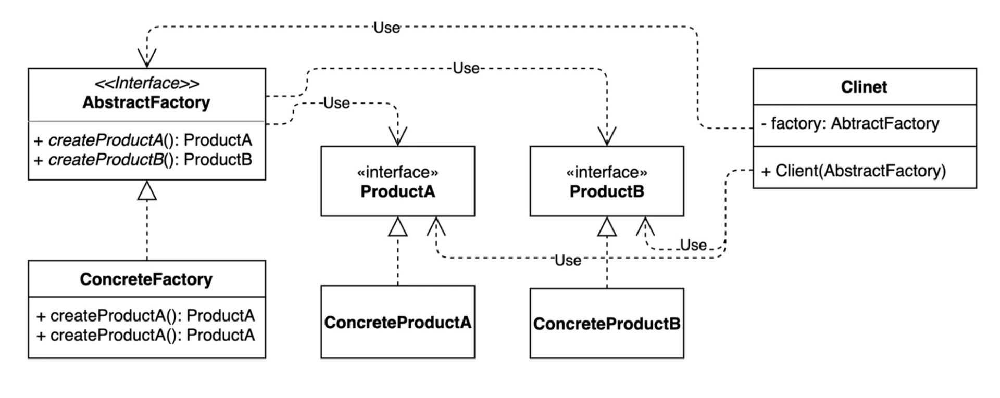
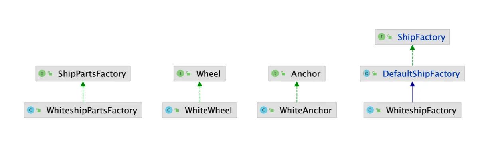
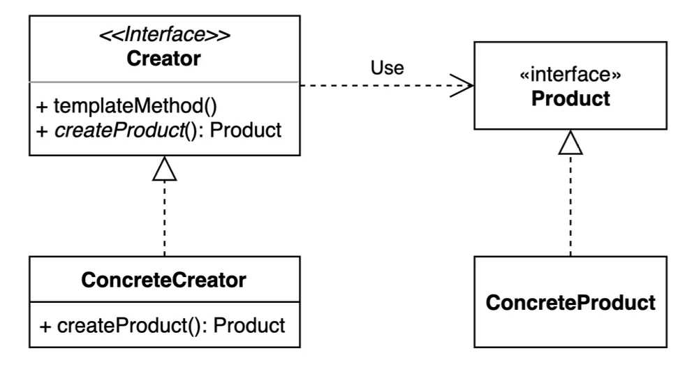

> 📝 
> 
> <a id="1c3eda9b0fe181f0af2fe407d35af204"></a>
> 
> <strong>질문</strong>
> 
> <details>
> <summary>팩토리 메소드 패턴과 어떤 점이 다른가?</summary>
> 
> 
> 
> </details>
> 
> <details>
> <summary>추상 팩토리 패턴의 장점과 단점은 무엇인가?</summary>
> 
> 
> 
> </details>
> 
> <details>
> <summary>실무에서는 어떻게 활용 되는가?</summary>
> 
> 
> 
> </details>

<a id="1c3eda9b0fe1814797daf04e273814ec"></a>

## 추상 팩토리 ( Abstract factory ) 패턴

---

> 📖 
> 
> <a id="1c3eda9b0fe18107b858db9455244be1"></a>
> 
> 관련있는 여러 인스턴스를 만들어주는 팩토리를  추상화된 형태로 정의하는 패턴
> 
> 
> 
> - 팩토리 메서드 패턴과 유사하지만, 사용 목적이 다르다&#46;
>     <a id="1c3eda9b0fe181f98265d207cb8f61de"></a>
> 
>     →   <a href="#/post/1c3eda9b-0fe1-8194-838b-f9236b0b8a9b">페이지</a> 
> 
> <details>
> <summary>Factory를 사용하는 클라이언트 측에 초점을 맞춰서 바라보면 추상 팩토리 패턴이다&#46; </summary>
> 
> > ✏️ 
> > 
> > <a id="1c3eda9b0fe181f4a89df945d17990ce"></a>
> > 
> > “<strong>클라이언트(사용자 코드)</strong> 입장에서 보면, 추상 팩토리 패턴은 <u>구성 요소들을 일관되게 생성해주는</u><u> </u><strong><u>팩토리(공장)를 외부에서 주입</u></strong><u>받는 방식</u>이다&#46;”
> 
> <details>
> <summary>ex) WhiteshipFactory</summary>
> 
> <a id="1c3eda9b0fe1812ba81edb4e48cef4b1"></a>
> 
> ```java
> public class WhiteshipFactory extends DefaultShipFactory {
>     private final ShipPartsFactory partsFactory;
> 
>     public WhiteshipFactory(ShipPartsFactory partsFactory) {
>         this.partsFactory = partsFactory;
>     }
> 
>     @Override
>     public Ship createShip() {
>         Ship ship = new Whiteship();
>         ship.setAnchor(partsFactory.createAnchor()); // 여기!
>         ship.setWheel(partsFactory.createWheel());   // 여기!
>         return ship;
>     }
> }
> ```
> 
> > <code>WhiteshipFactory</code>가 <strong>클라이언트</strong>이고, <code>ShipPartsFactory</code>가 <strong>추상 팩토리이다&#46;</strong>
> 
> - 클라이언트는 이제 직접 인스턴스를 생성 (<code>new WhiteAnchor()</code>)하지 않고 <br>,<strong>“Anchor를 만들어주는 공장”</strong> (<code>partsFactory&#46;createAnchor()</code>)에게 위임한다&#46;
> 
> - 따라서  <strong>클라이언트는 </strong><strong><code>Anchor</code></strong><strong>가 White인지 Black인지 신경 쓰지 않는다&#46;</strong>
> 
> - 즉, <strong><u>클라이언트 입장</u></strong>에서는 <strong><u>‘팩토리를 쓸 뿐, 내부는 모른다’</u></strong>
> 
> </details>
> 
> <a id="1c3eda9b0fe181e1ab86f9afa812dcd2"></a>
> 
> <strong>정리</strong>
> 
> | <strong>질문</strong> | <strong>답변</strong> |
> | --- | --- |
> | “클라이언트에서 보면 추상 팩토리 패턴이다” | 클라이언트가 여러 구성 요소를 팩토리를 통해 <strong>일관되게 생성</strong>하고 <strong>팩토리 구현은 몰라도 되는 구조</strong>라는 의미이다&#46; |
> | 왜 이런 구조가 좋은가? | 결합도를 낮추고, 제품군을 쉽게 교체/확장할 수 있다&#46; |
> | 클라이언트는 어떤 팩토리인지 알아야 하나? | ❌  인터페이스(추상 팩토리)만 알고 있으면 된다&#46; |
> 
> </details>

<a id="1c3eda9b0fe1816f9315fb2cd8ad87c0"></a>

### 1&#46; 기본 예제

<a id="1c3eda9b0fe181c095b2fd5516438283"></a>

### 코드

[DesignPattern&#95;with&#95;jave/src/&#95;01&#95;creational&#95;patterns/&#95;03&#95;abstract&#95;factory/&#95;01&#95;before at main · gyungsubLee/DesignPattern&#95;with&#95;jave]()

<details>
<summary>&#91; 코드 &#93; WhiteAnchor</summary>

<a id="1c3eda9b0fe181a4a416f642a61cf578"></a>

```java
public class WhiteAnchor implements Anchor {
}
```

</details>

<details>
<summary>&#91; 코드 &#93; WhiteWheel</summary>

<a id="1c3eda9b0fe18115bb73c694fba77b2d"></a>

```java
public class WhiteWheel implements Wheel {
}
```

</details>

<details>
<summary>&#91; 코드 &#93; <code>클라이언트</code>&#58; WhiteshipFactory</summary>

<a id="1c3eda9b0fe1813ab3c6c458dcc109e4"></a>

```java
public class WhiteshipFactory extends DefaultShipFactory {

    @Override
    public Ship createShip() {
        Ship ship = new Whiteship();
        ship.setAnchor(new WhiteAnchor());
        ship.setWheel(new WhiteWheel());
        return ship;
    }
}
```

</details>

> ✏️ 
> 
> <a id="1c3eda9b0fe181428ac8cf71ac7bdbdd"></a>
> 
> <strong>문제점</strong>
> 
> <details>
> <summary>1&#46; 구체 클래스에 의존하고 있음 (SRP &#38; DIP 위반) </summary>
> 
> - WhiteshipFactory는 Ship을 생성하는 역할만 하면 되는데, 어떤 Anchor와 Wheel을 사용하는지까지 알고 있음
>     <a id="1c3eda9b0fe1818b8376e80c3968b0b5"></a>
> 
>     →  단일 책임 원칙(SRP) 위반 
> 
> - WhiteAnchor, WhiteWheel이라는 구체 클래스에 직접 의존 
>     <a id="1c3eda9b0fe181519d03c944977757c5"></a>
> 
>     →  의존성 역전 원칙(DIP) 위반
> 
> </details>
> 
> <details>
> <summary>2&#46; 변경 및 확장이 어렵다</summary>
> 
> <details>
> <summary>WhiteshipFactory 에서 Whiteship의 구성 요소들이 변경된다고 한다면, 내부 요소들을 직접 바꿔줘야 한다&#46; </summary>
> 
> <a id="1c3eda9b0fe181d39686fcdec11a983c"></a>
> 
> ```java
> ship.setAnchor(new WhiteAnchor());
> ship.setWheel(new WhiteWheel());
> ```
> 
> - Whiteship 내부 제품 구성요소(필드 값)를 변경하는 경우, 직접 해당 factory 객체 내부에서<br>넘겨주는 <strong><u>인스턴스 자체를 변경</u></strong>해야 한다&#46;
> 
> </details>
> 
> - 새로운 제품군(예&#58; BlackShip, GoldShip)을 추가할 때마다, 각 Ship에 맞는 Anchor, Wheel을 일일이 수동으로 주입해야 함&#46;
> 
> </details>
> 
> <details>
> <summary>3&#46; 테스트와 재사용이 어렵다 </summary>
> 
> - new WhiteAnchor()와 같은 직접 생성 로직이 박혀있으면, Mocking이나 Stubbing이 어려워짐
> 
> - 테스트 코드에서 WhiteAnchor를 대체할 수 없음 → 결합도가 높음
> 
> </details>

<a id="1c3eda9b0fe181cc9918dbb498824d66"></a>

팩토리 메서드를 사용한 방법은 여러 내부 객체(구성 요소)를  가지는 경우, 위와 같은 문제점이 생긴다&#46; 

<a id="1c3eda9b0fe18173b92dccdf05be772f"></a>

이를  <code>추상 팩토리 패턴</code> 해결할 수 있다&#46; 

- 단일 객체 생성의 경우, 팩토리 메서드  패턴을 통한 구현이 더 적합하다&#46; 

<a id="1c3eda9b0fe181039817c77c2a87a3e5"></a>

### 2&#46; 추상 팩토리 패턴 적용



<a id="1c3eda9b0fe1814898b3c96334fcf92a"></a>

### 코드 

[DesignPattern&#95;with&#95;jave/src/&#95;01&#95;creational&#95;patterns/&#95;03&#95;abstract&#95;factory/&#95;02&#95;after at main · gyungsubLee/DesignPattern&#95;with&#95;jave]()

<details>
<summary>basic</summary>

<details>
<summary>factory</summary>

<details>
<summary>&#91; 코드 &#93; &#60; interface &#62; ShipFactory</summary>

<a id="1c3eda9b0fe1818aba47fa4fe477a03a"></a>

```java
public interface ShipFactory {

    default Ship orderShip(String name, String email) {
        validate(name, email);
        prepareFor(name);
        Ship ship = createShip();
        sendEmailTo(email, ship);
        return ship;
    }

    private void validate(String name, String email) {
        if (name == null || name.isBlank()) {
            throw new IllegalArgumentException("배 이름을 지어주세요.");
        }
        if (email == null || email.isBlank()) {
            throw new IllegalArgumentException("연락처를 남겨주세요.");
        }
    }
    private void prepareFor(String name) {
        System.out.println(name + " 만들 준비 중");
    }

    Ship createShip();
    void sendEmailTo(String email, Ship ship);
}
```

</details>

<details>
<summary>&#91; 코드 &#93; &#60; abstract class &#62; DefaultShipFactory</summary>

<a id="1c3eda9b0fe1813e9407f9cd435200aa"></a>

```java
public abstract class DefaultShipFactory implements ShipFactory {

    @Override
    public void sendEmailTo(String email, Ship ship) {
        System.out.println(ship.getName() + " 다 만들었습니다.");
    }
}
```

</details>

</details>

<details>
<summary>parts</summary>

<details>
<summary>&#91; 코드 &#93; &#60; interface &#62; Anchor</summary>

<a id="1c3eda9b0fe181168828decc5aaf7a5f"></a>

```java
public interface Anchor {
}
```

</details>

<details>
<summary>&#91; 코드 &#93; &#60; interface &#62; Wheel</summary>

<a id="1c3eda9b0fe1816c8664dd2dbe1f7715"></a>

```java
public interface Wheel {
}
```

</details>

</details>

<details>
<summary>ship</summary>

<details>
<summary>&#91; 코드 &#93; Ship</summary>

<a id="1c3eda9b0fe1810eb2b4dcd4eab97d7a"></a>

```java
public class Ship {
    private String name;
    private String color;
    private String logo;
    private Anchor anchor;
    private Wheel wheel;

    // getter, setter, toString ...
}
```

</details>

<details>
<summary>&#91; 코드 &#93; Whiteship</summary>

<a id="1c3eda9b0fe181e5b007ec444b63c7e5"></a>

```java
public class Whiteship extends Ship {
}
```

</details>

</details>

</details>

<details>
<summary>Case 1</summary>

<details>
<summary>&#91; 코드 &#93; WhiteshipPartsFactory</summary>

<a id="1c3eda9b0fe18161bd29f388bb5683d4"></a>

```java
package _01_creational_patterns._03_abstract_factory._02_after.case1;


import _01_creational_patterns._03_abstract_factory._02_after.ShipPartsFactory;
import _01_creational_patterns._03_abstract_factory._02_after.basic.parts.Anchor;
import _01_creational_patterns._03_abstract_factory._02_after.basic.parts.Wheel;

public class WhiteshipPartsFactory implements ShipPartsFactory {
    @Override
    public Anchor createAnchor() {
        return new WhiteAnchor();
    }

    @Override
    public Wheel createWheel() {
        return new WhiteWheel();
    }
}
```

</details>

<details>
<summary>&#91; 코드 &#93; WhiteAnchor</summary>

<a id="1c3eda9b0fe181a380c5ed263c4747c7"></a>

```java
package _01_creational_patterns._03_abstract_factory._02_after.case1;

import _01_creational_patterns._03_abstract_factory._02_after.basic.parts.Anchor;

public class WhiteAnchor implements Anchor {
}
```

</details>

<details>
<summary>&#91; 코드 &#93; WhiteWheel</summary>

<a id="1c3eda9b0fe18136b137f72ff824c049"></a>

```java
package _01_creational_patterns._03_abstract_factory._02_after.case1;

import _01_creational_patterns._03_abstract_factory._02_after.basic.parts.Wheel;

public class WhiteWheel implements Wheel {
}
```

</details>

</details>

<details>
<summary>Case 2</summary>

<details>
<summary>&#91; 코드 &#93; WhitePartsProFactory</summary>

<a id="1c3eda9b0fe181b884d9c141c7201032"></a>

```java
package _01_creational_patterns._03_abstract_factory._02_after.case2;

import _01_creational_patterns._03_abstract_factory._02_after.ShipPartsFactory;
import _01_creational_patterns._03_abstract_factory._02_after.basic.parts.Anchor;
import _01_creational_patterns._03_abstract_factory._02_after.basic.parts.Wheel;

public class WhitePartsProFactory implements ShipPartsFactory {
    @Override
    public Anchor createAnchor() {
        return new WhiteAnchorPro();
    }

    @Override
    public Wheel createWheel() {
        return new WhiteWheelPro();
    }
}
```

</details>

<details>
<summary>&#91; 코드 &#93; WhiteAnchorPro</summary>

<a id="1c3eda9b0fe1814f8664eda74cfaeb3d"></a>

```java
package _01_creational_patterns._03_abstract_factory._02_after.case2;

import _01_creational_patterns._03_abstract_factory._02_after.basic.parts.Anchor;

public class WhiteAnchorPro implements Anchor {
}
```

</details>

<details>
<summary>&#91; 코드 &#93; WhiteWheel</summary>

<a id="1c3eda9b0fe18117a948cd43fe537777"></a>

```java
package _01_creational_patterns._03_abstract_factory._02_after.case1;

import _01_creational_patterns._03_abstract_factory._02_after.basic.parts.Wheel;

public class WhiteWheel implements Wheel {
}
```

</details>

</details>

<details>
<summary>&#91; 코드 &#93; <strong><code>추상 팩토리</code></strong>&#58; &#60; interface &#62; ShipPartsFactory</summary>

<a id="1c3eda9b0fe1815eaa94d7063faa62de"></a>

```java
public interface ShipPartsFactory {
		Anchor createanchor();
		Wheel create Wheel();
}
```

<a id="1c3eda9b0fe1812da798faa800634eb6"></a>

위와 같이 각 제품들의 특징(구성요소로써 매개변수로 넘겨주는 값)을  

</details>

<details>
<summary>&#91; 코드 &#93; <strong><code>기본 팩토리 구현체</code></strong>&#58; WhiteshipFactory</summary>

<a id="1c3eda9b0fe181dc823bec1907850e8c"></a>

```java
package _01_creational_patterns._03_abstract_factory._02_after;


import _01_creational_patterns._03_abstract_factory._02_after.basic.factory.DefaultShipFactory;
import _01_creational_patterns._03_abstract_factory._02_after.basic.ship.Ship;
import _01_creational_patterns._03_abstract_factory._02_after.basic.ship.Whiteship;

public class WhiteshipFactory extends DefaultShipFactory {

    private ShipPartsFactory shipPartsFactory;

    public WhiteshipFactory(ShipPartsFactory shipPartsFactory) {
        this.shipPartsFactory = shipPartsFactory;
    }

    @Override
    public Ship createShip() {
        Ship ship = new Whiteship();
        ship.setAnchor(shipPartsFactory.createAnchor());
        ship.setWheel(shipPartsFactory.createWheel());
        return ship;
    }
}
```

</details>

<details>
<summary>&#91; 코드 &#93; <code>클라이언트</code>&#58; ShipInventory</summary>

<a id="1c3eda9b0fe181ff89abdb3c03497b03"></a>

```java
public class ShipInventory {

    public static void main(String[] args) {

        // Case 1: WhiteshipPartsFactory
        ShipFactory shipFactory1 = new WhiteshipFactory(new WhiteshipPartsFactory());
        Ship ship1 = shipFactory1.createShip();
        System.out.println(ship1.getAnchor().getClass()); // WhiteAnchor
        System.out.println(ship1.getWheel().getClass());  // WhiteWheel

        // Case 2: WhitePartsProFactory
        ShipFactory shipFactory2 = new WhiteshipFactory(new WhitePartsProFactory());
        Ship ship2 = shipFactory2.createShip();
        System.out.println(ship2.getAnchor().getClass());  // WhiteAnchorPro
        System.out.println(ship2.getWheel().getClass());   // WhiteWheelPro
    }
}
```

</details>

<a id="1c3eda9b0fe18176a8befca89ffcacdd"></a>

### 3&#46; <code>추상 팩토리 패턴</code>,  <code>팩토리 메서드 패턴</code> 비교

> ✏️ 
> 
> <a id="1c3eda9b0fe1807d8feee46c9a8d8b13"></a>
> 
> <code>추상 팩토리 패턴</code>은 <code>팩토리 메서드 패턴</code>과 굉장히 흡사하다&#46;
> 
> - 둘 다 구체적인 객체 생성 과정을 추상화한 인터페이스를 제공한다&#46;
> 
> <a id="1c3eda9b0fe180678db8dd69378120c9"></a>
> 
> 그러나 두 패턴은 관점과 목적성이 다르다&#46;
> 
> | 구분 | 관점 | 목적 |
> | --- | --- | --- |
> | 팩토리 메서드 패턴 |  “<strong><u>팩토리를 구현하는 방법”<br></u></strong><em><strong>→ </strong></em> 상속, inheritance  | 구체적인 객체 생성 과정을 하위 또는 구체적인 클래스로 옮기는 것 |
> | 추상 팩토리 패턴 |  “<strong><u>팩토리를 사용하는 방법</u></strong> <br>→  구성, composition  | 관련있는 여러 객체를 구체적인 클래스에 의존하지 않고 만들 수 있게 해주는 것 |
> 
> <details>
> <summary>관점</summary>
> 
> - <code>팩토리 메소드 패턴</code>&#58; “<strong><u>팩토리를 구현하는 방법</u></strong> ( 상속, inheritance )”에 초점을 둔다&#46; 
> 
> - <code>추상 팩토리 패턴</code>&#58; “<strong><u>팩토리를 사용하는 방법</u></strong> ( 구성, composition )”에 초점을 둔다&#46; 
> 
> </details>
> 
> <details>
> <summary>목적</summary>
> 
> - <code>팩토리 메소드 패턴</code>&#58; 이 목적이다&#46; 
> 
> - <code>추상 팩토리 패턴</code>&#58; 관이 목적이다 &#46;
> 
> </details>




<a id="1c3eda9b0fe180db964cc6e7b86e8bf8"></a>

### 4&#46; 실무 사용

<details>
<summary>자바 라이브러리 ( 레거시 )</summary>

> ☝🏻 
> 
> <a id="1c3eda9b0fe18025b5bcc7e8d1d703f2"></a>
> 
> javax 패키지 계열은 Java EE(이제는 Jakarta EE로 변경됨)에 속하던 예전 API들이라 지금은 많이 쓰이지 않거나, 대체 기술로 옮겨가는 중이다&#46; 특히 &#46; 특히 Spring 기반의 개발 환경에서는 직접적으로 javax&#46;xml 관련 클래스를 사용할 일이 거의 없다&#46;<br>주로 JAXB나 Jackson, 또는 JSON 기반 설정과 데이터 포맷을 사용한다&#46; 

- <code>javax&#46;xml&#46;xpath&#46;XPathFactory&#35;newInstance()</code>

- <code>javax&#46;xml&#46;transform&#46;TransformerFactory&#35;newInstance()</code>

- <code>javax&#46;xml&#46;parsers&#46;DocumentBuilderFactory&#35;newInstance()</code>

</details>

<details>
<summary>스프링</summary>

- FactoryBean 과 그 구현체 
    <details>
    <summary><strong><code>ApplicationContext</code></strong><strong> → </strong><strong><code>추상 팩토리 패턴</code></strong></summary>

    <a id="1c3eda9b0fe18077abacf87912637712"></a>

    ```java
    ApplicationContext context = new AnnotationConfigApplicationContext(AppConfig.class);
    MyService service = context.getBean(MyService.class);
    ```

    - ApplicationContext는 여러 Bean(Product)을 생성해주는 <strong>팩토리 역할을 한다&#46;</strong>

    - Bean들은 하나의 “제품군(Product family)“이라 할 수 있다&#46;

    - 다양한 구현체(<code>ClassPathXmlApplicationContext</code>, <code>AnnotationConfigApplicationContext</code>)로 구체화를 제공

    </details>

    <details>
    <summary><strong><code>getBean()</code></strong><strong>  → </strong><strong><code>팩토리 메서드 패턴</code></strong></summary>

    <a id="1c3eda9b0fe180198e60c7dafa5c62ff"></a>

    ```java
    MyService service = context.getBean(MyService.class);
    ```

    -  <strong><u>단일 Bean 객체를 생성</u></strong>하거나 <strong><u>반환</u></strong>하므로 <strong><code>팩토리 메서드 패턴</code></strong><strong>이다&#46;</strong>

    </details>

</details>
