> ❗ 
> 
> <a id="200eda9b0fe180548e85f174f12e0f77"></a>
> 
> <strong>문제점</strong>
> 
> ---
> 
> - [x] 인터페이스가 있는 경우에는 JDK 동적 프록시를 적용하고, 그렇지 않은 경우에는 CGLIB를 적용하려면 어떻게해야 하는가?
>     - ProxyFactory
> 
> - [x] 두 기술을 함께 사용할 때 부가 기능을 제공하기 위해서 JDK 동적 프록시가 제공하는 <code>InvocationHandler</code>와 CGLIB가 제공하는 <code>MethodInterceptor</code> 를 각각 중복으로 만들어서 관리하는가?
>     - Advice
> 
> - [x] 특정 조건에 맞을 때 프록시 로직을 적용하는 기능도 공통으로 작성 되었다면?
>     - Pointcut

<a id="200eda9b0fe180e7b4ddf20215c8bd84"></a>

## 프록시 팩토리 ( FroxyFactory )

---

<a id="201eda9b0fe1802ca7f1e810b5d7f84d"></a>

### &#91;<code>ProxyFactory</code>&#93; &#45; <u>인터페이스 존재 유무</u><strong>에 따른 </strong><strong><u>JDK 동적 프록시</u></strong><strong>(</strong><strong><code>interface</code></strong><strong>) 나 </strong><strong><u>CGLIB</u></strong><strong>(</strong><strong><code>Concrete Class</code></strong><strong>) 적용</strong>

> ✏️ 
> 
> <a id="200eda9b0fe180b88aa8de12330c6f43"></a>
> 
> 스프링은<strong><u> 유사한 구체적인 기술들이 있</u></strong>을 때, 그것을 <strong><u>통합해 일관성 있게 접근</u></strong>할 수 있고, <strong><u>더욱 편리하게 사용</u></strong>할 수 있는 <strong><u>추상화된 기술을 제공</u></strong>한다&#46; 
> 
> <a id="200eda9b0fe180ba8995f355a12100a4"></a>
> 
> <strong><u>동적 프록시 기술</u></strong>에 대해서도 <strong><u>통합해 편리하게 만</u></strong>들어주는 <strong>프록시 팩토리</strong><strong> (</strong><strong><code>FroxyFactory</code></strong><strong>)라는 기능을 제공</strong>한다&#46;
> 
> - <strong><code>FroxyFactory</code></strong>를 통해 <strong><u>JDK 동적 프록시</u></strong> 와 <strong><u>CGLIB</u></strong>를 통합하여 처리 가능하다&#46; 

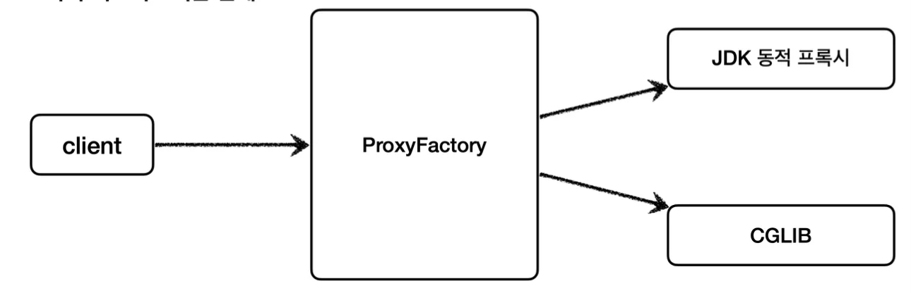

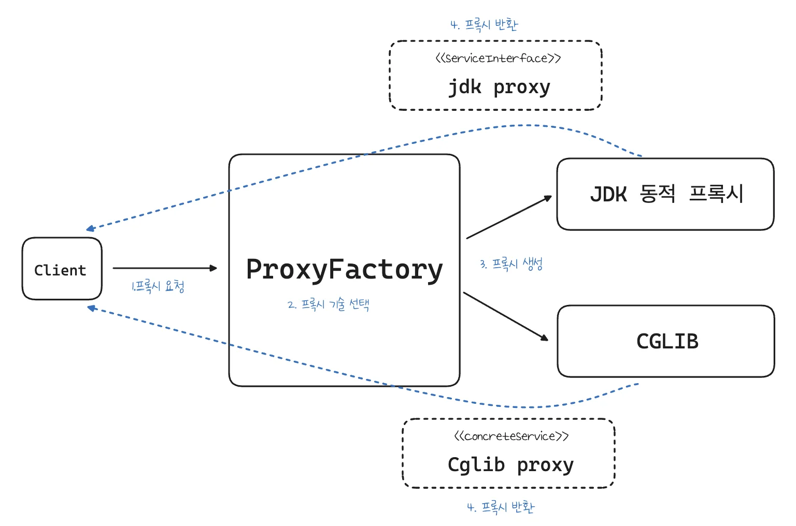

- 프록시 팩토리는 <u>인터페이스가 있</u>다면 <strong><u>JDK 동적 프록시</u></strong>를, <u>구체 클래스만 있</u>다면 <strong><u>CGLIB</u></strong>를 사용한다&#46; <br>( 해당 설정 변경 가능 )

<a id="201eda9b0fe1803d8ed1f0dce79cd98f"></a>

### <strong>&#91;</strong><strong><code>Advice</code></strong><strong>&#93; &#45; </strong><strong><u>두 기술을 함께 사용</u></strong><strong>할 때 부가 기능을 제공하기 위해서 </strong><strong><u>JDK 동적 프록시가 제공</u></strong><strong>하는 </strong><strong><code>InvocationHandler</code></strong><strong>와 </strong><strong><u>CGLIB가 제공</u></strong><strong>하는 </strong><strong><code>MethodInterceptor</code></strong><strong> 를 각각 </strong><strong><u>중복</u></strong><strong>으로 만들어서 관리</strong><strong>하는가?</strong>

> ✏️ 
> 
> <a id="20feda9b0fe18018a226c9b1111da382"></a>
> 
> 앞선 내용을 학습 <strong><u>두 기술을 함께 사용</u></strong><strong>할 때 부가 기능을 제공하기 위해서 </strong><strong><u>JDK 동적 프록시가 제공</u></strong><strong>하는 </strong><strong><code>InvocationHandler</code></strong><strong>와 </strong><strong><u>CGLIB가 제공</u></strong><strong>하는 </strong><strong><code>MethodInterceptor</code></strong><strong> 를 각각 </strong><strong><u>중복</u></strong><strong>으로 만들</strong>
> 
> <a id="201eda9b0fe180bca714fd3c95c6b376"></a>
> 
> 스프링은 해당 문제를 해결하기 위해 부가 기능을 적용할 때 <code>Advice</code>라는 새로운 개념을 도입했다&#46;
> 
> - <code>Advice</code>를 만들면 ProxyFactory에 넘기면 내부적으로 <code>InvocationHandler</code> 나 <code>MethodInterceptor</code>는 <code>Advice</code>를 호출하여 target에 접근한다&#46; 
> 
> - 프록시 팩토리를 사용하면 <code>Advice</code>를 호출하는 전용 <code>InvocationHandler</code>, <code>MethodInterceptor</code>를 내부에서 사용한다&#46;

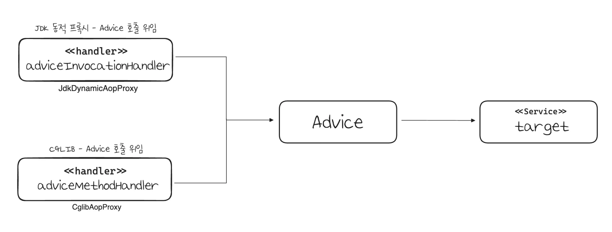

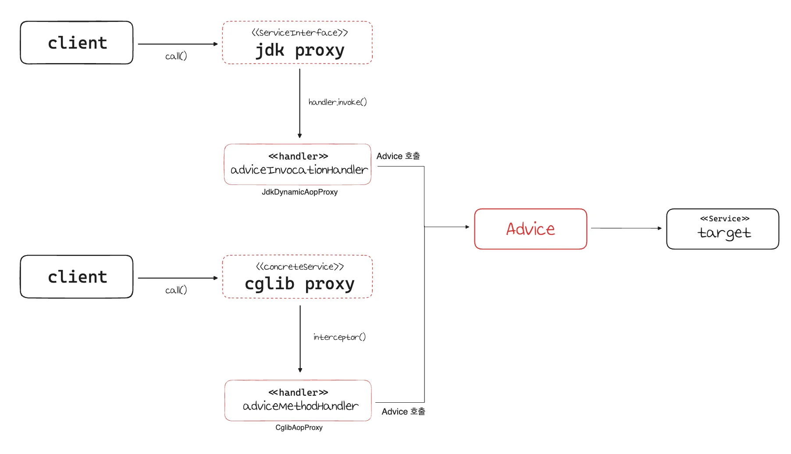

<a id="201eda9b0fe1805eba55cdb4bf8e9e30"></a>

### &#91;<code>Pointcut</code>&#93; &#45; 특정 조건에 맞을 때 프록시 로직을 적용하는 기능도 공통으로 처리

- 앞서 fillter 형태로 특정 메서드 이름의 조건에 맞을 때만 프록시 부가 기능이 적용되는 코드를 직접 만들었다&#46; 

- 스프링은 <code>Pointcut</code>이라는 개념을 도입하여 이 문제를 <strong><u>일관성 있게 해결</u></strong>한다&#46;

<a id="201eda9b0fe1804fa636ee0c257bd741"></a>

### 실습 &#45; 프록시 팩토리

> ✏️ 
> 
> <a id="201eda9b0fe180db8f44d045a9b50593"></a>
> 
> <strong>Advice 만들기</strong>
> 
> <a id="201eda9b0fe1808fbe1dc5e3bd06d8a5"></a>
> 
> <code>Advice</code>는 <u>프록시에 적용하는 부가 기능 로직</u>이다&#46; <br>JDK 동적 프록시가 제공하는 <code>InvocationHandler</code> 와<br>CGLIB 제공하는 <code>MethodInterceptor</code>의 개념과 유사하다&#46; 
> 
> <details>
> <summary><code>org&#46;aopalliance&#46;interceptor&#46;</code><strong><code>MethodInterceptor</code></strong></summary>
> 
> <a id="201eda9b0fe180e79bf0ee9b8a6d35e8"></a>
> 
> ```java
> package org.aopalliance.interceptor;
> 
> public interface MethodInterceptor extends Interceptor {
> 		Object invoke(MethodInvocation invocation) throws Throwable;
> }
> ```
> 
> - <code>MethodInvocation invocation</code>
>     - 내부에는 다음 메서드 호출 방법, 현재 프록시 객체 인스턴스, <code>args</code>, 메서드 정보 등이 포함되어 있다&#46; 
> 
>     - 기존에 파라미터로 제공되는 부분들이 <code>MethodInvocation</code> 객체 내부에 담겨 처리된다&#46;
> 
> - CGLIB의 <code>MethodInterceptor</code>와 이름이 같으므로 패키지 이름 주의 필요
>     - <code>org&#46;aopalliance&#46;inpercept</code> 패키지는 스프링 AOP 모듈 (spring&#45;aop) 안에 들어있다&#46;
> 
> - <code>MethodInterceptor</code> 인터페이스는 <code>Interceptor</code> 인터페이스를 상속하고 <code>Interceptor</code> 인터페이스는 <code>Advice</code> 인터페이스를 상속한다&#46;
>     <a id="201eda9b0fe18017a06eefe97458abe6"></a>
> 
>     ```java
>     MethodInterceptor  <-상속- Interceptor <-상속- Advice 
>     ```
> 
> </details>

<details>
<summary>&#91; 코드 &#93; <strong>TimeAdvice&#58; 부가 기능 정의</strong></summary>

<a id="201eda9b0fe180b8871ce2f88aac769c"></a>

```java
package com.inflearn.lecture_prac.common.advice;

import lombok.extern.slf4j.Slf4j;
import org.aopalliance.intercept.MethodInterceptor;
import org.aopalliance.intercept.MethodInvocation;


@Slf4j
public class TimeAdvice implements MethodInterceptor {

    @Override
    public Object invoke(MethodInvocation invocation) throws Throwable {
        log.info("TimeProxy 실행");
        long startTime = System.currentTimeMillis();
        Object result = invocation.proceed();

        long endTime = System.currentTimeMillis();
        long resultTime = endTime - startTime;
        log.info("TimeProxy 종료 resultTime={}ms", resultTime);

        return result;
    }
}
```

- TimeAdvice는 앞서 설명한 MethodInterceptor를 구현한다&#46;<br>( 패키지 이름 주의 필요 )

- <code>Object result = invocation&#46;proceed()</code>
    - <code>invocation&#46;proceed()</code>를 호출하면 <code>target</code> 클래스를 호출하고 그 결과를 받는다&#46; 

    - 기존에 보았던 코드들과 다르게 <code>target</code> 클래스의 정보가 보이지 않는다&#46; 

    - target 클래스의 정보는 <code>MethodInvocation invocation</code> 안에 모두 포함되어 있다 &#46;
        - 프록시 팩토리로 프록시를 생성하는 단계에서 이미 <code>target</code> 정보를 파라미터로 전달받기 때문이다&#46; 

</details>

<a id="201eda9b0fe1805a89c6ccd763fc6df4"></a>

### 예시 

<details>
<summary> JDK 동적 프록시 &#45; interface 기반 프록시 </summary>

> 📌 
> 
> <details>
> <summary><code>new ProxyFactory(target)</code></summary>
> 
> - 프록시 팩토리를 생성할 때, 생성자에 프록시의 호출 대상(<code>target</code>)을 함께 넘긴다&#46;프록시 팩토리는 해당 인스턴스 정보를 기반으로 프록시를 생성한다&#46; 
> 
> - 만약 이 인스턴스에 인터페이스가 있다면, JDK 동적 프록시를 기본으로 사용하고, 구체 클래스만 있다면 CGLIB를 통해서 동적 프록시를 생성한다&#46; 
> 
> - 위 예제에서는 호출 대상(<code>target</code>)이 <code>new ServiceImpl()</code>의 인스턴스이기 때문에 인터페이스가 존해한다&#46; (<code>ServiceInterface</code>)
>     <a id="201eda9b0fe180c9a1a8ce5ef4fd41a6"></a>
> 
>     따라서 해당 인터페이스를 기반으로 JDK 동적 프록시를 생성한다&#46; 
> 
> </details>
> 
> <details>
> <summary><code>proxyFactory&#46;addAdvice(new TimeAdvice())</code></summary>
> 
> - 프록시 팩토리를 통해 만든, 프록시가 사용할 부가기능 로직을 설정한다&#46;
> 
> - JDK 동적 프록시가 제공하는 InvocationHandler 와 CGLIB가 제공하는 MethodInterceptor의 개념과 유사하다&#46; 
> 
> - 이렇게 프록시가 제공하는 부가기능 로직을 어드바이스(Advice)라 한다&#46; 
> 
> </details>
> 
> <details>
> <summary><code>proxyFactory&#46;getProxy()</code></summary>
> 
> - 프록시 객체를 생성하고 그 결과를 받는다&#46; 
> 
> </details>

<details>
<summary>&#91; 코드 &#93; <strong>ProxyFactoryTest</strong><strong><code>&#46;</code></strong><code>interfaceProxy()</code></summary>

<a id="201eda9b0fe180ab945be19734e75898"></a>

```java
package com.inflearn.lecture_prac.proxyfactory;

import com.inflearn.lecture_prac.common.advice.TimeAdvice;
import com.inflearn.lecture_prac.common.service.ServiceImpl;
import com.inflearn.lecture_prac.common.service.ServiceInterface;
import lombok.extern.slf4j.Slf4j;
import org.junit.jupiter.api.DisplayName;
import org.junit.jupiter.api.Test;
import org.springframework.aop.framework.ProxyFactory;
import org.springframework.aop.support.AopUtils;

import static org.assertj.core.api.Assertions.assertThat;

@Slf4j
public class ProxyFactoryTest {

    @Test
    @DisplayName("인터페이스가 있으면 JDK 동적 프록시 사용")
    void interfaceProxy() {
        ServiceInterface target = new ServiceImpl();
        ProxyFactory proxyFactory = new ProxyFactory(target);
        proxyFactory.addAdvice(new TimeAdvice());
        ServiceInterface proxy = (ServiceInterface) proxyFactory.getProxy();

        log.info("targetClass={}", target.getClass());
        log.info("proxyClass={}", proxy.getClass());

        proxy.save();

        assertThat(AopUtils.isAopProxy(proxy)).isTrue();
        assertThat(AopUtils.isJdkDynamicProxy(proxy)).isTrue();
        assertThat(AopUtils.isCglibProxy(proxy)).isFalse();
    }
}
```

<a id="201eda9b0fe180b9af7ec789cd1d94d5"></a>

<strong>실행 결과</strong>

<a id="201eda9b0fe180fea326d21473161e24"></a>

```plaintext
ProxyFactoryTest - targetClass=class hello.proxy.common.service.ServiceImpl ProxyFactoryTest - proxyClass=class com.sun.proxy.$Proxy13
TimeAdvice - TimeProxy 실행
ServiceImpl - save 호출
TimeAdvice - TimeProxy 종료 resultTime=1ms
```

- 실행 결과를 보면 프록시가 정상 적용된 것을 확인할 수 있다&#46; 
    - JDK 동적 프록시 적용

    -  <code>proxyClass=class com&#46;sun&#46;proxy&#46;&#36;Proxy13</code>

</details>

</details>

<details>
<summary>CGLIB &#45; Concrete Class 기반 프록시</summary>

<details>
<summary>&#91; 코드 &#93; ProxyFactoryTest<code>&#46;concreteProxy()</code></summary>

<a id="200eda9b0fe18036ba03e4389f0d1a2c"></a>

```java
@Test
@DisplayName("구체 클래스만 있으면 CGLIB 사용")
void concreteProxy() {
    ConcreteService target = new ConcreteService();
    ProxyFactory proxyFactory = new ProxyFactory(target);
    proxyFactory.addAdvice(new TimeAdvice());
    ConcreteService proxy = (ConcreteService) proxyFactory.getProxy();
    log.info("targetClass={}", target.getClass());
    log.info("proxyClass={}", proxy.getClass());

    proxy.call();

    assertThat(AopUtils.isAopProxy(proxy)).isTrue();
    assertThat(AopUtils.isJdkDynamicProxy(proxy)).isFalse();
    assertThat(AopUtils.isCglibProxy(proxy)).isTrue();
}
```

<a id="200eda9b0fe1808b92e0e4203c1c28f4"></a>

<strong>실행 결과</strong>

<a id="201eda9b0fe1806c9682f6d5cffeb227"></a>

```plaintext
ProxyFactoryTest - targetClass=class hello.proxy.common.service.ConcreteService 
ProxyFactoryTest - proxyClass=class hello.proxy.common.service.ConcreteService$ $EnhancerBySpringCGLIB$$103821ba
TimeAdvice - TimeProxy 실행
ConcreteService - ConcreteService 호출 
TimeAdvice - TimeProxy 종료 resultTime=1ms
```

- 실행 결과를 보면 프록시가 정상 적용된 것을 확인할 수 있다&#46;

- CGLIB 프록시 적용 확인
    - <code>proxyClass=&#46;&#46;&#46;ConcreteService&#36; &#36;EnhancerBySpringCGLIB&#36;&#36;103821ba</code>

</details>

</details>

<details>
<summary>CGLIB 강제 &#45; proxyTargetClass 옵션 지정</summary>

> 📌 
> 
> <a id="201eda9b0fe1802a99e4f07eb226acf9"></a>
> 
> 인터페이스가 존재하지만, CGLIB를 사용해 인터페이스가 아닌 클래스 기반으로 동적 프로시를 생성 가능하다&#46; 
> 
> - 프록시 팩토리는 <code>proxyTargetClass</code>라는 옵션을 제공하는데, 해당 옵션에 <code>true</code> 값을 넣으면 인터페이스가 있어도 강제로 <code>CGLIB</code>를 사용한다&#46; 
>     - 클래스 기반의 프록시 생성

<details>
<summary>&#91; 코드 &#93; ProxyFactoryTest<code>&#46;proxyTargetClass()</code></summary>

<a id="201eda9b0fe18088a6bbf83b625b26e1"></a>

```java
@Test
@DisplayName("ProxyTargetClass 옵션을 사용하면 인터페이스가 있어도 CGLIB를 사용하고, 클래스 기반 프록시 사용")
void proxyTargetClass() {
    ServiceInterface target = new ServiceImpl();
    ProxyFactory proxyFactory = new ProxyFactory(target);
    proxyFactory.setProxyTargetClass(true); // CGLIB 강제
    proxyFactory.addAdvice(new TimeAdvice());

    ServiceInterface proxy = (ServiceInterface) proxyFactory.getProxy();
    log.info("targetClass={}", target.getClass());
    log.info("proxyClass={}", proxy.getClass());
    proxy.save();


    assertThat(AopUtils.isAopProxy(proxy)).isTrue();
    assertThat(AopUtils.isJdkDynamicProxy(proxy)).isFalse();
    assertThat(AopUtils.isCglibProxy(proxy)).isTrue();
}
```

<a id="201eda9b0fe180e9b8b9f2acb11eb568"></a>

<strong>실행 결과</strong>

<a id="201eda9b0fe180f397b1f9c7bec2d1c8"></a>

```plaintext
ProxyFactoryTest - targetClass=class hello.proxy.common.service.ServiceImpl 
ProxyFactoryTest - proxyClass=class hello.proxy.common.service.ServiceImpl$ $EnhancerBySpringCGLIB$$2bbf51ab
TimeAdvice - TimeProxy 실행
ServiceImpl - save 호출
TimeAdvice - TimeProxy 종료 resultTime=1ms
```

- <code>ServiceImpl&#36;&#36;EnhancerBySpringCGLIB&#46;&#46;&#46;</code>를 보면 CGLIB 기반의 프록시가 생성된 것을 확인할 수 있다&#46; 

- 인터페이스가 있지만 <code>proxyTargetClass</code> 옵션에 의해 CGLIB가 사용된다&#46;

</details>

</details>

<a id="201eda9b0fe1805b8175cf4c07474627"></a>

### NOTES

<details>
<summary><strong>프록시 팩토리를 통한 프록시 적용 확인</strong></summary>

- <code>AopUtils&#46;isAopProxy(proxy)</code>
    - 프록시 팩토리를 통해서 프록시가 생성되면 JDK 동적 프록시나, CGLIB 모두 참이다&#46; 

- <code>AopUtils&#46;isJdkDynamicProxy(proxy)</code>
    - 프록시 팩토리를 통해서 프록시가 생성되고, <br>JDK 동적 프록시인 경우, 참

- <code>AopUtils&#46;isCglibProxy(proxy)</code>
    - 프록시 팩토리를 통해서 프록시가 생성되고,<br>CGLIB 동적 프록시인 경우, 참

- <code>proxy&#46;getClass()</code>처럼 인스턴스의 클래스 정보를 직접 출력해서 확인할 수 있다

</details>

> ✏️ 
> 
> - <code>대상 인터페이스 존재</code>&#58; JDK 동적 프록시 ( 인터페이스 기반) 
> 
> - <code>대상 인터페이스 ❌</code>&#58; CGLIB, ( 구체 클래스 기반 )
> 
> - <code>proxyTargetClass=Ture</code>&#58; CGLIB, 구체 클래스 기반 프록시, 인터페이스 여부와 상관없음

> 🗒️ 
> 
> <a id="201eda9b0fe18093b003ff805f400a37"></a>
> 
> <strong>정리</strong>
> 
> - <code>ProxyFactory</code> 서비스 추상화 덕분에 구체적인 CGLIB, JDK 동적 프록시 기술에 의존하지 않고, 매우 편리하게 동적 프록시 생성이 가능 해졌다&#46; 
> 
> - 프록시의 부가 기능 로직도 특정 기술에 종속적이지 않게 Advice 하나로 편리하게 사용 가능해졌다&#46; 
>     - 이는 프록시 팩토리 내부에서 JDK 동적 프록시인 경우 <code>InvocationHandler</code>가 <code>Advice</code> 를 호출하고, CGLIB인 경우 <code>MethodInterceptor</code> 가 <code>Advice</code> 를 호출하도록 동작하기 때문이다&#46; 

> ☝🏻 
> 
> <a id="201eda9b0fe18013bae2dd88380dc3ce"></a>
> 
> 스프링 부트는 AOP를 적용할 때 기본적으로 <code>proxyTargetClass=true</code> 로 설정해서 사용한다&#46; <br>따라서 <strong><u>인터페이스가 있</u></strong>어도 <strong><u>항상 CGLIB를 사용해서 구체 클래스를 기반으로 프록시를 생성</u></strong>한다&#46;
> 
> - 자세한 내용은 뒤 챕터에서 설명

<a id="201eda9b0fe1806697f7c82260052768"></a>

### 포인트 컷, 어드바이스, 어드바이저

> ✏️ 
> 
> 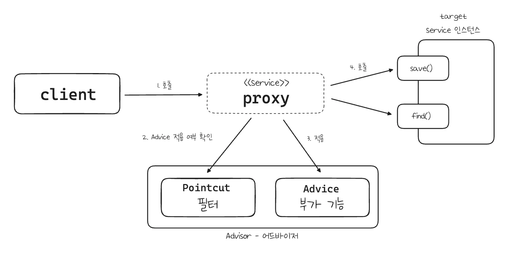
> 
> > 부가 기능 로직을 적용 시, <code>포인트컷</code>으로 <strong><u>어디에 적용</u></strong>할지 선택하고,<code>어드바이스</code>로 <strong><u>어떤 로직을 적용</u></strong>할지 선택한다&#46; <br>그리고 <strong><u>어디에, 어떤 로직</u></strong>을 모두 알고 있는 것이 <code>어드바이저</code>이다&#46;
> 
> <details>
> <summary>포인트컷(<code>Pointcut</code>)</summary>
> 
> - 어디에 부가 기능을 적용할지, 어디에 부가 기능을 적용하지 않을지 판단하는 필러링 로직이다&#46;
> 
> </details>
> 
> <details>
> <summary>어드바이스(<code>Advice</code>)</summary>
> 
> - 프록시가 호출하는 부가 기능
> 
> - 단순하게 프록시 로직이라 생각하면 된다&#46; 
> 
> </details>
> 
> <details>
> <summary>어드바이저(<code>Advisor</code>)</summary>
> 
> - 단순하게 하나의 포인트컷과 하나의 어드바이스를 가지고 있는 것이다&#46; 
> 
> - 포인트컷 <code>1</code> &#43; 어드바이스 <code>1</code>
> 
> </details>

> 📌 
> 
> <a id="201eda9b0fe18067acd7d17804687401"></a>
> 
> <strong>역할과 책임 분리</strong>
> 
> - <code>포인트컷</code>은 대상 여부를 확인하는 필터 역할만 담당한다&#46; 
> 
> - <code>어드바이스</code>는 부가 기능 로직만 담당한다&#46;
> 
> - 둘이 합치면 <code>어드바이저</code>가 된다 &#46; 스프링의 어드바이저는 <strong><u>하나의 포인트컷 &#43; 하나의 어드바이스</u></strong>로 구성된다&#46;

> 💬 
> 
> <a id="201eda9b0fe18009958ffbe13a72d77f"></a>
> 
> <strong>쉽게 기억하기</strong>
> 
> - 조인(<code>Advice</code>)을 어디(<code>Pointcut</code>)에 할 것인가?
> 
> - 조언자(<code>Advisor</code>)는 어디(<code>Pointcut</code>)에 조언(<code>Advice</code>)을 해야할지 알고 있다&#46; 

<a id="201eda9b0fe180739d20cc827c75efb0"></a>

### 예제

<details>
<summary>1&#46; 어드바이저</summary>

> ✏️ 
> 
> 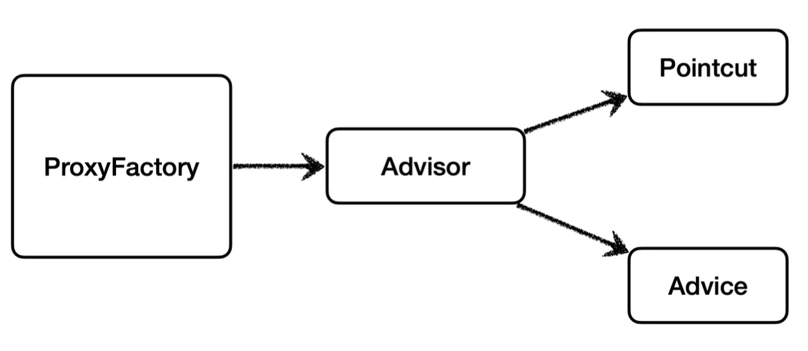
> 
> <a id="201eda9b0fe18091a9f5ce81a4c43af2"></a>
> 
> <code>Advisor</code>는 하나의 <code>Pointcut</code>과 하나의 <code>Advice</code>를 가지고 있다&#46;
> 
> <a id="201eda9b0fe18022bd72c936aa1c2b74"></a>
> 
> 프록시 팩토리를 통해 프록시를 생성할 때 <code>Advisor</code>를 제공하면 <strong><u>어디에 어떤 기능을 제공할 지 알 수 있</u></strong>다&#46; 

<details>
<summary>&#91; 코드 &#93; AdvisorTest</summary>

> 📌 
> 
> <details>
> <summary><code>new DefaultPointcutAdvisor(Pointcut, Advice)</code></summary>
> 
> - 인터페이스의 가장 일반적인 구현체이다&#46;
> 
> - 생성자를 통해 하나의 포인트컷과 하나의 어드바이스를 넣어주면 된다&#46; 
>     - 어드바이저는 하나의 포인트컷과 하나의 어드바이스로 구성된다&#46; 
> 
> </details>
> 
> <details>
> <summary><code>Pointcut&#46;TRUE</code></summary>
> 
> - 항상 true를 반환하는 포인트컷이다&#46; 
> 
> - 이후 직접 포인트컷 구현함
> 
> </details>
> 
> <details>
> <summary><code>new TimeAdvice()</code></summary>
> 
> - 앞서 개발한 TimeAdvice를 제공
> 
> </details>
> 
> <details>
> <summary><code>proxyFactory&#46;addAdvisor(advisor)</code></summary>
> 
> - 프록시 팩토리에 적용할 어드바이저를 지정한다
> 
> - 어드바이저는 내부에 포인트컷과 어드바이스를 모두 가지고 있다&#46; 따라서 어떤 부가 기능을 적용해야 할지 어드바이저 하나로 알 수 있다&#46; 
> 
> <details>
> <summary>프록시 팩토리를 사용할 때 어드바이저는 필수이다&#46;</summary>
> 
> <a id="201eda9b0fe180d6ac2bdbc26e05242d"></a>
> 
> ```java
> proxyFactory.addAdvice(new TimeAdvice())
> ```
> 
> - 이전 실습 코드에서 위와 같이 <code>Advise</code>만을 프록시 팩토리에 적용했다&#46; 
> 
> <a id="201eda9b0fe18046ae09e668a360eb26"></a>
> 
> ```java
> DefaultPointcutAdvisor(Pointcut.TRUE, new TimeAdvice())`
> ```
> 
> - <code>addAdvice()</code> 메서드 내부에서 위와 같이 어드바이저가 생성되고 적용된다&#46; 
> 
> 
> </details>
> 
> </details>

<a id="201eda9b0fe180a4ab1bf82764b2f197"></a>

```java
package com.inflearn.lecture_prac.advisor;

import com.inflearn.lecture_prac.common.advice.TimeAdvice;
import com.inflearn.lecture_prac.common.service.ServiceImpl;
import com.inflearn.lecture_prac.common.service.ServiceInterface;
import lombok.extern.slf4j.Slf4j;
import org.junit.jupiter.api.Test;
import org.springframework.aop.Pointcut;
import org.springframework.aop.framework.ProxyFactory;
import org.springframework.aop.support.DefaultPointcutAdvisor;

@Slf4j
public class AdvisorTest {

    @Test
    void advisorTest() {
        ServiceInterface target = new ServiceImpl();
        ProxyFactory proxyFactory = new ProxyFactory(target);
        DefaultPointcutAdvisor advisor = new DefaultPointcutAdvisor(Pointcut.TRUE, new TimeAdvice());
        proxyFactory.addAdvisor(advisor);
        ServiceInterface proxy = (ServiceInterface) proxyFactory.getProxy();

        proxy.save();
        proxy.find();
    }
}
```

<a id="201eda9b0fe1808daec9c8bb1b2b9434"></a>

<strong>실행 결과</strong>

<a id="201eda9b0fe180b094bdfd4acf7cd9c1"></a>

```bash
# save() 호출
TimeAdvice - TimeProxy 실행
ServiceImpl - save 호출
TimeAdvice - TimeProxy 종료 resultTime=0ms

# find() 호출
TimeAdvice - TimeProxy 실행
ServiceImpl - find 호출
TimeAdvice - TimeProxy 종료 resultTime=1ms
```

<a id="201eda9b0fe180f08294d747aa4e396d"></a>

실행 결과를 보면 <code>save()</code>, <code>find()</code> 각각 모두 어드바이스가 적용된 것을 확인할 수 있다&#46; 

</details>

</details>

<details>
<summary>2&#46; 직접 만든 포인트 컷</summary>

> ✏️ 
> 
> <a id="201eda9b0fe1804a8f01dc92ae7197a0"></a>
> 
> 이전 학습에서 특정 패턴을 필터링 해서 프록시(부가기능)을 적용했다&#46; 
> 
> <a id="201eda9b0fe1809c8e61e59b49b750e6"></a>
> 
> 이렇게 <strong><u>어디에 Advice(부가기능)를 적용</u></strong>할 것이가에 특화된 기능이 바로 <code>포인트컷</code>이다&#46; 
> 
> <details>
> <summary>&#91; 코드 &#93; LogTraceFilterHandler</summary>
> 
> <a id="201eda9b0fe180858953d33e639c91aa"></a>
> 
> ```java
> package com.inflearn.lecture_prac.proxy.config.v2_dynamicproxy.handler;
> 
> import com.inflearn.lecture_prac.proxy.app.basic_ex.trace.TraceStatus;
> import com.inflearn.lecture_prac.proxy.app.basic_ex.trace.logtrace.LogTrace;
> import org.springframework.util.PatternMatchUtils;
> 
> import java.lang.reflect.InvocationHandler;
> import java.lang.reflect.Method;
> 
> public class LogTraceFilterHandler implements InvocationHandler {
> 
>     private final Object target;
>     private final LogTrace logTrace;
>     private final String[] patterns;
> 
>     public LogTraceFilterHandler(Object target, LogTrace logTrace, String ...patterns) {
>         this.target = target;
>         this.logTrace = logTrace;
>         this.patterns = patterns;
>     }
> 
>     @Override
>     public Object invoke(Object proxy, Method method, Object[] args) throws Throwable {
> 
>         // 메서드 이름 필터
>         String methodName = method.getName();
>         if (!PatternMatchUtils.simpleMatch(patterns, methodName)) {
>             return method.invoke(target, args);
>         }
> 
>         TraceStatus status = null;
>         try {
>             String message = method.getDeclaringClass().getSimpleName() + "." + method.getName() +
>                     "()";
>             status = logTrace.begin(message);
> 
>             // 로직 호출
>             Object result = method.invoke(target, args);
> 
>             logTrace.end(status);
>             return result;
>         } catch (Exception e) {
>             logTrace.exception(status, e);
>             throw e;
>         }
>     }
> }
> 
> ```
> 
> </details>

<details>
<summary><strong>Pointcut 관련</strong> 인터페이스 &#45; <code>springframwork&#46;aop</code> 제공</summary>

> ✏️ 
> 
> <a id="201eda9b0fe180abbd09ea9f9b17cbeb"></a>
> 
> 포인트컷은 크게 <code>ClassFilter</code>와 <code>MethodMatcher</code> 둘로 이뤄졌다&#46; 이름 그대로 클래스가 맞는지, 메서드가 맞는지 확인할 때 사용한다&#46; 
> 
> <a id="201eda9b0fe1802d8bb7cbcc1deedd83"></a>
> 
> 둘다 <code>true</code>로 반환되어야 Advise가 적용된다&#46; 

<details>
<summary>Pointcut</summary>

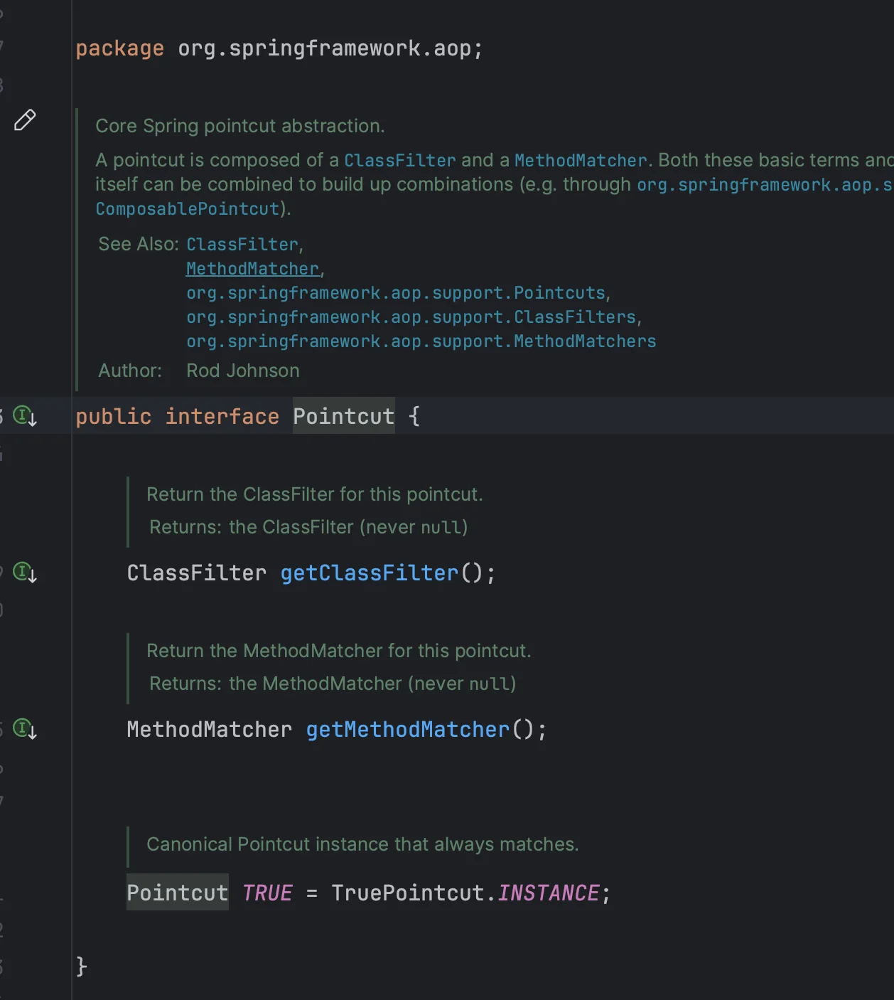

</details>

<details>
<summary>ClassFilter</summary>

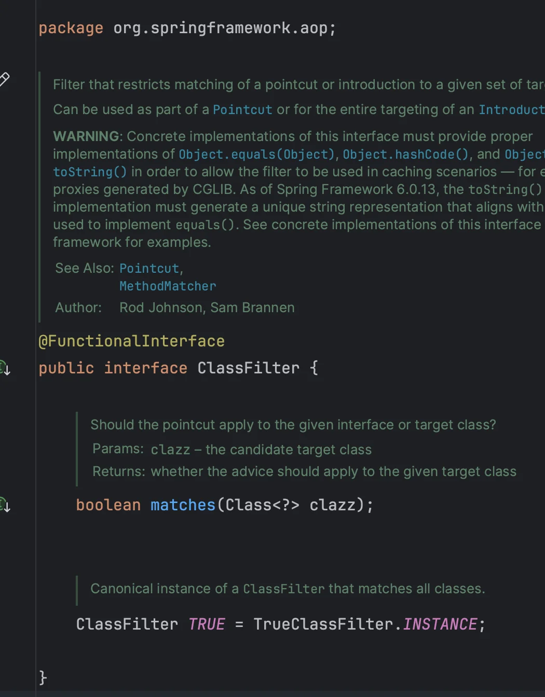

</details>

<details>
<summary>MethodMatcher</summary>

<a id="201eda9b0fe180aba8b2cf1d78ce893b"></a>

```java
package org.springframework.aop;

import java.lang.reflect.Method

public interface MethodMatcher {
		boolean matches(Method method, Class<?> targetClass);
		boolean isRuntime();
		boolean matches(Method method, Class<?> targetClass, Object... args);
		MethodMatcher TRUE = TrueMethodMatcher.INSTANCE;
}	
```

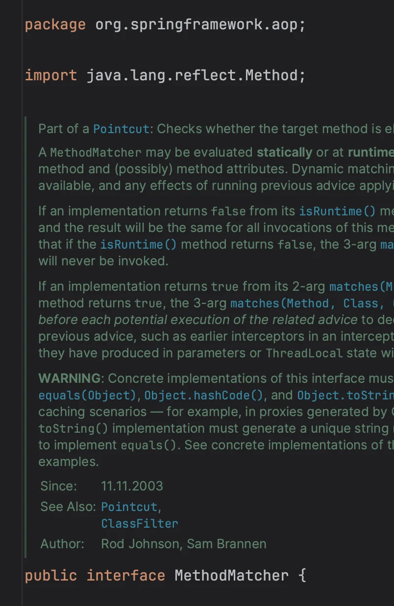

</details>

</details>

<details>
<summary><code>save()</code> 호출</summary>

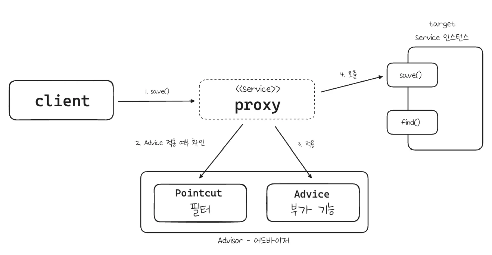

1. 클라이언트가 프록시의 <code>save()</code>를 호출한다&#46;

1. 포인트컷에 Service 클래스의 <code>save()</code>메서드에 어드바이스를 적용해도 될지 물어본다&#46; 

1. 포인트컷이 <code>true</code>를 반환한다&#46; 따라서 어드바이스를 호출해서 부가기능을 적용한다&#46;

1. 이후 실제 인스턴스의 <code>save()</code>를 호출한다&#46; 

</details>

<details>
<summary><code>find()</code> 호출</summary>

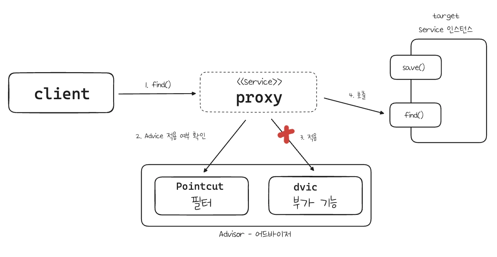

1. 클라이언트가 프록시의 <code>find()</code>를 호출한다&#46; 

1. 포인트컷에 Service 클래스의 <code>find()</code>메서드에 어드바이스가 적용 가능한지 확인한다&#46; 

1. 포인트컷이 <code>false</code> 를 반환한다&#46; 따라서 어드바이스를 호출하지 않고, 부가 기능도 적용되지 않는다&#46; 

1. 실제 인스턴스를 호출한다&#46;

</details>

<a id="201eda9b0fe180029e87e3e27138be70"></a>

### 코드

<details>
<summary>&#91; 코드 &#93; AdvisorTest &#45; <code>advisorTest2()</code></summary>

<a id="201eda9b0fe1802bb14aff0d89b500e2"></a>

```java
package com.inflearn.lecture_prac.advisor;

import com.inflearn.lecture_prac.common.advice.TimeAdvice;
import com.inflearn.lecture_prac.common.service.ServiceImpl;
import com.inflearn.lecture_prac.common.service.ServiceInterface;
import lombok.extern.slf4j.Slf4j;
import org.junit.jupiter.api.DisplayName;
import org.junit.jupiter.api.Test;
import org.springframework.aop.ClassFilter;
import org.springframework.aop.MethodMatcher;
import org.springframework.aop.Pointcut;
import org.springframework.aop.framework.ProxyFactory;
import org.springframework.aop.support.DefaultPointcutAdvisor;

import java.lang.reflect.Method;

@Slf4j
public class AdvisorTest {

     . . .

    @Test
    @DisplayName("직접 만든 포인트컷")
    void advisorTest2() {
        ServiceImpl target = new ServiceImpl();
        ProxyFactory proxyFactory = new ProxyFactory(target);
        DefaultPointcutAdvisor advisor = new DefaultPointcutAdvisor(new MyPointcut(), new TimeAdvice());
        proxyFactory.addAdvice(advisor);
        ServiceInterface proxy = (ServiceInterface) proxyFactory.getProxy();

        proxy.save();
        proxy.find();
    }

    static class MyPointcut implements Pointcut {
        @Override
        public ClassFilter getClassFilter() {
            return ClassFilter.TRUE;
        }

        @Override
        public MethodMatcher getMethodMatcher() {
            return new MyMethodMatcher();
        }
    }

    static class MyMethodMatcher implements MethodMatcher {
        private String matchName = "save";

        @Override
        public boolean matches(Method method, Class<?> targetClass) {
            boolean result = method.getName().equals(matchName);
            log.info("포인트컷 호출 method={} targetClass={}", method.getName(), targetClass);
            log.info("포인트컷 결과 result={}", result);
            return result;
        }

        @Override
        public boolean isRuntime() {
            return false;
        }

        @Override
        public boolean matches(Method method, Class<?> targetClass, Object... args) {
            throw new UnsupportedOperationException();
        }
    }
}
```

<a id="201eda9b0fe1809c9f7df9d010255b46"></a>

<strong>실행 결과</strong>

<a id="201eda9b0fe180779977c5ee4b62f788"></a>

```bash
# save() 호출
AdvisorTest -- 포인트컷 호출 method=save targetClass=class com.inflearn.lecture_prac.common.service.ServiceImpl
AdvisorTest -- 포인트컷 결과 result=true
TimeAdvice -- TimeProxy 실행
ServiceImpl -- save 호출
TimeAdvice -- TimeProxy 종료 resultTime=0ms

# find() 호출
AdvisorTest -- 포인트컷 호출 method=find targetClass=class com.inflearn.lecture_prac.common.service.ServiceImpl
AdvisorTest -- 포인트컷 결과 result=false
ServiceImpl -- find 호출
```

- <code>save()</code> 호출 시 어드바이스가 적용되지만 <code>find()</code> 호출 시 어드바이스가 적용되지 않는 것을 확인 가능하다&#46; 

</details>

</details>

<details>
<summary>3&#46; 스프링에서 제공하는 포인트컷</summary>

> ✏️ 
> 
> <a id="201eda9b0fe1801e9585fbefcd9b69ec"></a>
> 
> 스프링은 필요한 포인트컷 대부분을 제공한다&#46; 

<a id="201eda9b0fe1801bbcefc84ad2ea3718"></a>

### 코드 

<details>
<summary>&#91; 코드 &#93; AdvisorTest &#45; advisorTest3() 추가 </summary>

<a id="201eda9b0fe1805ebc00d25602a6d15d"></a>

```java
@Test
@DisplayName("스프링이 제공하는 포인트컷") 
void advisorTest3() {
     ServiceImpl target = new ServiceImpl();
	   ProxyFactory proxyFactory = new ProxyFactory(target);
	   NameMatchMethodPointcut pointcut = new NameMatchMethodPointcut();
	   pointcut.setMappedNames("save");
	   DefaultPointcutAdvisor advisor = new DefaultPointcutAdvisor(pointcut, newTimeAdvice());	   
	   proxyFactory.addAdvisor(advisor);
	   ServiceInterface proxy = (ServiceInterface) proxyFactory.getProxy();
	   
	   proxy.save();
	   proxy.find();
}
```

<a id="201eda9b0fe18042b215d56c094d608e"></a>

<strong>실행 결과</strong>

<a id="201eda9b0fe180e6895eccfbc68d8417"></a>

```bash
# save() 호출
TimeAdvice -- TimeProxy 실행
ServiceImpl -- save 호출
TimeAdvice -- TimeProxy 종료 resultTime=0ms

# find() 호출
ServiceImpl -- find 호출
```

</details>

</details>

<details>
<summary>&#91; 코드 &#93;</summary>

<a id="201eda9b0fe18022a9bec41302d0cc21"></a>

```java

```

</details>

<details>
<summary>&#91; 코드 &#93;</summary>

<a id="201eda9b0fe180dbb06de437bfa3b955"></a>

```java

```

</details>

<details>
<summary>&#91; 테스트 &#93; API 호출</summary>

<a id="200eda9b0fe180cc93cdc21ef36fd2cb"></a>

```java

```

</details>
