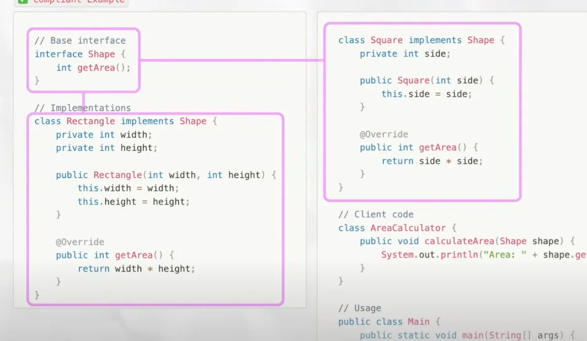
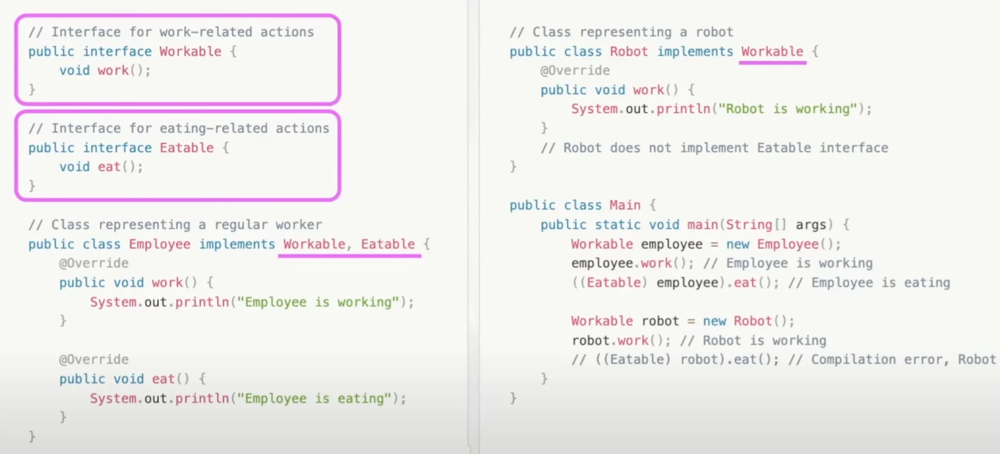
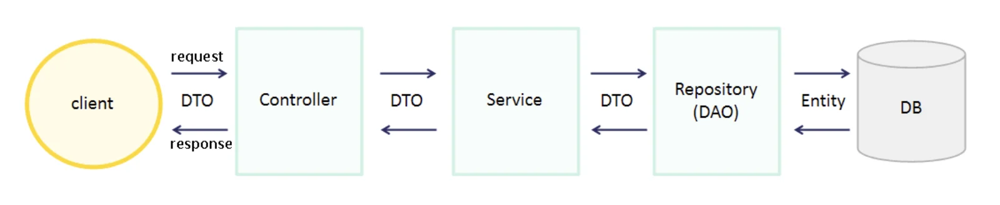
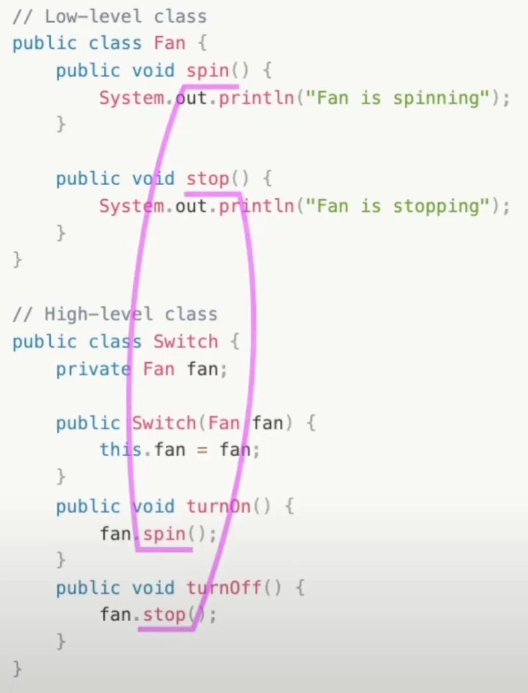

<a id="1c3eda9b0fe181928c20ded31b36965c"></a>

## Single Responsibility Principle

---

- 하나의 클래스에는 하나의 책임만 있어야 한다&#46;
    - 하나의 책임을 위해 여러 메서드가 사용될 수 있지만
        <a id="1c3eda9b0fe18188ae64f55f3c4b79b5"></a>

        단, 클래스가 이들을 통해 수행하는 대표적인 업무(책임)는 하나 이어야 한다<br>

<details>
<summary>문제) SRP 미준수</summary>

<details>
<summary>&#91; <strong>코드 &#93; UserService</strong></summary>

<details>
<summary>&#91; 코드 &#93; User</summary>

<a id="1c3eda9b0fe18141be9fff91f1363242"></a>

```java
class User {
    private String name;
    private String email;

    public User(String name, String email) {
        this.name = name;
        this.email = email;
    }

    public String getName() {
        return name;
    }

    public String getEmail() {
        return email;
    }
}
```

</details>

<a id="1c3eda9b0fe1817c8540e80af4d5f7ba"></a>

```java
package prac.designPetterns.solid.SingleResponsibility;

public class UserService {

    // 1. Save user to database
    public void saverUser(User user){
			      .  .  .
        System.out.println("User saved to database:" + user.getName());
    }

		// 2. Send welcome email to user
    public void sendWelcomeEmail(User user){
			      .  .  .
        System.out.println("Welcome email sent to: " + user.getEmail());
    }

		// 3. Log user activity
    public void logUserActivity(User user){
            .  .  .
        System.out.println("Logging activity for user: " + user.getName());
    }
}
```

</details>

---

- 위 코드를 보면 <strong>UserService</strong> 클래스에 <strong><u>총 3가지의 책임</u></strong>이 부여되어 있다&#46; 
    - 회원 저장 ( <code>saverUser</code> )

    - 가입 환영 이메일을 보냄 ( <code>sendWelcomeEmail</code> )

    - 유저 활동 로그에 기록 ( <code>logUserActivity</code> )

- 이러한 코드에는 여러가지 문제점이 있다&#46;
    - 각 클래스의 코드가 복잡해지고, 이들의 역활을 직관적으로 이해하기 어렵다&#46; 

    - 클래스가 가진 책임의 수 만큼 해당 클래스를 수정해야 할 이유가 많아진다&#46; 

    - 하나의 책임 수정 시 의도치 않게 다른 책임에 영향을 줄 수 있다&#46; 

    - 여러 책임이 한 곳에 얽혀 있기 때문에 테스트와 리펙토링도 까다롭다&#46;

    - 한데 묶여있기 때문에 필요한 부분만 가져다 쓸 수도 없다&#46; 
        <a id="1c3eda9b0fe181779376e5e529b539c9"></a>

        ⇒ <strong><u> 확장성과 유연성이 떨</u></strong>어지며 <strong><u>유지보수 하기에 어렵다</u></strong>&#46;  

</details>

<details>
<summary>해결) SRP 준수</summary>

<details>
<summary>&#91; 코드 &#93; <strong>UserService</strong></summary>

<details>
<summary>&#91; 코드 &#93; User</summary>

<a id="1c3eda9b0fe18151b9e6c00e077d39da"></a>

```java
class User {
    private String name;
    private String email;

    public User(String name, String email) {
        this.name = name;
        this.email = email;
    }

    public String getName() {
        return name;
    }

    public String getEmail() {
        return email;
    }
}
```

</details>

<a id="1c3eda9b0fe18195a3e6fc9737c36468"></a>

```java
package prac.designPetterns.solid.SingleResponsibility;

// SRP 준수
public class UserRepository {
    public void saveUser(User user){
        // Save user to database
        System.out.println("User saved to database: " + user.getName());
    }
}

// 예시를 위한 코드로 파일을 나누지 않음
// public 생략
class EmailService {
    public void snedWelcomeEmail(User user){
        // Send welcome email to user
        System.out.println("Welcome email sent to: " + user.getEmail());
    }
}

// 위와 동일
class UserActivityLogger {
    public void logUserActivity(User user){
        // Log user activity
        System.out.println("Logging activity for user: " + user.getName());
    }
}
```

</details>

---

- 하나의 클래스에 담겨있던 3개의 책임을 각 클래스로 분리

- 하<strong><u>나의 클래스</u></strong>에 <strong><u>한개의 책임</u></strong>만을 부여함
    - 각 클래스 이름을 통해 이들에게 할당된 책임을 쉽게 유추할 수 있다&#46; 

    - 각 책임들이 독립적이기 때문에 한 책임이 수정되어도 다른 책임에는 영향을 주지 않음

    - 유지보수 시에 수정하려는 책임을 가진 클래스만을 수정하면 됨

    - 테스트 시, 한 책임 씩 나눠  단위 테스트 가능함&#46;

    <a id="1c3eda9b0fe181e181bbf8c5917b9240"></a>

        ⇒  코드의 확장성과 유연성이 증가

</details>

<a id="1c3eda9b0fe181f281d8e8aa840740db"></a>

## Open/Closed Principle

---

> &#34;소프트위어 엔티티(클래스, 모듈, 함수 등)는 확장에 대해서는 열려 있어야 하지만 변경에 대해서는 닫혀 있어야 한다&#46;&#34;
> 
> - 로버트 C 마틴&#45;

- 개방/폐쇠 원칙
    - <strong><u>확장에는 열려</u></strong>있어야 하고 <strong><u>변경에는 닫혀</u></strong> 있어야 한다&#46; 

    - <strong>기능이 변하거나 확장되는 것은 가능</strong>하지만 <strong>그 과정에서 기존의 코드가 수정되지 않아야 한다&#46;</strong>

<details>
<summary>문제) OCP 미준수 </summary>

<details>
<summary><strong>&#91; 코드 &#93; ReportGenerator</strong></summary>

<a id="1c3eda9b0fe181e49a3bf222153821db"></a>

```java
public class ReportGenerator {
    public void generateReport(String type) {
        if (type.equals("PDF")) {
            System.out.println("Generating PDF report...");
        } else if (type.equals("HTML")) {
            System.out.println("Generating HTML report...");
        }
        // If we need to add another format, we have to modify this method.
    }
}
```

</details>

---

- 위 ReportGenerator 클래스는 요구받은 방식으로 레포트 문서를 생성하는 프로그램이다&#46; 
    - 인자로 입력 받는 타입을 기준으로 조건문(if문)을 실행하여 해당하는 형식의 문서를 생성한다&#46; 

- 이후 XML 등 <strong><u>포맷 형식이</u></strong><u> </u><strong><u>확장</u></strong> 됨에 따라 <strong><u>generateReport 메서드가 계속 수정</u></strong>되어야 하고 해당 메서드의 코드는 매우 복잡해지고 지저분해진다&#46; 

- 그 과정에서 <strong><u>기존 과정에 영향</u></strong>을 줄 수 있고, 해당 메서드가 <strong><u>이미 사용되는 곳</u></strong>들에서도 <strong><u>부작용(side effect)들이 발생될 수 있</u></strong>다&#46; 

</details>

<details>
<summary>해결) OCP 준수</summary>

<details>
<summary>&#91; 코드 &#93; Interface &#45; Report ⇒ PDFReport, HTMLReport …</summary>

<a id="1c3eda9b0fe18132b39ed15d9449e6a4"></a>

```java
// 공통적인 행동, 속성 정의
public interface Report {
    void generate();
}

// 정의한 행동을 형식별로 확장
public class PDFReport implements Report {
    @Override
    public void generate() {
        System.out.println("Generating PDF report...");
    }
}

public class HTMLReport implements Report {
    @Override
    public void generate() {
        System.out.println("Generating HTML report...");
    }
}

public class XMLReport implements Report {
    @Override
    public void generate() {
        System.out.println("Generating XML report...");
    }
}

public class Main {
    public static void main(String[] args) {
        Report pdfReport = new PDFReport();
        pdfReport.generate();  // Generating PDF report...

        Report htmlReport = new HTMLReport();
        htmlReport.generate();  // Generating HTML report...

        Report xmlReport = new XMLReport();
        xmlReport.generate();  // Generating XML report...
    }
}
```

</details>

---

- 클래스는 확장에는 열려있고 변경에는 닫혀있어야 한다&#46; 그러나 첫번째 코드는 새로운 형식이 추가될 때마다 조건문으로 추가되어 기존의 메서드가 수정된다&#46; 이는 부작용(side effect)이 생길 수 있는 OCP 원칙을 위배하는 설계이다&#46;  

- 따라서 <code>공통적인 행동(메서드</code>)인 <strong><u>‘문서 생성 기능’</u></strong>을 <strong><u><code>interface</code></u></strong><strong><u>로 정의</u></strong>하고, <strong><u>각 형식(</u></strong><strong><u><code>PDF</code></u></strong><strong><u>, </u></strong><strong><u><code>HTML</code></u></strong><strong><u> …)별</u></strong>로 <strong><u>interface를 구현</u></strong>하여 <strong><u>클래스를 생성</u></strong>해 <strong><u>정의한 행동을 확장</u></strong>한다&#46;
    - interface는 각 껍데기 즉, 행동(메서드)의 이름만 명시한다&#46; <br>각 메서드가 어떻게 수행 되는지는 작성하지 않는다&#46;  

    - 해당 interface를 상속하는 클래스들이 각자의 구체적인 행동을 정의한다&#46; 

- 이로인해, <strong><u>공통적인 행동의 변경에는 닫혀</u></strong>있고, <strong><u>형식(</u></strong><strong><u><code>PDF</code></u></strong><strong><u>, </u></strong><strong><u><code>HTML</code></u></strong><strong><u> …)</u></strong><strong><u>마다 행동 정의(확장)에는 열려 있</u></strong>다&#46;
    > <strong><u>공통적인 속성 인터페이스 정의 (폐쇠) → 상속하여 구체화 속성 확장</u></strong>

</details>

<a id="1c3eda9b0fe181b39ca3d327c644b759"></a>

## Liskov Substitution  Principle

---

- 리스코프 치한 원칙
    - 처음 제안한 컴퓨터 과학자 바바라 리스코프(Barbara Liskov)의 이름에서 따옴

- 자식 클래스는 부모 클래스를 대체할 수 있어야 한다&#46; <br>즉, 부모 클래스 객체가 사용되는 곳에 자식 클래스 객체를 넣어도 문제없이 동작해야 한다&#46;  

- 예시1) Bird &#45; Penguin
    <details>
    <summary>문제) LSP 미준수 </summary>

    <details>
    <summary>&#91; <strong>코드 &#93;  Bird&#46;fly() &#45; Penguin</strong></summary>

    <a id="1c3eda9b0fe1819f8c65cf8110ffb61e"></a>

    ```java
    // Parent class Bird
    public class Bird {
        public void fly() {
            System.out.println("Bird is flying");
        }
    }

    // Child class Penguin that violates LSP
    public class Penguin extends Bird {
        @Override
        public void fly() {
            // Penguins cannot fly
            throw new UnsupportedOperationException("Penguins cannot fly");
        }
    }

    public class Main {
        public static void main(String[] args) {
            Bird bird = new Bird();
            bird.fly(); // Bird is flying

            Bird penguin = new Penguin();
            penguin.fly(); // Throws UnsupportedOperationException
        }
    }
    ```

    </details>

    ---

    - Bird를 상속하는 자식 클래스의 Peguin은 날지 못하는 새이므로  부모의 행동인 fiy를 실행할 수 없다&#46; 

    - <strong><u><code>자식 클래스</code></u></strong>는 <strong><u><code>부모 클래스</code></u></strong>를 <strong><u>대체(Subsituation)</u></strong> 할 수 있어야 한다는
        <a id="1c3eda9b0fe181c59323d31e54adeaf6"></a>

        즉, <strong><u>부모의 모든 행동이 </u></strong><strong><u><code>자식 클래스</code></u></strong><strong><u>에게 상속</u></strong>되어야 한다는 LSP원칙에 위배된다&#46; 

    </details>

    <details>
    <summary>해결) LSP 준수</summary>

    <details>
    <summary>&#91; 코드 &#93; Flyable, Bird&#46;eat() &#45; Penguin, Sparrow</summary>

    <a id="1c3eda9b0fe1816cac9ffb3929a1191b"></a>

    ```java
    // Interface for birds that can fly
    public interface Flyable {
        void fly();
    }

    // Base class Bird
    public class Bird {
        public void eat() {
            System.out.println("Bird is eating");
        }
    }

    // Class for a bird that can fly
    public class Sparrow extends Bird implements Flyable {
        @Override
        public void fly() {
            System.out.println("Sparrow is flying");
        }
    }

    // Class for a bird that cannot fly
    public class Penguin extends Bird {
        // Penguins do not implement Flyable
    }

    public class Main {
        public static void main(String[] args) {
            Bird sparrow = new Sparrow();
            sparrow.eat(); // Bird is eating
            ((Flyable) sparrow).fly(); // Sparrow is flying

            Bird penguin = new Penguin();
            penguin.eat(); // Bird is eating
            // ((Flyable) penguin).fly(); // Compilation error, Penguin is not Flyable
        }
    }
    ```

    </details>

    ---

    - Bird&#46;fly() → Flyable, Bird&#46;eat()
        <details>
        <summary>공통적이지 않는 Bird의 나는 행동(<code>fly()</code>)를 독립된 인터페이스(Flyable)로 구분하여 Brid의 자식 클래스 중 날수 있는 것에만 적용한다&#46; <br>즉, <strong><u>공통적이지 않은 속성</u></strong>은 <strong><u>독립적인 인터페이스로 분리</u></strong> 후, 적용되는 <strong><u>하위 자식 클래스에만 상속</u></strong>시킨다&#46; </summary>

        <details>
        <summary>&#60;interface&#62; Flyable</summary>

        <a id="1c3eda9b0fe181e8b236cebe615159fb"></a>

        ```java
        public interface Flyable {
            void fly();
        }
        ```

        </details>

        <details>
        <summary>참새(Sparrow) &#45; 날수 있음</summary>

        <a id="1c3eda9b0fe181c8b403df61cb7a6adb"></a>

        ```java
        public class Sparrow extends Bird implements Flyable {
        		@Override
        	  public void fly() {
        	      System.out.println("Sparrow is flying");
        	  }
        }
        ```

        </details>

        <details>
        <summary>펭귄(Penguin) &#45; 날 수 없음</summary>

        <a id="1c3eda9b0fe181f39201f2c8711a972b"></a>

        ```java
        public class Penguin extends Bird {
            // Penguins do not implement Flyable
        }
        ```

        </details>

        </details>

        <details>
        <summary>공통적으로 가지는 행동인 eat()을 추가하여 상속 처리 </summary>

        <a id="1c3eda9b0fe181ca803fddb6e010c7fe"></a>

        ```java
        public class Sparrow extends Bird implements Flyable { ... }

        public class Penguin extends Bird { ... }
        ```

        - sparrow 와 penguin 모두 부모의 행동인 <code>eat()</code>을 상속하여 정상 동작함 → LSP 원칙 준수

        <a id="1c3eda9b0fe181e789bdec035366a0bd"></a>

        ```java
        public class Main {
            public static void main(String[] args) {
                Bird sparrow = new Sparrow();
                sparrow.eat(); // Bird is eating
                ((Flyable) sparrow).fly(); // Sparrow is flying

                Bird penguin = new Penguin();
                penguin.eat(); // Bird is eating
                // ((Flyable) penguin).fly(); // Compilation error, Penguin is not Flyable
            }
        }
        ```

        </details>

    </details>

- 예시2) Rectangle &#45; Square
    <details>
    <summary>문제) LSP 미준수</summary>

    <details>
    <summary>&#91; <strong>코드 &#93; </strong>Rectangle &#45; Square</summary>

    <a id="1c3eda9b0fe1817e8d84dd7ebe32aeae"></a>

    ```java
    // Base class
    class Rectangle {
        protected int width;
        protected int height;

        public void setWidth(int width) {
            this.width = width;
        }

        public void setHeight(int height) {
            this.height = height;
        }

        public int getArea() {
            return width * height;
        }
    }

    // Subclass violating LSP
    class Square extends Rectangle {
        @Override
        public void setWidth(int width) {
            this.width = width;
            this.height = width;
        }

        @Override
        public void setHeight(int height) {
            this.width = height;
            this.height = height;
        }
    }

    // Client code
    class AreaCalculator {
        public void calculateArea(Rectangle rectangle) {
            rectangle.setWidth(5);
            rectangle.setHeight(4);
            System.out.println("Area: " + rectangle.getArea());
            // Expected output for Rectangle: Area: 20
            // Actual output for Square: Area: 16 (LSP violation)
        }
    }
    ```

    </details>

    ---

    - 직사각형(Rectangle)과 정사각형(Square)의 두 성질이 다르다&#46;
        - 정사각형(Square)는 너비(width)와 높이(height)가 항상 같아야 하지만, 직사각형(Rectangle)은 그렇지 않다&#46; 

        <details>
        <summary>따라서 직사각형(Rectangle)을 상속하는 정사각형(Square)의 넓이는  직사각형의 넓이(<code>getArea()</code>) 와 다르다&#46;</summary>

        <a id="1c3eda9b0fe1815b9afcef56fd952ab6"></a>

        ```java
        rectangle.setWidth(5);
        rectangle.setHeight(4);
        System.out.println("Area: " + rectangle.getArea());
        ```

        <a id="1c3eda9b0fe181739d76da1ed9795f63"></a>

        위와 같이 직사각형의 넓이를 구하면 20이지만, 이를 자식 클래스인 정사각형으로 대체하면 16이 나온다&#46; 

        <a id="1c3eda9b0fe181ec851df45fb694442f"></a>

        즉, 부모의 결과 값과는 다르게 나와 부모를 대체하는 LSP 원칙에 위배된다&#46; 

        </details>

    </details>

    <details>
    <summary>해결) LSP 준수</summary>

    <details>
    <summary>&#91; 코드 &#93; Shape &#45; Ractangle, Square</summary>

    <a id="1c3eda9b0fe181ac9224e78b1d2bd9b2"></a>

    ```java
    // Base interface
    interface Shape {
        int getArea();
    }

    // Implementations
    class Rectangle implements Shape {
        private int width;
        private int height;

        public Rectangle(int width, int height) {
            this.width = width;
            this.height = height;
        }

        @Override
        public int getArea() {
            return width * height;
        }
    }

    class Square implements Shape {
        private int side;

        public Square(int side) {
            this.side = side;
        }

        @Override
        public int getArea() {
            return side * side;
        }
    }

    // Client code
    class AreaCalculator {
        public void calculateArea(Shape shape) {
            System.out.println("Area: " + shape.getArea());
        }
    }

    // Usage
    public class Main {
        public static void main(String[] args) {
            AreaCalculator calculator = new AreaCalculator();

            // LSP Violation
            //Rectangle rectangle = new Rectangle();
            //calculator.calculateArea(rectangle); // Output: Area: 20

            //Square square = new Square();
            //calculator.calculateArea(square); // Output: Area: 16 (Unexpected)

            // LSP Compliant
            Shape rectangle = new Rectangle(5, 4);
            calculator.calculateArea(rectangle); // Output: Area: 20

            Shape square = new Square(5);
            calculator.calculateArea(square); // Output: Area: 25 (Expected)
        }
    }
    ```

    </details>

    ---

    

    - 위와 같이 &#91; 부모 &#45; 자식 &#93; 간에 정의를 수정하여  해당 부분을 해결한다&#46; 
        - 첫번째 예시는 두 객체 사이는 비슷한 것 같지만 전혀 다른 속성을 가지고 있었기에, 부모 &#45; 자식 간의 관계 설정이 잘못되었다&#46;

        - 따라서 Shape 이라는 공통된 속성은 interface로 정의 후 상속 처리하여 LSP 원칙을 준수한다&#46; 

    </details>

<a id="1c3eda9b0fe181aa90eee3ecf2174c72"></a>

## Interface Segregation Principle

---

- 인터페이스 분리 원칙
    - 클래스는 자신이 사용하지 않을 메소드를 구현하도록 강요 받지 말아야 한다&#46; 

    - 따라서 여러 속성의 <u>인터페이스를 분리</u>하여 <u>각 객체의 특징에 맞</u>게 <strong><u>해당하는 인터페이스를 상속</u></strong>해야 한다&#46; 

<details>
<summary>문제) ISP 미준수 </summary>

<details>
<summary>&#91; <strong>코드 &#93; &#60;interface&#62; Worker → 사람 ( Employee ), 로봇 ( Robot )</strong></summary>

- &#60;interface&#62; Worker
    <a id="1c3eda9b0fe1814abe70c82ba462e50c"></a>

    ```java
    public interface Worker {
        void work();
        void eat();
    }
    ```

- Employee
    <a id="1c3eda9b0fe181ce8a0ac7d452d1be94"></a>

    ```java
    public class Employee implements Worker {
        @Override
        public void work() {
            System.out.println("Employee is working");
        }

        @Override
        public void eat() {
            System.out.println("Employee is eating");
        }
    }
    ```

- Robot
    <a id="1c3eda9b0fe1814ba443ef7720fb58f2"></a>

    ```java
    public class Robot implements Worker {
        @Override
        public void work() {
            System.out.println("Robot is working");
        }

        @Override
        public void eat() {
            // Robots do not eat
            throw new UnsupportedOperationException("Robots do not eat");
        }
    }
    ```

<a id="1c3eda9b0fe181ca809cf5e035508ee9"></a>

```java
public class Main {
    public static void main(String[] args) {
        Worker employee = new Employee();
        employee.work(); // Employee is working
        employee.eat(); // Employee is eating

        Worker robot = new Robot();
        robot.work(); // Robot is working
        robot.eat(); // Throws UnsupportedOperationException
    }
}
```

</details>

---

- Worker 인터페이스의 work와 eat 메서드는 사람에게는 해당되지만 로봇에게는 eat()이 해당되지 않는다&#46; 
    <a id="1c3eda9b0fe1813bb670c9e1763f8cca"></a>

    이는 클래스가 ‘자신이 사용하지 않을 메서드를 구현되도록 하지 않는다’의 ISP 원칙을 위배한다&#46; 

    <a id="1c3eda9b0fe1811da006cb92a5dbcf98"></a>

    ```java
    public class Robot implements Worker {
        @Override
        public void work() {
            System.out.println("Robot is working");
        }

        @Override
        public void eat() {
            // Robots do not eat
            throw new UnsupportedOperationException("Robots do not eat");
        }
    }
    ```

</details>

<details>
<summary>해결) ISP 준수 &#45; 인터페이스 분리 </summary>

<details>
<summary>&#91; 코드 &#93; Workable, Eatable → Employee, Robot</summary>

- &#60;interface&#62; Workable, Eatable
    <a id="1c3eda9b0fe1812d9e4ac215ab5a4787"></a>

    ```java
    public interface Workable {
        void work();
    }

    public interface Eatable {
        void eat();
    }
    ```

- Employee ( 사람 )
    <a id="1c3eda9b0fe181cc8b67dd5e267e8d99"></a>

    ```java
    public class Employee implements Workable, Eatable {
        @Override
        public void work() {
            System.out.println("Employee is working");
        }

        @Override
        public void eat() {
            System.out.println("Employee is eating");
        }
    }
    ```

- Robot
    <a id="1c3eda9b0fe1818889c6d193e8d227fe"></a>

    ```java
    public class Robot implements Workable {
        @Override
        public void work() {
            System.out.println("Robot is working");
        }
        // Robot does not implement Eatable interface
    }
    ```


<a id="1c3eda9b0fe1811db662ec4e8067312c"></a>

```java

public class Main {
    public static void main(String[] args) {
        Workable employee = new Employee();
        employee.work(); // Employee is working
        ((Eatable) employee).eat(); // Employee is eating

        Workable robot = new Robot();
        robot.work(); // Robot is working
        // ((Eatable) robot).eat(); // Compilation error, Robot does not implement Eatable
    }
}
```

</details>

---



- 위와 같이 &#60;interface&#62; Worker의 각 메서드들을  &#60;interface&#62; Workable, Eatable 분리하여 각 클래스에 맞는 곳에 상속처리하여 구현한다&#46; 

</details>

<a id="1c3eda9b0fe18128b5d9ceb06f3ef23f"></a>

## Dependency Inversion Principle

---

- 의존성 역전 원칙
    - 고수준 모듈이 저수준 모듈에 의존해서는 안된다&#46; 
        <details>
        <summary>ex) Fan &#45; Switch</summary>

        - 스위치 클래스는 내부에 선풍기 클래스의 인스턴스를 속성으로 포함하고 있다&#46; 

        - 스위치를 켜고 끄는 메서드들을 실행하면 선풍기가 가동하거나 멈추도록 되어 있다&#46; 
            <details>
            <summary>저수준 모듈&#58; Fan</summary>

            - 구체적인 동작을 하기 때문에 저수준 모듈이다&#46; 
                <a id="1c3eda9b0fe18197a72de9418b3dda78"></a>

                ```java
                // Low-level class
                public class Fan {
                    public void spin() {
                        System.out.println("Fan is spinning");
                    }

                    public void stop() {
                        System.out.println("Fan is stopping");
                    }
                }
                ```

            </details>

            <details>
            <summary>고수준 모듈&#58; Switch </summary>

            - 스위치는 선풍기(Fan)을 제어하는 추상화된 로직을 제공하므로 고수준 모듈이다&#46; 
                <a id="1c3eda9b0fe18159b049fc4f56c4ae57"></a>

                ```java
                // High-level class
                public class Switch {
                    private Fan fan;

                    public Switch(Fan fan) {
                        this.fan = fan;
                    }

                    public void turnOn() {
                        fan.spin();
                    }

                    public void turnOff() {
                        fan.stop();
                    }
                }
                ```

            </details>

        </details>

    - 스프링에서 <strong>3 Layer Architecture</strong>&#91;Controller&#45;Service&#45;Repository&#93; 에서 각 클래스들의 의존성을 형성하는데 있어서도 중요한 핵심 원리이다&#46; 

    - Dependency injaction, 의존성 주입하고 헷갈린 듯?
        

<details>
<summary>문제) DIP 미준수 </summary>

<details>
<summary>&#91; <strong>코드 &#93; Fan, Switch</strong></summary>

<a id="1c3eda9b0fe18101b0fce577550a498c"></a>

```java
// Low-level class
public class Fan {
    public void spin() {
        System.out.println("Fan is spinning");
    }

    public void stop() {
        System.out.println("Fan is stopping");
    }
}

// High-level class
public class Switch {
    private Fan fan;

    public Switch(Fan fan) {
        this.fan = fan;
    }

    public void turnOn() {
        fan.spin();
    }

    public void turnOff() {
        fan.stop();
    }
}
```

</details>

---



- <strong>고수준 모듈인 Swtich가 저수준 모듈인 Fan 에 의존하고 있다 &#46;</strong>
    - 저수준 모듈의 메서드들이 고수준 모듈애서 그대로 사용되고 있다&#46; 

    - 만약 해당 메서드들의 이름이나 매개변수가 변경된다면 스위치 클래스의 실행부분도 이에 따라 변경되어야 한다&#46; 

    - 또한 이러한 구조는 Switch가 Fan외 다른 전자기기들로 확장될 수 없다&#46; 
        <a id="1c3eda9b0fe18117bd61fb7adf84ac78"></a>

        ⇒ 코드의 확장성과 유연성이 떨어진다&#46; 이는 객체지향의 <code>다형성</code>의 특성을 해치는 코드이다&#46; 

</details>

<details>
<summary>해결) DIP 준수 &#45; interface 의존</summary>

<details>
<summary><strong>&#91; 코드 &#93; </strong><strong> &#60;interface&#62; Switchable</strong><strong>, Fan, Switch</strong></summary>

- &#60;interface&#62; Switchable
    <a id="1c3eda9b0fe18172b04ed881273ab55a"></a>

    ```java
    public interface Switchable {
        void turnOn();
        void turnOff();
    }
    ```

- Fan
    <a id="1c3eda9b0fe181d79bd6e85dcd05ca04"></a>

    ```java
    public class Fan implements Switchable {
        @Override
        public void turnOn() {
            System.out.println("Fan is spinning");
        }

        @Override
        public void turnOff() {
            System.out.println("Fan is stopping");
        }
    }
    ```

- Switch
    <a id="1c3eda9b0fe1816c9da5cec1bd72fc19"></a>

    ```java
    public class Switch {
        private Switchable device;

        public Switch(Switchable device) {
            this.device = device;
        }

        public void turnOn() {
            device.turnOn();
        }

        public void turnOff() {
            device.turnOff();
        }
    }
    ```

</details>

---

- 저수준 모듈(Fan)의 형식을 인터페이스로 구현 후, 고수준 모듈에서 해당 interface를 의존하고 생성자 주입을 통해 저수준 모듈을 할당하여 코드의 다형성을 지켰다&#46; 

- 이로 인해 고수준 모듈이 저수준 모듈에 의존해서는 안된다는 DIP 원칙을 준수하였다&#46; 

</details>
