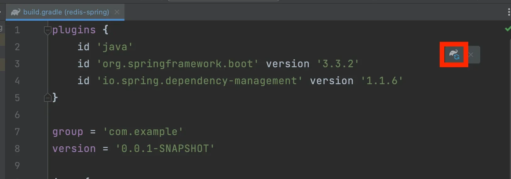
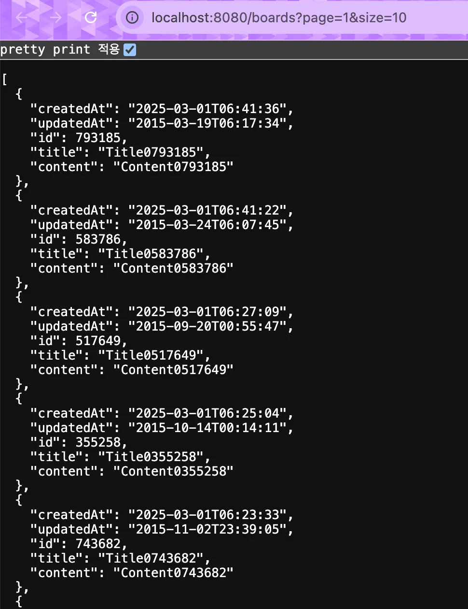

<a id="1c3eda9b0fe181e3add2f6c3e4e53c9c"></a>

## Redis 셋팅 추가 

---

<a id="1c3eda9b0fe181e7a130ee2507c9bc74"></a>

### 1&#46; <strong>Redis 의존성 추가</strong>

<details>
<summary><strong><code>build&#46;gradle</code></strong></summary>

<a id="1c3eda9b0fe18113b5f3c3d066d85614"></a>

```java
dependencies {
  ...
  
  implementation 'org.springframework.boot:spring-boot-starter-data-redis'
}
```



- 의존성 추가 후, gradle 새로고침

<a id="1c3eda9b0fe181cd962cc7ce5ec9af27"></a>

<br>

</details>

<details>
<summary><strong><code>application&#46;yml</code></strong><strong> </strong></summary>

<a id="1c3eda9b0fe18168b424c0caddd992ac"></a>

```java
server:
  port: 8080

spring:
  datasource:
    url: ${SPRING_DATASOURCE_URL}
    username: ${SPRING_DATASOURCE_USERNAME}
    password: ${SPRING_DATASOURCE_PASSWORD}
    driver-class-name: com.mysql.cj.jdbc.Driver
    initialization-mode: always
  jpa:
    hibernate:
      ddl-auto: create
    show-sql: true
    properties:
      hibernate:
        format_sql: true
	data:
	  redis:
	    host: ${SPRING_REDIS_HOST}
	    port: ${SPRING_REDIS_PORT}

  sql:
    init:
      mode: always

logging:
  level:
    org.springframework: INFO
```

</details>

<a id="1c3eda9b0fe1816a9d3ff8a1ccf4e860"></a>

### 2&#46; Redis Config 설정

<details>
<summary><strong>config/</strong><strong><code>RedisConfig</code></strong></summary>

<a id="1c3eda9b0fe1814baa70cc5580c461f6"></a>

```java
@Configuration
public class RedisConfig {
  @Value("${spring.data.redis.host}")
  private String host;

  @Value("${spring.data.redis.port}")
  private int port;

  @Bean
  public LettuceConnectionFactory redisConnectionFactory() {
    // Lettuce라는 라이브러리를 활용해 Redis 연결을 관리하는 객체를 생성하고
    // Redis 서버에 대한 정보(host, port)를 설정한다. 
    return new LettuceConnectionFactory(new RedisStandaloneConfiguration(host, port));
  }
}
```

</details>

<details>
<summary><strong>config/</strong><strong><code>RedisCacheConfig</code></strong></summary>

<a id="1c3eda9b0fe1814eb226cfbf52cb9242"></a>

```java
@Configuration
@EnableCaching // Spring Boot의 캐싱 설정을 활성화
public class RedisCacheConfig {
  @Bean
  public CacheManager boardCacheManager(RedisConnectionFactory redisConnectionFactory) {
    RedisCacheConfiguration redisCacheConfiguration = RedisCacheConfiguration
        .defaultCacheConfig()
	      // Redis에 Key를 저장할 때 String으로 직렬화(변환)해서 저장
        .serializeKeysWith(
            RedisSerializationContext.SerializationPair.fromSerializer(
                new StringRedisSerializer()))
        // Redis에 Value를 저장할 때 Json으로 직렬화(변환)해서 저장
        .serializeValuesWith(
            RedisSerializationContext.SerializationPair.fromSerializer(
                new Jackson2JsonRedisSerializer<Object>(Object.class)
            )
        )
        // 데이터의 만료기간(TTL) 설정
        .entryTtl(Duration.ofMinutes(1L));

    return RedisCacheManager
        .RedisCacheManagerBuilder
        .fromConnectionFactory(redisConnectionFactory)
        .cacheDefaults(redisCacheConfiguration)
        .build();
  }
}
```

</details>

<a id="1c3eda9b0fe181e3ae1dc9b653399ff4"></a>

### 3&#46; <strong>BoardService에 캐싱 로직 추가</strong>

[실습1 - redis 캐싱](https://github.com/gyungsubLee/Redis_prac/commit/e723712394ce7395fb8e275fac41cb86f7d4977b)

<details>
<summary>&#91; 🤬 오류 &#93;  Jackson 라이브러리의 <code>LocalDateTime</code> <strong><u>직렬화/역직렬화</u></strong><strong> 오류</strong></summary>

<a id="1c3eda9b0fe1814f9896cb938e48ed7f"></a>

### 오류 내용

---

<details>
<summary>전체 오류 메세지 </summary>

<a id="1c3eda9b0fe181f1ae27c5498ecb6e3e"></a>

```bash
2025-03-01T06:05:09.193Z ERROR 1 --- [nio-8080-exec-2] o.a.c.c.C.[.[.[/].[dispatcherServlet]    : Servlet.service() for servlet [dispatcherServlet] in context with path [] threw exception [Request processing failed: org.springframework.data.redis.serializer.SerializationException: Could not write JSON: Java 8 date/time type `java.time.LocalDateTime` not supported by default: add Module "com.fasterxml.jackson.datatype:jackson-datatype-jsr310" to enable handling (through reference chain: java.util.Collections$UnmodifiableRandomAccessList[0]->com.example.redis_prac.board.entity.Board["createdAt"])] with root cause

com.fasterxml.jackson.databind.exc.InvalidDefinitionException: Java 8 date/time type `java.time.LocalDateTime` not supported by default: add Module "com.fasterxml.jackson.datatype:jackson-datatype-jsr310" to enable handling (through reference chain: java.util.Collections$UnmodifiableRandomAccessList[0]->com.example.redis_prac.board.entity.Board["createdAt"])
	at com.fasterxml.jackson.databind.exc.InvalidDefinitionException.from(InvalidDefinitionException.java:77) ~[jackson-databind-2.18.2.jar!/:2.18.2]
	at com.fasterxml.jackson.databind.SerializerProvider.reportBadDefinition(SerializerProvider.java:1328) ~[jackson-databind-2.18.2.jar!/:2.18.2]
	at com.fasterxml.jackson.databind.ser.impl.UnsupportedTypeSerializer.serialize(UnsupportedTypeSerializer.java:35) ~[jackson-databind-2.18.2.jar!/:2.18.2]
	at com.fasterxml.jackson.databind.ser.BeanPropertyWriter.serializeAsField(BeanPropertyWriter.java:732) ~[jackson-databind-2.18.2.jar!/:2.18.2]
	at com.fasterxml.jackson.databind.ser.std.BeanSerializerBase.serializeFields(BeanSerializerBase.java:770) ~[jackson-databind-2.18.2.jar!/:2.18.2]
	at com.fasterxml.jackson.databind.ser.BeanSerializer.serialize(BeanSerializer.java:184) ~[jackson-databind-2.18.2.jar!/:2.18.2]
	at com.fasterxml.jackson.databind.ser.impl.IndexedListSerializer.serializeContents(IndexedListSerializer.java:119) ~[jackson-databind-2.18.2.jar!/:2.18.2]
	at com.fasterxml.jackson.databind.ser.impl.IndexedListSerializer.serialize(IndexedListSerializer.java:79) ~[jackson-databind-2.18.2.jar!/:2.18.2]
	at com.fasterxml.jackson.databind.ser.impl.IndexedListSerializer.serialize(IndexedListSerializer.java:18) ~[jackson-databind-2.18.2.jar!/:2.18.2]
	at com.fasterxml.jackson.databind.ser.DefaultSerializerProvider._serialize(DefaultSerializerProvider.java:502) ~[jackson-databind-2.18.2.jar!/:2.18.2]
	at com.fasterxml.jackson.databind.ser.DefaultSerializerProvider.serializeValue(DefaultSerializerProvider.java:341) ~[jackson-databind-2.18.2.jar!/:2.18.2]
	at com.fasterxml.jackson.databind.ObjectMapper._writeValueAndClose(ObjectMapper.java:4811) ~[jackson-databind-2.18.2.jar!/:2.18.2]
	at com.fasterxml.jackson.databind.ObjectMapper.writeValueAsBytes(ObjectMapper.java:4077) ~[jackson-databind-2.18.2.jar!/:2.18.2]
	at org.springframework.data.redis.serializer.Jackson2JsonRedisSerializer.serialize(Jackson2JsonRedisSerializer.java:155) ~[spring-data-redis-3.4.3.jar!/:3.4.3]
	at org.springframework.data.redis.serializer.DefaultRedisElementWriter.write(DefaultRedisElementWriter.java:42) ~[spring-data-redis-3.4.3.jar!/:3.4.3]
	at org.springframework.data.redis.serializer.RedisSerializationContext$SerializationPair.write(RedisSerializationContext.java:292) ~[spring-data-redis-3.4.3.jar!/:3.4.3]
	at org.springframework.data.redis.cache.RedisCache.serializeCacheValue(RedisCache.java:343) ~[spring-data-redis-3.4.3.jar!/:3.4.3]
	at org.springframework.data.redis.cache.RedisCache.put(RedisCache.java:204) ~[spring-data-redis-3.4.3.jar!/:3.4.3]
	at org.springframework.cache.interceptor.AbstractCacheInvoker.doPut(AbstractCacheInvoker.java:164) ~[spring-context-6.2.3.jar!/:6.2.3]
	at org.springframework.cache.interceptor.CacheAspectSupport$CachePutRequest.performCachePut(CacheAspectSupport.java:1051) ~[spring-context-6.2.3.jar!/:6.2.3]
	at org.springframework.cache.interceptor.CacheAspectSupport$CachePutRequest.apply(CacheAspectSupport.java:1036) ~[spring-context-6.2.3.jar!/:6.2.3]
	at org.springframework.cache.interceptor.CacheAspectSupport.evaluate(CacheAspectSupport.java:580) ~[spring-context-6.2.3.jar!/:6.2.3]
	at org.springframework.cache.interceptor.CacheAspectSupport.execute(CacheAspectSupport.java:447) ~[spring-context-6.2.3.jar!/:6.2.3]
	at org.springframework.cache.interceptor.CacheAspectSupport.execute(CacheAspectSupport.java:409) ~[spring-context-6.2.3.jar!/:6.2.3]
	at org.springframework.cache.interceptor.CacheInterceptor.invoke(CacheInterceptor.java:65) ~[spring-context-6.2.3.jar!/:6.2.3]
	at org.springframework.aop.framework.ReflectiveMethodInvocation.proceed(ReflectiveMethodInvocation.java:184) ~[spring-aop-6.2.3.jar!/:6.2.3]
	at org.springframework.aop.framework.CglibAopProxy$DynamicAdvisedInterceptor.intercept(CglibAopProxy.java:727) ~[spring-aop-6.2.3.jar!/:6.2.3]
	at com.example.redis_prac.board.service.BoardService$$SpringCGLIB$$0.getBoards(<generated>) ~[!/:0.0.1-SNAPSHOT]
	at com.example.redis_prac.board.controller.BoardController.getBoards(BoardController.java:25) ~[!/:0.0.1-SNAPSHOT]
	at java.base/jdk.internal.reflect.NativeMethodAccessorImpl.invoke0(Native Method) ~[na:na]
	at java.base/jdk.internal.reflect.NativeMethodAccessorImpl.invoke(NativeMethodAccessorImpl.java:77) ~[na:na]
	at java.base/jdk.internal.reflect.DelegatingMethodAccessorImpl.invoke(DelegatingMethodAccessorImpl.java:43) ~[na:na]
	at java.base/java.lang.reflect.Method.invoke(Method.java:568) ~[na:na]
	at org.springframework.web.method.support.InvocableHandlerMethod.doInvoke(InvocableHandlerMethod.java:257) ~[spring-web-6.2.3.jar!/:6.2.3]
	at org.springframework.web.method.support.InvocableHandlerMethod.invokeForRequest(InvocableHandlerMethod.java:190) ~[spring-web-6.2.3.jar!/:6.2.3]
	at org.springframework.web.servlet.mvc.method.annotation.ServletInvocableHandlerMethod.invokeAndHandle(ServletInvocableHandlerMethod.java:118) ~[spring-webmvc-6.2.3.jar!/:6.2.3]
	at org.springframework.web.servlet.mvc.method.annotation.RequestMappingHandlerAdapter.invokeHandlerMethod(RequestMappingHandlerAdapter.java:986) ~[spring-webmvc-6.2.3.jar!/:6.2.3]
	at org.springframework.web.servlet.mvc.method.annotation.RequestMappingHandlerAdapter.handleInternal(RequestMappingHandlerAdapter.java:891) ~[spring-webmvc-6.2.3.jar!/:6.2.3]
	at org.springframework.web.servlet.mvc.method.AbstractHandlerMethodAdapter.handle(AbstractHandlerMethodAdapter.java:87) ~[spring-webmvc-6.2.3.jar!/:6.2.3]
	at org.springframework.web.servlet.DispatcherServlet.doDispatch(DispatcherServlet.java:1088) ~[spring-webmvc-6.2.3.jar!/:6.2.3]
	at org.springframework.web.servlet.DispatcherServlet.doService(DispatcherServlet.java:978) ~[spring-webmvc-6.2.3.jar!/:6.2.3]
	at org.springframework.web.servlet.FrameworkServlet.processRequest(FrameworkServlet.java:1014) ~[spring-webmvc-6.2.3.jar!/:6.2.3]
	at org.springframework.web.servlet.FrameworkServlet.doGet(FrameworkServlet.java:903) ~[spring-webmvc-6.2.3.jar!/:6.2.3]
	at jakarta.servlet.http.HttpServlet.service(HttpServlet.java:564) ~[tomcat-embed-core-10.1.36.jar!/:na]
	at org.springframework.web.servlet.FrameworkServlet.service(FrameworkServlet.java:885) ~[spring-webmvc-6.2.3.jar!/:6.2.3]
	at jakarta.servlet.http.HttpServlet.service(HttpServlet.java:658) ~[tomcat-embed-core-10.1.36.jar!/:na]
	at org.apache.catalina.core.ApplicationFilterChain.internalDoFilter(ApplicationFilterChain.java:195) ~[tomcat-embed-core-10.1.36.jar!/:na]
	at org.apache.catalina.core.ApplicationFilterChain.doFilter(ApplicationFilterChain.java:140) ~[tomcat-embed-core-10.1.36.jar!/:na]
	at org.apache.tomcat.websocket.server.WsFilter.doFilter(WsFilter.java:51) ~[tomcat-embed-websocket-10.1.36.jar!/:na]
	at org.apache.catalina.core.ApplicationFilterChain.internalDoFilter(ApplicationFilterChain.java:164) ~[tomcat-embed-core-10.1.36.jar!/:na]
	at org.apache.catalina.core.ApplicationFilterChain.doFilter(ApplicationFilterChain.java:140) ~[tomcat-embed-core-10.1.36.jar!/:na]
	at org.springframework.web.filter.RequestContextFilter.doFilterInternal(RequestContextFilter.java:100) ~[spring-web-6.2.3.jar!/:6.2.3]
	at org.springframework.web.filter.OncePerRequestFilter.doFilter(OncePerRequestFilter.java:116) ~[spring-web-6.2.3.jar!/:6.2.3]
	at org.apache.catalina.core.ApplicationFilterChain.internalDoFilter(ApplicationFilterChain.java:164) ~[tomcat-embed-core-10.1.36.jar!/:na]
	at org.apache.catalina.core.ApplicationFilterChain.doFilter(ApplicationFilterChain.java:140) ~[tomcat-embed-core-10.1.36.jar!/:na]
	at org.springframework.web.filter.FormContentFilter.doFilterInternal(FormContentFilter.java:93) ~[spring-web-6.2.3.jar!/:6.2.3]
	at org.springframework.web.filter.OncePerRequestFilter.doFilter(OncePerRequestFilter.java:116) ~[spring-web-6.2.3.jar!/:6.2.3]
	at org.apache.catalina.core.ApplicationFilterChain.internalDoFilter(ApplicationFilterChain.java:164) ~[tomcat-embed-core-10.1.36.jar!/:na]
	at org.apache.catalina.core.ApplicationFilterChain.doFilter(ApplicationFilterChain.java:140) ~[tomcat-embed-core-10.1.36.jar!/:na]
	at org.springframework.web.filter.CharacterEncodingFilter.doFilterInternal(CharacterEncodingFilter.java:201) ~[spring-web-6.2.3.jar!/:6.2.3]
	at org.springframework.web.filter.OncePerRequestFilter.doFilter(OncePerRequestFilter.java:116) ~[spring-web-6.2.3.jar!/:6.2.3]
	at org.apache.catalina.core.ApplicationFilterChain.internalDoFilter(ApplicationFilterChain.java:164) ~[tomcat-embed-core-10.1.36.jar!/:na]
	at org.apache.catalina.core.ApplicationFilterChain.doFilter(ApplicationFilterChain.java:140) ~[tomcat-embed-core-10.1.36.jar!/:na]
	at org.apache.catalina.core.StandardWrapperValve.invoke(StandardWrapperValve.java:167) ~[tomcat-embed-core-10.1.36.jar!/:na]
	at org.apache.catalina.core.StandardContextValve.invoke(StandardContextValve.java:90) ~[tomcat-embed-core-10.1.36.jar!/:na]
	at org.apache.catalina.authenticator.AuthenticatorBase.invoke(AuthenticatorBase.java:483) ~[tomcat-embed-core-10.1.36.jar!/:na]
	at org.apache.catalina.core.StandardHostValve.invoke(StandardHostValve.java:115) ~[tomcat-embed-core-10.1.36.jar!/:na]
	at org.apache.catalina.valves.ErrorReportValve.invoke(ErrorReportValve.java:93) ~[tomcat-embed-core-10.1.36.jar!/:na]
	at org.apache.catalina.core.StandardEngineValve.invoke(StandardEngineValve.java:74) ~[tomcat-embed-core-10.1.36.jar!/:na]
	at org.apache.catalina.connector.CoyoteAdapter.service(CoyoteAdapter.java:344) ~[tomcat-embed-core-10.1.36.jar!/:na]
	at org.apache.coyote.http11.Http11Processor.service(Http11Processor.java:397) ~[tomcat-embed-core-10.1.36.jar!/:na]
	at org.apache.coyote.AbstractProcessorLight.process(AbstractProcessorLight.java:63) ~[tomcat-embed-core-10.1.36.jar!/:na]
	at org.apache.coyote.AbstractProtocol$ConnectionHandler.process(AbstractProtocol.java:905) ~[tomcat-embed-core-10.1.36.jar!/:na]
	at org.apache.tomcat.util.net.NioEndpoint$SocketProcessor.doRun(NioEndpoint.java:1743) ~[tomcat-embed-core-10.1.36.jar!/:na]
	at org.apache.tomcat.util.net.SocketProcessorBase.run(SocketProcessorBase.java:52) ~[tomcat-embed-core-10.1.36.jar!/:na]
	at org.apache.tomcat.util.threads.ThreadPoolExecutor.runWorker(ThreadPoolExecutor.java:1190) ~[tomcat-embed-core-10.1.36.jar!/:na]
	at org.apache.tomcat.util.threads.ThreadPoolExecutor$Worker.run(ThreadPoolExecutor.java:659) ~[tomcat-embed-core-10.1.36.jar!/:na]
	at org.apache.tomcat.util.threads.TaskThread$WrappingRunnable.run(TaskThread.java:63) ~[tomcat-embed-core-10.1.36.jar!/:na]
	at java.base/java.lang.Thread.run(Thread.java:833) ~[na:na]


2025-03-01T06:05:09.193Z ERROR 1 --- [nio-8080-exec-2] o.a.c.c.C.[.[.[/].[dispatcherServlet]    : Servlet.service() for servlet [dispatcherServlet] in context with path [] threw exception [Request processing failed: org.springframework.data.redis.serializer.SerializationException: Could not write JSON: Java 8 date/time type `java.time.LocalDateTime` not supported by default: add Module "com.fasterxml.jackson.datatype:jackson-datatype-jsr310" to enable handling (through reference chain: java.util.Collections$UnmodifiableRandomAccessList[0]->com.example.redis_prac.board.entity.Board["createdAt"])] with root cause
```

</details>

<a id="1c3eda9b0fe181648880c7ae558f674b"></a>

```plaintext
InvalidDefinitionException: Java 8 date/time type java.time.LocalDateTime not supported by default
```

<a id="1c3eda9b0fe181e5861ec65313e0eae4"></a>

해당 오류는 <strong>Jackson 라이브러리가 기본적으로 </strong><strong><u>Java 8 날짜/시간 타입인 LocalDateTime</u></strong><strong>을 </strong><strong>직렬화하거나 역직렬화하는 것을 지원하지 않</strong>기 때문에 발생되었다&#46; 

<a id="1c3eda9b0fe1814f98f2dfc8a8f43a5b"></a>

따라서<strong><u> 날짜/시간 타입의 직렬화/역직렬화 convert 설정을 추가</u></strong>해야 한다&#46;

<a id="1c3eda9b0fe1812682a9f33766845202"></a>

### 해결 

---

> ✏️ 
> 
> <a id="1c3eda9b0fe1819c822dc1d18b68ff43"></a>
> 
> LocalDateTime을 JSON으로 직렬화하기 위해 <code>jackson&#45;datatype&#45;jsr310</code> 모듈 추가 및 ObjectMapper 에 <code>JavaTimeModule</code>을 등록해야 한다&#46; 

<details>
<summary>🧐 <code>Jackson2JsonRedisSerializer</code></summary>

<a id="1c3eda9b0fe18165b3b2dfae700b3e2b"></a>

```java
public class Jackson2JsonRedisSerializer<T> implements RedisSerializer<T> {

	@Deprecated(since = "3.0", forRemoval = true) //
	public static final Charset DEFAULT_CHARSET = StandardCharsets.UTF_8;

	private final JavaType javaType;

	private ObjectMapper mapper;

	private final JacksonObjectReader reader;

	private final JacksonObjectWriter writer;
	

	public Jackson2JsonRedisSerializer(Class<T> type) {
		this(new ObjectMapper(), type);
	}

	public Jackson2JsonRedisSerializer(JavaType javaType) {
		this(new ObjectMapper(), javaType);
	}
	
	// 커스텀한 ObjectMapper로 등록
	public Jackson2JsonRedisSerializer(ObjectMapper mapper, Class<T> type) {

		Assert.notNull(mapper, "ObjectMapper must not be null");
		Assert.notNull(type, "Java type must not be null");

		this.javaType = getJavaType(type);
		this.mapper = mapper;
		this.reader = JacksonObjectReader.create();
		this.writer = JacksonObjectWriter.create();
	}

	public Jackson2JsonRedisSerializer(ObjectMapper mapper, JavaType javaType) {
		this(mapper, javaType, JacksonObjectReader.create(), JacksonObjectWriter.create());
	}

	public Jackson2JsonRedisSerializer(ObjectMapper mapper, JavaType javaType, JacksonObjectReader reader,
			JacksonObjectWriter writer) {

		Assert.notNull(mapper, "ObjectMapper must not be null!");
		Assert.notNull(reader, "Reader must not be null!");
		Assert.notNull(writer, "Writer must not be null!");

		this.mapper = mapper;
		this.reader = reader;
		this.writer = writer;
		this.javaType = javaType;
	}

	@Deprecated(since = "3.0", forRemoval = true)
	public void setObjectMapper(ObjectMapper mapper) {

		Assert.notNull(mapper, "'objectMapper' must not be null");
		this.mapper = mapper;
	}

	@Override
	public byte[] serialize(@Nullable T value) throws SerializationException {

		if (value == null) {
			return SerializationUtils.EMPTY_ARRAY;
		}
		try {
			return this.writer.write(this.mapper, value);
		} catch (Exception ex) {
			throw new SerializationException("Could not write JSON: " + ex.getMessage(), ex);
		}
	}

	@Nullable
	@Override
	@SuppressWarnings("unchecked")
	public T deserialize(@Nullable byte[] bytes) throws SerializationException {

		if (SerializationUtils.isEmpty(bytes)) {
			return null;
		}
		try {
			return (T) this.reader.read(this.mapper, bytes, javaType);
		} catch (Exception ex) {
			throw new SerializationException("Could not read JSON: " + ex.getMessage(), ex);
		}
	}

	protected JavaType getJavaType(Class<?> clazz) {
		return TypeFactory.defaultInstance().constructType(clazz);
	}
}
```

</details>

<details>
<summary> <code>jackson&#45;datatype&#45;jsr310</code> 의존성 추가 </summary>

<a id="1c3eda9b0fe18155842ad014209a0574"></a>

```groovy
dependencies {
    implementation 'com.fasterxml.jackson.datatype:jackson-datatype-jsr310'
}
```

</details>

<details>
<summary>&#91; 코드 &#93; <code>RedisCacheConfig</code></summary>

<a id="1c3eda9b0fe181698e3dde2f6fe93e8c"></a>

```java
@Configuration
@EnableCaching
public class RedisCacheConfig {

    @Bean
    public CacheManager boardCacheManager(RedisConnectionFactory redisConnectionFactory) {

        RedisCacheConfiguration redisCacheConfiguration = RedisCacheConfiguration
                .defaultCacheConfig()
                // Redis에 Key를 저장할 때 String으로 직렬화(변환)해서 저장
                .serializeKeysWith(
                        RedisSerializationContext.SerializationPair.fromSerializer(
                                new StringRedisSerializer()
                        )
                )
                // serializer 적용
                .serializeValuesWith(
                        RedisSerializationContext.SerializationPair.fromSerializer(
                                new Jackson2JsonRedisSerializer<>(objectMapper(), Object.class)
                        )
                )
                // 데이터의 만료기간(TTL) 설정
                .entryTtl(Duration.ofMinutes(1L));

        return RedisCacheManager
                .RedisCacheManagerBuilder
                .fromConnectionFactory(redisConnectionFactory)
                .cacheDefaults(redisCacheConfiguration)
                .build();
    }

    private ObjectMapper objectMapper() {
        ObjectMapper objectMapper = new ObjectMapper();
        objectMapper.registerModule(new JavaTimeModule()); // Java 8 시간 타입 처리
        objectMapper.disable(SerializationFeature.WRITE_DATES_AS_TIMESTAMPS); // ISO-8601 형식으로 날짜 직렬화
        return objectMapper;
    }
}

```

<details>
<summary>1&#46; <code>LocalDateTime</code>을 직렬화 할 수 있는 <code>jackson&#45;datatype&#45;jsr310</code> 모듈의 <code>JavaTimeModule</code> 을 등록한 ObjectMapper 생성한다&#46;</summary>

<a id="1c3eda9b0fe18105acdbcaeb87966ad3"></a>

```java
private ObjectMapper objectMapper() {
    ObjectMapper objectMapper = new ObjectMapper();
    objectMapper.registerModule(new JavaTimeModule()); // Java 8 시간 타입 처리
    objectMapper.disable(SerializationFeature.WRITE_DATES_AS_TIMESTAMPS); // ISO-8601 형식으로 날짜 직렬화
    return objectMapper;
}
```

</details>

<details>
<summary>2&#46; 그리고  redis의 직렬화 컨버터인 <code>Jackson2JsonRedisSerializer</code>  생성자에  해당 ObjectMapper를 인자로 넘겨 등록한다&#46; </summary>

<details>
<summary><code>Jackson2JsonRedisSerializer</code>의 생성자</summary>

<a id="1c3eda9b0fe181f49b6bfa6cbece07e2"></a>

```java
// 커스텀한 ObjectMapper를 Serializer에 등록
public Jackson2JsonRedisSerializer(ObjectMapper mapper, Class<T> type) {

		Assert.notNull(mapper, "ObjectMapper must not be null");
		Assert.notNull(type, "Java type must not be null");
	
		this.javaType = getJavaType(type);
		this.mapper = mapper;
		this.reader = JacksonObjectReader.create();
		this.writer = JacksonObjectWriter.create();
}
```

</details>

<details>
<summary><code>RedisCacheConfig</code> &#45; <code>Jackson2JsonRedisSerializer</code> 설정</summary>

<a id="1c3eda9b0fe1815fb932c29e8a70a7de"></a>

```java
@Bean
public CacheManager boardCacheManager(RedisConnectionFactory redisConnectionFactory) {

    RedisCacheConfiguration redisCacheConfiguration = RedisCacheConfiguration
            .defaultCacheConfig()
            // Redis에 Key를 저장할 때 String으로 직렬화(변환)해서 저장
            .serializeKeysWith(
                    RedisSerializationContext.SerializationPair.fromSerializer(
                            new StringRedisSerializer()
                    )
            )
            // serializer 적용
            .serializeValuesWith(
                    RedisSerializationContext.SerializationPair.fromSerializer(
                            new Jackson2JsonRedisSerializer<>(objectMapper(), Object.class)
                    )
            ) 
```

</details>

</details>

<a id="1c3eda9b0fe18107a5f3deee93799580"></a>

이를 통해 객체 직렬화 시, <code>JavaTimeModule</code>을  사용하여 <code>LocalDataeTime</code>을  정상 처리한다&#46;

</details>

<a id="1c3eda9b0fe181618e92f8f59f3cd7b7"></a>

### 확인

<a id="1c3eda9b0fe1817893bdcc27e16b577d"></a>

```bash
 curl -X GET "http://localhost:8080/boards?page=1&size=10"    
```



- 위와 같이 정상 출력을 확인할 수 있다&#46; 

</details>

<details>
<summary>🧐 <code>&#64;Cacheable</code></summary>

<a id="1c3eda9b0fe181ce97a7ea00c1bb183f"></a>

```java
package org.springframework.cache.annotation;

import java.lang.annotation.Documented;
import java.lang.annotation.ElementType;
import java.lang.annotation.Inherited;
import java.lang.annotation.Retention;
import java.lang.annotation.RetentionPolicy;
import java.lang.annotation.Target;
import java.util.concurrent.Callable;

import org.springframework.aot.hint.annotation.Reflective;
import org.springframework.core.annotation.AliasFor;


@Target({ElementType.TYPE, ElementType.METHOD})
@Retention(RetentionPolicy.RUNTIME)
@Inherited
@Documented
@Reflective
public @interface Cacheable {

		@AliasFor("cacheNames")
		String[] value() default {};
	
		@AliasFor("value")
		String[] cacheNames() default {};
	
		
		String key() default "";
	
		
		String keyGenerator() default "";
	
		
		String cacheManager() default "";
	
		
		String cacheResolver() default "";
	
		
		String condition() default "";
	
		
		String unless() default "";
	
		
		boolean sync() default false;
}
```

</details>

<details>
<summary>&#91; 코드 &#93; <strong>RedisCacheConfig ( 오류 내용 수정 )</strong></summary>

<a id="1c3eda9b0fe18168b822deaa789c1fdb"></a>

```java
@Configuration
@EnableCaching
public class RedisCacheConfig {

    @Bean
    public CacheManager boardCacheManager(RedisConnectionFactory redisConnectionFactory) {

        RedisCacheConfiguration redisCacheConfiguration = RedisCacheConfiguration
                .defaultCacheConfig()
                // Redis에 Key를 저장할 때 String으로 직렬화(변환)해서 저장
                .serializeKeysWith(
                        RedisSerializationContext.SerializationPair.fromSerializer(
                                new StringRedisSerializer()
                        )
                )
                // serializer 적용
                .serializeValuesWith(
                        RedisSerializationContext.SerializationPair.fromSerializer(
                                new Jackson2JsonRedisSerializer<>(objectMapper(), Object.class)
                        )
                )
                // 데이터의 만료기간(TTL) 설정
                .entryTtl(Duration.ofMinutes(1L));

        return RedisCacheManager
                .RedisCacheManagerBuilder
                .fromConnectionFactory(redisConnectionFactory)
                .cacheDefaults(redisCacheConfiguration)
                .build();
    }

    private ObjectMapper objectMapper() {
        ObjectMapper objectMapper = new ObjectMapper();
        objectMapper.registerModule(new JavaTimeModule()); // Java 8 시간 타입 처리
        objectMapper.disable(SerializationFeature.WRITE_DATES_AS_TIMESTAMPS); // ISO-8601 형식으로 날짜 직렬화
        return objectMapper;
    }
}

```

</details>

<details>
<summary>&#91; 코드 &#93; <strong>BoaradService</strong> &#45; 캐싱</summary>

<a id="1c3eda9b0fe181efb9cbea623d0296e4"></a>

```java
@Service
@RequiredArgsConstructor
public class BoardService {

    private final BoardRepository boardRepository;

    // Cache Aside 전략
    @Cacheable(cacheNames = "getBoards", key="'boards:page:' + #page + ':size:' + #size", cacheManager = "boardCacheManager")
    public List<Board> getBoards(int page, int size) {
        Pageable pageable = PageRequest.of(page - 1, size);
        Page<Board> pageOfBoards = boardRepository.findAllByOrderByCreatedAtDesc(pageable);
        return pageOfBoards.getContent();
    }
}
```

</details>
