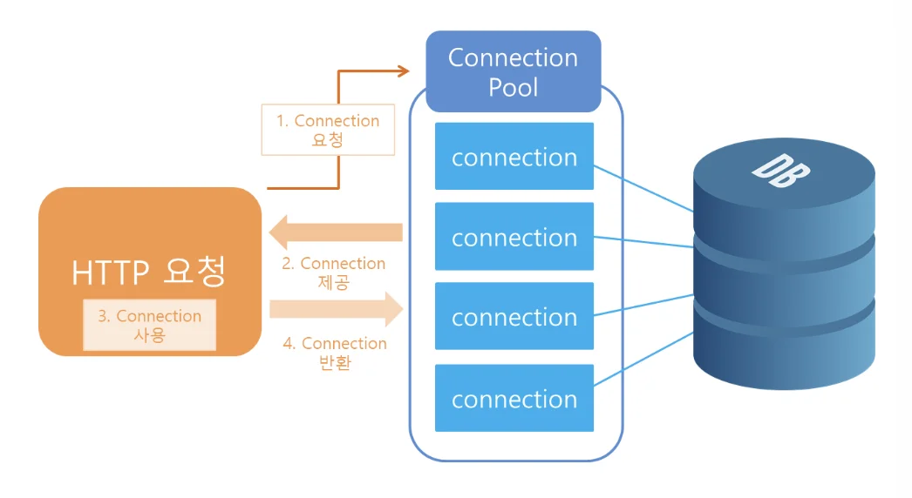

<a id="1c3eda9b0fe1813d9433c87be740277c"></a>

<strong>애플리케이션 시작 시점에 필요한 연결(</strong><strong>데이터베이스 커넥션 풀, 네트워크 소캣</strong>)<strong>을 미리 해두고</strong>, <strong>애플리케이션 종료 시점에  연결을 모두 종료</strong>하는 작업을 진행하려면, 객체의 초기화 종료 작업이 필요하다&#46;

<details>
<summary><a href="https://linked2ev.github.io/spring/2019/08/14/Spring-3-%EC%BB%A4%EB%84%A5%EC%85%98-%ED%92%80%EC%9D%B4%EB%9E%80/">커넥션 풀( Connection pool, DBCP) 이란?</a></summary>

<a id="1c3eda9b0fe181b989f0ed9c5b667009"></a>

웹 컨테이너(WAS)가 실행되면서 DB와 미리 connection(연결)을 해놓은 객체들을 pool에 저장해두었다가

<a id="1c3eda9b0fe181b0a877d950842c951d"></a>

클라이언트 요청이 오면 connection을 빌려주고, 처리가 끝나면 다시 connection을 반납받아 pool에 저장하는 방식을 말한다&#46; 



<a id="1c3eda9b0fe181489442d6619a0b8a31"></a>

→ 자세한 내용은 <a href="https://beautiful-college-c84.notion.site/1f92496e43424b8da720603caabb5a28">페이지</a> 참조

</details>

<details>
<summary><strong>왜 애플리케이션 시작 시점에 DB를 미리 연결하는가? </strong></summary>

> 애플리케이션은  보통 관계형 데이터베이스를 사용<br> → 애플리케이션 서버가 올라올 때, 데이터베이스 랑 연결을 미리 맺어놓는다&#46; <br>🧐 why?)<br>TCP/IP 핸드쉐이킹하고  연결하는데 오래 걸림(요즘에는 빠르다고 함&#46;&#46;? 어케 확인)<br>→  애플리케이션 서버 와 DB 의 커넥션을 미리 해놓는다&#46;

</details>

<details>
<summary><a href="https://jeongkyun-it.tistory.com/180">🧐 </a><strong><a href="https://jeongkyun-it.tistory.com/180">TCP와 3&#45;Way, 4&#45;Way Handshake란?</a></strong></summary>


</details>

<a id="1c3eda9b0fe181398a5ed0f14a368b18"></a>

## 연결 및 분리 시나리오

> 간단하게 외부 네트워크에 미리 연결하는 객체 생성    (실제로 연결하는 것은 아니고 단순 문자만 출력)<br>→ <code>NetworkClient</code>
> 
> - 애플리케이션 시작 시점에 <code>connect(</code>)를 호출하여 연결
> 
> - 애플리케이션이 종료되면 <code>disConnect()</code> 를 호출해서 연결을 끊음

<details>
<summary>가상 네트워크 연결(단순 문자 출력) 및 분리 시나리오</summary>

> ⚠️ <strong><code>ac&#46;close()</code></strong><strong> 사용 시 </strong>
> 
> <a id="1c3eda9b0fe18115a76afed52d31719e"></a>
> 
> <code>close()</code>는 기본 <code>ApplicationContext</code>에서 제공해주지 않는다&#46; 
> 
> <a id="1c3eda9b0fe181ab9648cfad5a799d36"></a>
> 
> 따라서 <code>AnnotationConfigApplicationContext</code>, <code>ConfigurableApplicationContext</code>
> 
> <a id="1c3eda9b0fe18198b1f4c5541eecec54"></a>
> 
> 둘 중 하나 사용하여 불러온다&#46;  
> 
> > <code>ConfigurableApplicationContext</code>은 <code>AnnotationConfigApplicationContext</code> 의 상위(부모) 인터페이스이다&#46; 따라서 타입으로 선언될 수 있다&#46; 

<a id="1c3eda9b0fe18185a2f1dfc1a419878c"></a>

```java
package hello.core.lifecycle;

public class NetworkClient {
    private String url;

    public NetworkClient() {
        System.out.println("생성자 호출, url = " + url);
        connect();
        call("초기화 연결 메세지");
    }

    public void setUrl(String url) {
        this.url = url;
    }

    // 서비스 시작 시 호출
    public void connect() {
        System.out.println("connect: " + url);
    }

    public void call(String message) {
        System.out.println("call = " + url + " message = " + message);
    }

		//서비스 종료시 호출
		public void disconnect() {
         System.out.println("close: " + url);
    }
}
```

</details>

<details>
<summary>스프링 환결 설정 및 실행(테스트)</summary>

<a id="1c3eda9b0fe18113bec3de0a4e4c81b4"></a>

```java
package hello.core.lifecycle;

import org.junit.jupiter.api.Test;
import org.springframework.context.annotation.AnnotationConfigApplicationContext;
import org.springframework.context.annotation.Bean;
import org.springframework.context.annotation.Configuration;

public class BeanLifeCycleTest {

    @Test
    public void LifeCycleTest() {
        AnnotationConfigApplicationContext ac = new AnnotationConfigApplicationContext(LifeCycleConfig.class);
        NetworkClient client = ac.getBean(NetworkClient.class);
        ac.close(); //스프링 컨테이너를 종료
    }

    @Configuration
    static class LifeCycleConfig {

        @Bean
        public NetworkClient networkClient() {
            NetworkClient networkClient = new NetworkClient();
            networkClient.setUrl("http://hello-spring.dev");
            return networkClient;
        }
    }
}
```

</details>

<details>
<summary>실행 결과</summary>

<a id="1c3eda9b0fe181bdbaf5f44eabaecdd3"></a>

```plaintext
생성자 호출, url = null 
connect: null
call: null message = 초기화 연결 메시지
```

</details>

<a id="1c3eda9b0fe181189366e2b48ed9164b"></a>

스프링 빈은 객체를 생성하고, 의존관계 주입이 다 끝난 다음에야 필요한 데이터를 사용할 수 있다&#46; <br>따라서 초기화 작업은 의존관계 주입이 모두 완료된 후, 호출되어야 한다&#46; <br>그렇다면  선행 작업(의존관계 주입)이 완료된 시점을 어떻게 알 수가 있을까?<br>⇒ <br>스프링은 선행 작업(의존관계 주입)이 끝나면 알려주는 콜백 메서드를 제공한다&#46;

<a id="1c3eda9b0fe181079389fdd5605521ee"></a>

또한 스프링은 스프링 컨테이너가 종료되기 직접에 소멸 콜백을 준다&#46; 따라서 안전하게 종료 작업도 진행할 수 있다&#46;

- 스프링 빈의 이벤트 라이프사이클

> 스프링 컨테이너 생성 → 스프링 빈 생성 → 의존관계 주입 → 초기화 콜백 → 사용 → 소멸전 콜백 → 스프링 종료

- 생명주기 콜백

<a id="1c3eda9b0fe18140a79ed76d008e99d0"></a>

스프링은 다양한 방식으로 생명주기 콜백을 지원한다&#46;

> <strong>초기화 콜백</strong>&#58; 빈이 생성되고, 빈의 의존관계 주입이 완료된 후 호출<br><strong>소멸전 콜백</strong>&#58; 빈이 소멸되기 직전에 호출

> ⚠️ <strong>객체의 생성과 초기화 분리<br></strong>생성자는 필수 정보(파라미터)를 받고, 메모리를 할당해서 객체를 생성하는 책임을 가진다&#46;<br>반면에 초기화는 생성된 값들을 활용한 외부 커넥션을 연결 등 무거운 동작을 수행한다&#46;<br>따라서 생성자 안에서 무거운 초기화 작업을 함께 하는 것보다는 객체를 생성하는 부분과 초기화하는 부분을 명확하게 나누는 것이 유지보수 관점에서 좋다&#46;<br><br>(물론 초기화 작업이 내부 값들만 약간 변경하는 정도로 가벼운 동작인 경우, 한번에 다 처리하는 것이 나을 수 있다&#46;)<strong><br></strong>

> ⚠️ <strong>빈들의 스코프와 소멸 콜백</strong><br>스프링 컨테이너가 종료될 때, 싱글톤 빈들은 함께 종료된다&#46; 따라서  스프링 컨테이너가 종료 되기 직전에 소멸전 콜백이 일어난다&#46;<br>싱글톤 처럼 컨테이너의 시작과 종료까지 생존하는 빈 도 있지만, 생명주기가 짧은 빈들도 있는데 이 빈들은 컨테이너와 무관하게 해당 빈이 종료되기 직전에 소멸전 콜백이 일어난다&#46; <br>→ 자세한 내용은 스코프에서 설명

<a id="1c3eda9b0fe1817a837ac90b45bb91c3"></a>

### 스프링이 지원하는 빈 생명주기 콜백

<a id="1c3eda9b0fe1816c82d0ff48068ed023"></a>

스프링은 크게 3가지 방법으로 빈 생명주기 콜백을 지원한다&#46;

- 인터페이스(InitializingBean, DisposableBean) 

- 설정 정보에 초기화 메서드, 종료 메서드 지정 

- <strong>&#64;PostConstruct, &#64;PreDestroy 애노테이션 지원</strong>

<a id="1c3eda9b0fe181ec9d7beb4c1673f265"></a>

다음 챕터부터 차례대로 설명
