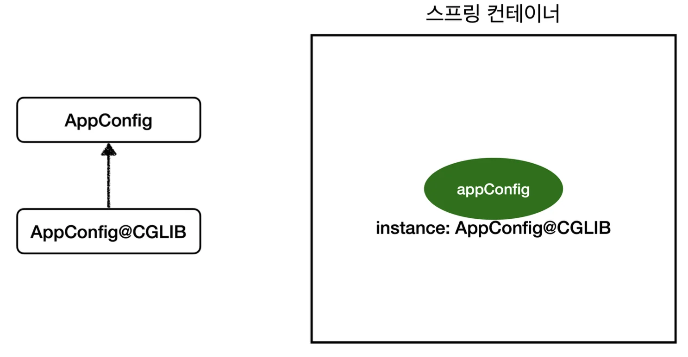

<a id="1c3eda9b0fe18101be4fc718753fd377"></a>

스프링 컨테이너는 싱글톤 레지스트리 이다&#46; 따라서 스프링 빈이 싱글톤이 되도록 보장해주어야 한다&#46; <br>그런데 스프링이 자바 코드까지는 처리하지 못한다&#46; 따라서 이를 <strong><code>바이트코드 조작 라이브러리(CGLIB)</code></strong>를 사용하여 처리한다&#46;

<details>
<summary>🧐 싱글톤 레지스트리?</summary>


</details>

> 이전(5&#46;5) &#91; AppConfig 호출 검증 &#93;에서 <code>System&#46;out&#46;println(&#34;call AppConfig&#46;orderService&#34;);</code> 가 3번 출력이 아닌 1번 출력 처리됨<br>⇒  <strong><code>바이트코드 조작 라이브러리(CGLIB)</code></strong>를 사용하여 한번만 호출되게 처리함&#46; 

<a id="1c3eda9b0fe18156bdf1ee24176bb13e"></a>

## <code>AppConfig</code>를 스프링 빈으로 조회, 클래스 정보 출력

---

<a id="1c3eda9b0fe181bebb13f7d0e4ec5738"></a>

```java
@Test
void configurationDeep() {
		ApplicationContext ac = new AnnotationConfigApplicationContext(AppConfig.class);
		
		//AppConfig도 스프링 빈으로 등록된다.
		AppConfig bean = ac.getBean(AppConfig.class);

		System.out.println("bean = " + bean.getClass());
		//출력: bean = class hello.core.AppConfig$$EnhancerBySpringCGLIB$$bd479d70 
}
```

> <strong>• </strong><code>AnnotationConfigApplicationContext</code> 에 파라미터로 넘긴 값은 스프링 빈으로 등록됨<br>     →  <code>AppConfig</code> = 스프링 빈<br><br><strong>•</strong> <code>AppConfig</code> 스프링 빈을 조회,  클래스 정보 출력
> 
> <a id="1c3eda9b0fe1811e9d62cdfc17dfc29d"></a>
> 
> ```plaintext
> bean = class hello.core.AppConfig$$EnhancerBySpringCGLIB$$bd479d70
> ```

<a id="1c3eda9b0fe181e2a6a3d9468b6ceae1"></a>

## <code>CGLIB</code>로 생성된 또다른 AppConfig (<code>AppConfig&#64;CGLIB</code>)

---

> <code>&#64;Configuration</code> 을 명시한 <strong>AppConfig&#46;class</strong> 이다&#46;

<a id="1c3eda9b0fe181babd0cff5bfb82d5ec"></a>

<code>AppConfig</code> 스프링 빈을 조회 시, 순수한 클래스라면 <code>class hello&#46;core&#46;AppConfig</code> 이와 같이 출력되어야 했으나,

<a id="1c3eda9b0fe18131aef5d417d2a4c907"></a>

위 출력 정보를 보면 <code>xxxCGLIB</code> 가 붙으면서 상당히 복잡해진 것 알수 있다&#46; 



<a id="1c3eda9b0fe181dea4afc6984ae6b846"></a>

이는, 스프링이 <u><code>CGLIB 라는 바이트코드 조작 라이브러리</code></u><u>를 통해</u>, <strong>AppConfig 클래스를 상속받는 임의의 다른 클래스</strong>(<code>AppConfig&#64;CGLIB</code>) <strong>를 만들고 빈으로 등록하여 사용</strong>한 것이기 때문이다&#46;

<a id="1c3eda9b0fe1814e8550eac0f6f7539e"></a>

그리고 이를 통해, <strong>싱글톤이 보장</strong>되도록 한다&#46; 

<details>
<summary><strong>AppConfig&#64;CGLIB 예상 코드</strong></summary>

> 실제로는 CGLIB의 내부 기술을 사용하는데 매우 복잡함

<a id="1c3eda9b0fe181a1acb4e61afbe2aeb9"></a>

```java
@Bean
public MemberRepository memberRepository() {
    if (memoryMemberRepository가 이미 스프링 컨테이너에 등록되어 있으면?) { 
				return 스프링 컨테이너에서 찾아서 반환;
    } 

		else { //스프링 컨테이너에 없으면
        기존 로직을 호출해서 MemoryMemberRepository를 생성하고 스프링 컨테이너에 등록 
				return 반환
    }
}
```

> • <code>&#64;Bean</code> 이 붙은 메서드마다 이미 스프링 빈이 존재하면 존재하는 빈 반환<br>•  스프링 빈이 없으면 생성해서 스프링 빈으로 등록하고 반환<br>  하는 코드가 동적으로 만들어짐   <br>      → 이를 통해, 싱글톤 보장

</details>

<a id="1c3eda9b0fe181418b5cfd87a1d06f86"></a>

## <code>&#64;Configuration</code>을 적용하지 않고, <code>&#64;Bean</code> 만 적용 시

---

<a id="1c3eda9b0fe18151ba1eeba792647940"></a>

```java
//@Configuration 삭제 
public class AppConfig {
		.  .  .
}
```

- <strong>AppConfig 출력</strong>
    > AppConfig가 <code>CGLIB</code> 기술 없이 순수한 AppConfig로 스프링 빈에 등록된 것을 확인
    > 
    > <a id="1c3eda9b0fe181528552d677c73fedca"></a>
    > 
    > ```java
    > bean = class hello.core.AppConfig
    > ```

- <code>System&#46;out&#46;println(&#34;call AppConfig&#46;orderService&#34;);</code>   출력  → 3번 출력됨
    > 출력 결과를 통해서 <code>MemberRepository</code>가 총 3번 호출된 것을 알 수 있다&#46;<br>( 1번은 &#64;Bean에 의해 스프링 컨테이 너에 등록하기 위해서이고, 2번은 각각 <code>memberRepository()</code> 를 호출하면서 발생된다&#46;)

    <a id="1c3eda9b0fe1812eb7f4decdd6eeb90e"></a>

    ```plaintext
    call AppConfig.memberService
    call AppConfig.memberRepository
    call AppConfig.orderService
    call AppConfig.memberRepository
    call AppConfig.memberRepository
    ```

- <strong>인스턴스가 같은지 테스트 결과 </strong>
    > <strong>각각 다 다른 MemoryMemberRepository 인스턴스</strong>를 가 지고 있음

    <a id="1c3eda9b0fe1819888c9e628958a0a5b"></a>

    ```plaintext
    memberService -> memberRepository = hello.core.member.MemoryMemberRepository@6239aba6
    orderService -> memberRepository  = hello.core.member.MemoryMemberRepository@3e6104fc
    memberRepository = hello.core.member.MemoryMemberRepository@12359a82
    ```

<a id="1c3eda9b0fe181049bb7ed7fbe9c54b8"></a>

## 정리

---

<a id="1c3eda9b0fe18193a0bee0c00f1c4425"></a>

<strong><code>&#64;Configuration</code></strong>을 사용한 AppConfig는 <u><code>바이트코드 조작 라이브러리(CGLIB)</code></u>를 사용해, <code>AppConfig&#64;CGLIB</code>  생성하여 이를 통해, 빈의 싱글톤을 보장한다&#46;

<a id="1c3eda9b0fe181e6b17febde541ae7e9"></a>

<strong><code>&#64;Configuration</code></strong><strong> </strong>없이<strong>, </strong><code>&#64;Bean</code> 만 사용해도 스프링 빈으로 등록되지만, 싱글톤을 보장하지 않는다&#46;

<a id="1c3eda9b0fe181bd96c6ceec896e77bf"></a>

   따라서 구성 정보(AppConfig)에는 항상 <code>&#64;Configuration</code> 명시해야 한다&#46;
