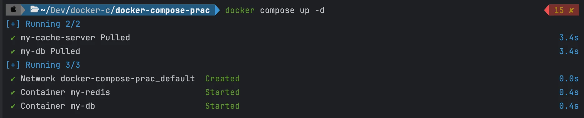
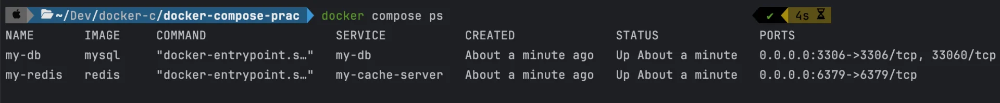
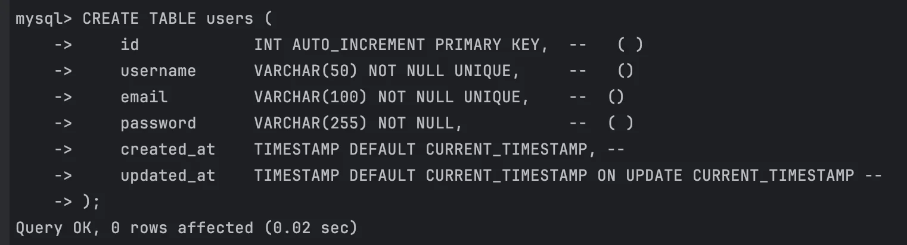
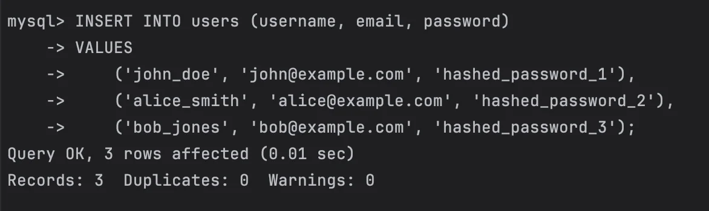
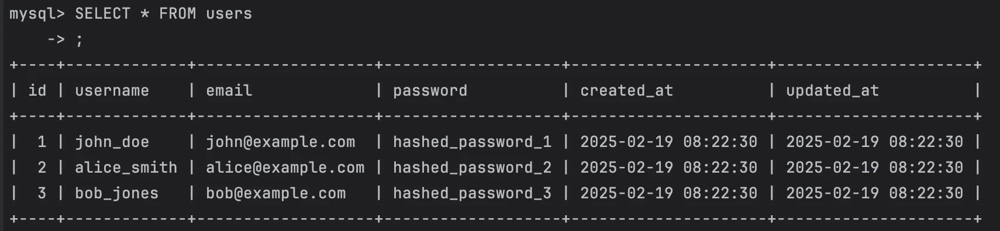
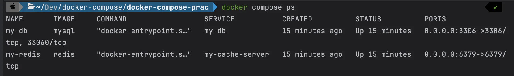
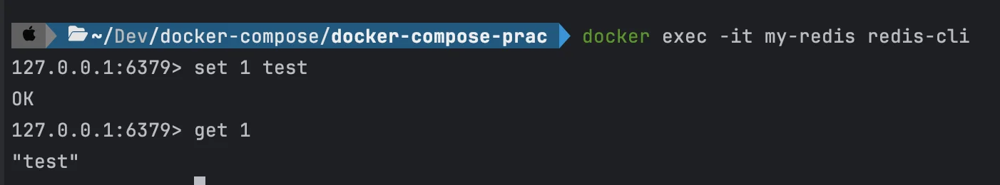

<a id="1c3eda9b0fe1818ea633ca5450cc7148"></a>

## &#91; 실습 &#93; MySQL, Redis 

---

<details>
<summary>1&#46; compose 파일 작성</summary>

- compose&#46;yml
    <a id="1c3eda9b0fe1817080afe0ea28c20606"></a>

    ```yaml
    services:
      my-db:
        container_name: my-db
        image: mysql
        environment:
          MYSQL_ROOT_PASSWORD: pwd1234
        volumes:
          - ~/Develop/docker-mysql/mysql_data:/var/lib/mysql
        ports:
          - 3306:3306

      my-cache-server:
        container_name: my-redis
        image: redis
        ports:
          - 6379:6379
    ```

</details>

<details>
<summary>2&#46; compose 파일 실행</summary>

<a id="1c3eda9b0fe181ec99a8c841eea50be4"></a>

```bash
docker compose up -d 
```



</details>

<details>
<summary>3&#46; 실행 확인</summary>

<a id="1c3eda9b0fe18161884ad6b701aff0d0"></a>

```bash
docker compose ps 
```



</details>

<details>
<summary>4&#46; 내부 컨테이너 접속</summary>

<details>
<summary>mysql</summary>

- mysql 접속
    <a id="1c3eda9b0fe1815b9d61fbcd8a192b3a"></a>

    ```bash
    # mysql 컨테이너 내부 bash 접속
    docker exec -it my-db bash 

    # mysql cli 접속
    mysql -u root -p
    	# password 입력
    ```

- DB 생성 및 테이블, 데이터 삽입
    <a id="1c3eda9b0fe181f1a161c71931eef521"></a>

    ```bash
    # DB 생성
    create database [DB명];

    # DB 생성 확인
    show databases;

    # 생성한 DB로 이동
    use [DB명] 

    # 테이블 생성
    create table [테이블명](
    		[필드 1 ... ],
    		[필드 2 ... ],
    		 . . .
    );

    # 테이블 생성 확인
    show tables

    # 데이터 삽입
    INSERT INTO [테이블명] (필드1, 필드2, ...)
    VALUES
    	('data1.1', 'date1.2', ...),
    	('data2.1', 'date2.2', ...),
      ('data3.1', 'date3.2', ...);
      
    # 테이블 데이터 확인
    SELECT * FROM [테이블명]
    ```

    <details>
    <summary>ex) users 테이블 생성 및 데이터 삽입 </summary>

    <a id="1c3eda9b0fe1817ba278cc9f1327ed18"></a>

    ```bash
    # DB 생성
    create database test;

    # DB 생성 확인
    show databases;

    # 생성한 DB로 이동
    use test; 

    # 테이블 생성
    CREATE TABLE users (
        id            INT AUTO_INCREMENT PRIMARY KEY,  -- 기본 키 (자동 증가)
        username      VARCHAR(50) NOT NULL UNIQUE,     -- 사용자 이름 (고유)
        email         VARCHAR(100) NOT NULL UNIQUE,    -- 이메일 (고유)
        password      VARCHAR(255) NOT NULL,           -- 비밀번호 (암호화 필요)
        created_at    TIMESTAMP DEFAULT CURRENT_TIMESTAMP, -- 생성 일자
        updated_at    TIMESTAMP DEFAULT CURRENT_TIMESTAMP ON UPDATE CURRENT_TIMESTAMP -- 업데이트 일자
    );

    # 테이블 생성 확인
    show tables

    # 데이터 삽입
    INSERT INTO users (username, email, password)
    VALUES 
        ('john_doe', 'john@example.com', 'hashed_password_1'),
        ('alice_smith', 'alice@example.com', 'hashed_password_2'),
        ('bob_jones', 'bob@example.com', 'hashed_password_3');
      
    # 테이블 데이터 확인
    SELECT * FROM users;
    ```

    

    

    

    </details>

</details>

<details>
<summary>redis</summary>

<a id="1c3eda9b0fe1813e83dcdd014591f35f"></a>

```bash
# 실행 중인 compose 컨테이너 확인
docker compose ps

# 컨테이너 내부 redis-cli 접속
docker exec -it my-redis redis-cli

# redis 데이터 저장
set 1 test

# 확인
get 1
```





</details>

</details>

<details>
<summary>5&#46; <strong>compose로 실행된 컨테이너 삭제</strong></summary>

<a id="1c3eda9b0fe18133a42bf7caad1901b5"></a>

```bash
docker compose down
```

</details>
