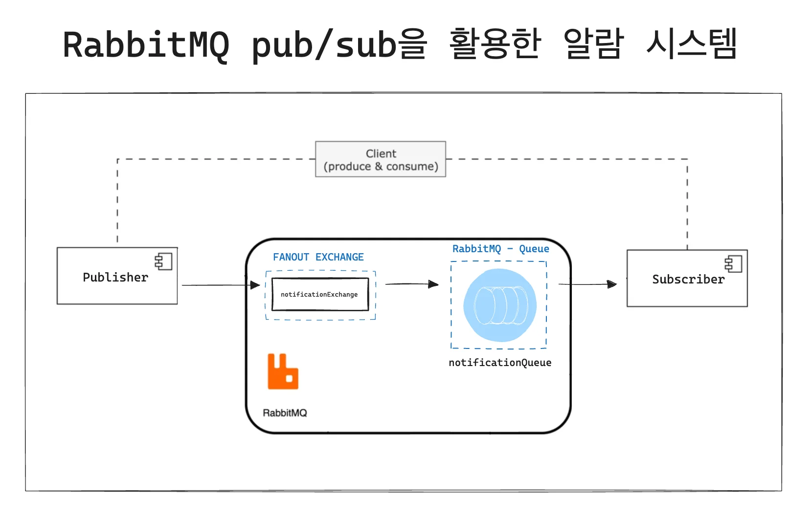
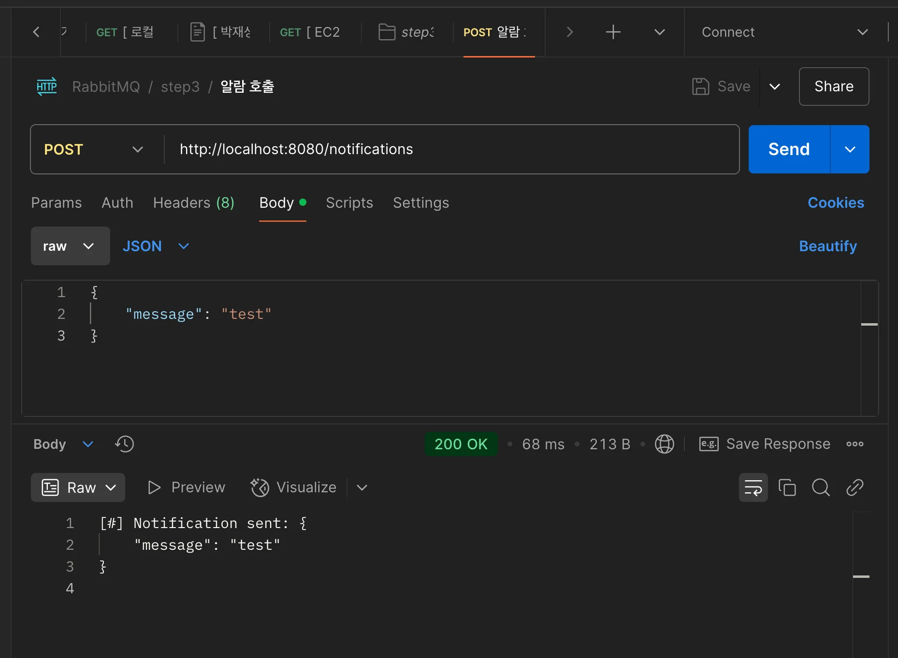
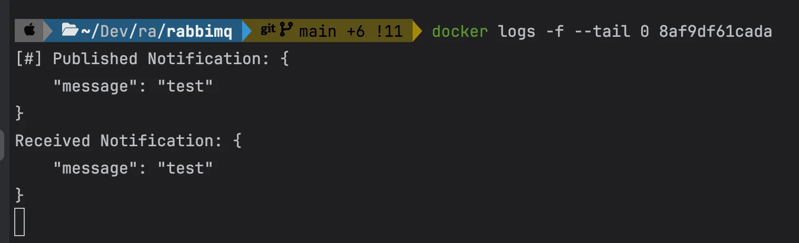
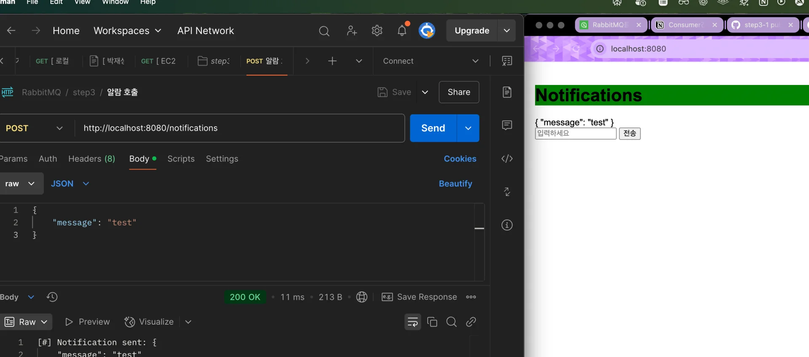
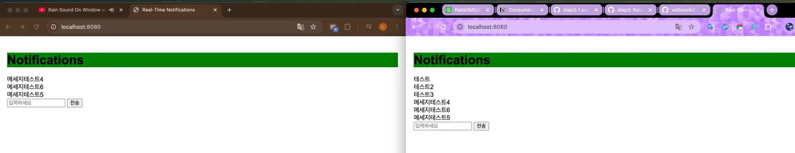

<a id="1c3eda9b0fe1810a8e81c22f1b73c43b"></a>

## Pub&#45;Sub 모델을 이용한 실시간 알림 

---



- <code>FANOUT EXCHANGE</code> 사용하기 때문에, <u><code>Routing Key</code></u><u>없</u>이 해당 큐에 바로 메세지를 보낸다&#46; 
    - 구독된 모든 클라이언트에게 브로드캐스트를 한다&#46;

<a id="1c3eda9b0fe1813dabb6d2297cb93461"></a>

### 코드 

[step3: RabbitMQ pub/sub 모델](https://github.com/gyungsubLee/RabbitMQ_prac/commit/dfe574de62f0be4f14f4b0080e9e02a7ba99c0fc)

<details>
<summary><code>config</code> &#45;  RabbitMQConfig, WebsocketConfig</summary>

<details>
<summary>RabbitMQConfig</summary>

<a id="1c3eda9b0fe181c7a052c1a4d31deb4a"></a>

```java
package com.prac.rabbimq.step3.config;

import org.springframework.amqp.core.Binding;
import org.springframework.amqp.core.BindingBuilder;
import org.springframework.amqp.core.FanoutExchange;
import org.springframework.amqp.core.Queue;
import org.springframework.context.annotation.Bean;
import org.springframework.context.annotation.Configuration;

@Configuration
public class RabbitMQConfig {

    // 큐 이름,
    public static final String QUEUE_NAME = "notificationQueue";
    public static final String FANOUT_EXCHANGE = "notificationExchange";

    @Bean
    public Queue notificationQueue() {
        return new Queue(QUEUE_NAME, false);
    }

    @Bean
    public FanoutExchange fanoutExchange() {
        // 메시지를 수신하면 연결된 모든 큐로 브로드캐스트
        return new FanoutExchange(FANOUT_EXCHANGE);
    }

    @Bean
    public Binding bindNotification(Queue notificationQueue, FanoutExchange fanoutExchange) {
        return BindingBuilder.bind(notificationQueue).to(fanoutExchange);
    }
}
```

</details>

<details>
<summary>WebsocketConfig</summary>

<a id="1c3eda9b0fe181f2b34de36eb206c666"></a>

```java
package com.prac.rabbimq.step3.config;

import org.springframework.context.annotation.Configuration;
import org.springframework.messaging.simp.config.MessageBrokerRegistry;
import org.springframework.web.socket.config.annotation.EnableWebSocketMessageBroker;
import org.springframework.web.socket.config.annotation.StompEndpointRegistry;
import org.springframework.web.socket.config.annotation.WebSocketMessageBrokerConfigurer;

@Configuration
@EnableWebSocketMessageBroker
public class WebsocketConfig implements WebSocketMessageBrokerConfigurer {

    @Override
    public void configureMessageBroker(MessageBrokerRegistry registry) {
        registry.enableSimpleBroker("/sub");  // 클라이언트 구독 경로
        registry.setApplicationDestinationPrefixes("/pub");  // 메세지 발행 prefix
    }

    @Override
    public void registerStompEndpoints(StompEndpointRegistry registry) {
        registry.addEndpoint("/ws") // Websocket 연결 엔드포인트
                .setAllowedOriginPatterns("*")
                .withSockJS();
    }
}
```

</details>

</details>

<details>
<summary><code>controller</code> &#45; NotificationController, StompController</summary>

<details>
<summary>NotificationController</summary>

<a id="1c3eda9b0fe1814cb5a9d9d92b16eb71"></a>

```java
package com.prac.rabbimq.step3.controller;

import com.prac.rabbimq.step3.NotificationPublisher;
import org.springframework.web.bind.annotation.PostMapping;
import org.springframework.web.bind.annotation.RequestBody;
import org.springframework.web.bind.annotation.RequestMapping;
import org.springframework.web.bind.annotation.RestController;

@RestController
@RequestMapping("/notifications")
public class NotificationController {

    private final NotificationPublisher publisher;

    public NotificationController(NotificationPublisher publisher) {
        this.publisher = publisher;
    }

    @PostMapping
    public String sendNotification(@RequestBody String message) {
        publisher.publish(message);
        return "[#] Notification sent: " + message + "\n";
    }
}
```

</details>

<details>
<summary>StompController</summary>

<a id="1c3eda9b0fe18157a461f2e5706a35c6"></a>

```java
package com.prac.rabbimq.step3.controller;

import com.prac.rabbimq.step3.NotificationMessage;
import org.springframework.messaging.handler.annotation.MessageMapping;
import org.springframework.messaging.simp.SimpMessagingTemplate;
import org.springframework.stereotype.Controller;

@Controller
public class StompController {

    private final SimpMessagingTemplate messagingTemplate;

    public StompController(SimpMessagingTemplate messagingTemplate) {
        this.messagingTemplate = messagingTemplate;
    }

    @MessageMapping("/send")
    public void sendMessage(NotificationMessage notificationMessage) {
        // 수신된 메세지 브로드캐스팅
        String message = notificationMessage.getMessage();

        System.out.println("[#] message = " + message);
        // 클라이언트에 메시지 브로드캐스트
        messagingTemplate.convertAndSend("/sub/notifications", message);
    }
}

```

</details>

</details>

<details>
<summary><code>dto</code>&#58; NotificationMessage</summary>

<details>
<summary> 🧐 왜 기본 생성자와 setter가 필수적으로 필요한가?</summary>


</details>

> ✏️ 
> 
> <a id="1c3eda9b0fe1819b9f8ed46fac943e7b"></a>
> 
> 간단하게 동작 확인을 위한 프로젝트이기 때문에, dto, entity를 구분하지 않고 진행

<a id="1c3eda9b0fe181559184fdc1a689a76d"></a>

```java
package com.prac.rabbimq.step3;

public class NotificationMessage {

    private String message;

    // 기본 생성자 (필수)
    public NotificationMessage() {
    }

    // 선택
    public NotificationMessage(String message) {
        this.message = message;
    }

    public String getMessage() {
        return message;
    }

    // 필수
    public void setMessage(String message) {
        this.message = message;
    }
}
```

</details>

<details>
<summary><code>publisher</code>&#58; NotificationPublisher</summary>

<a id="1c3eda9b0fe181ed81cbd30853717ff3"></a>

```java
package com.prac.rabbimq.step3;

import com.prac.rabbimq.step3.config.RabbitMQConfig;
import org.springframework.amqp.rabbit.core.RabbitTemplate;
import org.springframework.stereotype.Component;

@Component
public class NotificationPublisher {

    private final RabbitTemplate rabbitTemplate;

    public NotificationPublisher(RabbitTemplate rabbitTemplate) {
        this.rabbitTemplate = rabbitTemplate;
    }

    public void publish(String message) {
        // Fanout에서 routing key는 무시됨
        rabbitTemplate.convertAndSend(RabbitMQConfig.FANOUT_EXCHANGE, "", message); // args: exchange, routing_key, message
        System.out.println("[#] Published Notification: " + message);
    }
}
```

</details>

<details>
<summary><code>subscriber</code>&#58; NotificationSubscriber</summary>

<a id="1c3eda9b0fe18130b7f0f655a4f3689f"></a>

```java
package com.prac.rabbimq.step3;

import com.prac.rabbimq.step3.config.RabbitMQConfig;
import org.springframework.amqp.rabbit.annotation.RabbitListener;
import org.springframework.messaging.simp.SimpMessagingTemplate;
import org.springframework.stereotype.Component;

@Component
public class NotificationSubscriber {

    public static final String CLIENT_URL = "/sub/notifications";

    // WebSocket으로 메세지를 전달하기 위한 Spring 템플릿 클래스
    private final SimpMessagingTemplate simpMessagingTemplate;

    public NotificationSubscriber(SimpMessagingTemplate simpMessagingTemplate) {
        this.simpMessagingTemplate = simpMessagingTemplate;
    }

    // RabbitMQ Queue 에서 메세지 수신
    @RabbitListener(queues = RabbitMQConfig.QUEUE_NAME)
    public void subscriber(String message) {

        // @RabbitListener를 사용하지 않으면 아래와 같이 직접 큐에서 메세지를 받아와 convert 해서 사용해야 한다.
            // String message = (String) rabbitTemplate.receiveAndConvert(RabbitMQConfig.QUEUE_NAME);

        System.out.println("Received Notification: " + message);

        // 클라이언트의 구독 엔드포인트로 메세지 전송
        simpMessagingTemplate.convertAndSend(CLIENT_URL, message); // 클라이언트 브로드캐스트
    }
}
```

</details>

---

<details>
<summary>클라이언트 </summary>

<details>
<summary>index&#46;html</summary>

<a id="1c3eda9b0fe181e38385fe53a03e02e3"></a>

```html
<!DOCTYPE html>
<html lang="en" xmlns:th="http://www.w3.org/1999/xhtml">
<head>
    <meta charset="UTF-8">
    <meta name="viewport" content="width=device-width, initial-scale=1.0">
    <title>Real-Time Notifications</title>
    <link href="css/style.css" rel="stylesheet">  <!-- thymeleaf에서 'static'을 기본 경로로 찾음 -->
    <script src="https://cdnjs.cloudflare.com/ajax/libs/sockjs-client/1.5.1/sockjs.min.js"></script>
    <script src="https://cdnjs.cloudflare.com/ajax/libs/stomp.js/2.3.3/stomp.min.js"></script>
    <script src="js/script.js"></script>  <!-- thymeleaf에서 'static'을 기본 경로로 찾음 -->
</head>
<body>
<h1>Notifications</h1>
<div id="notifications"></div>

<form id="notificationForm">
    <input type="tel" id="notificationMessage" placeholder="입력하세요" required>
    <button type="submit">전송</button>
</form>
</body>
</html>
```

<details>
<summary>✎  thymeleaf에서는 css, js 파일을 로드르할때, <code>src/main/resouces/static</code>폴더를 기준으로 불러온다&#46; </summary>

- 실제 경로
    - index&#46;html 경로&#58; <strong><code>src/main/resouces/templates</code></strong>

    - css 경로&#58; <strong><code>src/main/resouces/static/css/style&#46;css</code></strong>

    - js 경로&#58; <strong><code>src/main/resouces/static/js/script&#46;js</code></strong>

<a id="1c3eda9b0fe1817899aae56b60be5c73"></a>

index&#46;html을 기준(상대 경로)으로 css, js를 불러오는 경우, 아래와 같아야 하지만,

- <strong><code>&#46;&#46;/static/js/script&#46;js</code></strong>

- <strong><code>&#46;&#46;/static/css/style&#46;css</code></strong>

<a id="1c3eda9b0fe1816bb8f2f6f76983aacf"></a>

thymleaf에서 static을 기본 경로로 매핑하기 때문에, 아래와 같이 static을 기준으로 불러오면 된다&#46; 

- <code>js/script&#46;js</code>

- <code>css/style&#46;css</code>

</details>

</details>

<details>
<summary>style&#46;css</summary>

<a id="1c3eda9b0fe181dc996ac293fa7f59b8"></a>

```css
body {
    font-family: Arial, sans-serif;
    margin: 0;
    padding: 20px;
}

h1 {
    color: #000000;
    background-color: green;
}
```

</details>

<details>
<summary>script&#46;js</summary>

<a id="1c3eda9b0fe18183b5a9feeac6069499"></a>

```javascript
const socket = new SockJS('/ws'); // 서버의 WebSocket Endpoint 연결
const stompClient = Stomp.over(socket); // SockJS 객체를 STOMP 클라이언트로 wrapping

stompClient.connect({}, function () {
    console.log('Connected to WebSocket');

    // 서버로부터 메시지 구독
    stompClient.subscribe('/sub/notifications', function (message) { // ✅ subscribe 메서드 수정
        const notificationsDiv = document.getElementById('notifications');
        if (notificationsDiv) { // ✅ notificationsDiv가 존재하는지 확인
            const newNotification = document.createElement('div');
            newNotification.textContent = message.body;
            notificationsDiv.appendChild(newNotification);
        }
    });

    // 폼이 존재하는 경우, 메시지 전송 이벤트 추가
    const form = document.getElementById('notificationForm');
    if (form) { // ✅ form이 존재하는지 확인
        form.addEventListener('submit', function (event) {
            event.preventDefault();
            const messageInput = document.getElementById('notificationMessage');
            if (messageInput) { // ✅ messageInput이 존재하는지 확인
                const message = messageInput.value;

                stompClient.send('/pub/send', {}, JSON.stringify({ message: message }));
                messageInput.value = '';
            }
        });
    }
});
```

- <code>SockJS</code>와 <code>Stomp</code>를 사용하여 websocket을 연결 한다&#46;

</details>

</details>

<a id="1c3eda9b0fe1810190e7daba0fad8da5"></a>

### 테스트

<details>
<summary>RESTfull &#45; 알람 호출</summary>







<a id="1c3eda9b0fe1816e9cc9f9bf63ed32ce"></a>

postman을 통해 http 요청 시, 브라우저 화면에 해당 메세지가 보이는 것을 확인할 수 있다&#46; 

</details>

<details>
<summary>실시간 채팅 가능</summary>



- 위 화면과 같이 각 브라우저에서 전송한 메세지들이 두 브라우저에 함께 메세지를 받아와 보여주는 것을 확인할 수 있다&#46; 

- 여기에 room에 대한 path를 추가하면, 메세지들을 각 room마다 구분지어 관리할 수 있다&#46; 

</details>
