<a id="1c3eda9b0fe18177a43efe226ef0d1bb"></a>

### Consumer 간 작업 분배  &#45; Part 1

---

<details>
<summary><strong>Package Structure</strong></summary>

<a id="1c3eda9b0fe18110af3ed07721d64a4e"></a>

```plaintext
HelloMessageQueue/src/main/java/net/harunote/hellomessagequeue
├── config
│   └── RabbitMQConfig.java         // RabbitMQ
├── producer
│   └── WorkQueueProducer.java      // 메세지 생성하는 Producer
├── consumer
│   └── WorkQueueConsumer.java      // 메세지를 처리하는 Consumer
└── controller
    └── WorkQueueController.java    // REST API로 작업
```

</details>

<details>
<summary><strong>개발 프로세스 </strong></summary>

<details>
<summary>1&#46; 파일</summary>

1. RabbitMQConfig
    - 큐 네임, 큐 속성, 

    - AcknowledgeMode

    -  리스너 어댑터 

1. WorkQueueProducer 생성
    - <code>rabbitTemplate&#46;convertAndSend(RabbitMQConfig,QUEUE&#95;NAME, message);</code>

1. WorkQueueConsumer 생성  ( AMQP의 설정에서 지정 클래스의 특정 메서드로 연결 )
    - <code>return new MessageListenerAdapter(workQueueTask, “workQueueTask”);</code>

1. WorkQueueController 생성
    - <code>workQueueProducer&#46;sendWorkQueue(message, duration);</code>

1. cURL 호출 테스트 

</details>

<details>
<summary>2&#46;<code>container&#46;setAcknowledgeMode(AcknowledgeMode&#46;</code><strong><code>AUTO</code></strong><code>)</code></summary>

- RabbitMQ에서 Acknowledgment 모드는 메세지 처리가 완료되었음을 RabbitMQ에 알리는 방식

- <strong><u>Round&#45;Robin 방식</u></strong>이며 별도 설정을 하지 않아도 기본으로 동작함

- AcknowledgeMode는 AUTO이외에 <code>MANUAL</code>과 <code>NONE</code>이 있음

</details>

<details>
<summary>3&#46; cURL 테스트 </summary>

<a id="1c3eda9b0fe1817d92c7ea3ff8256156"></a>

```plaintext
curl -X POST "http://localhost:8080/api/workqueue?message=Task1&duration=2000"
curl -X POST "http://localhost:8080/api/workqueue?message=Task2&duration=3000"
curl -X POST "http://localhost:8080/api/workqueue?message=Task3&duration=4000"
```

</details>

<details>
<summary>4&#46; durable 상태는 true로 세팅하고 메세지 전달과 에러 상황을 테스트하여 RabbitMQ management console에서 상태 모니터링</summary>

- producer에서 message를 넘길 때 공백을 파이프 라인에 붙여주면 아래와 같은 에러가 발생하며 어드민상에 unaked를 확인할 수 있다&#46;

- 일부러 메세지 전송 처리단에서 <strong><u>공백</u></strong>을 넣고 number로 바꿀 때, 에러를 발생 시킨 후 테스트 
    - Exception&#58; <code>NumberFormatException</code>

> ☝🏻 
> 
> <a id="1c3eda9b0fe181fc9b98fb8d5d785b3d"></a>
> 
> 메세지 처리가 안되는 경우, admin에서 확인해야 할 사항
> 
> - <code>ready</code>
>     - 메세지 큐에 있지만 아직 컨슈머에게 전달되지 않은 상태를 의미
> 
>     - 이 상태의 메세지는 대기 중이며, 컨슈머가 연결되면 전달될 준비가 됨
> 
>     - 큐의 적재량이 많아지면 ready 메세지 수가 증가
> 
> - <code>unacked</code>
>     - 메세지가 컨슈머에게 전달되었으나 아직 확인되지 않은 상태
> 
>     - 컨슈머가 메세지를 처리하고 확인(ACK)을 보내면, RabbitMQ는 해당 메세지를 삭제
> 
>     - 컨슈머가 확인을 보내지 못하거나 연결이 끊어지면, 메세지는 다시 ready 상태로 돌아감
>         - 설정 변경을 통해 다른 동작 가능
> 
>         - ex) unacked 상태에서 consumer를 제대로 소비하도록 프로그램을 수정하면 unacked에서도 처리가 되어 삭제됨

> ⚠️ 
> 
> <a id="1c3eda9b0fe181df8532d1b8ef4e51df"></a>
> 
> 메세지 삭제
> 
> - purge 동작
>     - purge 명령은 큐에 있는 ready 메세지를 삭제
> 
>     - 삭제된 메세지는 복구되지 않으며, 데이터는 소실됨
> 
>     - unacked 메세지는 purge로 삭제되지 않음
>         - unacked 메세지를 삭제하려면 컨슈머가 연결을 끊거나 rabbitMQ 큐를 재시작 해야함
> 
>         - 컨슈머가 연결을 끊으면 unacked 메세지는 다시 ready 상태로 돌아감

---

<details>
<summary>실습) purge &#45; 메세지 큐 내부의 메세지 삭제</summary>

<details>
<summary>오류 </summary>

- 오류 발생 코드
    <details>
    <summary>&#91; 코드 &#93; WorkQueueProducer</summary>

    <a id="1c3eda9b0fe1813995fecf10cbdc1789"></a>

    ```java
    @Component
    public class WorkQueueProducer {

        private final RabbitTemplate rabbitTemplate;

        public WorkQueueProducer(RabbitTemplate rabbitTemplate) {
            this.rabbitTemplate = rabbitTemplate;
        }

        public void sendWorkQueue(String workQueueMessage, int duration) {
            // 받아온 메세지와, duration을 파이프 라인으로 연결하여 통으로 넘김
            String message = workQueueMessage + "| " + duration;
            rabbitTemplate.convertAndSend(RabbitMQConfig.QUEUE_NAME, message);
            System.out.println("[#] Sent workqueue " + message);
        }
    }
    ```

    </details>

    <details>
    <summary>&#91; 코드 &#93; WorkQueueConsumerㅇ</summary>

    <a id="1c3eda9b0fe1812d8b67cb825eb129cb"></a>

    ```java
    @Component
    public class WorkQueueConsumer {

        public void workQueueTask(String message){

            // 파이프라인 연결 이유: 파라미터로 넘거온 메세지와 초를 파이프라인으로 붙여서 producer가 메세지를 전송할 수 있도록함
                 // 컨슈밍할 때, 파라미터로 받은 초만큼 sleep 처리 후 소진
            String[] messageParts = message.split("\\|");
            String originMessage = messageParts[0];
            int duration = Integer.parseInt(messageParts[1]); // 공백으로 인해 int 형변환 오류 발생
            System.out.println("# Consumer Received: " + originMessage + " (duration: "  + duration +" ms)");

            // 로그 확인을 위한 Thread.sleep 설정
            try {
                int seconds = duration / 1000; // duration을 초 단위로 변환
                for (int i = 0; i <= seconds; i++) {
                    Thread.sleep(1000); // 1초 대기
                    System.out.print("."); // 진행 상태 출력
                }
            } catch (InterruptedException e) {
                Thread.currentThread().interrupt();
            }
            System.out.println("\n[X] " +originMessage +" Completed!!");
        }
    }
    ```

    </details>

- exception으로 인해 consumer에서 메세지가 정상적으로 처리되지 않음<br>아래와 같이 모니터링을 통해 Queue 내부에 오류가 발생된 메세지가 보관(<code>Ready</code>) 되어 있는 것을 확인
    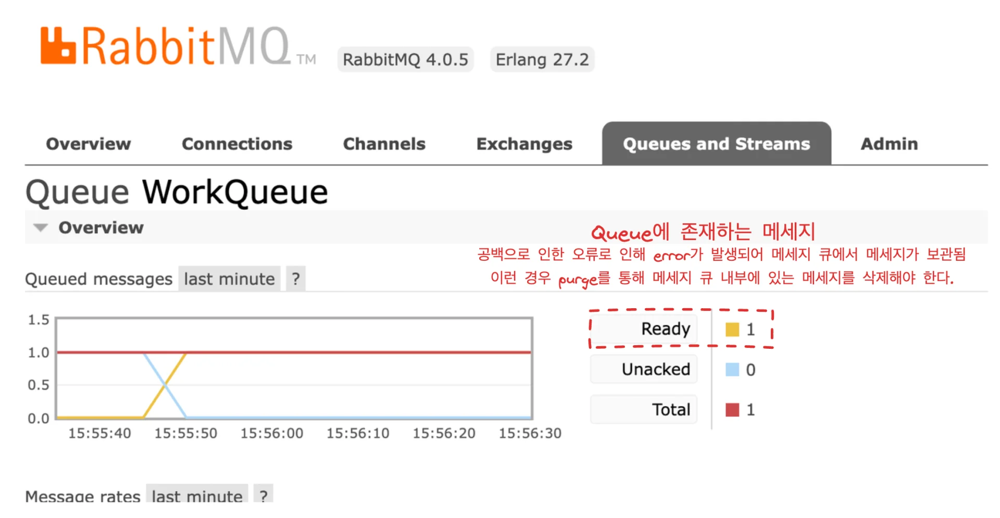

</details>

<details>
<summary>해결 &#45; purge</summary>

- 해결 코드
    > 👍🏻 
    > 
    > <a id="1c3eda9b0fe181bfad6ffc845e99a3a2"></a>
    > 
    > 공백 제거 후, parseInt로직에 <code>trim()</code>을 추가
    > 
    > - <code>trim()</code>&#58; 공백 제거

    ---

    <details>
    <summary>&#91; 코드 &#93; WorkQueueProducer</summary>

    <a id="1c3eda9b0fe18161a8abee03e174ab76"></a>

    ```java
    @Component
    public class WorkQueueProducer {

        private final RabbitTemplate rabbitTemplate;

        public WorkQueueProducer(RabbitTemplate rabbitTemplate) {
            this.rabbitTemplate = rabbitTemplate;
        }

        public void sendWorkQueue(String workQueueMessage, int duration) {
            // 받아온 메세지와, duration을 파이프 라인으로 연결하여 통으로 넘김
            String message = workQueueMessage + "| " + duration;
            rabbitTemplate.convertAndSend(RabbitMQConfig.QUEUE_NAME, message);
            System.out.println("[#] Sent workqueue " + message);
        }
    }
    ```

    </details>

    <details>
    <summary>&#91; 코드 &#93; WorkQueueConsumerㅇ</summary>

    <a id="1c3eda9b0fe181a3aa94ec4a09d8f9c0"></a>

    ```java
    @Component
    public class WorkQueueConsumer {

        public void workQueueTask(String message){

            // 파이프라인 연결 이유: 파라미터로 넘거온 메세지와 초를 파이프라인으로 붙여서 producer가 메세지를 전송할 수 있도록함
                 // 컨슈밍할 때, 파라미터로 받은 초만큼 sleep 처리 후 소진
            String[] messageParts = message.split("\\|");
            String originMessage = messageParts[0];
            int duration = Integer.parseInt(messageParts[1]); // 공백으로 인해 int 형변환 오류 발생
            System.out.println("# Consumer Received: " + originMessage + " (duration: "  + duration +" ms)");

            // 로그 확인을 위한 Thread.sleep 설정
            try {
                int seconds = duration / 1000; // duration을 초 단위로 변환
                for (int i = 0; i <= seconds; i++) {
                    Thread.sleep(1000); // 1초 대기
                    System.out.print("."); // 진행 상태 출력
                }
            } catch (InterruptedException e) {
                Thread.currentThread().interrupt();
            }
            System.out.println("\n[X] " +originMessage +" Completed!!");
        }
    }
    ```

    </details>

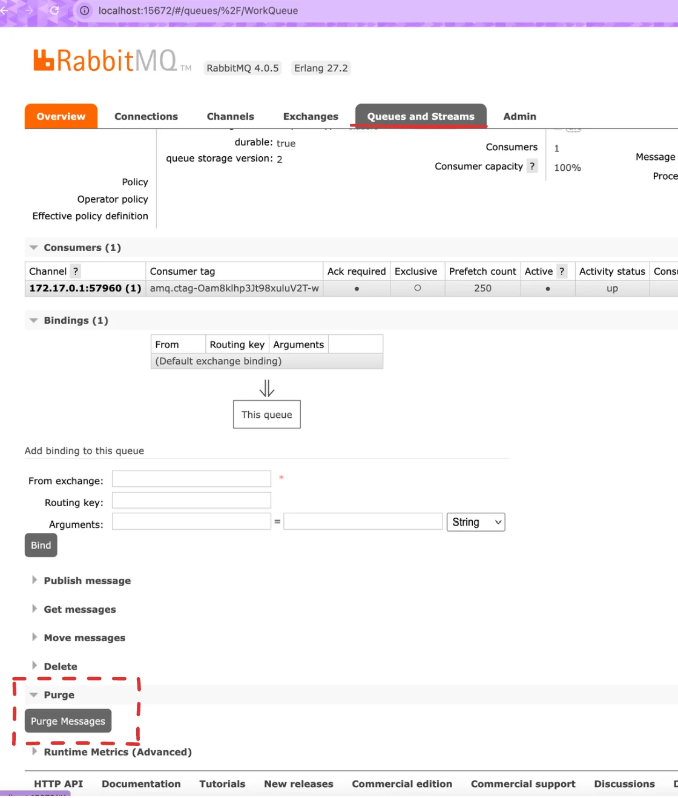

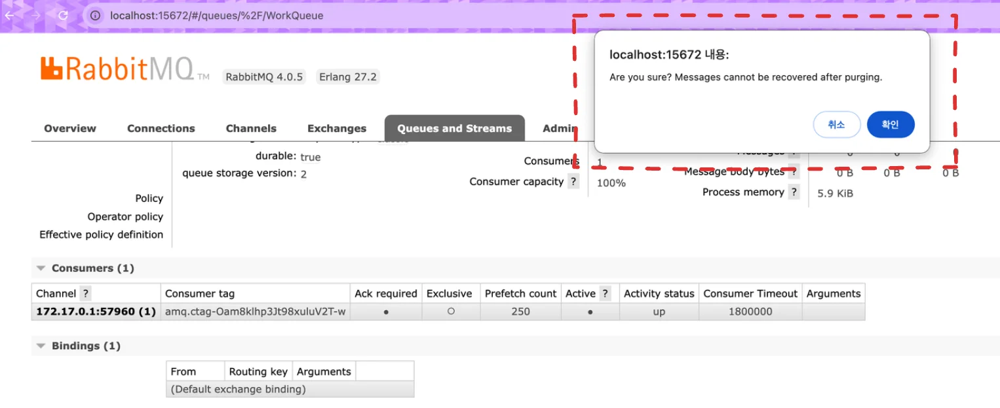

</details>

</details>

</details>

</details>

<a id="1c3eda9b0fe181d7bd6ad854594eaa98"></a>

### 코드 

[HelloMessageQueue/src/main/java/net/harunote/hellomessagequeue/step2 at tutorial&#45;step2 · villainscode/HelloMessageQueue]()

<details>
<summary>🧐 Queue &#45; <strong><code>Durable</code></strong></summary>

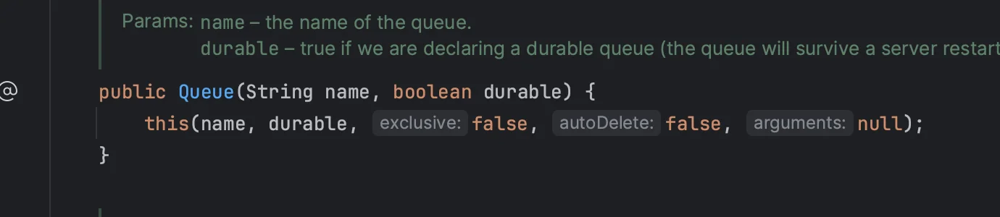

- <strong><u>durable</u></strong>&#58; <code>false</code> → <code>true</code>
    - <strong>해당 </strong><strong>큐(Queue)의 지속성(durability)이 보장</strong><strong>된다&#46; <br>즉, </strong><strong><u>RabbitMQ 서버가 재시작</u></strong><strong>되더라도</strong><strong><u> 해당 큐가 유지</u></strong><strong>된다&#46;</strong>

</details>

<details>
<summary>&#91; 코드 &#93; RabbitMQConfig</summary>

<a id="1c3eda9b0fe181ba96dbe0371b556573"></a>

```java
package com.example.hellomessagequeue.step2;

import org.springframework.amqp.core.AcknowledgeMode;
import org.springframework.amqp.core.Queue;
import org.springframework.amqp.rabbit.connection.ConnectionFactory;
import org.springframework.amqp.rabbit.core.RabbitTemplate;
import org.springframework.amqp.rabbit.listener.SimpleMessageListenerContainer;
import org.springframework.amqp.rabbit.listener.adapter.MessageListenerAdapter;
import org.springframework.context.annotation.Bean;
import org.springframework.context.annotation.Configuration;

@Configuration
public class RabbitMQConfig {

    public static final String QUEUE_NAME = "WorkQueue";

    @Bean
    public Queue queue() {
        return new Queue(QUEUE_NAME, true);
    }

    @Bean
    public RabbitTemplate rabbitTempl ate(ConnectionFactory connectionFactory) {
        return new RabbitTemplate(connectionFactory);
    }

    @Bean
    public SimpleMessageListenerContainer container(ConnectionFactory connectionFactory,
                                                    MessageListenerAdapter listenerAdapter) {
        SimpleMessageListenerContainer container = new SimpleMessageListenerContainer();
        container.setConnectionFactory(connectionFactory);
        container.setQueueNames(QUEUE_NAME);
        container.setMessageListener(listenerAdapter);
        container.setAcknowledgeMode(AcknowledgeMode.AUTO); // 명시적 선언 ( default: AUTO )
        return container;
    }

    @Bean
    public MessageListenerAdapter listenerAdapter(WorkQueueConsumer workQueueTask) {
        return new MessageListenerAdapter(workQueueTask, "workQueueTask");
    }
}

```

</details>

<details>
<summary>&#91; 코드 &#93; WorkQueueProducer</summary>

<a id="1c3eda9b0fe181c8a13fc504f55dacae"></a>

```java
package com.example.hellomessagequeue.step2;

import org.springframework.amqp.rabbit.core.RabbitTemplate;
import org.springframework.stereotype.Component;

@Component
public class WorkQueueProducer {

    private final RabbitTemplate rabbitTemplate;

    public WorkQueueProducer(RabbitTemplate rabbitTemplate) {
        this.rabbitTemplate = rabbitTemplate;
    }

    public void sendWorkQueue(String workQueueMessage, int duration) {
        // 받아온 메세지와, duration을 파이프 라인으로 연결하여 통으로 넘김
        String message = workQueueMessage + "|" + duration;
        rabbitTemplate.convertAndSend(RabbitMQConfig.QUEUE_NAME, message);
        System.out.println("[#] Sent workqueue " + message);
    }
}

```

</details>

<details>
<summary>&#91; 코드 &#93; WorkQueueConsumer</summary>

<a id="1c3eda9b0fe181c48e5fc3684c807d68"></a>

```java
package com.example.hellomessagequeue.step2;

import org.springframework.stereotype.Component;


@Component
public class WorkQueueConsumer {

    public void workQueueTask(String message){

        // 파이프라인 연결 이유: 파라미터로 넘거온 메세지와 초를 파이프라인으로 붙여서 producer가 메세지를 전송할 수 있도록함
             // 컨슈밍할 때, 파라미터로 받은 초만큼 sleep 처리 후 소진
        String[] messageParts = message.split("\\|");
        String originMessage = messageParts[0];
        int duration = Integer.parseInt(messageParts[1].trim());
        System.out.println("# Consumer Received: " + originMessage + " (duration: "  + duration +" ms)");

        // 로그 확인을 위한 Thread.sleep 설정
        try {
            int seconds = duration / 1000; // duration을 초 단위로 변환
            for (int i = 0; i <= seconds; i++) {
                Thread.sleep(1000); // 1초 대기
                System.out.print("."); // 진행 상태 출력
            }
        } catch (InterruptedException e) {
            Thread.currentThread().interrupt();
        }
        System.out.println("\n[X] " +originMessage +" Completed!!");
    }
}

```

</details>

<details>
<summary>&#91; 코드 &#93; WorkQueueController</summary>

<a id="1c3eda9b0fe1818b9136cee41a677d5b"></a>

```java
package com.example.hellomessagequeue.step2;

import org.springframework.web.bind.annotation.PostMapping;
import org.springframework.web.bind.annotation.RequestMapping;
import org.springframework.web.bind.annotation.RequestParam;
import org.springframework.web.bind.annotation.RestController;

@RestController
@RequestMapping("/api")
public class WorkQueueController {

    private final WorkQueueProducer workQueueProducer;

    public WorkQueueController(WorkQueueProducer workQueueProducer) {
        this.workQueueProducer = workQueueProducer;
    }

    @PostMapping("/workqueue")
    public String workQueue(@RequestParam String message, @RequestParam int duration) {
        workQueueProducer.sendWorkQueue(message, duration);
        return "Work queue sent = " + message + ", (" + duration + ")";
        /**
         * curl -X POST "http://localhost:8080/api/workqueue?message=Task1&duration=2000"
         * curl -X POST "http://localhost:8080/api/workqueue?message=Task2&duration=4000"
         * curl -X POST "http://localhost:8080/api/workqueue?message=Task3&duration=5000"
         */
    }

}
```

</details>

---

<details>
<summary>curl 호출</summary>

<a id="1c3eda9b0fe18176abcce6b922f5327c"></a>

```java
curl -X POST "http://localhost:8080/api/workqueue?message=Task1&duration=2000"
curl -X POST "http://localhost:8080/api/workqueue?message=Task2&duration=4000"
curl -X POST "http://localhost:8080/api/workqueue?message=Task3&duration=5000"
```

</details>

<a id="1c3eda9b0fe1814a842ed06a0ac27297"></a>

### 모니터링 ( management console )

> <a href="http://localhost:15672/#/queues">http&#58;//localhost&#58;15672/&#35;/queues</a>

<details>
<summary>모니터링 하고자하는 Queue 선택</summary>

- Queues and Streams &#45; Queue 선택

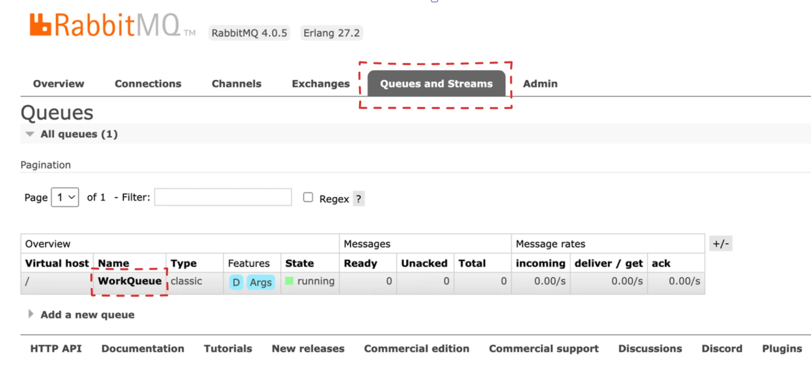

</details>

<details>
<summary>제공되는 목록</summary>

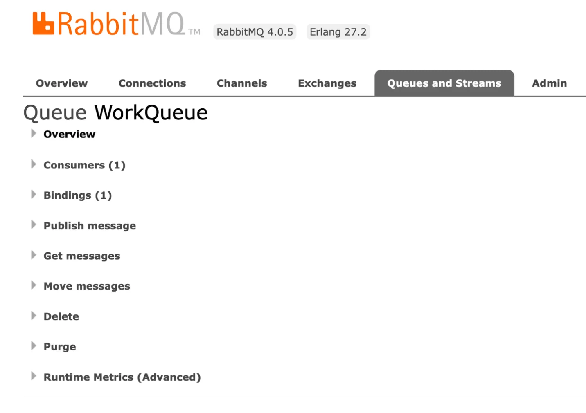

</details>

<details>
<summary>Overview</summary>

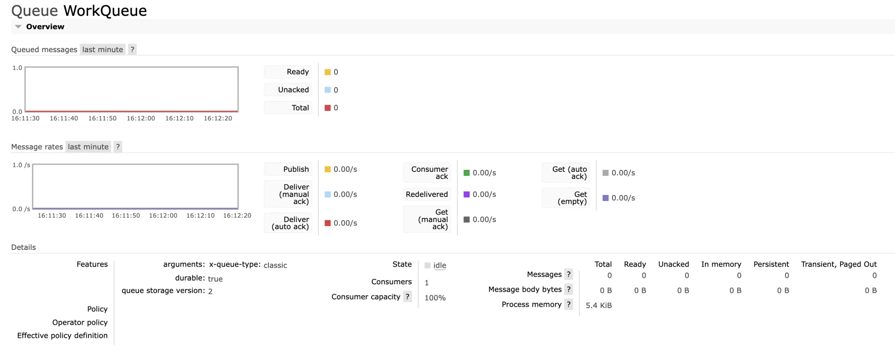

<a id="1c3eda9b0fe18128b127ec179a241fef"></a>

위 화면과 같이 메세지의 전송 상태를 구별할 수 있는 view화면을 제공한다&#46; 

- <code>Ready</code>&#58; 큐에 대기 중인 메세지

- <code>Unacked</code>&#58; 메세지를 전송했으나, 응답을 받지 못한 메세지

- <code>total</code>&#58; 메세지 수 

</details>

<a id="1c3eda9b0fe1811c9e63c92be9d8f0ce"></a>

### 오류 

<details>
<summary>🤬 오류 &#45; ListenerExecutionFailedException </summary>

<details>
<summary>오류 메세지 </summary>

<a id="1c3eda9b0fe1817e940acfe975047bbd"></a>

```java
org.springframework.amqp.rabbit.support.ListenerExecutionFailedException: Failed to invoke target method 'workQueueTask' with argument type = [class java.lang.String], value = [{Task3|5000}]
	at org.springframework.amqp.rabbit.listener.adapter.MessageListenerAdapter.invokeListenerMethod(MessageListenerAdapter.java:388) ~[spring-rabbit-3.2.2.jar:3.2.2]
	at org.springframework.amqp.rabbit.listener.adapter.MessageListenerAdapter.onMessage(MessageListenerAdapter.java:294) ~[spring-rabbit-3.2.2.jar:3.2.2]
	at org.springframework.amqp.rabbit.listener.AbstractMessageListenerContainer.doInvokeListener(AbstractMessageListenerContainer.java:1682) ~[spring-rabbit-3.2.2.jar:3.2.2]
	at org.springframework.amqp.rabbit.listener.AbstractMessageListenerContainer.actualInvokeListener(AbstractMessageListenerContainer.java:1604) ~[spring-rabbit-3.2.2.jar:3.2.2]
	at org.springframework.amqp.rabbit.listener.AbstractMessageListenerContainer.invokeListener(AbstractMessageListenerContainer.java:1592) ~[spring-rabbit-3.2.2.jar:3.2.2]
	at org.springframework.amqp.rabbit.listener.AbstractMessageListenerContainer.doExecuteListener(AbstractMessageListenerContainer.java:1583) ~[spring-rabbit-3.2.2.jar:3.2.2]
	at org.springframework.amqp.rabbit.listener.AbstractMessageListenerContainer.executeListenerAndHandleException(AbstractMessageListenerContainer.java:1528) ~[spring-rabbit-3.2.2.jar:3.2.2]
	at org.springframework.amqp.rabbit.listener.AbstractMessageListenerContainer.lambda$executeListener$8(AbstractMessageListenerContainer.java:1506) ~[spring-rabbit-3.2.2.jar:3.2.2]
	at io.micrometer.observation.Observation.observe(Observation.java:498) ~[micrometer-observation-1.14.3.jar:1.14.3]
	at org.springframework.amqp.rabbit.listener.AbstractMessageListenerContainer.executeListener(AbstractMessageListenerContainer.java:1506) ~[spring-rabbit-3.2.2.jar:3.2.2]
	at org.springframework.amqp.rabbit.listener.SimpleMessageListenerContainer.doReceiveAndExecute(SimpleMessageListenerContainer.java:1086) ~[spring-rabbit-3.2.2.jar:3.2.2]
	at org.springframework.amqp.rabbit.listener.SimpleMessageListenerContainer.receiveAndExecute(SimpleMessageListenerContainer.java:1022) ~[spring-rabbit-3.2.2.jar:3.2.2]
	at org.springframework.amqp.rabbit.listener.SimpleMessageListenerContainer$AsyncMessageProcessingConsumer.mainLoop(SimpleMessageListenerContainer.java:1425) ~[spring-rabbit-3.2.2.jar:3.2.2]
	at org.springframework.amqp.rabbit.listener.SimpleMessageListenerContainer$AsyncMessageProcessingConsumer.run(SimpleMessageListenerContainer.java:1326) ~[spring-rabbit-3.2.2.jar:3.2.2]
	at java.base/java.lang.Thread.run(Thread.java:840) ~[na:na]
Caused by: java.lang.NoSuchMethodException: com.example.hellomessagequeue.step2.WorkQueueConsumer.workQueueTask(java.lang.String)
	at java.base/java.lang.Class.getMethod(Class.java:2227) ~[na:na]
	at org.springframework.util.MethodInvoker.prepare(MethodInvoker.java:186) ~[spring-core-6.2.2.jar:6.2.2]
	at org.springframework.amqp.rabbit.listener.adapter.MessageListenerAdapter.invokeListenerMethod(MessageListenerAdapter.java:366) ~[spring-rabbit-3.2.2.jar:3.2.2]
	... 14 common frames omitted

2025-02-02T15:28:30.219+09:00  WARN 11689 --- [HelloMessageQueue] [    container-1] ingErrorHandler$DefaultExceptionStrategy : Fatal message conversion error; message rejected; it will be dropped or routed to a dead letter exchange, if so configured: (Body:'Task3|5000' MessageProperties [headers={}, contentType=text/plain, contentEncoding=UTF-8, contentLength=0, receivedDeliveryMode=PERSISTENT, priority=0, redelivered=false, receivedExchange=, receivedRoutingKey=WorkQueue, deliveryTag=1, consumerTag=amq.ctag-JQF14kxW7nprmojcyPY9Cg, consumerQueue=WorkQueue])
2025-02-02T15:28:30.219+09:00 ERROR 11689 --- [HelloMessageQueue] [    container-1] o.s.a.r.l.SimpleMessageListenerContainer : Execution of Rabbit message listener failed, and the error handler threw an exception

org.springframework.amqp.AmqpRejectAndDontRequeueException: Error Handler converted exception to fatal
	at org.springframework.amqp.rabbit.listener.ConditionalRejectingErrorHandler.handleError(ConditionalRejectingErrorHandler.java:148) ~[spring-rabbit-3.2.2.jar:3.2.2]
	at org.springframework.amqp.rabbit.listener.AbstractMessageListenerContainer.invokeErrorHandler(AbstractMessageListenerContainer.java:1475) ~[spring-rabbit-3.2.2.jar:3.2.2]
	at org.springframework.amqp.rabbit.listener.AbstractMessageListenerContainer.handleListenerException(AbstractMessageListenerContainer.java:1768) ~[spring-rabbit-3.2.2.jar:3.2.2]
	at org.springframework.amqp.rabbit.listener.AbstractMessageListenerContainer.executeListenerAndHandleException(AbstractMessageListenerContainer.java:1549) ~[spring-rabbit-3.2.2.jar:3.2.2]
	at org.springframework.amqp.rabbit.listener.AbstractMessageListenerContainer.lambda$executeListener$8(AbstractMessageListenerContainer.java:1506) ~[spring-rabbit-3.2.2.jar:3.2.2]
	at io.micrometer.observation.Observation.observe(Observation.java:498) ~[micrometer-observation-1.14.3.jar:1.14.3]
	at org.springframework.amqp.rabbit.listener.AbstractMessageListenerContainer.executeListener(AbstractMessageListenerContainer.java:1506) ~[spring-rabbit-3.2.2.jar:3.2.2]
	at org.springframework.amqp.rabbit.listener.SimpleMessageListenerContainer.doReceiveAndExecute(SimpleMessageListenerContainer.java:1086) ~[spring-rabbit-3.2.2.jar:3.2.2]
	at org.springframework.amqp.rabbit.listener.SimpleMessageListenerContainer.receiveAndExecute(SimpleMessageListenerContainer.java:1022) ~[spring-rabbit-3.2.2.jar:3.2.2]
	at org.springframework.amqp.rabbit.listener.SimpleMessageListenerContainer$AsyncMessageProcessingConsumer.mainLoop(SimpleMessageListenerContainer.java:1425) ~[spring-rabbit-3.2.2.jar:3.2.2]
	at org.springframework.amqp.rabbit.listener.SimpleMessageListenerContainer$AsyncMessageProcessingConsumer.run(SimpleMessageListenerContainer.java:1326) ~[spring-rabbit-3.2.2.jar:3.2.2]
	at java.base/java.lang.Thread.run(Thread.java:840) ~[na:na]
Caused by: org.springframework.amqp.rabbit.support.ListenerExecutionFailedException: Failed to invoke target method 'workQueueTask' with argument type = [class java.lang.String], value = [{Task3|5000}]
	at org.springframework.amqp.rabbit.listener.adapter.MessageListenerAdapter.invokeListenerMethod(MessageListenerAdapter.java:388) ~[spring-rabbit-3.2.2.jar:3.2.2]
	at org.springframework.amqp.rabbit.listener.adapter.MessageListenerAdapter.onMessage(MessageListenerAdapter.java:294) ~[spring-rabbit-3.2.2.jar:3.2.2]
	at org.springframework.amqp.rabbit.listener.AbstractMessageListenerContainer.doInvokeListener(AbstractMessageListenerContainer.java:1682) ~[spring-rabbit-3.2.2.jar:3.2.2]
	at org.springframework.amqp.rabbit.listener.AbstractMessageListenerContainer.actualInvokeListener(AbstractMessageListenerContainer.java:1604) ~[spring-rabbit-3.2.2.jar:3.2.2]
	at org.springframework.amqp.rabbit.listener.AbstractMessageListenerContainer.invokeListener(AbstractMessageListenerContainer.java:1592) ~[spring-rabbit-3.2.2.jar:3.2.2]
	at org.springframework.amqp.rabbit.listener.AbstractMessageListenerContainer.doExecuteListener(AbstractMessageListenerContainer.java:1583) ~[spring-rabbit-3.2.2.jar:3.2.2]
	at org.springframework.amqp.rabbit.listener.AbstractMessageListenerContainer.executeListenerAndHandleException(AbstractMessageListenerContainer.java:1528) ~[spring-rabbit-3.2.2.jar:3.2.2]
	... 8 common frames omitted
Caused by: java.lang.NoSuchMethodException: com.example.hellomessagequeue.step2.WorkQueueConsumer.workQueueTask(java.lang.String)
	at java.base/java.lang.Class.getMethod(Class.java:2227) ~[na:na]
	at org.springframework.util.MethodInvoker.prepare(MethodInvoker.java:186) ~[spring-core-6.2.2.jar:6.2.2]
	at org.springframework.amqp.rabbit.listener.adapter.MessageListenerAdapter.invokeListenerMethod(MessageListenerAdapter.java:366) ~[spring-rabbit-3.2.2.jar:3.2.2]
	... 14 common frames omitted
```

</details>

---

- 원인
    > ⛔ 
    > 
    > <a id="1c3eda9b0fe1814da936d3399ad9cc3c"></a>
    > 
    > Config에 등록한 Consumer 메서드와 실제 Cousumer 메서드가 일치하지 않아 인식을 하지 못해 발생됨

    <details>
    <summary>&#91; 코드 &#93; RabbitMQConfig</summary>

    <a id="1c3eda9b0fe181d9910fefbb257522a8"></a>

    ```java
    @Configuration
    public class RabbitMQConfig {

        public static final String QUEUE_NAME = "WorkQueue";

        @Bean
        public Queue queue() {
            return new Queue(QUEUE_NAME, true);
        }

        @Bean
        public RabbitTemplate rabbitTemplate(ConnectionFactory connectionFactory) {
            return new RabbitTemplate(connectionFactory);
        }

        @Bean
        public SimpleMessageListenerContainer container(ConnectionFactory connectionFactory,
                                                        MessageListenerAdapter listenerAdapter) {
            SimpleMessageListenerContainer container = new SimpleMessageListenerContainer();
            container.setConnectionFactory(connectionFactory);
            container.setQueueNames(QUEUE_NAME);
            container.setMessageListener(listenerAdapter);
            container.setAcknowledgeMode(AcknowledgeMode.AUTO); // 명시적 선언 ( default: AUTO )
            return container;
        }

        @Bean
        public MessageListenerAdapter listenerAdapter(WorkQueueConsumer workQueueTask) {
            return new MessageListenerAdapter(workQueueTask, "workQueueTask");
        }
    }
    ```

    </details>

    <details>
    <summary>&#91; 코드 &#93; WorkQueueConsumer</summary>

    <a id="1c3eda9b0fe181b49116fa3dd0f403c3"></a>

    ```java
    @Component
    public class WorkQueueConsumer {

        public void workQueueConsumer(String message){

            // 파이프라인 연결 이유: 파라미터로 넘거온 메세지와 초를 파이프라인으로 붙여서 producer가 메세지를 전송할 수 있도록함
                 // 컨슈밍할 때, 파라미터로 받은 초만큼 sleep 처리 후 소진
            String[] messageParts = message.split("\\|");
            String originMessage = messageParts[0];
            int duration = Integer.parseInt(messageParts[1].trim());
            System.out.println("# Consumer Received: " + originMessage + " (duration: "  + duration +" ms)");

            // 로그 확인을 위한 Thread.sleep 설정
            try {
                int seconds = duration / 1000; // duration을 초 단위로 변환
                for (int i = 0; i <= seconds; i++) {
                    Thread.sleep(1000); // 1초 대기
                    System.out.print("."); // 진행 상태 출력
                }
            } catch (InterruptedException e) {
                Thread.currentThread().interrupt();
            }
            System.out.println("\n[X] " +originMessage +" Completed!!");
        }
    }
    ```

    </details>

- 해결
    > 👍🏻 
    > 
    > <a id="1c3eda9b0fe18150b53be0a8572f6903"></a>
    > 
    > 아래 코드와 같이 config와 동일한 메서드명으로 수정

    <details>
    <summary>&#91; 코드 &#93; RabbitMQConfig</summary>

    <a id="1c3eda9b0fe1819181aaf7fdf65b3ec7"></a>

    ```java
    @Configuration
    public class RabbitMQConfig {

        public static final String QUEUE_NAME = "WorkQueue";

        @Bean
        public Queue queue() {
            return new Queue(QUEUE_NAME, true);
        }

        @Bean
        public RabbitTemplate rabbitTemplate(ConnectionFactory connectionFactory) {
            return new RabbitTemplate(connectionFactory);
        }

        @Bean
        public SimpleMessageListenerContainer container(ConnectionFactory connectionFactory,
                                                        MessageListenerAdapter listenerAdapter) {
            SimpleMessageListenerContainer container = new SimpleMessageListenerContainer();
            container.setConnectionFactory(connectionFactory);
            container.setQueueNames(QUEUE_NAME);
            container.setMessageListener(listenerAdapter);
            container.setAcknowledgeMode(AcknowledgeMode.AUTO); // 명시적 선언 ( default: AUTO )
            return container;
        }

        @Bean
        public MessageListenerAdapter listenerAdapter(WorkQueueConsumer workQueueTask) {
            return new MessageListenerAdapter(workQueueTask, "workQueueTask");
        }
    }
    ```

    </details>

    <details>
    <summary>&#91; 코드 &#93; WorkQueueConsumer</summary>

    <a id="1c3eda9b0fe181bbac04e025337ada29"></a>

    ```java
    @Component
    public class WorkQueueConsumer {

        public void workQueueTask(String message){

            // 파이프라인 연결 이유: 파라미터로 넘거온 메세지와 초를 파이프라인으로 붙여서 producer가 메세지를 전송할 수 있도록함
                 // 컨슈밍할 때, 파라미터로 받은 초만큼 sleep 처리 후 소진
            String[] messageParts = message.split("\\|");
            String originMessage = messageParts[0];
            int duration = Integer.parseInt(messageParts[1].trim());
            System.out.println("# Consumer Received: " + originMessage + " (duration: "  + duration +" ms)");

            // 로그 확인을 위한 Thread.sleep 설정
            try {
                int seconds = duration / 1000; // duration을 초 단위로 변환
                for (int i = 0; i <= seconds; i++) {
                    Thread.sleep(1000); // 1초 대기
                    System.out.print("."); // 진행 상태 출력
                }
            } catch (InterruptedException e) {
                Thread.currentThread().interrupt();
            }
            System.out.println("\n[X] " +originMessage +" Completed!!");
        }
    }
    ```

    </details>

</details>

<details>
<summary>🧐 메세지 동시 호출 시, 동기적으로 처리 </summary>

<details>
<summary>3개의 메세지 동시 호출</summary>

<a id="1c3eda9b0fe181568182cb3e52f2bf68"></a>

```java
curl -X POST "http://localhost:8080/api/workqueue?message=Task1&duration=2000"
curl -X POST "http://localhost:8080/api/workqueue?message=Task2&duration=4000"
curl -X POST "http://localhost:8080/api/workqueue?message=Task3&duration=5000"
```

</details>

<details>
<summary>동기적으로 처리</summary>

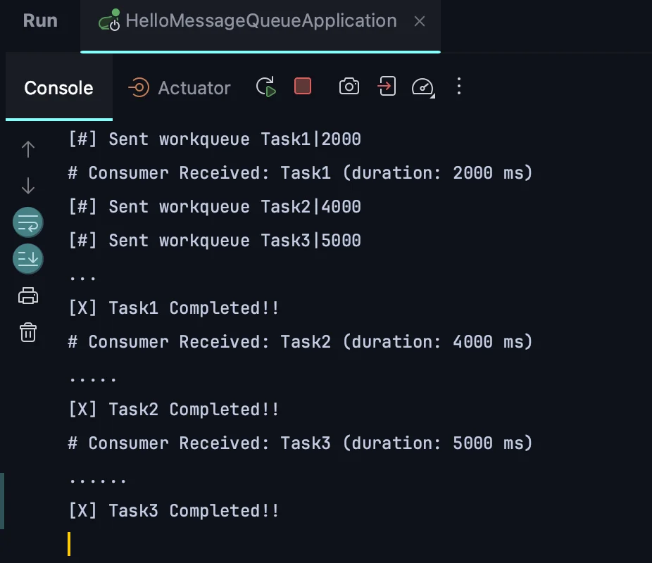

- 위 화면과 같이 task1, task2, tatk3이 순차적으로 실행 및 처리됨

</details>

<a id="1c3eda9b0fe181d0a079c0aea14d188c"></a>

### 해결

<a id="1c3eda9b0fe181eb853be9f877119931"></a>

최대 5개까지 스레드를 동시에 생성하여 처리

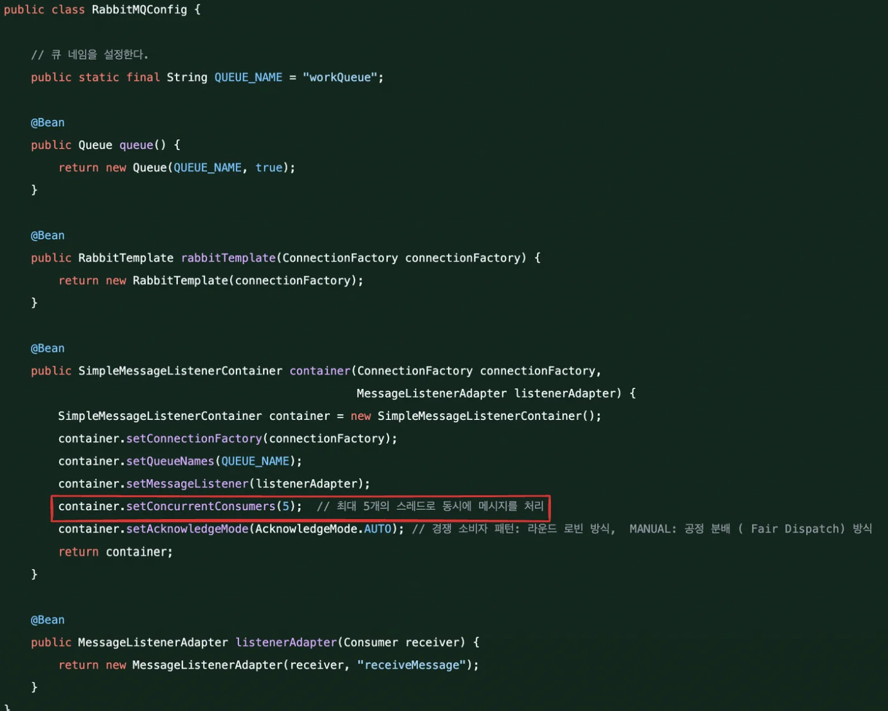

</details>

<a id="1c3eda9b0fe1810192e2e69468786900"></a>

### Step 2&#46; Consumer 간 작업 분배  &#45; Part 2

---

<details>
<summary>재처리 로직</summary>

<a id="1c3eda9b0fe1812598dbc90b2759f591"></a>

part 1에서 producer에서 메세지를 넘길 때, 공백으로 인한 <code>numberFormatException</code>이 발생되었다&#46; 

- 개발자라면 이러한 운영 상에서 오류가 발생되는 경우, 재처리 할 수 있는 방법들을 항상 고민 해야한다&#46; 

<a id="1c3eda9b0fe1812589cee6b190558237"></a>

이런 경우, 재전송에 대한 처리를 해줘야한다&#46; <code>durable=true</code>를 세팅하여 영속성 있게 큐의 데이터가 소실되지 않도록 기본 세팅을 해야한다&#46;

- Acknowledgement Mode가 기본값인 <code>AUTO</code> 되어있는 경우, 재처리를 자동으로 해준다&#46; 

- 또한 분산 서버 환경에서 요청을 라운드 로빈 방식으로 순차적으로  나눠 처리한다&#46; 

<a id="1c3eda9b0fe18146aaeae5927d061f33"></a>

만약 운영상에서 세밀한 조정이 필요하다면, Acknowledgement Mode를 <code>MANUAL</code>로 세팅하여 <code>Fair Dispatch</code> 방식으로 처리 가능하다&#46; 

- 이런 경우는 거의 없음

</details>

<details>
<summary>일반적으로 발생되는 문제, 해결 방법</summary>

- <code>ready</code>가 많을 경우
    - 컨슈머 수 확장

    -  컨슈머의 메세지 처리 속도 최적화

- <code>unacked</code>가 많을 경우
    - 컨슈머 코드 수정 ( 프로그램 에러일 가능성이 높음 )
        - 코드가 메세지를 처리하지 못하기 때문에, 빠르게 디버깅하여 ack로 처리

    - 컨슈머 연결 상태를 확인하여 재연결 혹은 재시작 필요

</details>

<details>
<summary>실습) 빌드 및 실행</summary>

<details>
<summary>1&#46; 프로젝트 directory로 이동</summary>

<a id="1c3eda9b0fe18164a27ad4e2e16e12f0"></a>

```java
cd Desktop/backend/MQ/rabbitMq/project/HelloMessageQueue
```

</details>

<details>
<summary>2&#46; jar 파일 생성</summary>

- gradle 빌드 후 build/libs에 build&#46;gradle에서 설정한 jarr가 생성되었는지 확인 후 실행

<a id="1c3eda9b0fe181298c06f7d32543858e"></a>

```java
./gradlew clean build
```

</details>

<details>
<summary>3&#46; 2개의 서버 실행</summary>

- 로컬 프로젝트 하위의 <code>/build/libs</code>에 jar 파일이 존재함
    <a id="1c3eda9b0fe181568f93ffa70db3b983"></a>

    ```java
    java -jar build/libs/[프로젝트명]-0.0.1-SNAPSHOT.jar --server.port=[포트 번호]
    ```

- 2개의 서버 실행 (포트 번호 주의)
    <a id="1c3eda9b0fe1812fa6a7ca9315232a91"></a>

    ```java
    // 서버 1
    java -jar build/libs/HelloMessageQueue-0.0.1-SNAPSHOT.jar --server.port=8080

    // 서버 2
    java -jar build/libs/HelloMessageQueue-0.0.1-SNAPSHOT.jar --server.port=8081
    ```

</details>

<details>
<summary>4&#46; cURL 호출로 각각 순서대로 처리되는지 확인</summary>

<a id="1c3eda9b0fe1812a8687d02ad87b953f"></a>

```plaintext
curl -X POST "http://localhost:8080/api/workqueue?message=Task1&duration=2000"
curl -X POST "http://localhost:8080/api/workqueue?message=Task2&duration=3000"
curl -X POST "http://localhost:8080/api/workqueue?message=Task3&duration=4000"
```

> Acknowledgement Mode = <code>AUTO</code> 설정 시, 분산 서버에서 라운드 로빈 방식으로 트패픽을 고르게 나눠 처리함

- 분산 서버에서 라운드 로빈 방식으로 호출된 요청을 순차적으로 나눠서 처리하는 것을 확인할 수 있다&#46; 
    <details>
    <summary>호출 1</summary>

    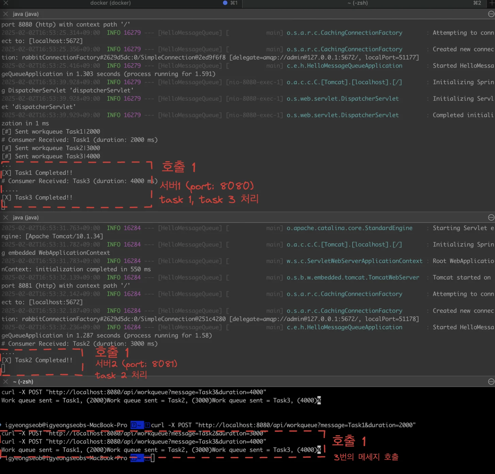

    - <code>서버 1 </code>( port&#58; <code>8080</code> )
        - task 1, task 3 처리

    - <code>서버 2</code> ( port&#58; <code>8081</code> )
        - task 2처리

    </details>

    <details>
    <summary>호출 2</summary>

    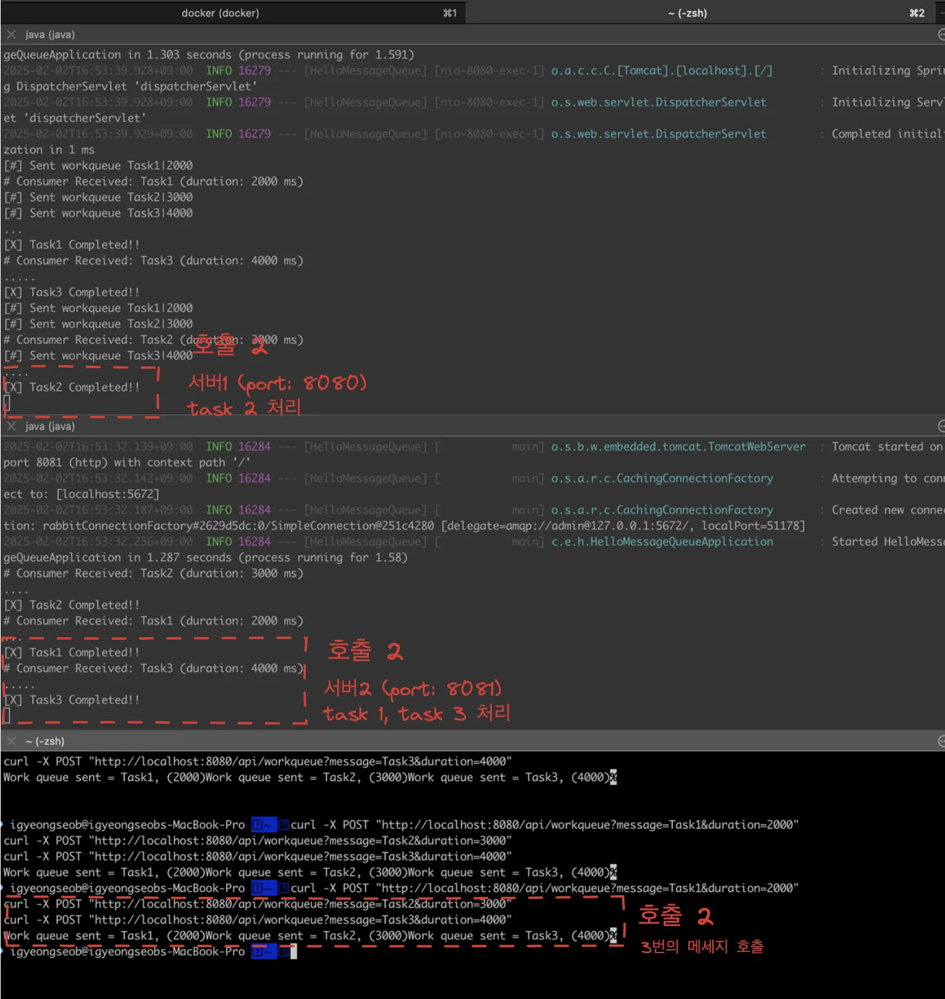

    - <code>서버 1 </code>( port&#58; <code>8080</code> )
        - task 2처리

    - <code>서버 2</code> ( port&#58; <code>8081</code> )
        - task 1, task 3 처리

    </details>

</details>

<details>
<summary>5&#46; 공백 오류 상황 확인</summary>

<details>
<summary>오류 발생 시,  아래와 같이 계속해서 재처리 되는것을 확인</summary>

- 오류 발생된 메세지를 큐에 삭제하지 않으면, 동일하게 계속 retry를 함

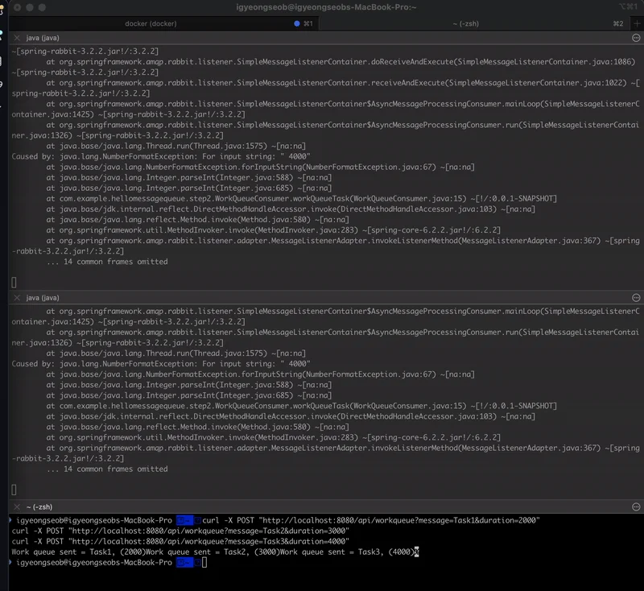

</details>

<details>
<summary>managemet console에서 ready 상태의 메세지 확인</summary>

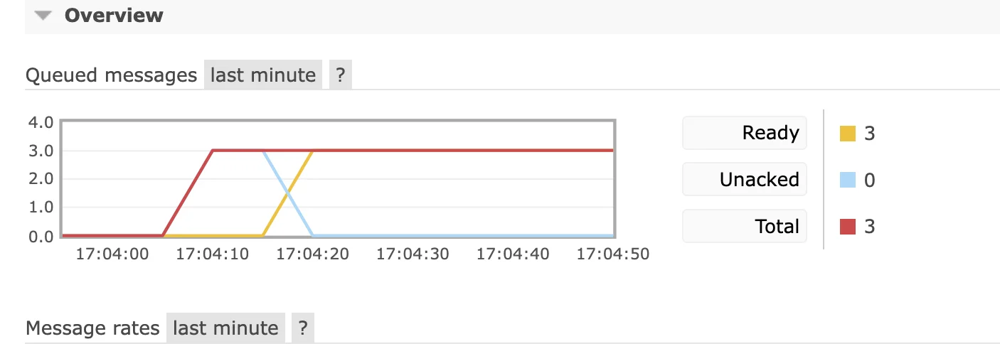


</details>

<details>
<summary>purge &#45; 메세지 큐 내부의 메세지 삭제</summary>


</details>

<details>
<summary>삭제 확인</summary>

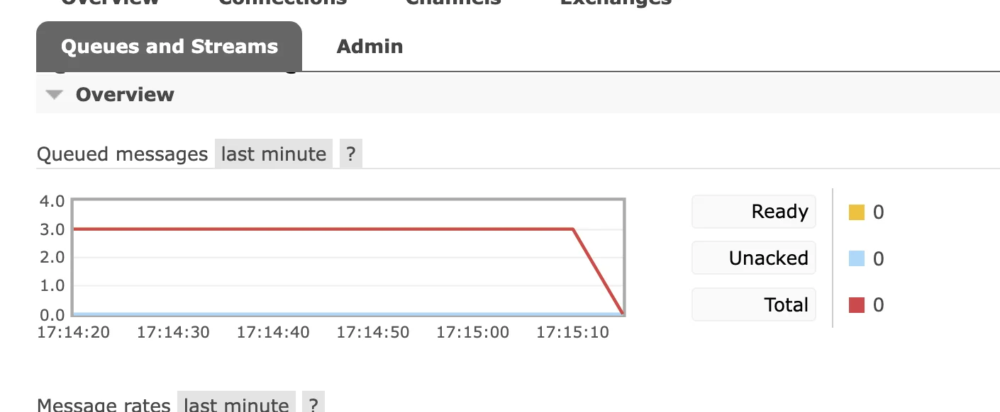

</details>

</details>

</details>

<a id="1c3eda9b0fe1811cacbbca9a8a3c36eb"></a>

### 실습) 오류 수정 및 docker compose로 curl 호출 확인

---

[step2: 경쟁 소비자 패턴을 이용한 작업 분배](https://github.com/gyungsubLee/RabbitMQ_prac/commit/50952d5875aa23b4e3101df87a6f1e0880be8dc7)

[step2/fix: 동일한 이름을 가지는 Controller, Config 중복 빈 등록 오류 외 자잘한 오류](https://github.com/gyungsubLee/RabbitMQ_prac/commit/76576a10e3645f4d4da36bc3cc22f94c48e1227b)

---

<details>
<summary>단일 메세지 호출</summary>

- curl 호출
    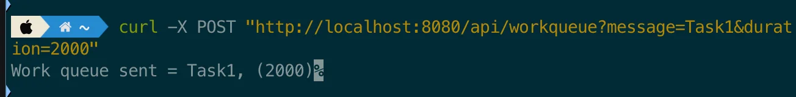

- 로그 확인
    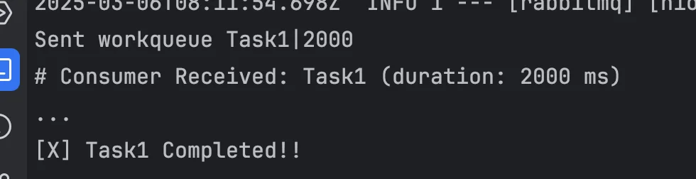

</details>

<details>
<summary>여러 메세지 호출 확인</summary>

- curl 호출 
    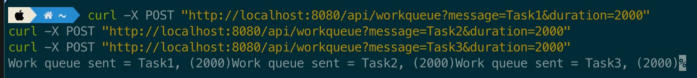

- 로그 확인
    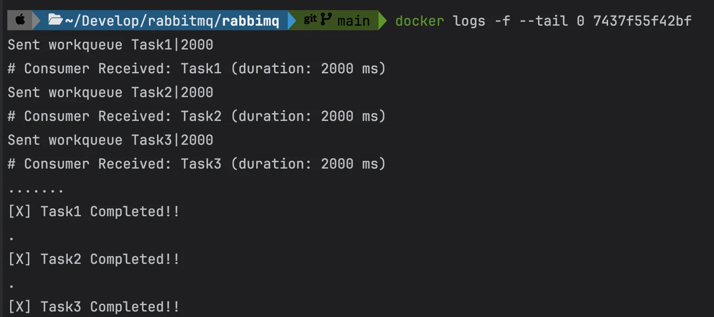

</details>

<details>
<summary>최대 5개까지 스레드를 동시에 생성하여 처리</summary>


</details>
