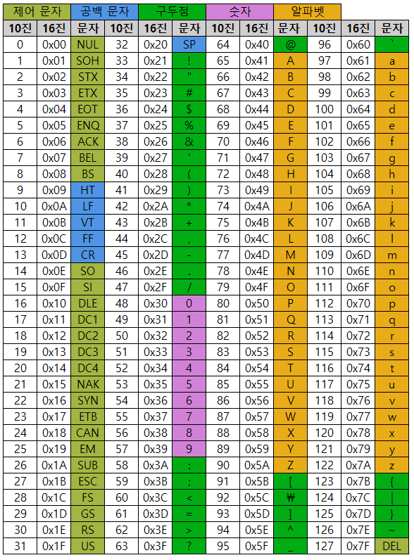

## <code>&#43;</code>

- Array(크기 고정, 변경X)

- ArrayList(크기 고정 X)

### String ↔ Array

<code>String → Array</code>&#58; <code>String&#46;toCharArray();</code>

<code>Array → String</code>&#58; <code>String&#46;valueOf(Array)</code>

### 대문자, 소문자 판별

소문자 판별&#58; <code>Character&#46;isLowerCase(word)</code>

대문자 판별&#58; <code>Character&#46;isUpperCase(word)</code>

### <a href="https://tussle.tistory.com/1024">문자 알파벳, 숫자 판별</a>

> <a href="https://ko.wikipedia.org/wiki/ASCII">아스키코드(ASCII)</a> 사용하면 더 간단하게 판별 가능함&#46;

### StringBuilder

> 👉🏻 <strong>StringBuilder String 객체, 지원되는 메소드가 많다&#46; (</strong><strong><code>append</code></strong><strong>, </strong><strong><code>insertdeletereplaace</code></strong><strong> , </strong><strong><code>reverse</code></strong><strong>…)  </strong><strong>why?) String 객체가 있음에도, StringBuilder가 존재하는 이유는?</strong><strong> 스트링은 스트링끼리 더하거나, replace, 수정하면 새로운 객체들이 막 생성된다&#46; (스트링 객체로 만든 문자 값 그 자체는 변경할 수 없다&#46; 따라서 새로운 객체를 만들고 변경된 걸 대입하고 하면서 객체가 자꾸 생성된다&#46; )  이러한 단점을 보안하기위해 StringBuilder가 나왔다&#46; StringBuilder는 처음에 만든 객체 하나를 가지고 추가, 수정, 등을 한다&#46;  </strong><strong>객체가 여러개 만들어지는 단점이 개선되어 메모리 낭비도 없고, 코드 자체가 가볍다&#46; </strong><strong>  </strong><strong>⇒ String 연산 처리가 많은 경우, StringBuilder를 사용함&#46;</strong>

- 문자열 문자 추가(<code>&#43;=</code>)

- <code>String&#46;lenght()</code>  가능

### int ↔ String 형변환

- <code>String&#46;valueOf(int)</code>

- <code>integer&#46;toString(int)</code>

### int ↔ char

- <code>(char)int형Value</code>     ex) int num = 49;  (char)num  ⇒ ‘1’

- <code>(int)char형Value</code>

### <a href="https://pythontoomuchinformation.tistory.com/493">Boolean 과 boolean 차이 (참조 타입 vs 원시 타입)</a>

### 아스키 코드

대문자&#58; 65 &#126; 90

소문자&#58; 97 &#126; 122

