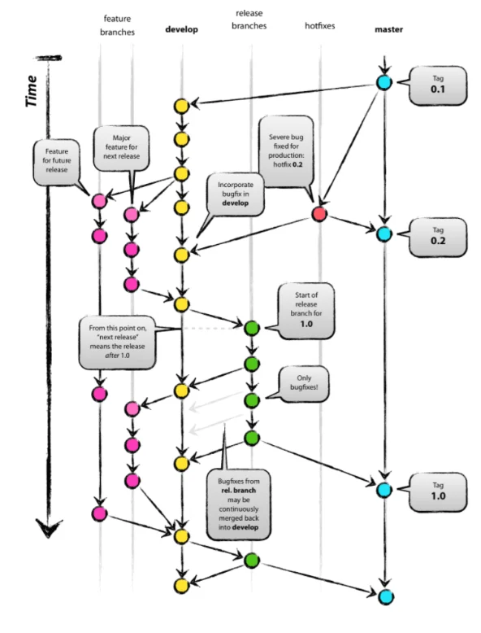

- &#91;&#33;info&#93; 브랜치 종류
    - <strong>master</strong> &#58; 기준이 되는 브랜치, 제품 배포

    - <strong>develop</strong> &#58; 개발 브랜치로 개발자들이 이 브랜치를 기준으로 각자 작업한 기능들을 Merge

    - feature &#58; 단위 기능을 개발하는 브랜치 기능 개발이 완료되면 develop 브랜치에 Merge

    - release &#58; 배포를 위해 master 브랜치로 보내기 전에 먼저 QA(품질검사)를 하기 위한 브랜치

    - hotfix &#58; master 브랜치로 배포했는데 버그가 생긴 경우, 긴급 수정하는 브랜치

- master, develop이 가장 중요한 메인 브랜치, 나머지는 필요에 의해 운영하는 브랜치
