<details>
<summary>이전 정리</summary>

<details>
<summary>1&#46;  rabbit 실행</summary>

<details>
<summary>도커 CLI ( <code>run</code> )</summary>

<a id="1c3eda9b0fe1817598cfc16d106d1690"></a>

```bash
docker run -it --rm --name rabbitmq -p 5672:5672 -p 15672:15672 rabbitmq:4.0-management
```

</details>

<details>
<summary>compose 실행 ( <code>compose&#46;yml</code> )</summary>

<a id="1c3eda9b0fe181c2802fdfd873e8016b"></a>

```yaml
version: 
services:
	rabbitmq:
		image: rabbitmq:4.0-management
		container_name: rabbitmq 
		prots:
			- "5672:5672"   # AMQP
			- "15672:15672" # magement UI
		restart: unless-stopped # 컨테이너가 중지되지 않는 한 항상 재시작
```

- 실행
    <a id="1c3eda9b0fe1816eaa6fc5583f5f0765"></a>

    ```bash
    docker compose up -d
    ```

- 종료
    <a id="1c3eda9b0fe18190b28cc48b8381f4bb"></a>

    ```bash
    docker compose down
    ```

</details>

</details>

<details>
<summary>2&#46; 유저 및 VHost 추가 </summary>

<a id="1c3eda9b0fe181f9934ae4fd61c60664"></a>

### Virtual Host

---

<a id="1c3eda9b0fe181648bb7c4aab80cddbc"></a>

기본적으로 권한 관리라고 보면 되는데, 리소스를 격리하는 권한을 관리한다&#46; 

<details>
<summary>🤬 오류 &#45; 새로운 계정 생성 시, <code>no access</code> 권한 오류 발생</summary>

- 오류 화면 
    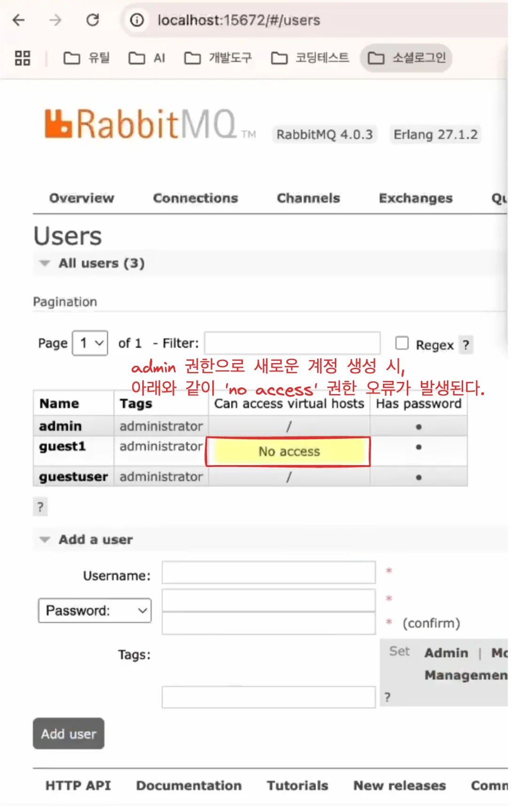

- 원인
    -  Virtual host의 권한을 부여하지 않아서 그렇다&#46; 
        - 권한 설정을 하지 않은 계정으로 sender, receiver를 돌리면 <strong><u>access 오류</u></strong>가 발생된다&#46; 

<a id="1c3eda9b0fe181c8bf2ac513737b1bde"></a>

따라서 <strong><u>virtual host 권한을 부여</u></strong>해줘야 한다&#46;

</details>

<details>
<summary>🧐 해결 &#45; virtual host 권한 설정</summary>

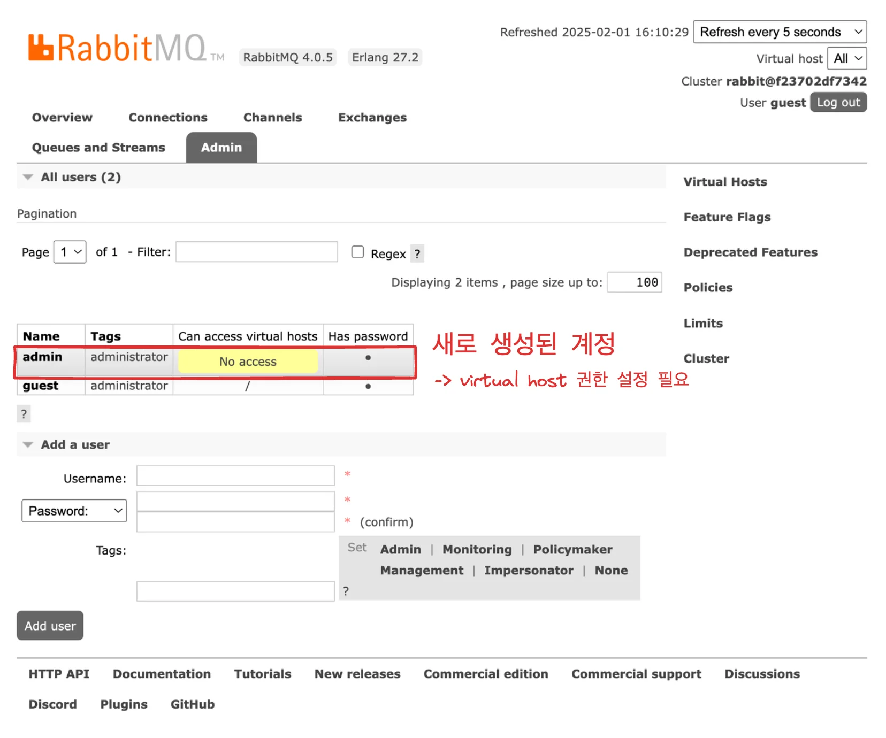

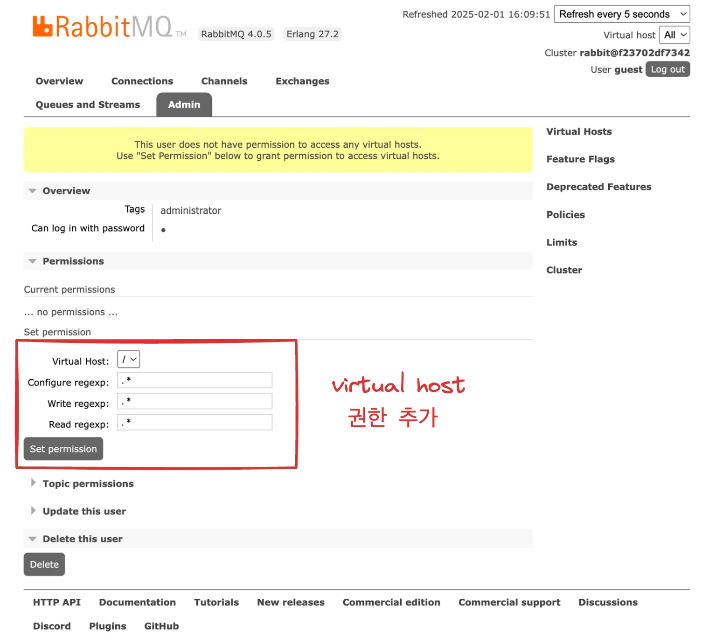

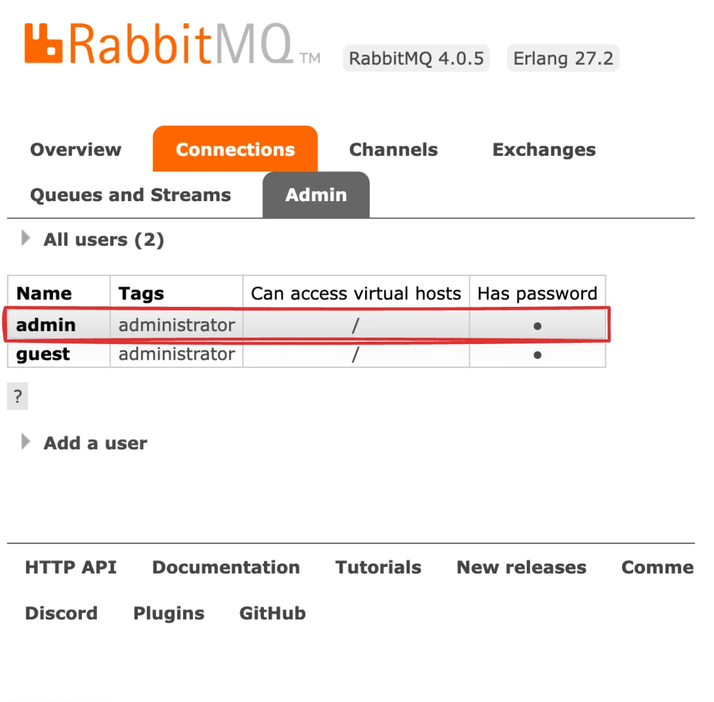

</details>

- Virtual Host의 권한의 역할


</details>

<details>
<summary>3&#46; 프로젝트 생성</summary>

- dependency
    - devtools

    - web

    - RabbitMQ

</details>

<details>
<summary>4&#46; 기본 api 호출 테스트 </summary>

<a id="1c3eda9b0fe181c3b1cbd1bbe6b86e12"></a>

### 내장된 인텔리제이의 HTTP 클라이언트로 API 테스트하기

- dependency&#58; <code>devtools</code> 추가

- controller에서 아래의 icon 클릭
    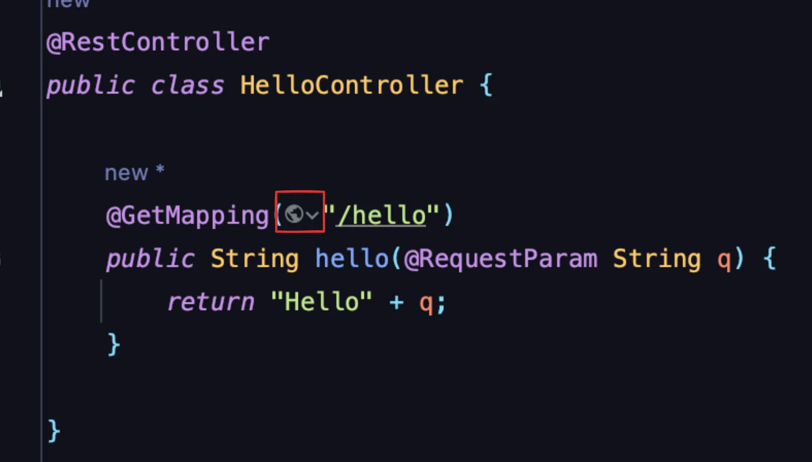

- 클릭 후 나오는 메뉴에서 <code>Generate request in HTTP Client</code> 클릭
    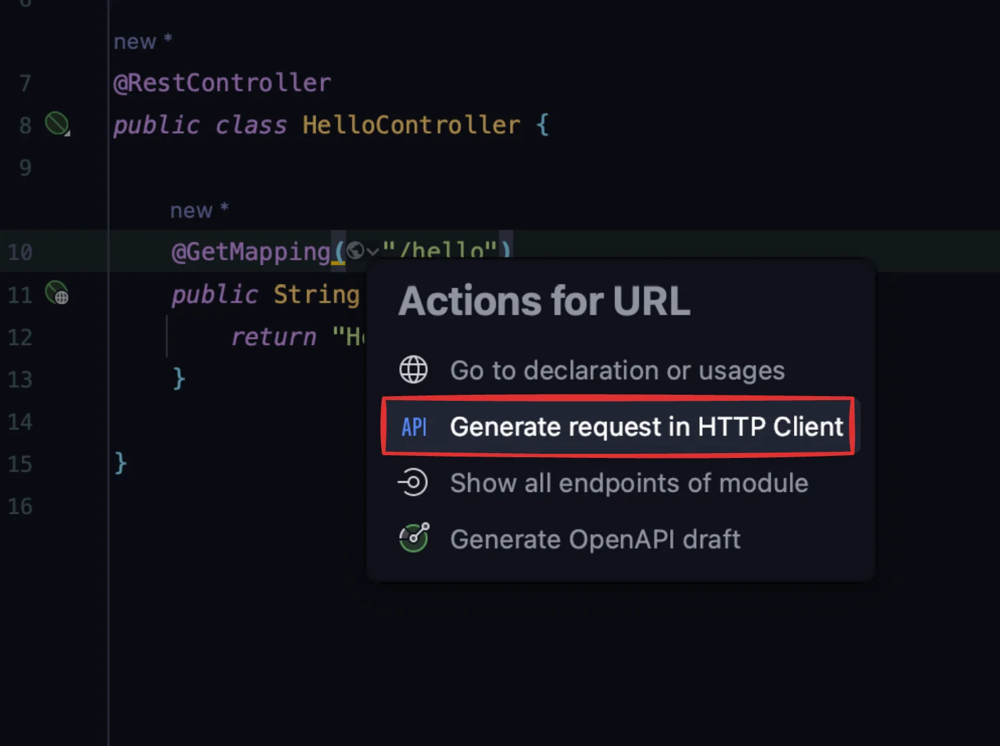

- API 테스트 
    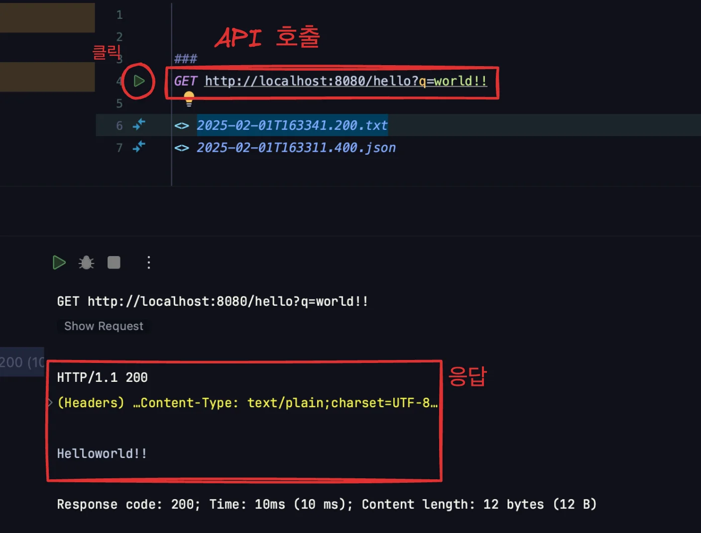

<details>
<summary>controller</summary>

<a id="1c3eda9b0fe1817d8c80f3b97b5351fe"></a>

```java
@RestController
public class HelloController {

    @GetMapping("/hello")
    public String hello(@RequestParam String q) {
        return "Hello" + q;
    }
}
```

</details>

<details>
<summary>HTTP client</summary>

<a id="1c3eda9b0fe181fdbb7bdf9b2a2eaebe"></a>

```java
GET http://localhost:8080/hello?q=world!!
```

</details>

</details>

<details>
<summary>5&#46; RabbitMQ 기본 설정&#58; <code>application&#46;yml</code></summary>

<details>
<summary><code>application&#46;yml</code></summary>

- host, port, username, password 지정

<a id="1c3eda9b0fe18128b91ccd25cffbf15d"></a>

```java
spring:
  rabbitmq:
    host: localhost
    port: 5672
    username: admin
    password: admin
  application:
    name: HelloMessageQueue
server:
  port: 8080
```

</details>

</details>

<details>
<summary>6&#46; Config 작성 ( Bean 생성 )</summary>

<details>
<summary>1&#46; Queue 인스턴스 생성&#58; <code>Queue</code></summary>

<a id="1c3eda9b0fe1814da4cbd0fffc0d6e8b"></a>

```java
Queue queue()
```

- Queue 인스턴스를 생성하고, 애플리케이션이 사용할 큐를 정의

- 메세지를 전달하고 처리하는 기본 큐 세팅
    - <code>QUEUE&#95;NAME</code>
        - 메세지가 쌓이고 처리될 큐의 이름을 정의

    - <code>Boolean</code>
        - 다음 인자로 넘기는 <code>false</code> 파라미터는 큐가 휘발성(volatile)인지 영속성(persistent)인지 여부를 지정하는 옵션이다&#46;

        - false 설정 시, 서버가 종료되거나 재시작될 때, 큐의 메세지가 사라진다&#46; 

</details>

<details>
<summary>2&#46; RabbitMQ와 통신하기 위한 템플릿 인스턴스 생성&#58; <code>RabbitTemplate</code>, ConnectionFactory</summary>

<a id="1c3eda9b0fe18163b3b9f22b654a1a6e"></a>

```java
RabbitTemplate rabbitTemplate(ConnectionFactory connectionFactory)
```

- RabbitMQ와 통신하기 위한 템플릿 인스턴스 생성, 메세지 송수신용
    - <code>JdbcTemplate</code>과 비슷하게, RabbitMQ와 상호작용하기 위한 간단한 API를 제공한다&#46; 

    - 주로 메세지 전송을 담당

    - <code>ConnectionFactory</code>
        -  RabbitMQ와의 연결을 관리하는 객체이다&#46;

        -  rabbitTemplate에 주입되어 메세지를 전송할 때 사용할 연결을 제공한다&#46;

    - 메세지를 전송하는 Sender가 <code>rabbitTemplate&#46;convertAndSend()</code> 메서드를 사용해 큐에 메세지를 넣는데 사용한다&#46;

</details>

<details>
<summary>3&#46; RabbitMQ 메세지를 비동기적으로 수신하기 위한 Listener 생성&#58; <code>SimpleMessageListenerContainer</code>, <code>MessageListenerAdapter</code>, <code>listenerAdapter</code></summary>

<a id="1c3eda9b0fe1818facb3c8a3aae0d8c0"></a>

```java
SimpleMessageListenerContainer container(ConnectionFactory connectionFactory, MessageListenerAdapter listenerAdapter)

container.setQueueName(QUEUE_NAME)
container.setMessageListener(listenerAdapter)

```

- RabbitMQ 메세지를 비동기적으로 수신하기 위해 <code>SimpleMessageListenerContainer</code>를 <strong><u>생성</u></strong>한다&#46; 해당 컨테이너가 <strong><u>특정 큐</u></strong>를 <strong><u>지속적으로 모니터링</u></strong>하고 <strong><u>메세지를 수신</u></strong>하면 <strong><u>지정된 리스너(</u></strong><strong><u><code>MessageListenerAdapter</code></u></strong><strong><u>)</u></strong>를 통해 처리한다&#46; 

- <code>ConnectionFactory</code>는<em><strong> </strong></em><strong><u>RabbitMQ와 연결을 유지</u></strong>하며, 수신하는 메세지를 이 연결을 통해 가져온다&#46; 

- <code>setQueueName(QUEUE&#95;NAME)</code>를 통해 모니터링 할 <strong><u>특정 큐를 설정</u></strong>한다&#46; 
    - 해당 컨테이너는 코드에서 설명 한 큐 네임만 helloQueue에서 수신되는 메세지를 모니터링한다&#46;

- <code>setMessageListener(listenerAdapter)</code>는 <code>listenerAdapter</code>를 설정하여, 메세지가 수신될 때 호출할 리스너를 지정한다&#46;

</details>

<details>
<summary>4&#46; 어댑터 설정</summary>

<a id="1c3eda9b0fe181a8a2e9f4d2022c8dd1"></a>

```java
 MessageListenerAdapter listenerAdapter(Receiver receiver)
```

- 수신한 메세지를 특정 클래스의 특정 메서드로 전달하는 어댑터
    - 인자로 전달된 메서드를 자동으로 호출

- <code>receiver</code> 객체는 메세지를 처리하는 역할을 하는 빈이며, <code>receiverMessage</code> 메서드를 호출한다&#46; 

- <code>MessageListenerAdapter</code>는 RabbitMQ에서 수신된 메세지를 특정 메세드에 전달 할 수 있도록 한다&#46;
    - 이 경우, receiveMessage 메서드가 자동으로 호출되며, 메세지 내용을 인자로 받는다&#46; 

- <code>Receiver</code> 클래스의 receiveMessage 메서드가 메세지를 수신하여 처리할 수 있도록 설정한다&#46; 
    - RabbitMQ에서 수신된 메세지가 <code>receiver&#46;receiveMessage(String message)</code> 메세드로 전달된다&#46;

</details>

---

<details>
<summary>&#91; 코드 &#93; RabbitMQConfig</summary>

- 참조&#58; ‣

<a id="1c3eda9b0fe181dba0d0ed580db35fc1"></a>

```java
package net.harunote.hellomessagequeue.step1;

import org.springframework.amqp.core.Queue;
import org.springframework.amqp.rabbit.connection.ConnectionFactory;
import org.springframework.amqp.rabbit.core.RabbitTemplate;
import org.springframework.amqp.rabbit.listener.SimpleMessageListenerContainer;
import org.springframework.amqp.rabbit.listener.adapter.MessageListenerAdapter;
import org.springframework.context.annotation.Bean;
import org.springframework.context.annotation.Configuration;

@Configuration
public class RabbitMQConfig {
    
    // 큐 네임을 설정한다.
    public static final String QUEUE_NAME = "helloqueue";
		
		/**
		 * 역할: 이 Bean은 Queue 인스턴스를 생성하고, 애플리케이션이 사용할 RabbitMQ 큐를 정의합니다.
     *  •	QUEUE_NAME은 메시지가 쌓이고 처리될 큐의 이름을 정의합니다. 이 예제에서는 helloQueue로 설정되어 있습니다.
     * 	•	false 파라미터는 큐가 휘발성(volatile)인지 영속성(persistent)인지 여부를 지정하는 옵션입니다. false로 설정하면 서버가 종료되거나 재시작될 때 큐의 메시지가 사라집니다.
     * 	•	사용 용도: 메시지를 전달하고 처리하는 기본 큐를 설정하는 데 사용됩니다.
     */
    @Bean
    public Queue queue() {
        return new Queue(QUEUE_NAME, false);
    }
    
    /**
     * 역할: RabbitMQ와의 통신을 위한 템플릿 클래스 RabbitTemplate의 인스턴스를 생성합니다. 이 템플릿은 메시지를 보내고 받을 때 주로 사용됩니다.
     *  •	RabbitTemplate은 Spring의 JdbcTemplate과 비슷하게, RabbitMQ와 상호작용하기 위한 간단한 API를 제공합니다. 주로 메시지 전송을 담당합니다.
     * 	•	ConnectionFactory는 RabbitMQ와의 연결을 관리하는 객체로, rabbitTemplate에 주입하여 메시지를 전송할 때 사용할 연결을 제공합니다.
     * 	•	사용 용도: 메시지를 전송하는 Sender가 rabbitTemplate.convertAndSend() 메서드를 사용해 큐에 메시지를 넣는 데 사용합니다.
    */
    @Bean
    public RabbitTemplate rabbitTemplate(ConnectionFactory connectionFactory) {
        return new RabbitTemplate(connectionFactory);
    }
    
    /**
	   *  역할: 이 Bean은 RabbitMQ 메시지를 비동기적으로 수신하기 위해 SimpleMessageListenerContainer를 생성합니다. 
	   *       이 컨테이너는 특정 큐를 지속적으로 모니터링하고,메시지를 수신하면 지정된 리스너(MessageListenerAdapter)를 통해 처리합니다.
     * 	•	ConnectionFactory는 RabbitMQ와 연결을 유지하며, 수신하는 메시지를 이 연결을 통해 가져옵니다.
     * 	•	setQueueNames(QUEUE_NAME) 메서드는 특정 큐 이름을 설정합니다. 이 컨테이너는 helloQueue에서 수신되는 메시지를 모니터링합니다.
     * 	•	setMessageListener(listenerAdapter)는 listenerAdapter를 설정하여, 메시지가 수신될 때 호출할 리스너를 지정합니다.
     * 	•   Spring AMQP에서 메시지를 자동으로 수신하려면 SimpleMessageListenerContainer가 필요합니다.
     * 	•	메시지 수신과 관련된 스레드 관리, 연결 유지, 큐 모니터링 작업을 자동으로 처리합니다.
     * 	•	없이 구현하면?:
     * 	•	RabbitTemplate의 receiveAndConvert() 메서드를 수동으로 호출하여 메시지를 가져오는 동기적 방식으로 구현해야 합니다.
     * 	•   이는 비효율적이며, 큐의 상태를 주기적으로 확인(polling)해야 하기 때문에 자원을 낭비할 수 있습니다.
    */
    @Bean
    public SimpleMessageListenerContainer container(ConnectionFactory connectionFactory,
                                                    MessageListenerAdapter listenerAdapter) {
        SimpleMessageListenerContainer container = new SimpleMessageListenerContainer();
        container.setConnectionFactory(connectionFactory);
        container.setQueueNames(QUEUE_NAME);
        container.setMessageListener(listenerAdapter);
        return container;
    }
		
		/**
		 * 역할: MessageListenerAdapter는 수신한 메시지를 특정 클래스의 특정 메서드로 전달하는 어댑터 역할을 합니다.
     *  •	receiver 객체는 메시지를 처리하는 역할을 하는 빈이며, receiveMessage 메서드를 호출합니다.
     * 	•	MessageListenerAdapter는 RabbitMQ에서 수신된 메시지를 특정 메서드에 전달할 수 있도록 해 줍니다.
     *     이 경우, receiveMessage 메서드가 자동으로 호출되며, 메시지 내용을 인자로 받습니다.
     * 	•	Receiver 클래스의 receiveMessage 메서드가 메시지를 수신하여 처리할 수 있도록 설정합니다.
     *     RabbitMQ에서 수신된 메시지가 receiver.receiveMessage(String message) 메서드로 전달됩니다.
		*/
    @Bean
    public MessageListenerAdapter listenerAdapter(Receiver receiver) {
        return new MessageListenerAdapter(receiver, "receiveMessage");
    }

}
```

</details>

</details>

<details>
<summary>7&#46; Message Sender 구현</summary>

- 참조&#58; ‣

<a id="1c3eda9b0fe1812cbff9c47a8e28b27c"></a>

```java
package net.harunote.hellomessagequeue.step1;

import org.springframework.amqp.rabbit.core.RabbitTemplate;
import org.springframework.stereotype.Component;

@Component
public class Sender {

    private final RabbitTemplate rabbitTemplate;

    public Sender(RabbitTemplate rabbitTemplate) {
        this.rabbitTemplate = rabbitTemplate;
    }

    public void send(String message) {
        rabbitTemplate.convertAndSend(RabbitMQConfig.QUEUE_NAME, message);
        System.out.println("[#] Sent : " + message);
    }
}
```

</details>

<details>
<summary>8&#46; Message Receiver 구현</summary>

- 참조&#58; ‣

<a id="1c3eda9b0fe181a4abafcebf1dab9bbf"></a>

```java
@Component
public class Receiver {
    public void receiveMessage(String message) {
        System.out.println("[#] Received: " + message);
    }
}
```

</details>

<details>
<summary>9&#46; Controller 구현</summary>

- 참조&#58; ‣

<a id="1c3eda9b0fe1817e9554f3c9b0e5538e"></a>

```java
@RestController
@RequestMapping("/api/messages")
public class MessageController {
    private final Sender sender;

    public MessageController(Sender sender) {
        this.sender = sender;
    }

    @PostMapping("/send")
    public String sendMessage(@RequestBody String message) {
        sender.send(message);
        return "[#] Message sent successfully! " + message;
    }
}
```

</details>

<details>
<summary>10&#46; 메세지 전송 테스트 ( 인텔리제이 내장 http client )</summary>

<a id="1c3eda9b0fe1819e8927ec65a5637b8a"></a>

```plaintext
###
GET http://localhost:8080/hello?q=world!!
<> 2024-11-20T201307.200.txt

###
POST http://localhost:8080/api/send
Content-Type: application/json

"MyQueue Hello World Test"
```

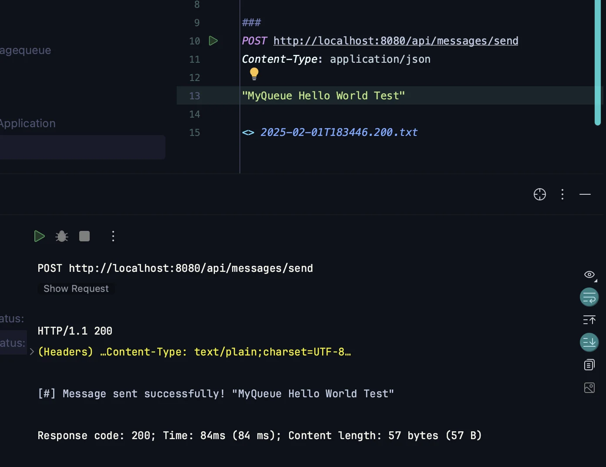

</details>

</details>

<a id="1c3eda9b0fe181d08853c18e38c53931"></a>

## RabbitMQ를 사용하여 기본 비동기 Message 전송

---

<details>
<summary>1&#46; Docker compose를 사용하여 build</summary>

- <strong>application&#46;yml</strong>
    <a id="1c3eda9b0fe181db8f0de0770e9245bb"></a>

    ```yaml
    spring:
      rabbitmq:
        host: ${RABBITMQ_HOST:localhost}
        port: 5672
        username: ${RABBITMQ_USER:guest}
        password: ${RABBITMQ_PASS:guest}
      application:
        name: rabbitmq
    server:
      port: 8080
    ```

- <strong>Dockerfile</strong>
    <a id="1c3eda9b0fe181539179e5ebbc8a4c7b"></a>

    ```docker
    FROM openjdk:17-jdk

    WORKDIR app

    COPY build/libs/*SNAPSHOT.jar /app.jar

    ENTRYPOINT ["java", "-jar", "/app.jar"]
    ```

- <strong>compose&#46;yml</strong>
    <a id="1c3eda9b0fe1814eaf80cba40cfb59dd"></a>

    ```yaml
    services:
      my-server:
        container_name: my-server
        build: .
        ports:
          - 8080:8080
        environment:
          - RABBITMQ_DEFAULT_USER=admin
          - RABBITMQ_DEFAULT_PASS=admin
          - RABBITMQ_HOST=my-rabbitmq
        depends_on:
          my-rabbitmq:
            condition: service_healthy

      my-rabbitmq:
        container_name: rabbitmq
        image: rabbitmq:4.0-management
        ports:
          - 5672:5672
          - 15672:15672
        volumes:
          - rabbitmq-data:/var/lib/rabbitmq/
          - rabbitmq-log:/var/log/rabbitmq/
        restart: unless-stopped
        environment:
          - RABBITMQ_DEFAULT_USER=admin
          - RABBITMQ_DEFAULT_PASS=admin
        healthcheck:
          test: ["CMD", "rabbitmqctl", "status"]
          interval: 5s
          retries: 10

    volumes:
      rabbitmq-data:
        name: rabbitmq-data
      rabbitmq-log:
        name: rabbitmq-log
    ```

- compose 실행
    <a id="1c3eda9b0fe181579832df0d327f5fff"></a>

    ```bash
    # compose 실행 전 - jar 파일 build
    ./gradlew clean build

    # compose 파일 실행
    docker compose up -d
    ```

    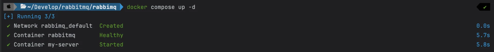

- 기본 호출 
    <details>
    <summary>HelloController</summary>

    <a id="1c3eda9b0fe181739e10c02d2089cf19"></a>

    ```java
    @RestController
    public class HelloController {

        @GetMapping("/")
        public String hello(){
            return "Hello!";
        }
    }

    ```

    </details>

    <a id="1c3eda9b0fe1817bb8aef3f2fe03ac0b"></a>

    ```java
    curl -X GET "localhost:8080"
    ```

    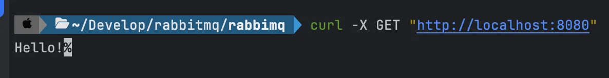

</details>

<a id="1c3eda9b0fe1810e97c0ca58665f2c57"></a>

### 코드

[step1 - 기본 비동기 메세지 전송](https://github.com/gyungsubLee/RabbitMQ_prac/commit/1623e924990e961630cc97d180f336d37aedf312)

<details>
<summary>&#91; 코드 &#93; RabbitMQConfig</summary>

<a id="1c3eda9b0fe181abaaf3cfbb502216c0"></a>

```java
package com.prac.rabbimq.step1;

import org.springframework.amqp.core.Queue;
import org.springframework.amqp.rabbit.connection.ConnectionFactory;
import org.springframework.amqp.rabbit.core.RabbitTemplate;
import org.springframework.amqp.rabbit.listener.SimpleMessageListenerContainer;
import org.springframework.amqp.rabbit.listener.adapter.MessageListenerAdapter;
import org.springframework.context.annotation.Bean;
import org.springframework.context.annotation.Configuration;

@Configuration
public class RabbitMQConfig {

    // 큐 네임을 설정한다.
    public static final String QUEUE_NAME = "helloqueue";

    @Bean
    public Queue queue() {
        return new Queue(QUEUE_NAME, false);
    }

    @Bean
    public RabbitTemplate rabbitTemplate(ConnectionFactory connectionFactory) {
        return new RabbitTemplate(connectionFactory);
    }

    @Bean
    public SimpleMessageListenerContainer container(ConnectionFactory connectionFactory,
                                                    MessageListenerAdapter listenerAdapter) {
        SimpleMessageListenerContainer container = new SimpleMessageListenerContainer();
        container.setConnectionFactory(connectionFactory);
        container.setQueueNames(QUEUE_NAME);
        container.setMessageListener(listenerAdapter);
        return container;
    }

    @Bean
    public MessageListenerAdapter listenerAdapter(Receiver receiver) {
        return new MessageListenerAdapter(receiver, "receiveMessage");
    }
}
```

</details>

<details>
<summary>&#91; 코드 &#93; Sender</summary>

<a id="1c3eda9b0fe181f2bc57e6ed389abd16"></a>

```java
package com.prac.rabbimq.step1;

import org.springframework.amqp.rabbit.core.RabbitTemplate;
import org.springframework.stereotype.Component;

@Component
public class Sender {

    private final RabbitTemplate rabbitTemplate;

    public Sender(RabbitTemplate rabbitTemplate) {
        this.rabbitTemplate = rabbitTemplate;
    }

    public void send(String message) {
        rabbitTemplate.convertAndSend(RabbitMQConfig.QUEUE_NAME, message);
        System.out.println("[#] Sent: " + message);
    }
}
```

</details>

<details>
<summary>&#91; 코드 &#93; Receiver</summary>

<a id="1c3eda9b0fe18126a82fc1f051effca4"></a>

```java
package com.prac.rabbimq.step1;

import org.springframework.stereotype.Component;

@Component
public class Receiver {
    public void receiveMessage(String message) {
        System.out.println("[#] Received: " + message);
    }
}
```

</details>

<details>
<summary>&#91; 코드 &#93; MessageController</summary>

<a id="1c3eda9b0fe1810cab9bfd4854e06ff8"></a>

```java
package com.prac.rabbimq.step1;

import com.prac.rabbimq.step1.Sender;
import org.springframework.web.bind.annotation.GetMapping;
import org.springframework.web.bind.annotation.RequestParam;
import org.springframework.web.bind.annotation.RestController;

@RestController
public class MessageController {

    private final Sender sender;

    public MessageController(Sender sender) {
        this.sender = sender;
    }

    @GetMapping("/msg")
    public String message(@RequestParam String message) {
        sender.send(message);
        return "Controller 메세지 호출: " + message;
    }
    
    // curl -X GET "http://localhost:8080?message="메세지1"
}
```

</details>

<a id="1c3eda9b0fe1812c80a1df66119d4058"></a>

### 설명

<details>
<summary>🧐 Queue &#45; <code>Durable</code> ( <code>지속성</code> ) </summary>


- <strong><u>durable</u></strong>&#58; <code>false</code> → <code>true</code>
    - <strong>해당 </strong><strong>큐(Queue)의 지속성(durability)이 보장</strong><strong>된다&#46; <br>즉, </strong><strong><u>RabbitMQ 서버가 재시작</u></strong><strong>되더라도</strong><strong><u> 해당 큐가 유지</u></strong><strong>된다&#46;</strong>

</details>

<details>
<summary>1&#46; Config ( RabbitMQConfig)</summary>

1.  Queue 인스턴스 ( <code>RabbitMQ 큐</code> ) 생성 
    <a id="1c3eda9b0fe18175acfaf25767b10ce6"></a>

    ```java
    @Bean
    public Queue queue() {
        return new Queue(QUEUE_NAME, false);
    }
    ```

    <details>
    <summary><code>new Queue</code>( <code>큐 이름</code>, <code>durable(지속성)</code> );</summary>

    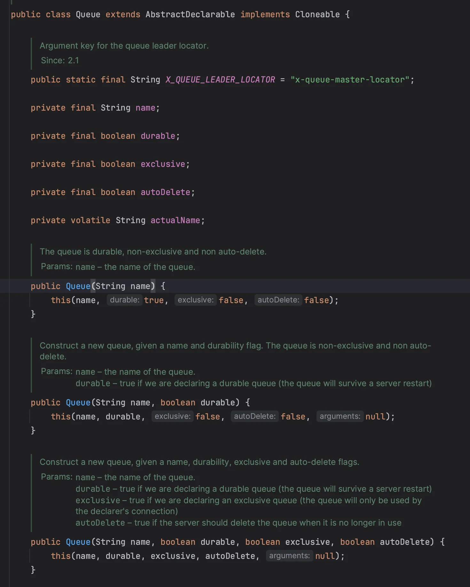

    </details>

1. <code>RabbitTemplate</code> 인스턴스 생성
    <a id="1c3eda9b0fe18142a920c6e7752b7153"></a>

    ```java
    @Bean
    public RabbitTemplate rabbitTemplate(ConnectionFactory connectionFactory) {
        return new RabbitTemplate(connectionFactory);
    }

    ```

    - <code>new RabbitTemplate</code>( <code>ConnectionFactory</code> )
        - 

1. SimpleMessageListenerContainer 생성 및 설정
    <a id="1c3eda9b0fe1811d8f1cc6b350f17395"></a>

    ```java
    @Bean
    public SimpleMessageListenerContainer container(ConnectionFactory connectionFactory,
                                                    MessageListenerAdapter listenerAdapter) {
        SimpleMessageListenerContainer container = new SimpleMessageListenerContainer();
        container.setConnectionFactory(connectionFactory);
        container.setQueueNames(QUEUE_NAME);
        container.setMessageListener(listenerAdapter);
        return container;  // helloQueue에서 수신되는 메시지를 모니터링함
    }
    ```

    - SimpleMessageListenerContainer를 통해 메세지를 비동기적으로 처리함
        - 특정 큐를 지속적으로 모니터링

        - 메시지를 수신 시, 지정된 리스너(MessageListenerAdapter)를 통해 메시지를 처리함

    -  container&#46;setConnectionFactory(connectionFactory)
        - ConnectionFactory는 RabbitMQ와 연결을 유지하며, 수신하는 메시지를 해당 연결을 통해 가져옴

    - setQueueNames(QUEUE&#95;NAME) 
        - 특정 큐 이름 설정

    - setMessageListener(listenerAdapter)
        - 메시지가 수신될 때 호출할 리스너 지정

    > ☝🏻 
    > 
    > <a id="1c3eda9b0fe1812eb43ccb293e529ff7"></a>
    > 
    > Spring AMQP에서 메시지를 자동으로 수신하려면 <code>SimpleMessageListenerContainer</code>가 필요하다&#46;
    > 
    > - 메시지 수신과 관련된 스레드 관리, 연결 유지, 큐 모니터링 작업을 자동으로 처리한다&#46;
    > 
    > <a id="1c3eda9b0fe181eea1eacea8c0d07ac2"></a>
    > 
    > <br><code>SimpleMessageListenerContainer</code> 없이 구현
    > 
    > -  RabbitTemplate의 <code>receiveAndConvert()</code> 메서드를  통해 <strong><u>수동으로 호출</u></strong>하여 메세지를 가져온다&#46;
    > 
    > - 이는 앞선 비동기 방식과 다르게<strong><u> 동기적 방식</u></strong>으로 구현된다&#46; 
    > 
    > - 또한 <strong><u>큐의 상태를 주기적으로 확인(polling)</u></strong>해야 하기 때문에 자원 낭비가 발생된다&#46; 
    >     <a id="1c3eda9b0fe181d388ebf4d034cb5a5f"></a>
    > 
    >     ⇒ 비효율적 

1. MessageListenerAdapter에 <strong><u>수신 객체 ( receiver )</u></strong> 등록
    <a id="1c3eda9b0fe1810ab08dfedcf6c9bb67"></a>

    ```java
    @Bean
    public MessageListenerAdapter listenerAdapter(Receiver receiver) {
        return new MessageListenerAdapter(receiver, "receiveMessage");
    }
    ```

    - <code>new MessageListenerAdapter</code> ( <code>수신 객체</code>, <code>메시지를 처리할 메서드</code> ) 

</details>

- 2&#46; Controller&#58; 클라이언트로 부터 메세지 전송 받음

<details>
<summary>3&#46;  Sender </summary>

> ✏️ 
> 
> <a id="1c3eda9b0fe18194af26df33045f6b9e"></a>
> 
> Controller에서 받아온 메세지를 큐에 전송하는 객체

<details>
<summary><code>🧐 RabbitTemplate</code> 클래스 &#45; 오버라이딩 된 <code>convertAndSend</code> 메서드들</summary>

<a id="1c3eda9b0fe18190bc64ff4d0d8672a1"></a>

```java
@Override
public void convertAndSend(Object object) throws AmqpException {
	convertAndSend(this.exchange, this.routingKey, object, (CorrelationData) null);
}

@Override
public void correlationConvertAndSend(Object object, CorrelationData correlationData) throws AmqpException {
	convertAndSend(this.exchange, this.routingKey, object, correlationData);
}

@Override
public void convertAndSend(String routingKey, final Object object) throws AmqpException {
	convertAndSend(this.exchange, routingKey, object, (CorrelationData) null);
}

@Override
public void convertAndSend(String routingKey, final Object object, CorrelationData correlationData)
		throws AmqpException {

	convertAndSend(this.exchange, routingKey, object, correlationData);
}

// 사용 
@Override
public void convertAndSend(String exchange, String routingKey, final Object object) throws AmqpException {
	convertAndSend(exchange, routingKey, object, (CorrelationData) null);
}

@Override
public void convertAndSend(String exchange, String routingKey, final Object object,
		@Nullable CorrelationData correlationData) throws AmqpException {

	send(exchange, routingKey, convertMessageIfNecessary(object), correlationData);
}

@Override
public void convertAndSend(Object message, MessagePostProcessor messagePostProcessor) throws AmqpException {
	convertAndSend(this.exchange, this.routingKey, message, messagePostProcessor);
}

@Override
public void convertAndSend(String routingKey, Object message, MessagePostProcessor messagePostProcessor)
		throws AmqpException {

	convertAndSend(this.exchange, routingKey, message, messagePostProcessor, null);
}

@Override
public void convertAndSend(Object message, MessagePostProcessor messagePostProcessor,
		CorrelationData correlationData)
		throws AmqpException {

	convertAndSend(this.exchange, this.routingKey, message, messagePostProcessor, correlationData);
}

@Override
public void convertAndSend(String routingKey, Object message, MessagePostProcessor messagePostProcessor,
		CorrelationData correlationData)
		throws AmqpException {

	convertAndSend(this.exchange, routingKey, message, messagePostProcessor, correlationData);
}

@Override
public void convertAndSend(String exchange, String routingKey, final Object message,
		final MessagePostProcessor messagePostProcessor) throws AmqpException {

	convertAndSend(exchange, routingKey, message, messagePostProcessor, null);
}

@Override
public void convertAndSend(String exchange, String routingKey, final Object message,
		final MessagePostProcessor messagePostProcessor,
		@Nullable CorrelationData correlationData) throws AmqpException {

	Message messageToSend = convertMessageIfNecessary(message);
	messageToSend = messagePostProcessor.postProcessMessage(messageToSend, correlationData,
			nullSafeExchange(exchange), nullSafeRoutingKey(routingKey));
	send(exchange, routingKey, messageToSend, correlationData);
}

```

</details>

- <code>RabbitTemplate&#46;convertAndSend()</code>
    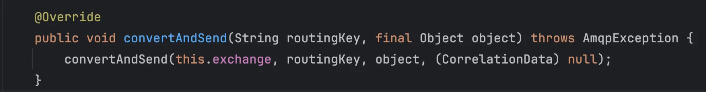

    > 메세지를 큐에 전송

    - 인자 ( Arguments )
        - routing key 

        - 전송할 메세지

</details>

<details>
<summary>4&#46; Receiver</summary>

> ✏️ 
> 
> <a id="1c3eda9b0fe181abb59dea030f3b6d7f"></a>
> 
> 큐에서 받아온 메세지를 클라이언트로 전송하는 객체

- 위 예시에서는 간단하게 <code>system&#46;out&#46;print</code> 만 진행

- 클라이언트로 메세지 전송 시, 아래와 같이 <code>SimpMessageTemplate</code> 사용하여 <strong><u>해당되는 엔드포인트 로 전송</u></strong>함
    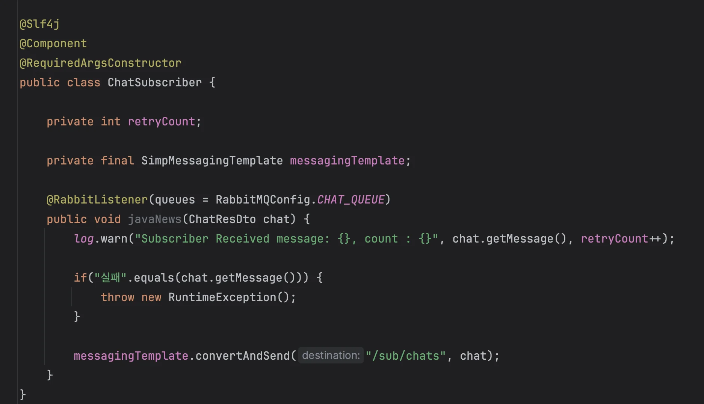

</details>
