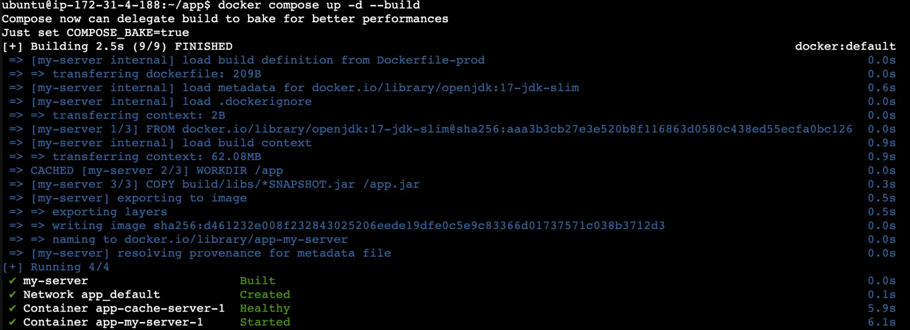
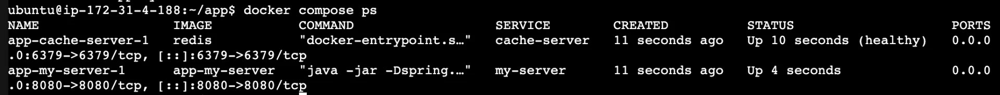
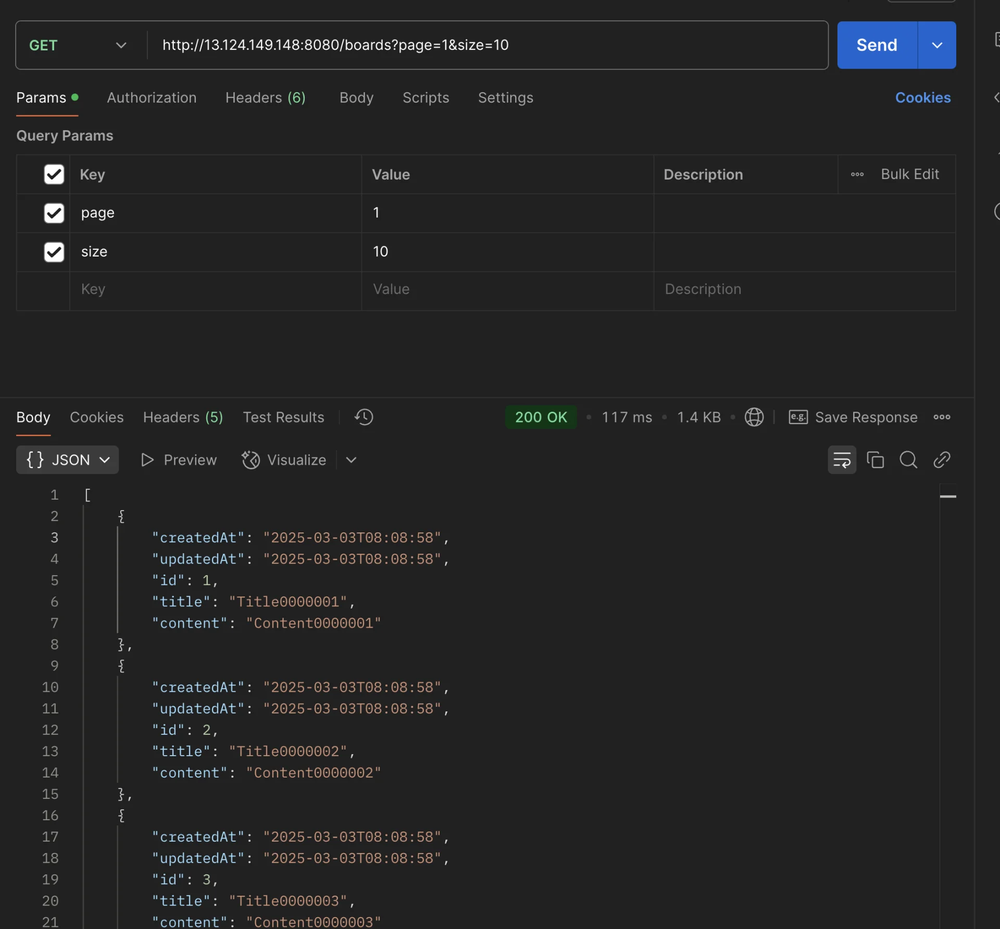
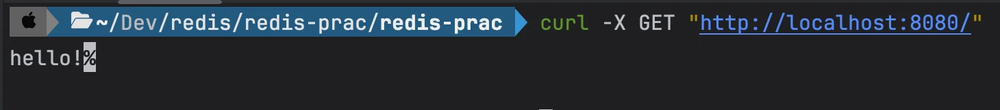
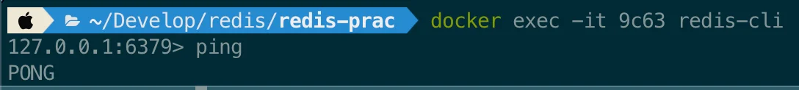
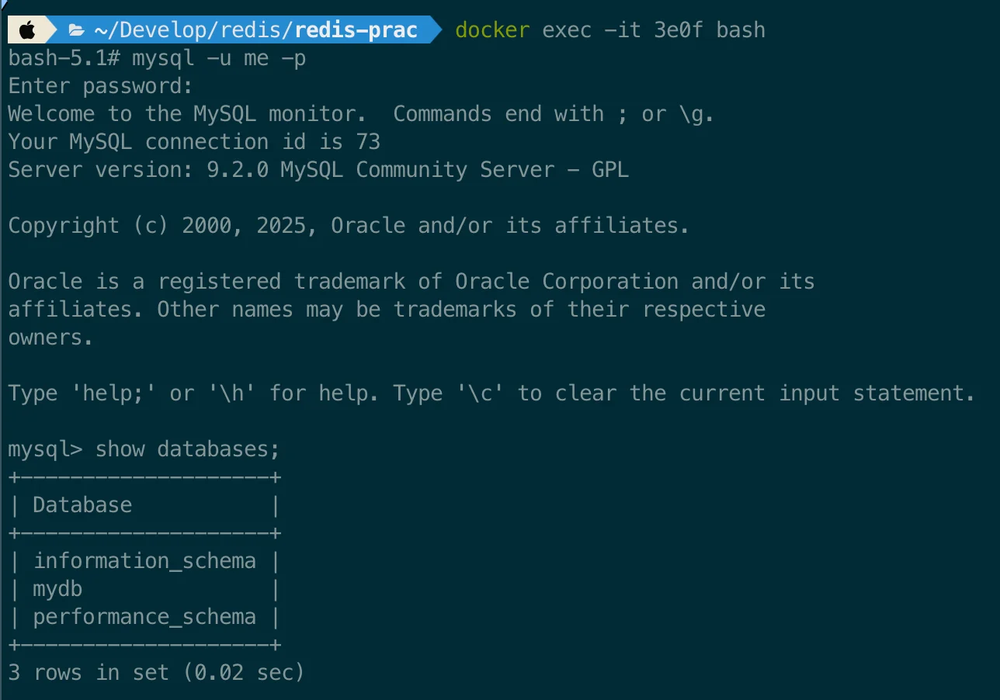

<a id="1c3eda9b0fe1811e98dcd5f5a170220b"></a>

### docker compose 사용 전

---

> ☝🏻 
> 
> <a id="1c3eda9b0fe1815788f9cf8c67258d83"></a>
> 
> docker ( compose )를 사용 전, 이전 학습에서는 <u>아래와 같이 초기 dependency (redis, JDK) 설치 및 서버 실행 cli를 입력</u>해야 했다
> 
> - 굉장히 번거로움

<details>
<summary>redis 설치</summary>

<a id="1c3eda9b0fe18108807bc1a5169276bf"></a>

```bash
# OS: ubuntu

sudo apt update

# Redis 설치
sudo apt install redis

# JDK 설치 
sudo apt install openjdk-17-jdk
```

</details>

<details>
<summary>서버 실행</summary>

<a id="1c3eda9b0fe18147838bc0bd59dafa0a"></a>

```bash
# jar 파일 build
./gradlew clean build

# 생성된 jar 파일 확인
ls build/libs

jar -jar -Dspring.profiles.active=prod {jar 파일 명}
```

</details>

<a id="1c3eda9b0fe181e08a45f412c9d402a6"></a>

이를 Docker를 통해 ( <code>Dockerfile</code>, <code>docker&#45;compose&#46;yml</code> )

<a id="1c3eda9b0fe1811491fcd3b6a20ee23e"></a>

간단하게 실행 및 종료 가능하다&#46; 

<a id="1c3eda9b0fe1817e9376e48bda9fc7d2"></a>

### EC2에서 <u>Docker Compose</u>를 활용하여 <code>서버</code>(<code>스프링부트</code>), <code>Redis</code>  실행시키기

---

<details>
<summary>1&#46;  Dockerfile, Compose 파일 정의</summary>

<details>
<summary><strong>Dockerfile&#45;prod</strong></summary>

<a id="1c3eda9b0fe18182b9e1cdfe3f7d924b"></a>

```docker
FROM openjdk:17-jdk-slim

WORKDIR /app

COPY build/libs/*SNAPSHOT.jar /app.jar

EXPOSE 8080

ENTRYPOINT ["java", "-jar", "-Dspring.profiles.active=prod", "/app.jar"]
```

</details>

<details>
<summary><strong>compose&#46;yml</strong></summary>

<a id="1c3eda9b0fe18137b146d2daeef256c5"></a>

```yaml
services:
	my-server:
		build:
			context: .
			dockerfile: ./Dockerfile-prod
		ports:
			- 8080:8080
		depends_on:
			cache-server:
				condition: service_healthy
	cache-server:
		image: redis
		ports:
			- 6379:6379
		healthcheck:
			test: [ "CMD", "redis-cli", "ping" ]
			interval: 5s
			retries: 10
```

</details>

<details>
<summary><strong>application&#46;yml</strong></summary>

<a id="1c3eda9b0fe181799b73cd0c34f1bbb8"></a>

```bash
# local 환경
spring:
  profiles:
    default: local
  datasource:
    url: jdbc:mysql://localhost:3306/mydb
    username: root
    password: password
    driver-class-name: com.mysql.cj.jdbc.Driver
  jpa:
    hibernate:
      ddl-auto: update
    show-sql: true
  redis:
    host: localhost
    port: 6379

logging:
  level:
    org.springframework.cache: trace

---

# Product 환경
spring:
  config:
    activate:
      on-profile: prod
  datasource:
    url: jdbc:mysql://redis-test.cre9tednguhb.ap-northeast-2.rds.amazonaws.com:3306/mydb
    username: admin
    password: password
  redis:
    host: cache-server
    port: 6379

```

</details>

</details>

<details>
<summary>2&#46; github에 push하고 EC2에서 pull 받아오기</summary>

<a id="1c3eda9b0fe181dbad6afb12fd53d256"></a>

```bash
git add .

git commit -m "커밋 메세지"
```

<a id="1c3eda9b0fe1813b9f3be2ccdbf6d146"></a>

```bash
git pull origin main

# 차례대로 입력
	# Username for 'https://github.com': {계정 유저 이름}
	# Password for 'https://%1B%5BA@github.com': {발급 받은 토큰 값}
```

</details>

<details>
<summary>3&#46;  <strong>EC2에 Docker 설치</strong></summary>

<a id="1c3eda9b0fe1811fbb5ffd15a315194b"></a>

```bash
# Docker, Docker Compose 설치
sudo apt-get update && \
	sudo apt-get install -y apt-transport-https ca-certificates curl software-properties-common && \
	curl -fsSL https://download.docker.com/linux/ubuntu/gpg | sudo apt-key add - && \
	sudo apt-key fingerprint 0EBFCD88 && \
	sudo add-apt-repository "deb [arch=amd64] https://download.docker.com/linux/ubuntu $(lsb_release -cs) stable" && \
	sudo apt-get update && \
	sudo apt-get install -y docker-ce && \
	sudo usermod -aG docker ubuntu && \
	newgrp docker && \
	sudo curl -L "https://github.com/docker/compose/releases/download/2.27.1/docker-compose-$(uname -s)-$(uname -m)" -o /usr/local/bin/docker-compose && \
	sudo chmod +x /usr/local/bin/docker-compose && \
	sudo ln -s /usr/local/bin/docker-compose /usr/bin/docker-compose
	
# Docker 버전 확인
docker -v 

# Docker Compose 버전 확인
docker compose version
```

</details>

<details>
<summary>4&#46; 기존에 실행되고 있는 Redis, Spring Boot 종료하기</summary>

<a id="1c3eda9b0fe18169ae1dcd0031ba0044"></a>

```bash
# Redis 중지
sudo systemctl stop redis
sudo systemctl status redis # 잘 종료됐는 지 확인

# Spring Boot 종료
sudo lsof -i:8080 # 8080번 포트 실행되고 있는 프로세스 확인
kill {Spring Boot의 PID} # 프로세스 종료
sudo lsof -i:8080 # 잘 종료됐는 지 확인
```

</details>

<details>
<summary>5&#46; compose 파일 실행</summary>

<a id="1c3eda9b0fe18176a728d9b0e1690273"></a>

```bash
# jar 파일 build
./gradlew clean build -x test

# compose 실행
docker compose up -d --build

# 실행 확인
docker compose ps 

# compose 종료
docker compose down
```

- compose 실행
    

- compose 프로세스 조회
    

- api 호출 
    <a id="1c3eda9b0fe181ffb0c2e5e61a678688"></a>

    ```bash
    http://{EC2 엔드포인트}:8080/boards?page=1&size=10
    ```

    

</details>

<a id="1c3eda9b0fe1814693f6f47fbbbfbfa6"></a>

### 추가) Docker Compose&#58; <code>Spring Boot</code> &#43; <code>Redis</code> &#43; <code>MySQL</code>

---

<details>
<summary><strong>application&#46;yml</strong></summary>

<a id="1c3eda9b0fe181cfac1bf6828d77ed75"></a>

```yaml
server:
  port: 8080

spring:
  datasource:
    url: ${SPRING_DATASOURCE_URL}
    username: ${SPRING_DATASOURCE_USERNAME}
    password: ${SPRING_DATASOURCE_PASSWORD}
    driver-class-name: com.mysql.cj.jdbc.Driver
  jpa:
    hibernate:
      ddl-auto: create
    show-sql: true
    properties:
      hibernate:
        format_sql: true

  redis:
    host: ${SPRING_REDIS_HOST}
    port: ${SPRING_REDIS_PORT}

  sql:
    init:
      mode: always

logging:
  level:
    org.springframework: INFO
```

</details>

<details>
<summary><strong>Dockerfile</strong></summary>

<a id="1c3eda9b0fe18132a6d9ee8cdfd84633"></a>

```docker
FROM openjdk:17-jdk-slim

WORKDIR /app

COPY build/libs/*SNAPSHOT.jar app.jar

EXPOSE 8080

ENTRYPOINT ["java", "-jar", "app.jar"]
```

</details>

<details>
<summary><strong>compose&#46;yml</strong></summary>

<a id="1c3eda9b0fe1813da6c6dc1b9804afc1"></a>

```yaml
services:
  server:
    container_name: my-server
    build: .
    environment:
      SPRING_DATASOURCE_URL: jdbc:mysql://mysql:3306/mydb?useSSL=false&serverTimezone=UTC&allowPublicKeyRetrieval=true
      SPRING_DATASOURCE_USERNAME: me
      SPRING_DATASOURCE_PASSWORD: 12345678
      SPRING_REDIS_HOST: redis
      SPRING_REDIS_PORT: 6379
    ports:
      - "8080:8080"
    restart: unless-stopped
    depends_on:
      mysql:
        condition: service_healthy
      redis:
        condition: service_healthy

  mysql:
    image: mysql:latest
    container_name: my-mysql
    environment:
      MYSQL_ROOT_PASSWORD: pwd123
      MYSQL_DATABASE: mydb
      MYSQL_USER: me
      MYSQL_PASSWORD: 12345678
    ports:
      - "3306:3306"
    volumes:
      - mysql_data:/var/lib/mysql
    restart: unless-stopped
    healthcheck:
      test: [ "CMD", "mysqladmin", "ping", "-h", "localhost" ]
      interval: 10s
      timeout: 5s
      retries: 5

  redis:
    image: redis:latest
    container_name: my-redis
    ports:
      - "6379:6379"
    restart: unless-stopped
    healthcheck:
      test: [ "CMD", "redis-cli", "ping" ]
      interval: 10s
      timeout: 5s
      retries: 5

volumes:
  mysql_data:
```

</details>

---

<details>
<summary>실행 확인</summary>

- compose 실행 및 종료
    <a id="1c3eda9b0fe181b2bcf3fdb138635f91"></a>

    ```bash
    # jar 파일 build
    ./gradlew clean build -x test 

    # compose 실행
    docker compose up -d --build

    # compose 종료
    docker compose down
    ```

- Spring Boot
    <a id="1c3eda9b0fe181caae18e18456518ca9"></a>

    ```bash
    curl -X GET "http://localhost:8080/"
    ```

    

- redis
    <a id="1c3eda9b0fe1810ea487f2cd0fdc78d6"></a>

    ```bash
    docker ps

    docker exec -it [redis 컨테이너 ID] redis-cli

    127.0.0.1:6379> ping
    # PONG
    ```

    

- mysql 
    <a id="1c3eda9b0fe181acbb55c867484a105a"></a>

    ```bash
    docker ps

    docker exec -it [mysql 컨테이너 ID] bash

    mysql -u [유저명] -p
    # password 입력

    mysql> show databases;
    ```

    

</details>
