<a id="1c3eda9b0fe18158b791e8bad34b8bf8"></a>

### 🧐 Error) Controller 에서 html 매핑 안됨

<a id="1c3eda9b0fe181e4a627ea4406b5c89f"></a>

### 문제

> Thymleaf를 사용해서 html을 매핑하는데, <strong>html이 매핑되지 안고 string 값만 return 됨</strong>

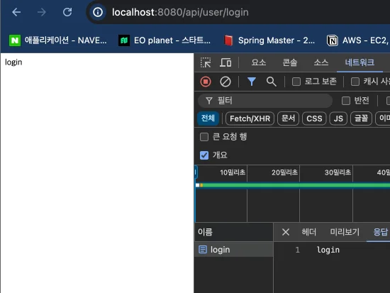

<a id="1c3eda9b0fe18156bed6cf1fa210ad11"></a>

### 원인

<a id="1c3eda9b0fe181c58e00c6b27f4fc3e8"></a>

<strong><u>Controller</u></strong><u>에 </u><u><code>&#64;RestController</code></u><u>를 적용</u>하여 <strong>JSON 데이터가 반환</strong>되어 String 값을 보여줌

<a id="1c3eda9b0fe1812cb62edcdd06e9cd8c"></a>

### 해결

> <code>&#64;RestController</code> → <code>&#64;Controller</code> 변경

<a id="1c3eda9b0fe1815988a4f005c5443ebf"></a>

```java
@Controller
@RequestMapping("/api")
@RequiredArgsConstructor
public class UserController {
```

<a id="1c3eda9b0fe181e7bcd6e3f8df37bd2f"></a>

정상적으로 html 응답

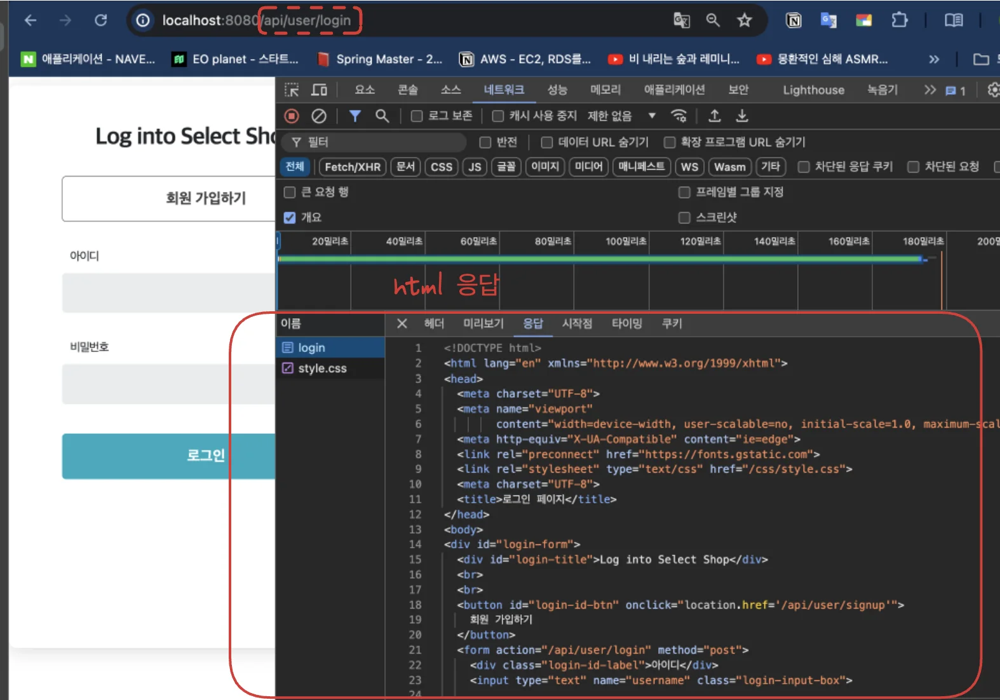

<a id="1c3eda9b0fe181288567e92ae59e30b7"></a>

### 🧐  Error) PostMapping 시 requestDto 에서 값을 받아오지 못함

<a id="1c3eda9b0fe181fdb916eda2ad819cf5"></a>

### 문제 발생 코드

<details>
<summary>SignupRequestDto</summary>

<a id="1c3eda9b0fe18150a743ff5599dcd186"></a>

```java
package com.example.auth.dto;


import lombok.Getter;

@Getter
public class SignupRequestDto {
    private String username;
    private String password;
    private String email;
    private boolean admin = false;
    private String adminToken = "";
}

```

</details>

<details>
<summary>UserController</summary>

<a id="1c3eda9b0fe18167ab0ced39e6f35955"></a>

```java
@PostMapping("/user/signup")
public String signup(SignupRequestDto requestDto){
    userService.signup(requestDto);
    return "redirect:/api/user/login-page";
}
```

</details>

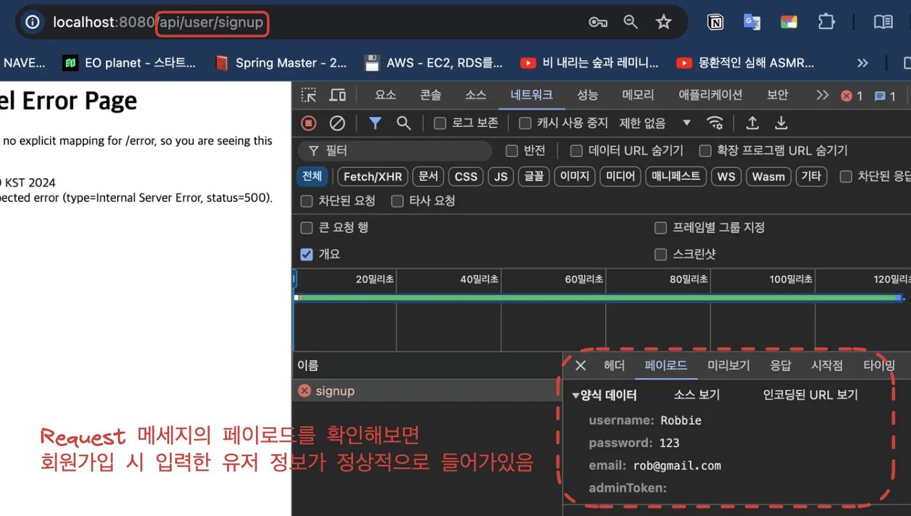

<a id="1c3eda9b0fe1816181dbd8ad24074241"></a>

### 해결

<a id="1c3eda9b0fe18119b26cde947b90efc8"></a>

<code>SignupRequestDto</code>에 Setter(<code>&#64;Setter</code>)가 없어 <strong><u>값이 추가되지 않</u></strong>았음<br>따라서 <strong>Setter(</strong><strong><code>&#64;Setter</code></strong>) 추가

<a id="1c3eda9b0fe181138902e8bf33818b88"></a>

```java
package com.example.auth.dto;


import lombok.Getter;
import lombok.Setter;

@Getter
@Setter
public class SignupRequestDto {
    private String username;
    private String password;
    private String email;
    private boolean admin = false;
    private String adminToken = "";
}

```

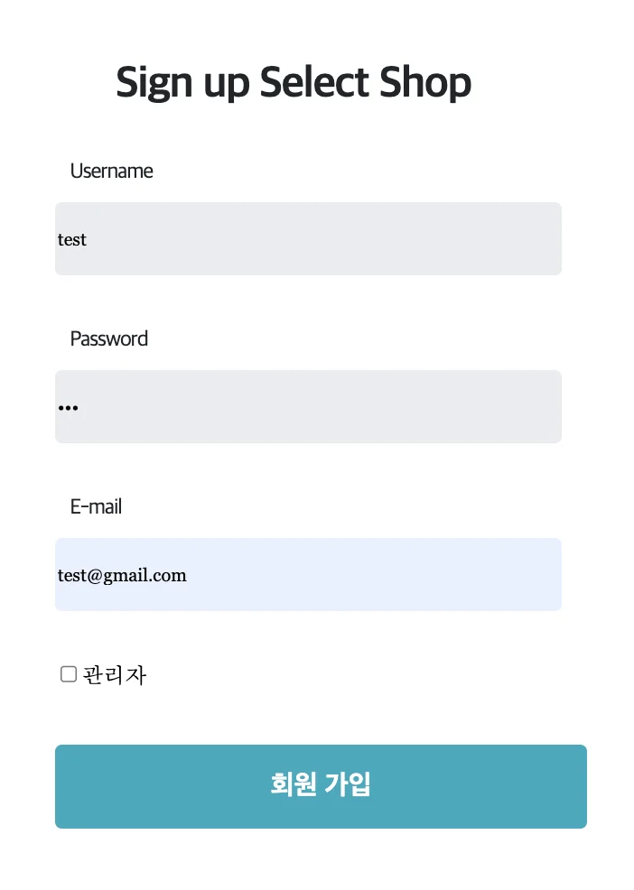

<a id="1c3eda9b0fe1811d8cebf056548ff49d"></a>

Dto로 값을 잘 받아와 DB에 쿼리 날려 저장

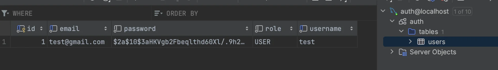

<details>
<summary><strong>🧐 Dto에 Setter 추가 시 어떻게 자동으로 값을 받아올 수 있는가?</strong></summary>

1. <strong>기본 파라미터 바인딩</strong>

<a id="1c3eda9b0fe18161b04cee7e3cf594da"></a>

Spring MVC는 요청 파라미터를 메서드의 파라미터 타입과 이름을 기반으로 자동으로 매핑한다&#46; 파라미터가 DTO 객체인 경우, Spring은 요청 파라미터를 DTO의 필드에 매핑하여 가져온다&#46;

1. <strong>커맨드 객체 인식</strong>

<a id="1c3eda9b0fe18136ac5ed2ae9d7ffc3f"></a>

컨트롤러 메서드 파라미터가 일반적인 자바 객체일 때, Spring은 이를 커맨드 객체로 인식하고, 요청 파라미터를 해당 객체의 필드에 자동으로 바인딩한다, 이 과정에서 &#64;ModelAttribute가 없어도 Spring은 기본적으로 객체 파라미터를 커맨드 객체로 처리한다&#46;

</details>

<details>
<summary><strong>🧐 커맨드 객체?</strong></summary>

<a id="1c3eda9b0fe18122ae1fcb60544738b6"></a>

커맨드 객체(Command Object)는 <code>Spring MVC</code>에서<strong><u> </u></strong><strong><u>HTTP 요청 파라미터를 자바 객체로 바인딩</u></strong><strong><u>하기 위해 사용되는 객체</u></strong>이다&#46;

<a id="1c3eda9b0fe181b29edbe96e956d3c15"></a>

 간단히 말해, <strong><u>클라이언트가 보낸 데이터를 컨트롤러에서 쉽게 다룰 수 있도록 도와주는 객체</u></strong>이다&#46;<br>

<a id="1c3eda9b0fe18146873dd3dbe489e539"></a>

<strong>커맨드 객체의 역할</strong>

1. <strong>데이터 바인딩</strong>&#58; HTTP 요청 파라미터(쿼리 스트링, 폼 데이터)를 자바 객체의 필드에 자동으로 매핑

1. <strong>유효성 검사</strong>&#58; 바인딩된 데이터를 기반으로 유효성 검사를 수행한다&#46;

1. <strong>재사용성</strong>&#58; 여러 컨트롤러에서 같은 커맨드 객체를 재사용한다&#46;

</details>

<a id="1c3eda9b0fe181939665e817a7e4bdec"></a>

## 회원가입 구현

<details>
<summary><strong>Client</strong></summary>

<details>
<summary><strong>resources/template</strong></summary>

<details>
<summary>index&#46;html</summary>

<a id="1c3eda9b0fe18123b684f52c313144d5"></a>

```java
<!doctype html>
<html lang="en">
<head>
    <meta charset="UTF-8">
    <meta name="viewport"
          content="width=device-width, user-scalable=no, initial-scale=1.0, maximum-scale=1.0, minimum-scale=1.0">
    <meta http-equiv="X-UA-Compatible" content="ie=edge">
    <link rel="preconnect" href="https://fonts.gstatic.com">

    <link rel="stylesheet" href="/css/style.css">
    <script src="https://code.jquery.com/jquery-3.7.0.min.js" integrity="sha256-2Pmvv0kuTBOenSvLm6bvfBSSHrUJ+3A7x6P5Ebd07/g=" crossorigin="anonymous"></script>
    <script src="https://cdn.jsdelivr.net/npm/js-cookie@3.0.5/dist/js.cookie.min.js"></script>
    <script src="/js/basic.js"></script>
    <title>나만의 셀렉샵</title>
</head>
<body>
<div class="header" style="position:relative;">
    <div id="login-true" style="display: none">
        <div id="header-title-login-user">
            <span th:text="${username}"></span> 님의
        </div>
        <div id="header-title-select-shop">
            Select Shop
        </div>
        <a id="login-text" href="javascript:logout()">
            로그아웃
        </a>
    </div>
    <div id="login-false" >
        <div id="header-title-select-shop">
            My Select Shop
        </div>
        <a id="sign-text" href="/api/user/signup">
            회원가입
        </a>
        <a id="login-text" href="/api/user/login-page">
            로그인
        </a>
    </div>
</div>
</body>
</html>
```

</details>

<details>
<summary>login&#46;html</summary>

<a id="1c3eda9b0fe181969c0ed50e180be6d9"></a>

```java
<!DOCTYPE html>
<html lang="en" xmlns="http://www.w3.org/1999/xhtml" xmlns:th="http://www.thymeleaf.org">
<head>
    <meta charset="UTF-8">
    <meta name="viewport"
          content="width=device-width, user-scalable=no, initial-scale=1.0, maximum-scale=1.0, minimum-scale=1.0">
    <meta http-equiv="X-UA-Compatible" content="ie=edge">
    <link rel="preconnect" href="https://fonts.gstatic.com">
    <link rel="stylesheet" type="text/css" href="/css/style.css">
    <meta charset="UTF-8">
    <title>로그인 페이지</title>
</head>
<body>
<div id="login-form">
    <div id="login-title">Log into Select Shop</div>
    <br>
    <br>
    <button id="login-id-btn" onclick="location.href='/api/user/signup'">
        회원 가입하기
    </button>
    <form action="/api/user/login" method="post">
        <div class="login-id-label">아이디</div>
        <input type="text" name="username" class="login-input-box">

        <div class="login-id-label">비밀번호</div>
        <input type="password" name="password" class="login-input-box">

        <button id="login-id-submit">로그인</button>
    </form>
    <div id="login-failed" style="display: none" class="alert alert-danger" role="alert">로그인에 실패하였습니다.</div>
</div>
</body>
<script>
    const href = location.href;
    const queryString = href.substring(href.indexOf("?")+1)
    if (queryString === 'error') {
        const errorDiv = document.getElementById('login-failed');
        errorDiv.style.display = 'block';
    }
</script>
</html>
```

</details>

<details>
<summary>signup&#46;html</summary>

<a id="1c3eda9b0fe181508419ff2a742850d8"></a>

```java
<!DOCTYPE html>
<html lang="en" xmlns="http://www.w3.org/1999/xhtml" xmlns:th="http://www.thymeleaf.org">
<head>
    <meta charset="UTF-8">
    <meta name="viewport"
          content="width=device-width, user-scalable=no, initial-scale=1.0, maximum-scale=1.0, minimum-scale=1.0">
    <meta http-equiv="X-UA-Compatible" content="ie=edge">
    <link rel="preconnect" href="https://fonts.gstatic.com">
    <link rel="stylesheet" type="text/css" href="/css/style.css">
    <meta charset="UTF-8">
    <title>회원가입 페이지</title>
    <script>
        function onclickAdmin() {
            // Get the checkbox
            var checkBox = document.getElementById("admin-check");
            // Get the output text
            var box = document.getElementById("admin-token");

            // If the checkbox is checked, display the output text
            if (checkBox.checked == true){
                box.style.display = "block";
            } else {
                box.style.display = "none";
            }
        }
    </script>
</head>
<body>
<div id="login-form">
    <div id="login-title">Sign up Select Shop</div>

    <form action="/api/user/signup" method="post">
        <div class="login-id-label">Username</div>
        <input type="text" name="username" placeholder="Username" class="login-input-box">

        <div class="login-id-label">Password</div>
        <input type="password" name="password" class="login-input-box">

        <div class="login-id-label">E-mail</div>
        <input type="text" name="email" placeholder="E-mail" class="login-input-box">

        <div>
            <input id="admin-check" type="checkbox" name="admin" onclick="onclickAdmin()" style="margin-top: 40px;">관리자
            <input id="admin-token" type="password" name="adminToken" placeholder="관리자 암호" class="login-input-box" style="display:none">
        </div>
        <button id="login-id-submit">회원 가입</button>
    </form>
</div>
</body>
</html>
```

</details>

</details>

<details>
<summary><strong>resources/static</strong></summary>

<details>
<summary>css/style&#46;css</summary>

<a id="1c3eda9b0fe18193972cc3ca186b8011"></a>

```java
* {
    font-family: 'Georgia', serif;
}

body {
    margin: 0px;
}

.header {
    height: 255px;
    box-sizing: border-box;
    background-color: #15aabf;
    color: white;
    text-align: center;
    padding-top: 80px;
    /*padding: 50px;*/
    font-size: 45px;
    font-weight: bold;
}

#header-title-login-user {
    font-size: 36px;
    letter-spacing: -1.08px;
}

#header-title-select-shop {
    margin-top: 20px;
    font-size: 45px;
    letter-spacing: 1.1px;
}

#login-form {
    width: 538px;
    height: 710px;
    margin: 70px auto 141px auto;
    display: flex;
    flex-direction: column;
    justify-content: flex-start;
    align-items: center;
    /*gap: 96px;*/
    padding: 56px 0 0;
    border-radius: 10px;
    box-shadow: 0 4px 25px 0 rgba(0, 0, 0, 0.15);
    background-color: #ffffff;
}

#login-title {
    width: 303px;
    height: 32px;
    /*margin: 56px auto auto auto;*/
    flex-grow: 0;
    font-family: SpoqaHanSansNeo;
    font-size: 32px;
    font-weight: bold;
    font-stretch: normal;
    font-style: normal;
    line-height: 1;
    letter-spacing: -0.96px;
    text-align: left;
    color: #212529;
}

#login-kakao-btn {
    border-width: 0;
    margin: 96px 0 8px;
    width: 393px;
    height: 62px;
    flex-grow: 0;
    display: flex;
    flex-direction: row;
    justify-content: center;
    align-items: center;
    gap: 10px;
    /*margin: 0 0 8px;*/
    padding: 11px 12px;
    border-radius: 5px;
    background-color: #ffd43b;

    font-family: SpoqaHanSansNeo;
    font-size: 20px;
    font-weight: bold;
    font-stretch: normal;
    font-style: normal;
    color: #414141;
}

#login-id-btn {
    width: 393px;
    height: 62px;
    flex-grow: 0;
    display: flex;
    flex-direction: row;
    justify-content: center;
    align-items: center;
    gap: 10px;
    /*margin: 8px 0 0;*/
    padding: 11px 12px;
    border-radius: 5px;
    border: solid 1px #212529;
    background-color: #ffffff;

    font-family: SpoqaHanSansNeo;
    font-size: 20px;
    font-weight: bold;
    font-stretch: normal;
    font-style: normal;
    color: #414141;
}

.login-input-box {
    border-width: 0;

    width: 370px !important;
    height: 52px;
    margin: 14px 0 0;
    border-radius: 5px;
    background-color: #e9ecef;
}

.login-id-label {
    /*width: 44.1px;*/
    /*height: 16px;*/
    width: 382px;
    padding-left: 11px;
    margin-top: 40px;
    /*margin: 0 337.9px 14px 11px;*/
    font-family: NotoSansCJKKR;
    font-size: 16px;
    font-weight: normal;
    font-stretch: normal;
    font-style: normal;
    line-height: 1;
    letter-spacing: -0.8px;
    text-align: left;
    color: #212529;
}

#login-id-submit {
    border-width: 0;
    width: 393px;
    height: 62px;
    flex-grow: 0;
    display: flex;
    flex-direction: row;
    justify-content: center;
    align-items: center;
    gap: 10px;
    margin: 40px 0 0;
    padding: 11px 12px;
    border-radius: 5px;
    background-color: #15aabf;

    font-family: SpoqaHanSansNeo;
    font-size: 20px;
    font-weight: bold;
    font-stretch: normal;
    font-style: normal;
    line-height: 1;
    letter-spacing: normal;
    text-align: center;
    color: #ffffff;
}

#sign-text {
    position:absolute;
    top:48px;
    right:110px;
    font-size: 18px;
    font-family: SpoqaHanSansNeo;
    font-size: 18px;
    font-weight: 500;
    font-stretch: normal;
    font-style: normal;
    line-height: 1;
    letter-spacing: 0.36px;
    text-align: center;
    color: #ffffff;
}

#login-text {
    position:absolute;
    top:48px;
    right:50px;
    font-size: 18px;
    font-family: SpoqaHanSansNeo;
    font-size: 18px;
    font-weight: 500;
    font-stretch: normal;
    font-style: normal;
    line-height: 1;
    letter-spacing: 0.36px;
    text-align: center;
    color: #ffffff;
}

.alert-danger {
    color: #721c24;
    background-color: #f8d7da;
    border-color: #f5c6cb;
}

.alert {
    width: 300px;
    margin-top: 22px;
    padding: 1.75rem 1.25rem;
    border: 1px solid transparent;
    border-radius: .25rem;
}
```

</details>

<details>
<summary>js/basic&#46;js</summary>

<a id="1c3eda9b0fe1811fbe40cad40fd0e379"></a>

```java
let host = 'http://' + window.location.host;

$(document).ready(function () {
    const auth = getToken();
    if(auth === '') {
        window.location.href = host + "/api/user/login-page";
    } else {
        $('#login-true').show();
        $('#login-false').hide();
    }
})

function logout() {
    // 토큰 삭제
    Cookies.remove('Authorization', { path: '/' });
    window.location.href = host + "/api/user/login-page";
}

function getToken() {
    let auth = Cookies.get('Authorization');

    if(auth === undefined) {
        return '';
    }

    return auth;
}
```

</details>

</details>

</details>

<a id="1c3eda9b0fe18166a12ac8d51b921577"></a>

## 로그인 구현

<details>
<summary>로그인 확인 </summary>

- user 확인
    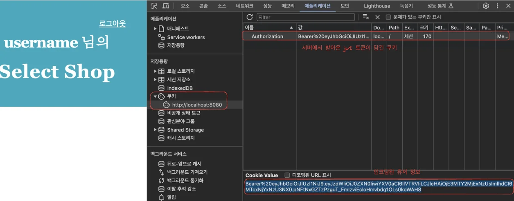


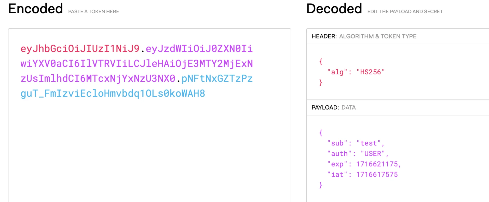

- admin 확인
    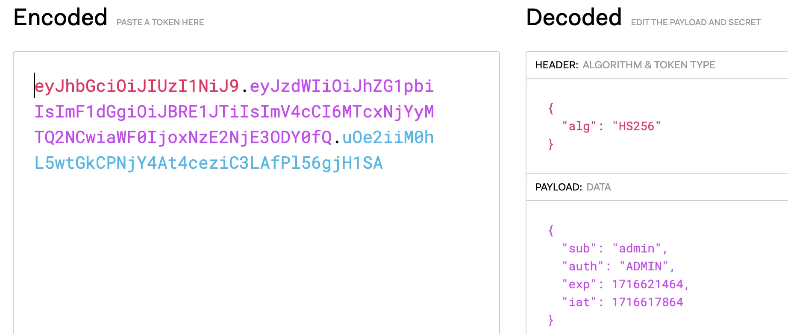

</details>

<details>
<summary>Error 확인</summary>

- <strong>url&#58;</strong> <code>/api/user/login&#45;page?error</code> 

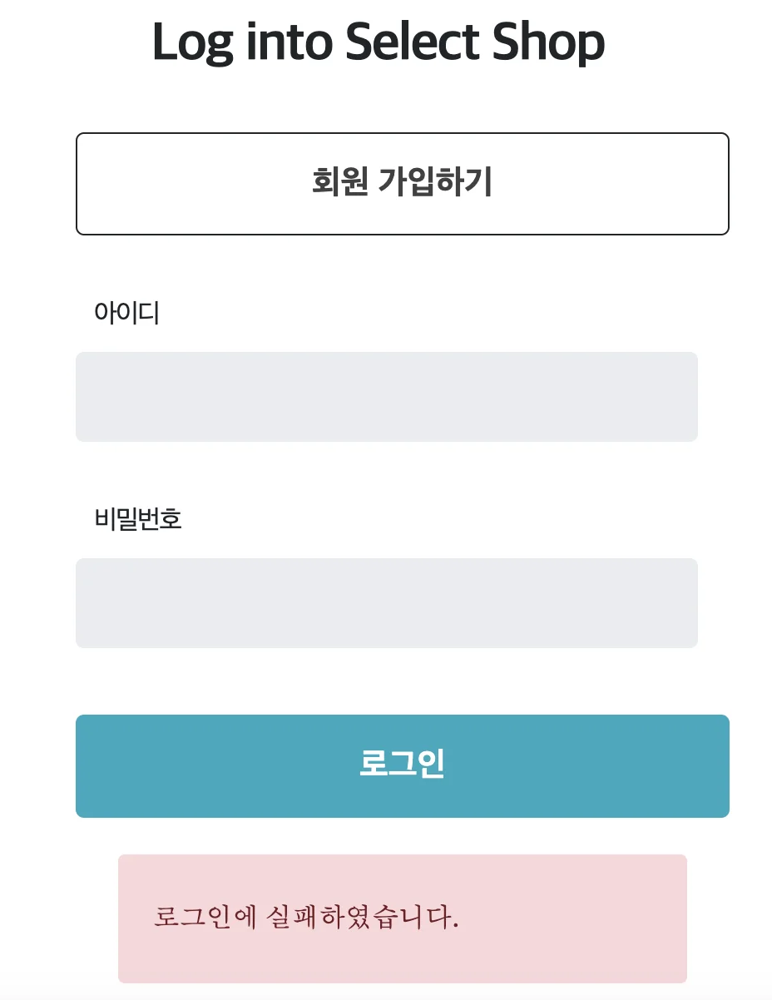

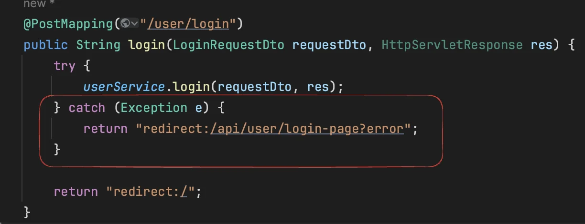

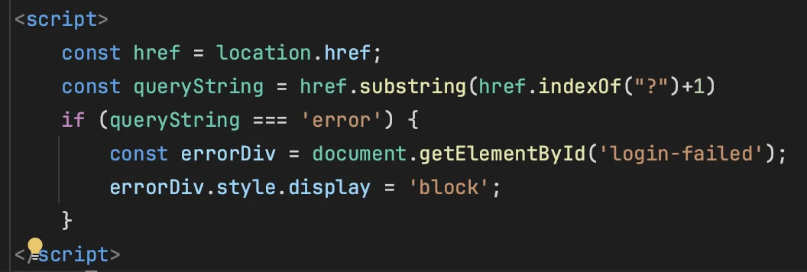

</details>

<a id="1c3eda9b0fe181cba79fd539ba106359"></a>

### 🧐 Error) 회원가입 시 입력한 비밀번호와 동일한 비밀번호를 입력하여 로그인 시 인증 오류 발생 ( PasswordEncoder )

<a id="1c3eda9b0fe181058cf8ec0bbf3561f4"></a>

### 문제  

<a id="1c3eda9b0fe181518604cd583a3d78f0"></a>

로그인 시 회원가입에 입력한 비밀번호와 동일한 비밀번호를 입력하였는데도 인증이 되지 않음

<details>
<summary>Controller</summary>

<a id="1c3eda9b0fe1816d8148f10dc48a4e79"></a>

```java
@PostMapping("user/login")
public String login(LoginRequestDto requestDto, HttpServletResponse res) {
    try {
        userService.login(requestDto, res);
    } catch (Exception e) {
        return "redirect:/api/user/login-page?error";
    }

    return "redirect:/";
}
```

</details>

<details>
<summary>Service</summary>

<a id="1c3eda9b0fe181cc9edcda6a9b7db5f0"></a>

```java
public void login(LoginRequestDto requestDto, HttpServletResponse res) {
      String username = requestDto.getUsername();
      String password = passwordEncoder.encode(requestDto.getPassword());
  
      // 유저 정보 검증
      User user = userRepository.findByUsername(username).orElseThrow(() ->
              new NullPointerException("해당하는 유저가 존재하지 않습니다.")
      );
  
      // Password 검증
      if(!password.equals(user.getPassword())) throw new InvalidPasswordException("올바르지 않은 비밀번호 입니다.");
  
      // JWT 생성
      String token = jwtUtil.createToken(user.getUsername(), user.getRole());
  
      // Cookie에 JWT 담기
      jwtUtil.addJwtToCookie(token, res);

  } 
```

</details>

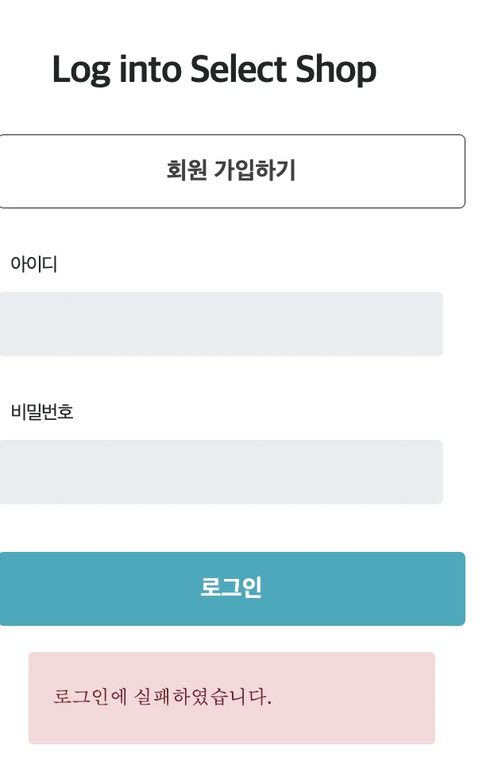

<a id="1c3eda9b0fe181c0879ce5260e63140c"></a>

### 원인

- <strong>패스워드 검증 코드</strong>
    <a id="1c3eda9b0fe181169b92c3e700e0e0ba"></a>

    ```java
    public void login(LoginRequestDto requestDto, HttpServletResponse res) {
    		
    		// 유저 정보 검증
    		String username = requestDto.getUsername();
        User user = userRepository.findByUsername(username).orElseThrow(() ->
                new NullPointerException("해당하는 유저가 존재하지 않습니다.")
        );
    		
    			
    		// 패스워드 검증	
    		String password = passwordEncoder.encode(requestDto.getPassword());
    	
    		// 각 패스워드 encoding 값 확인을 위한 출력
        System.out.println("password = " + password);
        System.out.println("user.getPassword() = " + user.getPassword());
        System.out.println("password.equals(user.getPassword()) = " + password.equals(user.getPassword()));
    ```

- 출력값
    <a id="1c3eda9b0fe181118e3cd6eb55236721"></a>

    ```java
    password = $2a$10$ciI6EvJVssRaFFj/V1ZiBOe3nVV91Jah4F9PvoFnk3Ib7c72uwF1K
    user.getPassword() = $2a$10$u3fiCr5HrOlXZRXjkqIOSeZFEqSiHGHAFq1Tb1x6QDjoOCEAE9G9K
    password.equals(user.getPassword()) = false
    ```

    <a id="1c3eda9b0fe181b7a8fef8b98a67b143"></a>

    <br>회원가입 시와 동일하게 <code>passwordEncoder&#46;encode()</code> encoding 하였는데도 , 동일한 값이 생성되지 않음

    <a id="1c3eda9b0fe1811096a6df0ed2a0a07b"></a>

    따라서 <code>passwordEncoder&#46;encode()</code>의 로직의 알고리즘 정보를 찾아봄

    <a id="1c3eda9b0fe181eaaf8cd868517e68fd"></a>

    그 결과, <strong><u>비밀번호 해싱(hash) 과정에서 사용되는 랜덤 데이터</u></strong>인 <strong><code>Salt</code></strong> 라는 개념 때문에 <strong><u>동일한 값을 인코딩해도 다른 해싱값이 나온다</u></strong>는 것을 확인함

    <a id="1c3eda9b0fe181b4bbd3e82b113d3e0f"></a>

    그리고 <code>해싱 변환 전 값</code>과 <code>해싱된 값</code> 비교 시, 제공되는 <code>&#46;matches()</code> 메서드를 사용하면 쉽게 검증할 수 있다는 것을 알게 됨&#46;

<a id="1c3eda9b0fe181eca80ee2a15b550bf1"></a>

### 해결

<a id="1c3eda9b0fe181608026ff7776589c8e"></a>

아래와 같이 <strong><u>Spring Security의 PasswordEncoder 인터페이스</u></strong>에서 제공하는  <code>&#46;matches</code> 메서드를 통해 쉽게 로그인 시 입력되는 비밀번호와 회원가입 시 저장한 해시를 비교하여 인증 검증함 

<a id="1c3eda9b0fe181e48b80d477a38d36af"></a>

```java
public void login(LoginRequestDto requestDto, HttpServletResponse res) {
    String username = requestDto.getUsername();
    String password = requestDto.getPassword();

    // 사용자 검증
    User user = userRepository.findByUsername(username).orElseThrow(() ->
            new NullPointerException("해당하는 유저가 존재하지 않습니다.")
    );

    // 비밀번호 검증
    if(passwordEncoder.matches(password, user.getPassword())) throw new InvalidPasswordException("올바르지 않은 비밀번호 입니다.");
    
    // JWT 생성
    String token = jwtUtil.createToken(user.getUsername(), user.getRole());

    // Cookie에 JWT 담기
    jwtUtil.addJwtToCookie(token, res);
}
```

<details>
<summary><strong>🧐 BCryptPasswordEncoder</strong></summary>

<a id="1c3eda9b0fe181a4aa9ec791f22d941d"></a>

Spring Security의 기본 구현체로 비밀번호를 안정하게 저장하기 위해 설계된 알고리즘이다&#46;

<a id="1c3eda9b0fe181499674c777d59e764f"></a>

해당 알고리즘은 비빌번호를 해싱할 때 Salt를 자동으로 생성하여 추가한다&#46; <br>이를 통해 동일한 비밀번호라도 서로 다른 해시 값을 갖게 되어 보안을 강화할 수 있다&#46;

</details>

<a id="1c3eda9b0fe18103ac3ff0df6b2cae88"></a>

## 필터

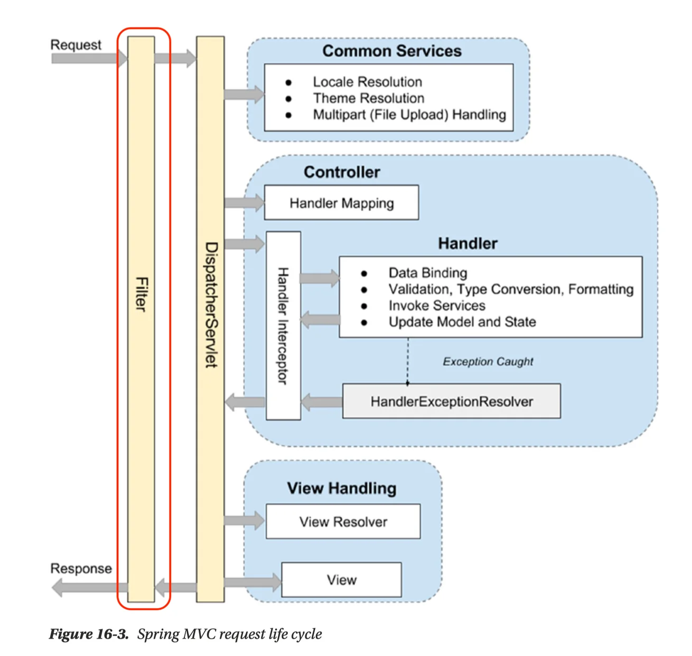

> ☝🏻 Filter는 DispatcherServlet 앞단에 존재하여  <code>&#64;CookieValue</code> 사용이 불가하다&#46;
> 
> > <code>&#64;CookieValue</code>를 통해 Request 객체 들어있는 Cookie 값을 쉽게 가져올 수 있었다&#46; 
> 
> <a id="1c3eda9b0fe181eebb08e9b8a320c598"></a>
> 
> 따라서 직접 Cookie 가져오는 메서드를 구현해야 한다&#46; 

<a id="1c3eda9b0fe181839cd3d2dbc83834a2"></a>

## ‘Spring Security’ 프레임워크

<a id="1c3eda9b0fe1819f8925d879e98e7222"></a>

‘Spring Security’ 프레임워크는 <strong>Spring 서버에 필요한 인증 및 인가를 위해 많은 기능을 제공</strong>해 줌으로써 개발의 수고를 덜어준다&#46; 

<a id="1c3eda9b0fe181258ab9c98271233106"></a>

마치 ‘Spring’ 프레임워크가 웹 서버 구현에 편의를 제공해 주는 것과 같다 &#46;

<details>
<summary>build&#46;gradle &#45; 의존성 추가</summary>

<a id="1c3eda9b0fe1811084f4e2e9eab23845"></a>

```groovy
// Security
implementation 'org.springframework.boot:spring-boot-starter-security'
```

</details>

<details>
<summary><strong>🧐 CSRF</strong>?</summary>

> 📌 <strong>CSRF(사이트 간 요청 위조, Cross&#45;site request forgery)</strong>

- <strong>공격자</strong>가 <strong><u>인증된 브라우저</u></strong>에 <strong><u>저장된 쿠키의 세션 정보를 활용</u></strong>하여 <strong><u>웹 서버에 사용자가 의도하지 않은 요청을 전달</u></strong>하는 것이다&#46;

- <strong><u>CSRF 설정</u></strong>이 되어있는 경우 <strong>html에서 CSRF 토큰 값을 넘겨</strong>주어야 <strong><u>요청을 수신 가능</u></strong>하다&#46;

- 쿠키 기반 취약점을 이용한 공격이기 때문에 <strong><u>REST 방식의 API에서는 disable 가능</u></strong>하다&#46; 
    > <strong>CSRF protection &#45; disable</strong> 

    - <code>http&#46;csrf((csrf) &#45;&#62; csrf&#46;disable());</code>

</details>

<details>
<summary>이전 <code>filter</code>를 통한 url <strong>인가</strong> 설정</summary>

<a id="1c3eda9b0fe18119aea4e6fc3b1528e9"></a>

```java
if (StringUtils.hasText(url) &&
        (url.startsWith("/api/user") || url.startsWith("/css") || url.startsWith("/js"))
) {
    log.info("인증 처리를 하지 않는 URL : " + url);
    // 회원가입, 로그인 관련 API 는 인증 필요없이 요청 진행
    chain.doFilter(request, response); // 다음 Filter 로 이동
} else 
```

</details>

<details>
<summary>Spring Security를 통한 인가 &#45; <code>securityChain()</code></summary>

<a id="1c3eda9b0fe1813bb185dd41f7ff25ab"></a>

url의 인가 여부, 즉 자원에 대한 접근성 여부를 판단하는 로직

> 아래의 해당하는 url을 인증 처리하지 않고 resources에 대한 모든 접근을 허용(<code>&#46;permitAll()</code>)한다&#46; 

<a id="1c3eda9b0fe18129bb48d28b30675de2"></a>

```java
.requestMatchers(PathRequest.toStaticResources().atCommonLocations()).permitAll() // resources 접근 허용 설정
```

>  그 외 모든 요청(&#46;<code>anyRequest()</code>) 인증 처리(<code>&#46;authenticated()</code>)

<a id="1c3eda9b0fe181439444c790910d63bc"></a>

```java
 .anyRequest().authenticated() // 그 외 모든 요청 인증처리
```

<a id="1c3eda9b0fe18134acafe276a2698863"></a>

```java
 http.authorizeHttpRequests((authorizeHttpRequests) ->
        authorizeHttpRequests
                .requestMatchers(PathRequest.toStaticResources().atCommonLocations()).permitAll() // resources 접근 허용 설정
                .anyRequest().authenticated() // 그 외 모든 요청 인증처리
);
```

</details>

> ☝🏻 앱이 커지고 더 복잡한 기능들이 늘어나게 되면 Security 프레임 워크를 사용하지 않고 직접 filter를 통해 Controll을 한다면 코드가 엄청 장대해지고 복잡해진다&#46;<br>즉, 비용이 너무 많이 든다&#46;  또한 유지보수도 어려워진다&#46;
> 
> <a id="1c3eda9b0fe18139a938ccf44ba42531"></a>
> 
> <br>아래와 같이 간단한 AuthFilter 예제에도 너무 많은 조건문(if문) 로직이 사용된다&#46;
> 
> <details>
> <summary>ex) AuthFilter</summary>
> 
> <a id="1c3eda9b0fe1816d91dce68a0d7789c6"></a>
> 
> ```java
> package com.sparta.spring_sparta.filter;
> 
> import com.sparta.spring_sparta.entity.User;
> import com.sparta.spring_sparta.jwt.JwtUtil;
> import com.sparta.spring_sparta.repository.UserRepository;
> import io.jsonwebtoken.Claims;
> import jakarta.servlet.*;
> import jakarta.servlet.http.HttpServletRequest;
> import lombok.extern.slf4j.Slf4j;
> import org.springframework.core.annotation.Order;
> import org.springframework.stereotype.Component;
> import org.springframework.util.StringUtils;
> 
> import java.io.IOException;
> 
> @Slf4j(topic = "AuthFilter")
> //@Component
> @Order(2)
> public class AuthFilter implements Filter {
> 
>     private final UserRepository userRepository;
>     private final JwtUtil jwtUtil;
> 
>     public AuthFilter(UserRepository userRepository, JwtUtil jwtUtil) {
>         this.userRepository = userRepository;
>         this.jwtUtil = jwtUtil;
>     }
> 
>     @Override
>     public void doFilter(ServletRequest request, ServletResponse response, FilterChain chain) throws IOException, ServletException {
>         HttpServletRequest httpServletRequest = (HttpServletRequest) request;
>         String url = httpServletRequest.getRequestURI();
> 
>         if (StringUtils.hasText(url) &&
>                 (url.startsWith("/api/user") || url.startsWith("/css") || url.startsWith("/js"))
>         ) {
>             log.info("인증 처리를 하지 않는 URL : " + url);
>             // 회원가입, 로그인 관련 API 는 인증 필요없이 요청 진행
>             chain.doFilter(request, response); // 다음 Filter 로 이동
>         } else {
>             // 나머지 API 요청은 인증 처리 진행
>             // 토큰 확인
>             String tokenValue = jwtUtil.getTokenFromRequest(httpServletRequest);
> 
>             if (StringUtils.hasText(tokenValue)) { // 토큰이 존재하면 검증 시작
>                 // JWT 토큰 substring
>                 String token = jwtUtil.substringToken(tokenValue);
> 
>                 // 토큰 검증
>                 if (!jwtUtil.validateToken(token)) {
>                     throw new IllegalArgumentException("Token Error");
>                 }
> 
>                 // 토큰에서 사용자 정보 가져오기
>                 Claims info = jwtUtil.getUserInfoFromToken(token);
> 
>                 User user = userRepository.findByUsername(info.getSubject()).orElseThrow(() ->
>                         new NullPointerException("Not Found User")
>                 );
> 
>                 request.setAttribute("user", user);
>                 chain.doFilter(request, response); // 다음 Filter 로 이동
>             } else {
>                 throw new IllegalArgumentException("Not Found Token");
>             }
>         }
>     }
> 
> }
> ```
> 
> </details>
> 
> <a id="1c3eda9b0fe1811db820cabfe20c310f"></a>
> 
> 또한 많은 기업에서도 Spring Security를 사용하니 이번 기회에 잘 배워 써먹어야 한다&#46; 

<details>
<summary>Spring Sequrity 에서 제공하는 기본 login 페이지</summary>

> ☝🏻 Spring Security는 <strong>세션 방식</strong>으로 <strong>인증(로그인)</strong>하는 <strong><u>default login 기능을 제공</u></strong>한다&#46;
> 
> - 인증&#58; 세션 방식

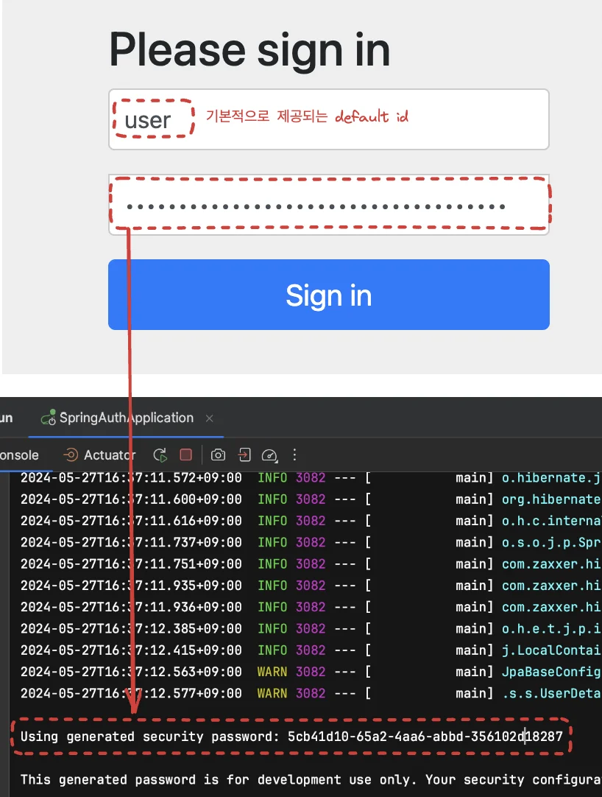

</details>

<a id="1c3eda9b0fe18126a16def3ba823a42b"></a>

## <strong>Spring Security&#58; 로그인</strong>

<details>
<summary><strong>Spring Security 사용 전</strong></summary>

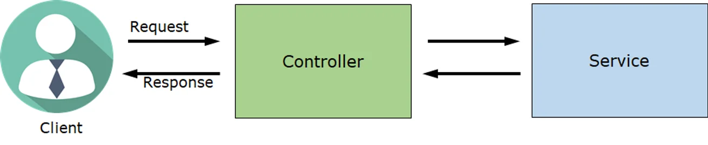

<a id="1c3eda9b0fe181128eaec177a9cc62ac"></a>

Controller에서 Client 요청 처리 및 반환함 

</details>

> ☝🏻 위에서도 한번 설명했듯이 직접 Filter 구현하여 URL 요청에 따른 인가 설정을 한다면 코드가 매우 복잡해지고 유지보수 비용이 많이 든다&#46; <br>이를 Spring Security를 통해 해결하고 간편하고 쉽게 <code>인증/인가</code> 처리를 한다&#46; 

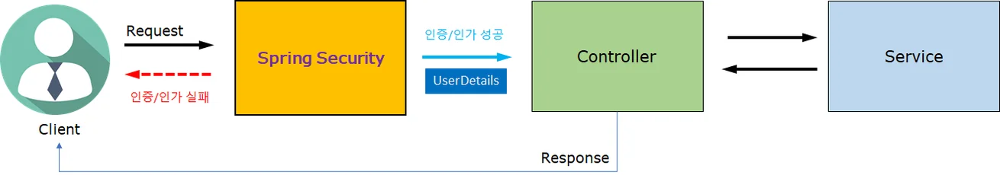

> Client의 요청은 모두 Spring Security를 거친다&#46;

- 역할&#58; <strong><code>인증/인가</code></strong>
    1. 성공&#58; Controller로 Client 요청 전달
        <a id="1c3eda9b0fe181188aa7c8ea42e58dcd"></a>

        ⇒ Client 요청  &#43; 사용자 정보 ( UserDetails )

    1. 실패&#58; Controller로 Client 요청이 전달되지 않음
        <a id="1c3eda9b0fe181cfa2e5e7cc53be919d"></a>

        ⇒ Client에게 Error Response 보냄

<a id="1c3eda9b0fe18101a874e8153dec9485"></a>

### 로그인 처리 과정

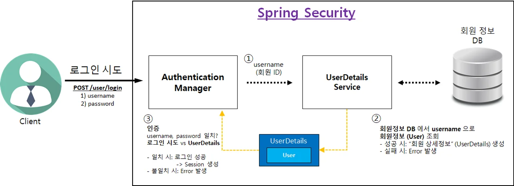

<details>
<summary>1&#46; Client &#45; 로그인 시도</summary>

- username, password &#45; HTTP body로 전달(POST 요청)

- <strong><u>로그인 시도 URL</u></strong>은 <strong>WebSecurityConfig</strong> 클래스에서 변경 가능하다&#46; 
    <a id="1c3eda9b0fe1813fa76fdc0a3143b0a2"></a>

    ```java
    @Bean
    public SecurityFilterChain securityFilterChain(HttpSecurity http) throws Exception {
        // CSRF 설정
        http.csrf((csrf) -> csrf.disable());

        http.authorizeHttpRequests((authorizeHttpRequests) ->
                authorizeHttpRequests
                        .requestMatchers(PathRequest.toStaticResources().atCommonLocations()).permitAll() // resources 접근 허용 설정
                        .anyRequest().authenticated() // 그 외 모든 요청 인증처리
        );

        // 로그인 사용
    	 http.formLogin((formLogin) ->
                formLogin
                     // 로그인 처리 (POST /api/user/login)
                    .loginProcessingUrl("/api/user/login").permitAll()
        );

        return http.build();
    }
    ```

</details>

<details>
<summary>2&#46; 인증 관리자 ( Authentication Manager )</summary>

1. UserDetailsService에게 username 전달 및 회원상세 정보 요청

</details>

<details>
<summary>3&#46; UserDetailsService</summary>

1. 회원 DB에서 회원 조회
    > 회원 정보 ❌  → Error

    <a id="1c3eda9b0fe1814ea704e06b705f3896"></a>

    ```java
    회원 DB 에서 회원 조회
    User user = userRepository.findByUsername(username)
            .orElseThrow(() -> new UsernameNotFoundException("Not Found " + username));
    ```

1. 조회된 회원 정보(user)를 UserDetails로 변환
    <a id="1c3eda9b0fe181538cf1d942ed035b26"></a>

    ```java
    UserDetails userDetails = new UserDetailsImpl(user)
    ```

1. UserDetails를 <strong>“인증 관리자”</strong>에게 전달

</details>

<details>
<summary>4&#46; “인증 관리자”&#58; <strong>인증 처리</strong></summary>

1. <strong>1️⃣ 인증 시 Client에서 받아온 로그인 정보</strong> 와<strong><u> </u></strong><strong>2️⃣ DB에서 가져온 회원 정보</strong><strong><u> </u></strong><strong><u>일치 여부 확인</u></strong>
    - 1️⃣ Client가 로그인 시도한 username, password

    - 2️⃣ UserDetailsService가 전달해준 UserDetails의 username, password

1. password 비교 시
    - Client가 보낸 password&#58; 평문

    - UserDetails의 password&#58; 암호문

    <a id="1c3eda9b0fe1814aab3fcc6d22091841"></a>

    따라서 Client가 보낸 password를 암호화 해서 비교해야 한다&#46;

1. 인증 성공 시 → 세션에 로그인 정보 저장

1. 인증 실패 시 → Error 발생

</details>

<a id="1c3eda9b0fe181ac84f3e69aeb39633c"></a>

### 코드) 로그인 구현

> default 로그인 페이지가 아닌 구현한 페이지 사용

<a id="1c3eda9b0fe1819e9395ee952f829538"></a>

```java
http.formLogin((formLogin) ->
        formLogin
                // 로그인 View 제공 (GET /api/user/login-page)
                .loginPage("/api/user/login-page")
                // 로그인 처리 (POST /api/user/login)
                .loginProcessingUrl("/api/user/login")
                // 로그인 처리 후 성공 시 URL
                .defaultSuccessUrl("/")
                // 로그인 처리 후 실패 시 URL
                .failureUrl("/api/user/login-page?error")
                .permitAll()
);
```

<details>
<summary>전체 코드 &#45; <strong>WebSecurityConfig</strong></summary>

<a id="1c3eda9b0fe1818d90caf9f5854e1dbf"></a>

```java
package com.sparta.spring_sparta.config;

import org.springframework.boot.autoconfigure.security.servlet.PathRequest;
import org.springframework.context.annotation.Bean;
import org.springframework.context.annotation.Configuration;
import org.springframework.security.config.annotation.web.builders.HttpSecurity;
import org.springframework.security.config.annotation.web.configuration.EnableWebSecurity;
import org.springframework.security.web.SecurityFilterChain;

@Configuration
@EnableWebSecurity // Spring Security 지원을 가능하게 함
public class WebSecurityConfig {

    @Bean
    public SecurityFilterChain securityFilterChain(HttpSecurity http) throws Exception {
        // CSRF 설정
        http.csrf((csrf) -> csrf.disable());

        http.authorizeHttpRequests((authorizeHttpRequests) ->
                authorizeHttpRequests
                        .requestMatchers(PathRequest.toStaticResources().atCommonLocations()).permitAll() // resources 접근 허용 설정
                        .requestMatchers("/api/user/**").permitAll() // '/api/user/'로 시작하는 요청 모두 접근 허가
                        .anyRequest().authenticated() // 그 외 모든 요청 인증처리
        );

        // 로그인 사용
        http.formLogin((formLogin) ->
                formLogin
                        // 로그인 View 제공 (GET /api/user/login-page)
                        .loginPage("/api/user/login-page")
                        // 로그인 처리 (POST /api/user/login)
                        .loginProcessingUrl("/api/user/login")
                        // 로그인 처리 후 성공 시 URL
                        .defaultSuccessUrl("/")
                        // 로그인 처리 후 실패 시 URL
                        .failureUrl("/api/user/login-page?error")
                        .permitAll()
        );

        return http.build();
    }
}
```

</details>

<a id="1c3eda9b0fe18105978ad760728b2ac9"></a>

## Spring Security&#58; Jwt

> 👉🏻 비지니스 로직과 인증/인가 로직 분리

> 로그인 Filter 에서 구현

<details>
<summary> Controller, Service에서 login 관련 로직들 제거 후, Fillter에서 로그인 제어</summary>

<details>
<summary>UserController</summary>

<a id="1c3eda9b0fe1819fb7c8dd7c4364ea70"></a>

```java
@PostMapping("/user/login")
public String login(LoginRequestDto requestDto, HttpServletResponse res) {
    try {
        userService.login(requestDto, res);
    } catch (Exception e) {
        return "redirect:/api/user/login-page?error";
    }
    return "redirect:/";
}
```

</details>

<details>
<summary>UserService</summary>

<a id="1c3eda9b0fe1813d9f1bcf4b09a895d8"></a>

```java
public void login(LoginRequestDto requestDto, HttpServletResponse res) {
    String username = requestDto.getUsername();
    String password = requestDto.getPassword();

    // 사용자 확인
    User user = userRepository.findByUsername(username).orElseThrow(
            () -> new IllegalArgumentException("등록된 사용자가 없습니다.")
    );

    // 비밀번호 확인
    if(!passwordEncoder.matches(password, user.getPassword())) {
        throw new IllegalArgumentException("비밀번호가 일치하지 않습니다.");
    };

    // JWT 생성 및 쿠키에 저장 후 Response 객체에 추가
    String token = jwtUtil.createToken(user.getUsername(), user.getRole());
    jwtUtil.addJwtToCookie(token, res);
}
```

</details>

</details>

<a id="1c3eda9b0fe181bba9d4c0b6f26e1a4d"></a>

## 접근 불가 페이지 만들기

> ☝🏻 ‘일반 사용자’는 관리자 페이지에 접속이 인가되지 않아야 한다&#46; 

1. Spring Security에 <strong>“권한(Authority)” </strong>설정 방법
    

    - 회원 상세정보 ( <strong>UserDetailsImpl </strong>) 를 통해 <strong>“권한 ( Authority )” </strong>설정 가능하다&#46;
        > 권한 1개 이상 설정 가능

    - <code>권한 이름</code> 규칙
        > 📌 <em><strong>“ROLE&#95;” </strong></em>로 시작해야 함

        <a id="1c3eda9b0fe1819981ddf6cdc3478ece"></a>

        ex)  <strong>“ADMIN”</strong> 권한 부여 → “<strong>ROLE&#95;</strong><strong>ADMIN</strong>”

        <a id="1c3eda9b0fe1817faa56f1c60b44203d"></a>

         <strong>“USER” </strong>권한 부여 → “<strong>ROLE&#95;</strong><strong>USER</strong>”

        <a id="1c3eda9b0fe1818e9f6ec5fe9a03fa29"></a>

        ```java
        public enum UserRoleEnum {
            USER(Authority.USER),  // 사용자 권한
            ADMIN(Authority.ADMIN);  // 관리자 권한

            private final String authority;

            UserRoleEnum(String authority) {
                this.authority = authority;
            }

            public String getAuthority() {
                return this.authority;
            }

            public static class Authority {
                public static final String USER = "ROLE_USER";
                public static final String ADMIN = "ROLE_ADMIN";
            }
        }
        ```
