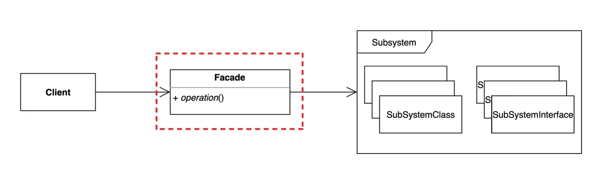
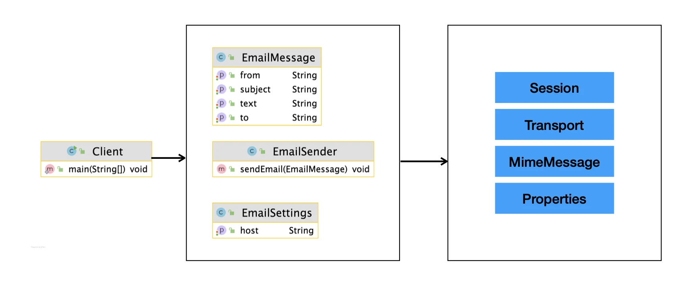
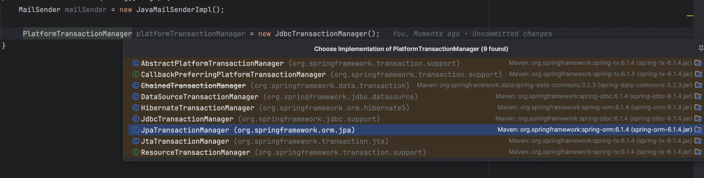

> 📝 
> 
> <a id="1d2eda9b0fe180e199fae305b09ab333"></a>
> 
> <strong>질문</strong>
> 
> <details>
> <summary>퍼사드 패턴이란 무엇인가?</summary>
> 
> 
> 
> </details>
> 
> <details>
> <summary>퍼사드 패턴의 장단점은?</summary>
> 
> 
> 
> </details>
> 
> <details>
> <summary>퍼사드 패턴과 어댑터 패턴의 차이점은?</summary>
> 
> 
> 
> </details>

<a id="1d2eda9b0fe180df98bee7ee99eda66c"></a>

## 퍼사드 패턴

---

> 📖 
> 
> <a id="1d2eda9b0fe18054ae84f0dfea181588"></a>
> 
> <strong>퍼사드 패턴</strong>
> 
> ---
> 
> > 복잡한 서브 시스템 의존성을 최소화하는 방법
> 
> 
> 
> <details>
> <summary>특징 및 의도</summary>
> 
> - <code>복잡성 숨기기</code>&#58; 여러 서브시스템의 복잡한 동작을 캡슐화하여 단순화된 인터페이스로 제공한다&#46;
> 
> - <code>낮은 결합도</code>&#58; 클라이언트에서 서브시스템의 세부사항을 알 필요없이 퍼사드 객체를 통해서 시스템을 사용할 수 있다&#46; 이를 통해 코드의 유지보수가 쉬워지고 종속성이 줄어든다&#46;
> 
> - <code>가독성 향상</code>&#58; 클라이언트 코드가 간결해지고 직관적으로 이해하기 쉽다&#46;
> 
> </details>
> 
> <details>
> <summary>장•단점</summary>
> 
> > <strong>장점</strong>
> 
> - <code>코드 가독성 향상</code>
>     - 클라이언트는 복잡한 서브시스템을 알 필요 없이 간단한 인터페이스만 사용하면 된다&#46;
> 
> - <code>유지보수 용이성</code>
>     -  결합도를 낮춰 시스템 변경 시 영향을 최소화한다&#46;
> 
> - <code>확장성</code>
>     - 필요에 따라 서브시스템에 직접 접근하거나 새로운 기능을 추가할 수 있다&#46;
> 
> > <strong>단점</strong>
> 
> - <code>퍼사드 객체의 과도한 책임</code>
>     - 모든 기능을 처리하려다 보면 퍼사드 객체가 지나치게 복잡해질 수 있다&#46;
> 
> - <code>서브시스템의 직접 접근 가능성</code>
>     - 퍼사드를 우회하여 서브시스템에 접근하면 결합도가 다시 높아질 위험이 있다&#46;
> 
> </details>
> 
> <details>
> <summary>적용 사례</summary>
> 
> - 복잡한 라이브러리나 프레임워크와 상호작용할 때
> 
> - 시스템 계층 간의 결합도를 줄이고자 할 때
> 
> - 클라이언트 코드에서 특정 기능만 필요로 할 때
> 
> </details>
> 
> <details>
> <summary>비교&#58; 어댑터 vs 퍼사드</summary>
> 
> > 🧐 
> > 
> > <a id="1d2eda9b0fe18048b177c4146c0dc422"></a>
> > 
> > 퍼사드가 중간 계층(퍼사드 객체)를 통해서 서브시스템과 클라이언트 사이를 연결하는 것이 언뜻 보면 어댑터 패턴과 유사하다&#46; 
> > 
> > <a id="1d2eda9b0fe1805ba38ce66bcca28449"></a>
> > 
> > 그렇다면 어떤 차이점이 있는가?
> 
> | <strong>특징</strong> | 퍼사드 패턴 | 어댑터 패턴 |
> | --- | --- | --- |
> | 목적 | 단순화된 인터페이스 제공 | 기존 인터페이스를 다른 형태로 변환 |
> | 대상 | 여러 클래스와 서브시스템 | 하나의 클래스 또는 인터페이스 |
> | 사용 방식 | 클라이언트와 서브시스템 간의 중재 | 기존 인터페이스를 새 환경에 맞게 조성 |
> 
> </details>

<a id="1d2eda9b0fe1801bb210f4c8f825eb71"></a>

### 1&#46; 기본 예제

<a id="1d2eda9b0fe1809aaf08ee93d330f682"></a>

### 코드

<details>
<summary>&#91; 코드 &#93; Client</summary>

<a id="1d2eda9b0fe180d8aebfcf1a309d66d2"></a>

```java
package _02_structural_patterns._10_facade._01_before;

import jakarta.mail.Message;
import jakarta.mail.MessagingException;
import jakarta.mail.Session;
import jakarta.mail.Transport;
import jakarta.mail.internet.InternetAddress;
import jakarta.mail.internet.MimeMessage;

import java.util.Properties;

public class Client {

    public static void main(String[] args) {
        String to = "keesun@whiteship.me";
        String from = "whiteship@whiteship.me";
        String host = "127.0.0.1";

        Properties properties = System.getProperties();
        properties.setProperty("mail.smtp.host", host);

        Session session = Session.getDefaultInstance(properties);

        try {
            MimeMessage message = new MimeMessage(session);
            message.setFrom(new InternetAddress(from));
            message.addRecipient(Message.RecipientType.TO, new InternetAddress(to));
            message.setSubject("Test Mail from Java Program");
            message.setText("message");

            Transport.send(message);
        } catch (MessagingException e) {
            e.printStackTrace();
        }
    }
}
```

</details>

<a id="1d2eda9b0fe18017b85bcd41c24e529d"></a>

### 2&#46; 패턴 적용



<a id="1d2eda9b0fe1805b8cfce357b8aa886c"></a>

### 코드

<details>
<summary>&#91; 코드 &#93; EmailSettings</summary>

<a id="1d2eda9b0fe1808a8e95d996047e10d2"></a>

```java
package _02_structural_patterns._10_facade._02_after;

public class EmailSettings {

    private final String host;

    public EmailSettings(String host) {
        this.host = host;
    }

    public String getHost() {
        return host;
    }
}
```

</details>

<details>
<summary>&#91; 코드 &#93; EmailMessage</summary>

<a id="1d3eda9b0fe180f5898bcb82efc9e993"></a>

```java
package _02_structural_patterns._10_facade._02_after;

public class EmailMessage {
    private final String from;
    private final String cc;
    private final String subject;
    private final String text;

    public EmailMessage(String from, String cc, String subject, String text) {
        this.from = from;
        this.cc = cc;
        this.subject = subject;
        this.text = text;
    }

    public String getFrom() {
        return from;
    }

    public String getCc() {
        return cc;
    }

    public String getSubject() {
        return subject;
    }

    public String getText() {
        return text;
    }
}

```

</details>

<details>
<summary>&#91; 코드 &#93; EmailSender</summary>

<a id="1d3eda9b0fe180e8be11f68fb8649e73"></a>

```java
package _02_structural_patterns._10_facade._02_after;

import jakarta.mail.Message;
import jakarta.mail.MessagingException;
import jakarta.mail.Session;
import jakarta.mail.Transport;
import jakarta.mail.internet.InternetAddress;
import jakarta.mail.internet.MimeMessage;

import java.util.Properties;

public class EmailSender {

    private EmailSettings emailSettings;

    public EmailSender(EmailSettings emailSettings) {
        this.emailSettings = emailSettings;
    }

    /**
     * <p>이메일 전송</p>
     * {@link EmailMessage} 객체를 받아 이메일을 전송
     * @param emailMessage
     */
    public void sendEmail(EmailMessage emailMessage) {
        Properties properties = System.getProperties();
        properties.setProperty("mail.smtp.host", emailSettings.getHost());

        Session session = Session.getDefaultInstance(properties);

        try {
            MimeMessage message = new MimeMessage(session);
            message.setFrom(new InternetAddress(emailMessage.getFrom()));
            message.addRecipient(Message.RecipientType.TO, new InternetAddress(emailMessage.getCc()));
            message.addRecipient(Message.RecipientType.CC, new InternetAddress(emailMessage.getCc()));
            message.setSubject(emailMessage.getSubject());
            message.setText(emailMessage.getText());

            Transport.send(message);
        } catch (MessagingException e) {
            e.printStackTrace();
        }
    }
}

```

</details>

<details>
<summary>&#91; 코드 &#93; Client</summary>

<a id="1d3eda9b0fe18070b060d8efa203e986"></a>

```java
package _02_structural_patterns._10_facade._02_after;

public class Client {

    public static void main(String[] args) {

        EmailSettings settings = new EmailSettings("127.0.0.1");
        EmailSender emailSender = new EmailSender(settings);
        EmailMessage message = new EmailMessage("dltjq2323@gmail,com", "another", "메세지1", "메세지  전송 테스트");
        emailSender.sendEmail(message);

    }
}
```

</details>

<a id="1d2eda9b0fe180fbb262c757437f3da3"></a>

### 3&#46; 장•단점

- 장점
    - 서브 시스템에 대한 의존성을 한곳으로 모을 수 있다&#46;

- 단점
    - 퍼사드 클래스가 서브 시스템에 대한 모든 의존성을 가지게 된다&#46;

<a id="1d2eda9b0fe180339c9ef57660b3eaa1"></a>

### 4&#46; 실무 활용

> ✏️ 
> 
> > 스프링
> 
> <details>
> <summary>PlatformTransactionManager</summary>
> 
> 
> 
> - JdbcTransactionManager
> 
> - JpaTransactionManager
> 
> - HibernateTransactionManager
> 
> </details>
> 
> - Spring MVC
> 
> - 스프링이 제공하는 대부분의 기술&#58; 독립적인 인터페이스와 그 구현체

<a id="1d2eda9b0fe180afbefdff8d1ea7d98e"></a>

### 코드

<details>
<summary>&#91; 코드 &#93; FacadeInSpring</summary>

<a id="1d2eda9b0fe1808cb5baffbe5791be77"></a>

```java
package _02_structural_patterns._10_facade._03_java;

import org.springframework.jdbc.support.JdbcTransactionManager;
import org.springframework.mail.MailSender;
import org.springframework.mail.javamail.JavaMailSenderImpl;
import org.springframework.transaction.PlatformTransactionManager;

public class FacadeInSpring {

    public static void main(String[] args) {
        MailSender mailSender = new JavaMailSenderImpl();

         PlatformTransactionManager platformTransactionManager = new JdbcTransactionManager();
    }
}

```

</details>
