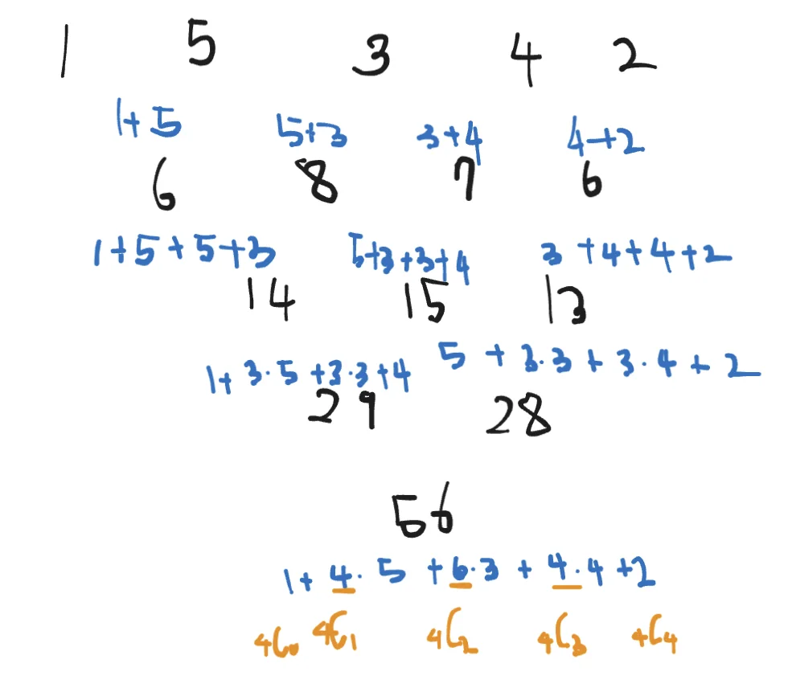
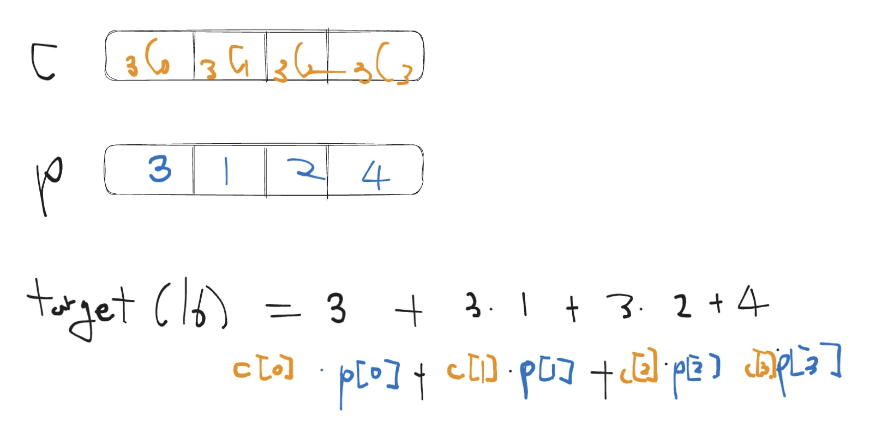
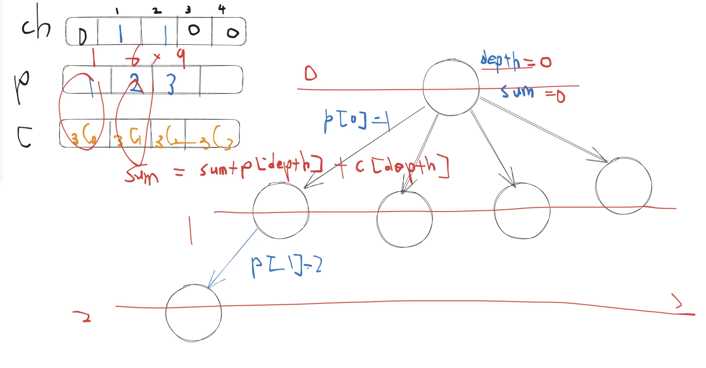

<a id="1c3eda9b0fe1818eadbbfce46f60f015"></a>

# 문제

<a id="1c3eda9b0fe1810ba634c0d57818103c"></a>

## <strong>8&#46; 수열 추측하기</strong>

---

<a id="1c3eda9b0fe181b28401df5522ad07fb"></a>

### 설명

<a id="1c3eda9b0fe1812cbfa3e25f82e5fc11"></a>

가장 윗줄에 1부터 N까지의 숫자가 한 개씩 적혀 있다&#46; 그리고 둘째 줄부터 차례대로 파스칼의 삼각형처럼 위의 두개를 더한 값이 저장되게 된다&#46;

<a id="1c3eda9b0fe181b9adb9ec673a2d8696"></a>

예를 들어 N이 4 이고 가장 윗 줄에 3 1 2 4 가 있다고 했을 때, 다음과 같은 삼각형이 그려진다&#46;


<a id="1c3eda9b0fe181198d3ce761cfd2f2f5"></a>

N과 가장 밑에 있는 숫자가 주어져 있을 때 가장 윗줄에 있는 숫자를 구하는 프로그램을 작성하시오&#46;

<a id="1c3eda9b0fe181b2a62cf0d6059d8d74"></a>

단, 답이 여러가지가 나오는 경우에는 사전순으로 가장 앞에 오는 것을 출력하여야 한다&#46;

<a id="1c3eda9b0fe18114acbaeadb6f4310bc"></a>

### 입력

<a id="1c3eda9b0fe18129aa24c606726d095f"></a>

첫째 줄에 두개의 정수 N(1≤N≤10)과 F가 주어진다&#46;

<a id="1c3eda9b0fe1818b865edf1e96586802"></a>

N은 가장 윗줄에 있는 숫자의 개수를 의미하며 F는 가장 밑에 줄에 있는 수로 1,000,000 이하이다&#46;

<a id="1c3eda9b0fe18167a8e3f381f5941aa0"></a>

### 출력

<a id="1c3eda9b0fe181339546d4a04deb4bab"></a>

첫째 줄에 삼각형에서 가장 위에 들어갈 N개의 숫자를 빈 칸을 사이에 두고 출력한다&#46;

<a id="1c3eda9b0fe1817d9306d932051e0aaf"></a>

답이 존재하지 않는 경우는 입력으로 주어지지 않는다&#46;

---

<a id="1c3eda9b0fe1812396e6c86399cca7fc"></a>

### 예시 입력 1

<a id="1c3eda9b0fe18135a127c65cba1cd3aa"></a>

```plaintext
4 16
```

<a id="1c3eda9b0fe1817887a2cc6d8888005f"></a>

### 예시 출력 1

<a id="1c3eda9b0fe18185b96df0626d2623e1"></a>

```plaintext
3 1 2 4
```

<a id="1c3eda9b0fe1818ba9e2d02045837789"></a>

# 풀이

<details>
<summary>그림</summary>







</details>

<a id="1c3eda9b0fe1812fbb3adcbe371aaaa0"></a>

## 풀이1)<code>강의풀이</code> 조합,  DFS, 메모제이션

<a id="1c3eda9b0fe181a9a7dbdb1e80392283"></a>

못품 → 복습 &#33;&#33;&#33;

<a id="1c3eda9b0fe181b190efca981507b700"></a>

```java
import java.util.*;

public class Main {
    static boolean flag=false;
    static int n, t;
    static int[] p, b, ch;
    static int[][] dy;

    public int combination(int n, int r){
        if(dy[n][r]>0) return dy[n][r];
        if(n==r || r==0) return 1;
        else return dy[n][r]=dy[n][n-r]=combination(n-1, r) + combination(n-1, r-1);
    }

    public void DFS(int L, int sum){
        if(flag) return;
        if(L==n) {
            if(sum==t){
                for(int x : p) System.out.print(x+" ");
                flag=true;
            }
        }
        else {
            for(int i=1; i<=n; i++){
                if (ch[i] == 0) {
                    ch[i] = 1;
                    p[L] = i;
                    DFS(L+1, sum+(p[L]*b[L]));
                    ch[i]=0;
                }
            }
        }
    }

    public static void main(String args[]) {
        Main T=new Main();
        Scanner sc=new Scanner(System.in);
        n=sc.nextInt();
        t=sc.nextInt();
        p=new int[n];
        b=new int[n];
        ch=new int[n+1];
        dy= new int[n+1][n+1];
        for(int i=0; i<n; i++){
            b[i]=T.combination(n-1, i);
        }
        T.DFS(0, 0);
    }
}
```

<a id="1c3eda9b0fe18132a41dd99627b1760e"></a>

## 풀이2) <code>2차 풀이</code>

<a id="1c3eda9b0fe18125b48ee83576b6401d"></a>

```java
import java.util.*;

public class Main {
    static boolean flag=false;
    static int n, target;
    static int[] am, pm, ch;

		// 조합
    static int[][] dy = new int[11][11];
    public int combi(int n, int r){
        if(dy[n][r]>0) return dy[n][r];
        if(n==r || r==0) return 1;
        else return dy[n][r]=dy[n][n-r] = combi(n-1, r-1) + combi(n-1, r);
    }
		
    public void DFS(int L, int sum){
        if(flag) return;
        if(sum> target) return;
        if(L==n && sum==target){
            flag=true;
            for(int x : pm) System.out.print(x+ " ");
        }
        else {
            for(int i=1; i<=n; i++){
                if(ch[i]==0){
                    ch[i]=1;
                    pm[L]=i;
                    DFS(L+1, sum+pm[L]*am[L]);
                    ch[i]=0;
                }
            }
        }
    }

    public static void main(String args[]) {
        Main T=new Main();
        Scanner sc = new Scanner(System.in);
        n=sc.nextInt();
        target=sc.nextInt();
        am=new int[n];
        for(int i=0; i<n; i++){
            am[i]=T.combi(n-1, i);
        }

        ch=new int[n+1];
        pm=new int[n];
        T.DFS(0, 0);

    }
}
```
