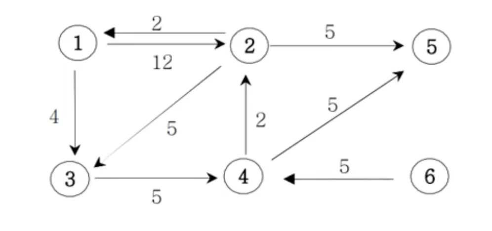
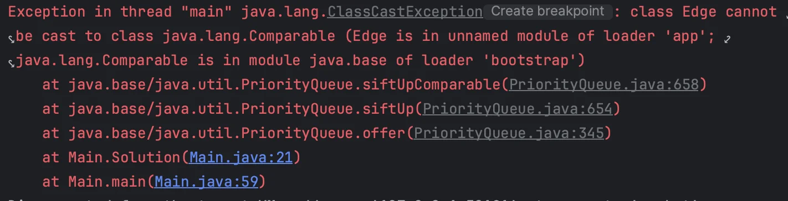

<a id="1c3eda9b0fe181b0adc3c9f0ecf772d0"></a>

# 문제

<a id="1c3eda9b0fe181daabceeb61931cd6e1"></a>

## 다익스트라 알고리즘

<a id="1c3eda9b0fe1819bad71ec4379b1188d"></a>

### 설명

<a id="1c3eda9b0fe181e0aee2d8dbc6cd33aa"></a>

아래의 가중치 방향 그래프에서 1번 정점에서 모든 정점으로의 최소 거리 비용을 출력하는 프로그램을 작성하<br>세요&#46; (경로가 없으면 <code>impossible</code> 을 출력한다)<br>



<a id="1c3eda9b0fe181bcae4be337ba480a99"></a>

### 입력

<a id="1c3eda9b0fe181519fa3fa172f4bff8c"></a>

첫째 줄에는 정점의 수 N(1≤N≤20)와 간선의 수 M가 주어진다&#46; 그 다음부터 M줄에 걸쳐 연결정보와 거리 비용이 주어진다&#46;

<a id="1c3eda9b0fe1816dab04d15626f9493d"></a>

### 출력

<a id="1c3eda9b0fe181faadcef6bdc786e447"></a>

1번 정점에서 각 정점으로 가는 최소비용을 2번 정점부터 차례대로 출력하세요&#46;

---

<a id="1c3eda9b0fe181d69c2fd1163683202a"></a>

### 입력 예시1

>  1 2 12  → 1번 정점에서 2번 정점으로 가는데 12의 비용이 든다&#46;

> &#91; 입력 오류 &#93; m(8)과 for문을 돌아 받는 횟수가 일치하지 않으면 입력값을 받지 못함

<a id="1c3eda9b0fe18171948fd383d96c8fba"></a>

```plaintext
6 9
1 2 12
1 3 4
2 1 2
2 3 5 
2 5 5
3 4 5
4 2 2
4 5 5
6 4 5
```

<a id="1c3eda9b0fe1815ba9bcd77e243a4d70"></a>

### 출력 예시1

<a id="1c3eda9b0fe1811e9d89e24c1e68ff1f"></a>

```plaintext
2 : 11
3 : 4
4 : 9
5 : 14
6 : impossible
```

<a id="1c3eda9b0fe1810882e2fd245816eb4a"></a>

# 풀이

<a id="1c3eda9b0fe181318dd5cee5286ee62c"></a>

## 풀이1) <code>DFS</code>

<a id="1c3eda9b0fe18116a6e4fedce2c620df"></a>

DFS로 될것 같아서 꾸역꾸역 작성했는데… 좋은 풀이는 아닌 것 같음

<a id="1c3eda9b0fe181c79458c5e47956df69"></a>

해당 예시에는 올바른 출력값이 나오나, 다른 예시는 모르겠음…

<a id="1c3eda9b0fe181ffbfcbc46b0ec8a7ce"></a>

```java
import java.util.*;

class Edge{
    int vex, cost;
    Edge(int vex, int cost){
        this.vex=vex;
        this.cost=cost;
    }
}


public class Main {
    static int n, m;
    static int[] dis;
    static ArrayList<ArrayList<Edge>> graph = new ArrayList<>();


    public void DFS(int node, int sumCost) {
        for(Edge currentEdge : graph.get(node)){
            if(currentEdge.vex==1) return;
            int cost = sumCost + currentEdge.cost;
            dis[currentEdge.vex]=Math.min(dis[currentEdge.vex], cost);
            DFS(currentEdge.vex, cost);
        }
    }

    public void answer(){
        int startPoint=0, startCost=Integer.MAX_VALUE;
        for(Edge e : graph.get(1)){
            if(startCost > e.cost) {
                startCost=e.cost;
                startPoint=e.vex;
            }
        }

        dis[startPoint]=startCost;
        DFS(startPoint, startCost);

        for (int i=2; i<=n; i++) {
            if (dis[i] == Integer.MAX_VALUE) System.out.println(i + " : impossible");
            else System.out.println(i + " = " + dis[i]);
        }
    }


    public static void main(String[] args) {
        Main T = new Main();
        Scanner sc = new Scanner(System.in);
        n= sc.nextInt();
        m= sc.nextInt();
        for (int i=0; i<=m; i++) {
            graph.add(new ArrayList<>());
        }
        for (int i=0; i<m; i++) {
            int a= sc.nextInt();
            int b=sc.nextInt();
            int c= sc.nextInt();
            graph.get(a).add(new Edge(b, c));
        }

        dis=new int[n+1];
        Arrays.fill(dis, Integer.MAX_VALUE);

        T.answer();
    }
}
```

<a id="1c3eda9b0fe1813a9891e25f2232d2ee"></a>

## 풀이2) <code>BFS</code> , &#91;  Queue → <code>PriorityQueue</code> &#93;

<details>
<summary>Error &#45; <code>PriorityQueue</code></summary>



> <code>PriorityQueue</code>  사용 시, 정렬 기준 설정 필요

<details>
<summary>Class Edge &#45; 기준 설정(<code>Comparable</code> &#45;<code>&#64;Override</code> )</summary>

<a id="1c3eda9b0fe1819ba1fdd71ee45af2a1"></a>

```java
class Edge implements Comparable<Edge>{
    int vex, cost;
    Edge(int vex, int cost){
        this.vex=vex;
        this.cost=cost;
    }

    @Override
    public int compareTo(Edge o){
        return this.cost - o.cost;
    }
}
```

</details>

</details>

<a id="1c3eda9b0fe181c2a670e5077c5be1e2"></a>

```java
import java.util.*;

class Edge implements Comparable<Edge>{
    int vex, cost;
    Edge(int vex, int cost){
        this.vex=vex;
        this.cost=cost;
    }

    @Override
    public int compareTo(Edge o){
        return this.cost - o.cost;
    }
}


public class Main {
    static int n, m;
    static int[] dis;
    static ArrayList<ArrayList<Edge>> graph = new ArrayList<>();


    public void Solution(int v){
        PriorityQueue<Edge> pQ = new PriorityQueue<>();
        pQ.offer(new Edge(v, 0));
        dis[v]=0;
        while(!pQ.isEmpty()){
            Edge tmp=pQ.poll();
            int currentNode = tmp.vex;
            int currentCost = tmp.cost;
            if(currentCost > dis[currentNode]) continue;
            for(Edge ob : graph.get(currentNode)){
                if(dis[ob.vex]>currentCost+ob.cost){
                    int cost = currentCost+ob.cost;
                    dis[ob.vex] =cost;
                    pQ.offer(new Edge(ob.vex, cost));
                }
            }

        }
    }


    public static void main(String[] args) {
        Main T = new Main();
        Scanner sc = new Scanner(System.in);
        n= sc.nextInt();
        m= sc.nextInt();

        for (int i=0; i<=n; i++) {
            graph.add(new ArrayList<>());
        }
        for (int i=0; i<m; i++) {
            int a= sc.nextInt();
            int b=sc.nextInt();
            int c= sc.nextInt();
            graph.get(a).add(new Edge(b, c));
        }

        dis=new int[n+1];
        Arrays.fill(dis, Integer.MAX_VALUE);

        T.Solution(1);

        for (int i=2; i<=n; i++) {
            if (dis[i] == Integer.MAX_VALUE) System.out.println(i + " : impossible");
            else System.out.println(i + " = " + dis[i]);
        }
    }
}
```
