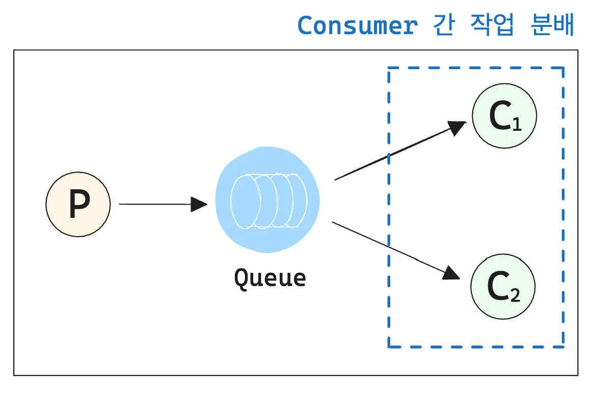

<a id="1c3eda9b0fe181e68bd6fefa204ff6a9"></a>

## Consumer 간 작업 분배 &#45; Work Queue ( <code>Competing Consumers Pattern</code> )

---



> ✏️ 
> 
> <a id="1c3eda9b0fe181e8b1cac1f7d202fd69"></a>
> 
> 메세지를 여러 <strong><u>Consumer(소비자)</u></strong> 간에 <strong><u>분배</u></strong>하는 <strong><u>작업을 분산 처리</u></strong>하는 구조
> 
> <a id="1c3eda9b0fe18128a0a8fc04b5275ead"></a>
> 
> <strong><u>작업 부하</u></strong>를 효율적으로 <strong><u>분산</u></strong>하고, <strong><u>병렬 처리</u></strong>를 가능하게 만들어 <strong><u>처리 속도를 향상</u></strong>시킨다&#46;

<details>
<summary>분배 방식(알고리즘)&#58; <strong><code>Round Robin</code></strong><strong>, </strong><strong><code>Fair Dispatch</code></strong></summary>

| 알고리즘 | 설명 |
| --- | --- |
| <strong><code>Round Robin</code></strong> | &#45; <code>Acknowledge Mode&#45;</code><strong><code>AUTO</code></strong><strong> ( </strong>AMQP 기본값 )<br>&#45; 메세지가 처리되었다는 것을 RabbitMQ에 자동으로 알려준다&#46;<br>&#45; RabbitMQ가 메세지를 컨슈머에게 전송하고, 컨슈머가 예외 없이 성공적으로 처리한 경우 자동으로 Acknowledge를 RabbitMQ에 전달한다&#46; |
| <strong><code>Fair Dispatch</code></strong> | &#45; <code>Acknowledge Mode&#45;</code><strong><code>MANUAL</code></strong><strong><br></strong>&#45; 컨슈머가 직접 <code>Channel&#46;basicAck()</code>를 호출해야 Acknowledgment가 전달된다&#46;<br>&#45; 해당 부분을 직접 코딩해야 하지만, 거의 사용되지 않는다&#46; |

</details>

<details>
<summary>주요 특징</summary>

| 특징 | 설명 |
| --- | --- |
| <strong><code>경쟁적인 메세지 소비</code></strong> | &#45; 여러 Consumer가 동일한 메세지 큐에서 메세지를 가져가 처리<br>&#45; 특정 메세지는 한 번에 하나의 Consumer에 의해 처리되므로 메세지 중복 처리를 방지 (라운드 로빈 방식) |
| <strong><code>작업 분산</code></strong> | &#45; 메세지가 여러 Consumer 간에 분배되어 병렬로 처리되므로 작업 부하를 효율적으로 분산 |
| <strong><code>확장성</code></strong> | &#45; Consumer를 추가하거나 제거함으로써 작업 처리 능력을 동적으로 확장하거나 축소 가능 |
| <strong><code>내결합성</code></strong> | &#45; Consumer 중 하나가 실패하더라도 다른 Consumer가 작업을 이어받아 처리할 수 있어 시스템 중단 없이 작동 |

</details>

<details>
<summary>🧐 <strong>라운드 로빈(Round Robin) 알고리즘</strong></summary>

<a id="1c3eda9b0fe181be87ebcf875840707c"></a>

### 라운드 로빈(Round Robin) 알고리즘

---

<a id="1c3eda9b0fe181c7875eff2a38cb7233"></a>

라운드 로빈은 선점형 스케줄링 기법 중 하나로, 각 프로세스에 <strong><u>동일한 시간 할당량(Time Quantum)</u></strong><strong><u>을 부여</u></strong>하여 <strong><u>CPU를 순차적으로 할당</u></strong>하는 방법이다&#46; 

<a id="1c3eda9b0fe181088cb8df8cac7e941d"></a>

해당 알고리즘은 공정성을 보장하며, <strong><u>모든 프로세스가 </u></strong><strong><u>일정한 주기</u></strong><strong><u>로 CPU를 사용</u></strong> 가능토록 한다&#46; 

<a id="1c3eda9b0fe181d5b5b3d095ee9d47f1"></a>

<strong>• 작동 방식</strong>

1. <code>프로세스 준비</code>&#58; 프로세스가 준비 큐에서 도착하면 큐 끝에 추가된다&#46; 

1. <code>시간 할당</code>&#58; CPU는 준비 큐 맨 앞의 프로세스에 주어진다 

1. <code>타이머 설정</code>&#58; 프로세스 실행 시 타이머가 설정되며, 시간 할당량 초과 시 인터럽트가 발생된다&#46; 

1. <code>시간 초과</code> 또는 <code>작업완료</code>
    - 시간이 초과되면 해당 프로세스는 큐의 끝으로 이동한다&#46;

    - 작업이 완료되면 큐에서 제거된다&#46;

1. <code>반복</code>&#58; 다음 프로세스로 CPU가 넘어가며 위 과정을 반복한다&#46; 

<a id="1c3eda9b0fe18136845cec96ccb84a8c"></a>

<strong>•  장•단점</strong>

- 장점
    - <code>공정성</code>&#58; 모든 프로세스가 동일한 시간 할당량을 받는다 

    - <code>빠른 응답 시간</code>&#58; 짧은 타입 슬라이스(간격)를 통해 대화형 시스템에 적합한다&#46; 

    - <code>간단한 구현</code>&#58; 구조와 로직이 단순하다&#46; 

- 단점
    - <code>문맥 전환(Context Switching) 오버헤드</code>&#58; 잦은 문맥 전환(Context Switching) 으로 인해 시스템 효율이 떨어질 수 있다&#46; 

    - <code>시간 할당량 설정 문제</code>&#58; 너무 짧거나 길 경우 성능 저하 가능성이 있다&#46;

<a id="1c3eda9b0fe1811f8edcc42a5c8c89cc"></a>

### RabbitMQ에서의 라운드 로빈 활용

---

<a id="1c3eda9b0fe181bdbcb3c23023f6c63f"></a>

RabbitMQ는 메세지 브로커로, 생산자(Producer)가 생성한 메세지를 소비자(Consumer)에게 전달한다&#46; 

<a id="1c3eda9b0fe1819aba06e4f7743a9b36"></a>

이 과정에서 라운드 로빈 알고리즘을 사용하여 메시지를 균등하게 분배한다&#46; 

<a id="1c3eda9b0fe181efb8a2cea0926a4908"></a>

<strong>• 작동 방식</strong>

1. <code>큐 생성 및 메세지 쌓기</code>&#58; 생산자가 메세지를 생성하여 큐에 저장한다&#46;

1. <code>소비자 연결</code>&#58; 여러 소비자가 동일한 큐를 바라보고 있으면, RabbitMQ는 메세지를 순차적으로 소비자들에게 전달한다&#46; 

1. <code>중복 방지 및 균등 분배</code>&#58; 각 메세지는 하나의 소비자에게만 전달되며, 모든 소비자가 평균적으로 동일한 수의 메세지를 처리하도록 보장한다&#46; 

<a id="1c3eda9b0fe1812ead72e43966189b8c"></a>

<strong>• 장점</strong>

- <code>부하 분산</code>&#58; 여러 소비자 간 작업을 균등하게 분배하여 시스템 부하를 줄인다&#46;

- <code>수평 확장 가능성</code>&#58; 소비자를 추가함으로써 쉽게 확장이 가능하다&#46;

> ☝🏻 
> 
> <a id="1c3eda9b0fe1814c82adea84a83dd871"></a>
> 
> <strong>주의)  라운드 로빈 → </strong><code>메세지 순서 보장 ❌</code>
> 
> <a id="1c3eda9b0fe181efa448cbf4cf6b92f6"></a>
> 
> 라운드 로빈 방식은 <strong><u>메세지 순서를 보장하지 않</u></strong>기 때문에, <strong><u>순서가 중요한 작업에는 적합하지 않</u></strong>을 수 있다&#46;

</details>

<details>
<summary>🧐 <strong>문맥 전환 ( Context Switching )</strong></summary>

<a id="1c3eda9b0fe181018f32ebd3366c26cb"></a>

문맥 전환 ( Context Switching )은 하나의 프로세스가 CPU를 사용하다가 다른 프로세스로 전환될 때 발생하는 일련의 작업을 말한다&#46; 

> 운영체제에서 context switching 시, 수행하는 과정

1. <code>현재 프로세스 상태 저장</code>&#58; 실행 중인 프로세스의 레지스터 값, 프로그램 카운터, 메모리 상태 등을 저장

1. <code>새로운 프로세스 상태 복원</code>&#58; 다음 실행될 프로세스의 저장된 상태를 복원

1. <code>커널 모드로 전환</code>&#58; context switching은 운영체제 커널에서 이루어지므로 &#91; 사용자 모드 → 커널 모드 → 사용자 모드 &#93; 전환이 필요하다&#46; 

</details>

<details>
<summary>🧐  <strong>Context Switching이 Overhead인 이유</strong></summary>

<a id="1c3eda9b0fe1810999defe68e35a7a4f"></a>

context switching은 유용한 작업(프로그램 실행)을 수행하지 않고, <strong><u>단지 프로세스를 교체하는 데 필요한 작업만 수행</u></strong>하여 OverHead로 간주된다&#46; 

<a id="1c3eda9b0fe181d497b5c52c63835692"></a>

<strong>• 주요 원인</strong>

- <code>레지스터 저장 및 복원</code>&#58; 각 프로세스는 고유한 레지스터 값을 가지며, 이를 메모리에 저장하고 복원하는데 시간이 소요된다&#46; 

- <code>메모리 관리 테이블 업데이트</code>&#58; 새로운 프로세스가 사용하는 메모리 영역에 대한 정보를 갱신해야 한다&#46; 

- <code>TLB(Translation Lookside Buffer) 플러시</code>&#58; 캐시 메모리에 저장된 이전 프로세스의메모리 매핑 정보를 지우고 새로 로드 해야한다&#46;

- <code>모드 전환 비용</code>&#58; 사용자 모드와 커널모드 전환이 필요하며, 해당 과정에도 시간이 소요된다&#46;

</details>

<details>
<summary>🧐 <strong>Fair Dispatch ( 공정 분배 ) 알고리즘</strong></summary>

<a id="1c3eda9b0fe181bbb178d4d26ac5413b"></a>

<strong>Fair Dispatch(공정한 분배) 알고리즘</strong>은 <strong><u>작업(Task) 또는 요청(Request)을 여러 워커(Worker)에게 균등하게 분배</u></strong>하는 방법으로 <strong><u>로드 밸런서</u></strong><strong>, </strong><strong><u>멀티스레딩 환경</u></strong><strong>, </strong><strong><u>비동기 작업 큐</u></strong> 등에서 자주 사용된다&#46; 

<a id="1c3eda9b0fe1816abcf5ff097af577e6"></a>

일반적으로 작<u>업(or 요청)을 여러 워커에게 균등하게 분배</u>하기 위해서 <strong><u>라운드 로빈(Round Robin)</u></strong>, <strong><u>랜덤 분배(Random Dispatch)</u></strong>  등을 사용한다&#46; 

<a id="1c3eda9b0fe18169bca5f794cbb2c0d6"></a>

그러나 위 알고리즘은 <strong><u>개별 워커의 부하(Load)</u></strong><strong><u>나 </u></strong><strong><u>처리 속도</u></strong><strong><u>를 고려하지 않</u></strong>기 때문에 <strong><u>공정하지 않</u></strong>을 수 있다&#46; 

<details>
<summary><strong>&#91; 🤬 문제 &#93;</strong><strong> 3개의 worker에서 </strong><strong><u>라운드 로빈</u></strong><strong> 방식 사용 시, 특정 worker에 과부하가 발생될 수 있다&#46;</strong></summary>

> 서버 3대 ( <code>Worker A</code>, <code>Worker B</code>, <code>Worker C </code>)

<a id="1c3eda9b0fe1819eb92ef184c5e77dcc"></a>

<code>Worker A</code>가 <strong><u>무거운 작업을 처리 중</u></strong>인데, 이를 <strong><u>라운드 로빈 방식</u></strong>으로 작업을 분배하면 <strong><u>새로운 요청이 A로 배정될 수도 있</u></strong>다&#46;

<a id="1c3eda9b0fe1810e99ecea8a3463c8d0"></a>

⇒  <code>Worker A</code><strong>에 </strong><strong><u>과부하</u></strong><strong>가 발생된다&#46; </strong>

<a id="1c3eda9b0fe1812ab4e3cc20cdc83203"></a>

위와 같은 문제를 <strong><u>공정분배 ( Fair Dispatch )</u></strong><strong> 방식</strong>을 적용하면 해결 가능하다&#46; 

</details>

<details>
<summary><strong>&#91; 🤓 해결 &#93;</strong><strong>  </strong><strong><u>공정 분배 ( Fair Dispatch )</u></strong><strong> 방식을 사용하여 Worker의 작업량을 고려하여 공정한 분배를 수행 할 수 있다&#46; </strong></summary>

- [ ] 알고리즘 예시에, 작업 종료 로직 추가 필요

<details>
<summary>1) <strong>Least&#45;Work&#45;First (LWF, 최소 작업 우선)</strong></summary>

- 현재 작업 중인 요청 개수가 가장 적은 Worker에게 새로운 작업 할당

- 워커의 작업 부하를 실시간으로 고려하여 공정하게 배분

- ✅ <strong>장점&#58;</strong> 워커가 과부하에 걸릴 가능성이 낮음

- ❌ <strong>단점&#58;</strong> 부하 측정을 위한 <strong>모니터링 비용</strong>이 필요

<details>
<summary>&#91;  <strong>예제 코드 (Java)</strong> &#93;</summary>

<a id="1c3eda9b0fe181aab9cdfd609cc23a84"></a>

```java
import java.util.*;

class Worker {
    String name;
    int taskCount;

    public Worker(String name) {
        this.name = name;
        this.taskCount = 0;
    }

    public void assignTask() {
        taskCount++;
    }

    public void completeTask() {
        if (taskCount > 0) taskCount--;
    }
}

public class FairDispatch {
    public static void main(String[] args) {
        List<Worker> workers = Arrays.asList(new Worker("A"), new Worker("B"), new Worker("C"));

        for (int i = 0; i < 10; i++) {
            Worker leastBusy = workers.stream()
                                      .min(Comparator.comparingInt(w -> w.taskCount))
                                      .orElseThrow();
            leastBusy.assignTask();
            System.out.println("Task assigned to Worker " + leastBusy.name);
        }
    }
}
```

- 작업을 할당 할 때, 현재 작업량이 가장 적은 Worker 선택

- Worker가 작업을 완료하면 taskCount&#45;&#45;를 수행하여 부하가 줄어듬

- stream()&#46;min()을 이용해 가장 적은 작업을 가진 Worker를 찾아냄

</details>

</details>

<details>
<summary>2) <strong>Shortest Queue First</strong> <strong>(SQF, 대기열이 가장 짧은 워커 선택)</strong></summary>

- Worker마다 <strong>작업 큐(Task Queue)</strong> 를 가지고 있고,<br><strong>가장 짧은 큐를 가진 Worker에 작업을 배정</strong>

- ✅ <strong>장점&#58;</strong> 개별 워커의 처리 속도를 반영할 수 있음

- ❌ <strong>단점&#58;</strong> 작업마다 실행 시간이 다르면 균등하지 않을 수 있음

<details>
<summary>&#91;  <strong>예제 코드 (Java)</strong> &#93;</summary>

<a id="1c3eda9b0fe1814ea778e37f81ba410f"></a>

```java
import java.util.*;

class WorkerQueue {
    String name;
    Queue<String> queue = new LinkedList<>();

    public WorkerQueue(String name) {
        this.name = name;
    }

    public void assignTask(String task) {
        queue.offer(task);
    }
}

public class FairDispatchQueue {
    public static void main(String[] args) {
        List<WorkerQueue> workers = Arrays.asList(new WorkerQueue("A"), new WorkerQueue("B"), new WorkerQueue("C"));

        for (int i = 0; i < 10; i++) {
            WorkerQueue shortestQueue = workers.stream()
                                               .min(Comparator.comparingInt(w -> w.queue.size()))
                                               .orElseThrow();
            shortestQueue.assignTask("Task " + i);
            System.out.println("Task assigned to Worker " + shortestQueue.name);
        }
    }
}
```

- queue&#46;size()가 가장 작은 Worker에게 작업을 배정

- 요청이 도착할 때마다 현재 <strong>대기열이 가장 짧은 Worker</strong> 를 찾음

- Worker가 작업을 완료하면 큐에서 제거하여 공정한 분배 유지

</details>

</details>

<details>
<summary>3) <strong>Weighted Fair Dispatch (가중치 기반 분배)</strong></summary>

- Worker마다 성능이 다를 수 있으므로,<br><strong>성능이 높은 Worker에게 더 많은 작업을 할당</strong>

- Worker별 가중치를 설정하고, <strong>가중치에 비례하여 작업을 분배</strong>

- ✅ <strong>장점&#58;</strong> 성능이 뛰어난 워커를 효율적으로 활용 가능

- ❌ <strong>단점&#58;</strong> 가중치를 정하는 기준이 필요

<details>
<summary> <strong>예제 코드 (Java)</strong></summary>

<a id="1c3eda9b0fe181f69308ec74c2c70e1d"></a>

```java
import java.util.*;

class WeightedWorker {
    String name;
    int weight;  // 가중치 (성능)
    int currentLoad;

    public WeightedWorker(String name, int weight) {
        this.name = name;
        this.weight = weight;
        this.currentLoad = 0;
    }

    public void assignTask() {
        currentLoad++;
    }

    public int getEffectiveLoad() {
        return currentLoad / weight;  // 가중치를 고려한 부하
    }
}

public class WeightedFairDispatch {
    public static void main(String[] args) {
        List<WeightedWorker> workers = Arrays.asList(
            new WeightedWorker("A", 3), // A의 성능이 높음
            new WeightedWorker("B", 1),
            new WeightedWorker("C", 2)
        );

        for (int i = 0; i < 10; i++) {
            WeightedWorker bestWorker = workers.stream()
                                               .min(Comparator.comparingInt(w -> w.getEffectiveLoad()))
                                               .orElseThrow();
            bestWorker.assignTask();
            System.out.println("Task assigned to Worker " + bestWorker.name);
        }
    }
}
```

- getEffectiveLoad()를 계산하여 가중치를 반영한 부하를 측정

- 성능이 좋은 Worker가 더 많은 작업을 할당받도록 함

</details>

</details>

</details>

<details>
<summary><strong>Fair Dispatch 실무 적용 사례</strong></summary>

1. <strong>멀티스레딩(Thread Pool)에서 공정한 작업 분배</strong>
    - Executors&#46;newFixedThreadPool(n)을 사용할 때 Worker 간 공정한 분배 적용 가능

1. <strong>웹 서버 로드 밸런서 (Nginx, HAProxy)</strong>
    - <strong>Least Connections Algorithm</strong>&#58; 가장 적은 연결을 가진 서버에 요청 전달

1. <strong>Kafka Consumer Group</strong>
    - Kafka는 여러 Consumer가 같은 토픽을 소비할 때 <strong>균등하게 할당</strong>

</details>

> ✏️ 
> 
> <a id="1c3eda9b0fe181b584b2eb62cf87345d"></a>
> 
> Fair Dispatch 알고리즘
> 
> <a id="1c3eda9b0fe18162b1b9cea4d1b0ab53"></a>
> 
> <strong><u>공정한 작업 분배</u></strong><u>를 보장</u>하여 <u>시스템의 </u><strong><u>부하를 최소화</u></strong><strong>하고 </strong><strong><u>성능을 극대화</u></strong>하는데 중요한 역할을 한다&#46;
> 
> <a id="1c3eda9b0fe181dabb0cfb6de1a26867"></a>
> 
> <strong>상황에 맞</strong>게 <code>LWF</code>, <code>SQF</code>, <code>Weighted</code> 방식을 <u>조합하여 사용</u>하면 최적의 성능을 낼 수 있다&#46;

</details>

<details>
<summary>🧐 Consumer는 client를 가르키는 것 아닌가?   </summary>

<a id="1c3eda9b0fe18183a8dddd0f54c1a12f"></a>

Consumer는 메세지를 클라이언트로 전달하는 서버 내부의 객체를 말한다&#46; 

<a id="1c3eda9b0fe1814baabaed3fe1de84cf"></a>

해당되는 엔드포인트로 메세지를 클라이언트에 전송한다&#46; 

- <code>SimpleMessageTemplate</code> 사용

</details>
