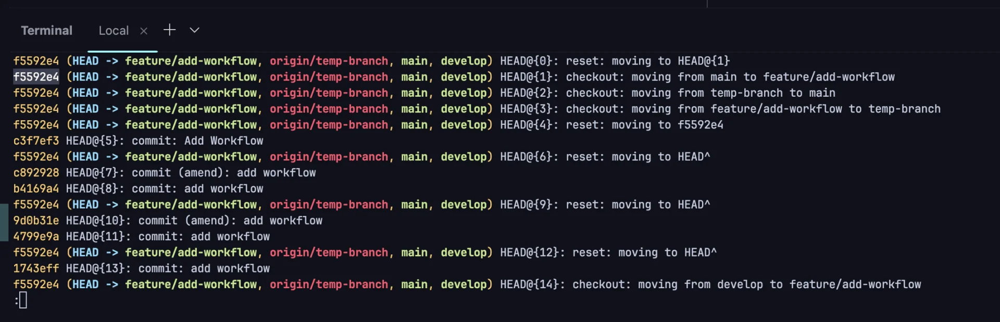

1. 작업 내용 복구 &#45; <code>git reflog</code>
    <a id="1c3eda9b0fe181c7b17ff33d0d40b037"></a>

    1&#46;  최근 작업의 모든 기록을 확인 가능

    <a id="1c3eda9b0fe181d39392e3906dfd9d43"></a>

    ```bash
    git reflog
    ```

    <details>
    <summary>결과 예시 </summary>

    <a id="1c3eda9b0fe1813eac82e6ced7ebf854"></a>

    ```bash
    b1c2d3e (HEAD -> main) HEAD@{0}: reset: moving to HEAD@{1}
    a1b2c3d HEAD@{1}: commit: Added feature X
    e4f5g6h HEAD@{2}: commit: Refactored module Y
    ```

    

    </details>

    1.  이전 상태로 복구 
        - 원하는 커밋 상태로 복구

        - reset이 아닌 checkout으로 작업 내역을 보존할 수 있다&#46;

        <a id="1c3eda9b0fe181a8ab19f7c654e1b487"></a>

        ```bash
        git checkout -b recover-branch a1b2c3d

        # a1b2c3d: 복구하려는 커밋 해시
        # 새로운 브랜치 recover-branch로 체크아웃하여 기존 작업 내용을 복원
        ```

    1. <strong>파일 복구 확인 </strong>
        - 복구된 브랜치에서 파일과 변경 사항이 복원되었는지 확인

        - 필요에 따라 작업을 추가적으로 수정

    1. <strong>다시 원래 브랜치로 병합 (선택 사항)</strong>
        - 복구한 브랜치의 내용을 원래 브랜치로 병합

        <a id="1c3eda9b0fe181bb9e11cdfd731bbbea"></a>

        ```bash
        git checkout [ 병할할 브런치 ]
        git merge recover-branch # 복구를 위해 임시 생성한 브랜치 
        ```


<a id="1c3eda9b0fe181aba599c609fa55b527"></a>

Tip)  <strong>git stash로 작업 보존 습관화</strong>

- reset 명령 전에 작업 내용을 안전하게 보존하려면 항상 stash를 활용
    <a id="1c3eda9b0fe1818da3cadedd166680bc"></a>

    ```bash
    git stash

    git stash pop
    ```
