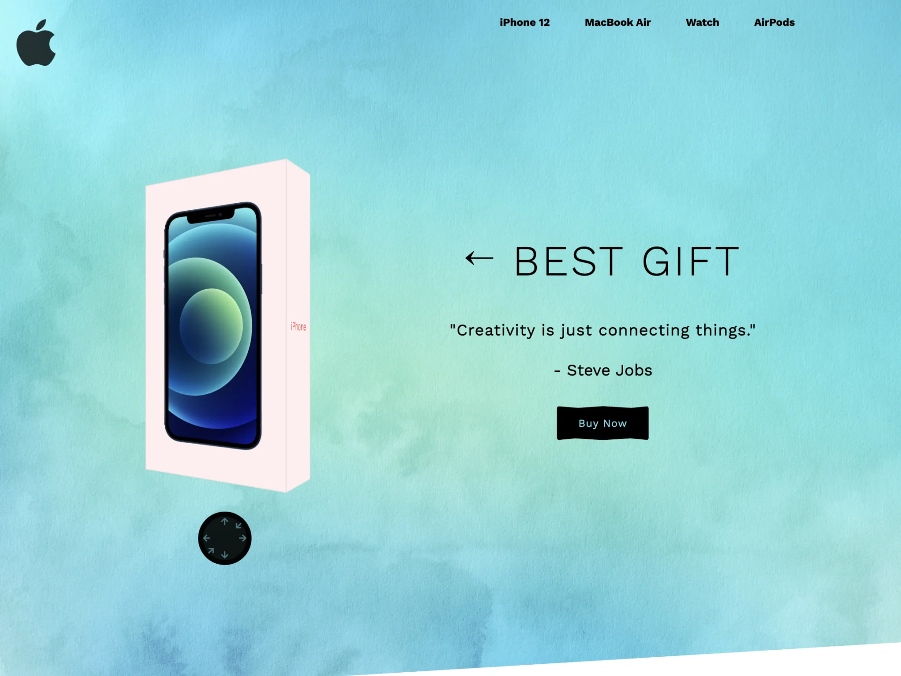
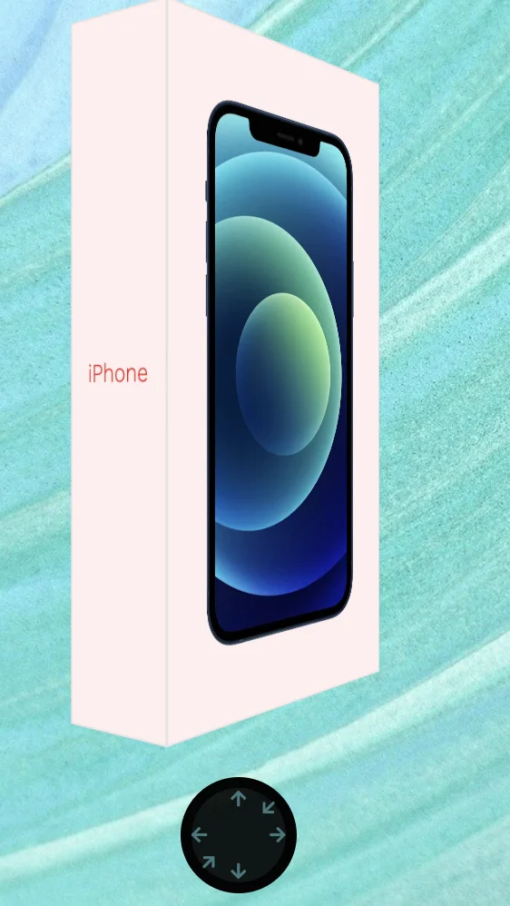
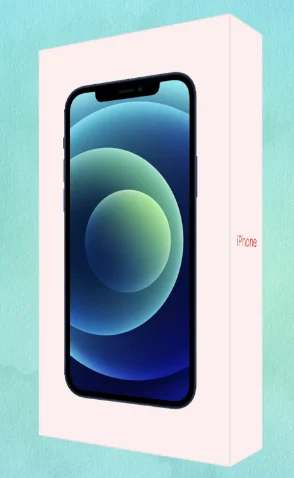
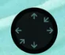
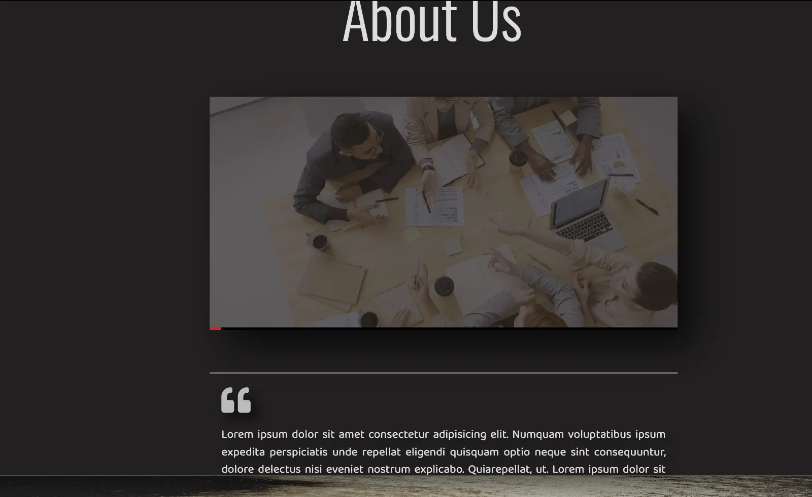

<a id="1c3eda9b0fe18137bac6d0391d4991b4"></a>

## Section  1 &#45; header



<a id="1c3eda9b0fe181dfbcdbf5ccfd86e39a"></a>

### 전체 코드

<details>
<summary>html</summary>

<a id="1c3eda9b0fe181fd8988fc52bb928a45"></a>

```html
<div class="container">
      <!-- Section 1 -->
      <section class="section-1" id="section-1">
        <!-- Logo -->
        <a href="#" class="logo">
          <i class="fab fa-apple"></i>
        </a>
        <!-- End of Logo -->

        <!-- Navbar -->
        <nav class="navbar">
          <a href="#setion-2" class="navbar-link">iPhone 12</a>
          <a href="#setion-3" class="navbar-link">MacBook Air</a>
          <a href="#setion-3" class="navbar-link">Watch</a>
          <a href="#setion-4" class="navbar-link">AirPods/a>
        </nav>
        <!-- End of Navbar -->

        <!-- Cube -->
        <div class="cube-wrapper">
          <div class="cube">
            <div class="front-side">
              
            </div>
            <div class="back-side center">
              <i class="fab fa-apple"></i>
            </div>
          </div>

          <!-- Controls -->
          <div class="controls">
            <a href="#" class="top-x-control">
              <i class="fas fa-arrow-up"></i>
            </a>
            <a href="#" class="bottom-x-control">
                <i class="fas fa-arrow-down"></i>
            </a>
            <a href="#" class="left-y-control">
                <i class="fas fa-arrow-left"></i>
            </a>
            <a href="#" class="right-y-control">
                <i class="fas fa-arrow-right"></i>
            </a>
            <a href="#" class="top-z-control">
                <i class="fas fa-arrow-down"></i>
            </a>
            <a href="#" class="bottom-z-control">
                <i class="fas fa-arrow-up"></i>
            </a>
          </div>
          <!-- End of Controls -->
        </div>
        <!-- End of CUbe -->

        <!-- Banner -->
        <div class="section-1-banner center">
            <h1>&#8592; Best Gift</h1>
            <p>"Creativity is just connectiong things."</p>
            <span> - Steve Jobs</span>
            <button type="button">Buy Now</button>
        </div>
        <!-- End of Banner -->

        <!-- SlideShow -->
        <div class="slideshow"></div>
        <!-- End of Section 1 -->
      </section>
```

</details>

<details>
<summary>css</summary>

<a id="1c3eda9b0fe181c896d9f88777f9ea25"></a>

```css
/* Section 1 */
.section-1 {
  width: 100%;
  height: 100vh;
  background-color: var(--primary-color);
  display: flex;
  align-items: center;
  justify-content: space-evenly;
  clip-path: polygon(100% 0, 100% 95%, 38% 100%, 0 100%, 0 0);
  position: relative;
}

/* Logo */
.logo {
  position: absolute;
  top: 3rem;
  left: 3rem;
}

.logo i {
  font-size: 10rem;
  color: rgba(0, 0, 0, 0.8);
}
/* End of Logo */

/* Navbar */
.navbar {
  position: absolute;
  top: 3rem;
  right: 10%;
}

.navbar-link {
  font-size: 2rem;
  display: inline-block;
  margin: 0 3rem;
  color: var(--black-color);
  transition: transform 0.5s;
}

.navbar-link:hover {
  transform: scale(1.5);
}
/* End of Navbar */

/* Cube */
.cube-wrapper {
  perspective: 100rem;
}

.cube {
  width: 30rem;
  height: 55rem;
  transform-style: preserve-3d;
  transform: rotateX(0) rotateY(20deg) rotateZ(0);
  position: relative;
  top: -2rem;
  transition: transform 0.5s;
}

.front-side,
.back-side {
  width: 100%;
  height: 100%;
  background-color: #fee;
  position: absolute;
  transform-style: preserve-3d;
  box-shadow: inset 0.1rem 0.1rem 0.1rem #ddd, inset -0.1rem -0.1rem 0.1rem #ddd;
}

.front-side {
  padding: 2.5rem;
  transform: translateZ(5rem);
}

.front-side::before,
.front-side::after {
  content: "";
  width: 100%;
  height: 10rem;
  background-color: #fee;
  position: absolute;
  box-shadow: inset 0.1rem 0.1rem 0.1rem #ddd, inset -0.1rem -0.1rem 0.1rem #ddd;
}

.front-side::before {
  top: 0;
  left: 0;
  transform: rotateX(-90deg);
  transform-origin: top;
}

.front-side::after {
  bottom: 0;
  left: 0;
  transform: rotateX(90deg);
  transform-origin: bottom;
}

.front-side img {
  width: 100%;
  height: 100%;
  object-fit: contain;
}

.back-side {
  transform: translateZ(-5rem);
}

.back-side::before,
.back-side::after {
  content: "iPhone";
  width: 10rem;
  height: 100%;
  background-color: #fee;
  position: absolute;
  display: flex;
  justify-content: center;
  align-items: center;
  font-size: 2rem;
  font-weight: 300;
  color: #ec1919;
  box-shadow: inset 0.1rem 0.1rem 0.1rem #ddd, inset -0.1rem -0.1rem 0.1rem #ddd;
}

.back-side::before {
  top: 0;
  left: 0;
  transform: rotateY(-90deg);
  transform-origin: left;
}

.back-side::after {
  top: 0;
  right: 0;
  transform: rotateY(90deg);
  transform-origin: right;
}

.back-side i {
  font-size: 12rem;
  color: var(--primary-color);
  text-shadow: 0.1rem 0.1rem 0.2rem #aaa, -0.1rem -0.1rem 0.2rem #aaa;
  transform: rotateY(180deg);
}

/* Controls */
.controls {
  position: absolute;
  bottom: -15rem;
  left: 50%;
  transform: translateX(-50%);
  width: 10rem;
  height: 10rem;
  background-color: rgba(0, 0, 0, 0.9);
  border-radius: 50%;
  border: 1rem solid rgba(0, 0, 0, 0.8);
}

.controls a {
  position: absolute;
}

.controls a:nth-child(1) {
  top: 0;
  left: 50%;
  transform: translateX(-50%);
}

.controls a:nth-child(2) {
  bottom: 0;
  left: 50%;
  transform: translateX(-50%);
}

.controls a:nth-child(3) {
  top: 50%;
  left: 0;
  transform: translateY(-50%);
}

.controls a:nth-child(4) {
  top: 50%;
  right: 0;
  transform: translateY(-50%);
}

.controls a:nth-child(5) {
  top: 10%;
  right: 10%;
  transform: rotate(45deg);
}

.controls a:nth-child(6) {
  bottom: 10%;
  left: 10%;
  transform: rotate(45deg);
}

.controls i {
  font-size: 1.5rem;
  color: var(--primary-color);
  opacity: 0.5;
  transition: opacity 0.5s;
}

.controls a:hover i {
  opacity: 1;
}
/* End of Controls */
/* End of Cube */

/* Banner */
.section-1-banner {
  flex-direction: column;
}

.section-1-banner h1 {
  font-size: 13rem;
  font-weight: 300;
  text-transform: uppercase;
  letter-spacing: 0.5rem;
}

.section-1-banner p {
  font-size: 4rem;
  font-weight: 400;
  letter-spacing: 0.1rem;
  margin: 6rem 0 4rem 0;
}

.section-1-banner span {
  font-size: 3rem;
  margin-bottom: 5rem;
}

.section-1-banner button {
  padding: 2rem 4rem;
  font-size: 2rem;
  background-color: var(--black-color);
  color: var(--primary-color);
  font-weight: 400;
  letter-spacing: 0.1rem;
  border: none;
  border-radius: 0.5rem;
  cursor: pointer;
  clip-path: polygon(
    50% 0%,
    81% 5%,
    100% 0,
    100% 100%,
    80% 95%,
    50% 100%,
    20% 95%,
    0 100%,
    0 0,
    23% 5%
  );
  transition: clip-path 0.5s;
}

.section-1-banner button:hover {
  clip-path: polygon(
    40% 15%,
    77% 15%,
    100% 10%,
    100% 90%,
    75% 85%,
    40% 85%,
    30% 100%,
    0 50%,
    0 50%,
    30% 0
  );
}
/* End of Banner */

/* Slideshow */
.slideshow {
  width: 100%;
  height: 100%;
  position: absolute;
  top: 0;
  left: 0;
  z-index: -1;
}

.slideshow div {
  width: 100%;
  height: 100%;
  position: absolute;
  background-size: cover;
  background-position: center;
  background-repeat: no-repeat;
  opacity: 0;
  transition: opacity 5s;
}

.slideshow div.change {
  opacity: 1;
}
/* End of Slideshow */
/* End of Section 1 */
```

</details>

<details>
<summary>js</summary>

<a id="1c3eda9b0fe181f6a456c9f532cea582"></a>

```javascript
document
  .querySelectorAll(".watch-control, .controls a, .iphone-btn")
  .forEach((control) => {
    control.addEventListener("click", (e) => {
      e.preventDefault();
    });
  });

// Cube
let x = 0;
let y = 20;
let z = 0;
let bool = true;
let interval;

const cube = document.querySelector(".cube");

document.querySelector(".top-x-control").addEventListener("click", () => {
  cube.style.transform = `rotateX(${(x += 20)}deg) rotateY(${y}deg) rotateZ(${z}deg)`;
});

document.querySelector(".bottom-x-control").addEventListener("click", () => {
  cube.style.transform = `rotateX(${(x -= 20)}deg) rotateY(${y}deg) rotateZ(${z}deg)`;
});

document.querySelector(".right-y-control").addEventListener("click", () => {
  cube.style.transform = `rotateX(${x}deg) rotateY(${(y += 20)}deg) rotateZ(${z}deg)`;
});

document.querySelector(".left-y-control").addEventListener("click", () => {
  cube.style.transform = `rotateX(${x}deg) rotateY(${(y -= 20)}deg) rotateZ(${z}deg)`;
});

document.querySelector(".bottom-z-control").addEventListener("click", () => {
  cube.style.transform = `rotateX(${x}deg) rotateY(${y}deg) rotateZ(${(z += 20)}deg)`;
});

document.querySelector(".top-z-control").addEventListener("click", () => {
  cube.style.transform = `rotateX(${x}deg) rotateY(${y}deg) rotateZ(${(z -= 20)}deg)`;
});

const playPause = () => {
  if (bool) {
    interval = setInterval(() => {
      cube.style.transform = `rotateX(${x}deg) rotateY(${y++} rotateZ(${z}))`;
    }, 100);
  } else {
    clearInterval(interval);
  }
};

playPause();

document.querySelector(".controls").addEventListener("mouseover", () => {
  bool = false;
  playPause();
});

document.querySelector(".controls").addEventListener("mouseout", () => {
  bool = true;
  playPause();
});
```

</details>

<a id="1c3eda9b0fe1816f9345d97883c23094"></a>

### navbar (각 section 마다 링크 걸기)


<details>
<summary>● <em>각 section 마다 링크 걸기</em></summary>

<a id="1c3eda9b0fe181f8afbfe5b59076ec20"></a>

<code>a</code> 의 <strong>하이퍼링크(href)</strong>에 해당하는 section의 <code>id 값</code> 을 입력해주면 된다&#46; 

</details>

<details>
<summary>html</summary>

<a id="1c3eda9b0fe181b29bfecd8f6c168b9d"></a>

```html
<nav class="navbar">
  <a href="#section-2" class="navbar-link">iPhone 12</a>
  <a href="#section-3" class="navbar-link">MacBook Air</a>
  <a href="#section-3" class="navbar-link">Watch</a>
  <a href="#section-4" class="navbar-link">AirPods</a>
</nav>
```

</details>

<details>
<summary>css</summary>

<a id="1c3eda9b0fe181c6bcb7d7124d0ddce9"></a>

```css

```

</details>

<a id="1c3eda9b0fe18118ade6e2dde9ab470f"></a>

### iPhon box animation



<a id="1c3eda9b0fe18110b28cfdd49a0c1f92"></a>

### ● iPhone box



<details>
<summary>html</summary>

<a id="1c3eda9b0fe181318c6eda10c790c215"></a>

```html
<div class="cube-wrapper">
  <div class="cube">
    <div class="front-side">
      
    </div>
    <div class="back-side center">
      <i class="fab fa-apple"></i>
    </div>
  </div>
```

</details>

<details>
<summary>css</summary>

<a id="1c3eda9b0fe18167ba71fa00ef53e2ff"></a>

```css
/* Cube */
.cube-wrapper {
  perspective: 100rem;
}

.cube {
  width: 30rem;
  height: 55rem;
  transform-style: preserve-3d;
  transform: rotateX(0) rotateY(20deg) rotateZ(0);
  position: relative;
  top: -2rem;
  transition: transform 0.5s;
}

.front-side,
.back-side {
  width: 100%;
  height: 100%;
  background-color: #fee;
  position: absolute;
  transform-style: preserve-3d;
  box-shadow: inset 0.1rem 0.1rem 0.1rem #ddd, inset -0.1rem -0.1rem 0.1rem #ddd;
}

.front-side {
  padding: 2.5rem;
  transform: translateZ(5rem);
}

.front-side::before,
.front-side::after {
  content: "";
  width: 100%;
  height: 10rem;
  background-color: #fee;
  position: absolute;
  box-shadow: inset 0.1rem 0.1rem 0.1rem #ddd, inset -0.1rem -0.1rem 0.1rem #ddd;
}

.front-side::before {
  top: 0;
  left: 0;
  transform: rotateX(-90deg);
  transform-origin: top;
}

.front-side::after {
  bottom: 0;
  left: 0;
  transform: rotateX(90deg);
  transform-origin: bottom;
}

.front-side img {
  width: 100%;
  height: 100%;
  object-fit: contain;
}

.back-side {
  transform: translateZ(-5rem);
}

.back-side::before,
.back-side::after {
  content: "iPhone";
  width: 10rem;
  height: 100%;
  background-color: #fee;
  position: absolute;
  display: flex;
  justify-content: center;
  align-items: center;
  font-size: 2rem;
  font-weight: 300;
  color: #ec1919;
  box-shadow: inset 0.1rem 0.1rem 0.1rem #ddd, inset -0.1rem -0.1rem 0.1rem #ddd;
}

.back-side::before {
  top: 0;
  left: 0;
  transform: rotateY(-90deg);
  transform-origin: left;
}

.back-side::after {
  top: 0;
  right: 0;
  transform: rotateY(90deg);
  transform-origin: right;
}

.back-side i {
  font-size: 12rem;
  color: var(--primary-color);
  text-shadow: 0.1rem 0.1rem 0.2rem #aaa, -0.1rem -0.1rem 0.2rem #aaa;
  transform: rotateY(180deg);
}
```

</details>

<a id="1c3eda9b0fe1810ca5ddf8faae60bbba"></a>

### ● Controler



<details>
<summary>html</summary>

<a id="1c3eda9b0fe181128844e2f0f77a5e32"></a>

```html
<div class="controls">
  <a href="#" class="top-x-control">
    <i class="fas fa-arrow-up"></i>
  </a>
  <a href="#" class="bottom-x-control">
    <i class="fas fa-arrow-down"></i>
  </a>
  <a href="#" class="left-y-control">
    <i class="fas fa-arrow-left"></i>
  </a>
  <a href="#" class="right-y-control">
    <i class="fas fa-arrow-right"></i>
  </a>
  <a href="#" class="top-z-control">
    <i class="fas fa-arrow-down"></i>
  </a>
  <a href="#" class="bottom-z-control">
    <i class="fas fa-arrow-up"></i>
  </a>
</div>
```

</details>

<details>
<summary>css</summary>

<a id="1c3eda9b0fe181c3b234d3fee21cdbde"></a>

```css
/* Controls */
.controls {
  position: absolute;
  bottom: -15rem;
  left: 50%;
  transform: translateX(-50%);
  width: 10rem;
  height: 10rem;
  background-color: rgba(0, 0, 0, 0.9);
  border-radius: 50%;
  border: 1rem solid rgba(0, 0, 0, 0.8);
}

.controls a {
  position: absolute;
}

.controls a:nth-child(1) {
  top: 0;
  left: 50%;
  transform: translateX(-50%);
}

.controls a:nth-child(2) {
  bottom: 0;
  left: 50%;
  transform: translateX(-50%);
}

.controls a:nth-child(3) {
  top: 50%;
  left: 0;
  transform: translateY(-50%);
}

.controls a:nth-child(4) {
  top: 50%;
  right: 0;
  transform: translateY(-50%);
}

.controls a:nth-child(5) {
  top: 10%;
  right: 10%;
  transform: rotate(45deg);
}

.controls a:nth-child(6) {
  bottom: 10%;
  left: 10%;
  transform: rotate(45deg);
}

.controls i {
  font-size: 1.5rem;
  color: var(--primary-color);
  opacity: 0.5;
  transition: opacity 0.5s;
}

.controls a:hover i {
  opacity: 1;
}
```

</details>

<a id="1c3eda9b0fe181ceb46fc8a810e8c8d3"></a>

### button style


- hover 시


<details>
<summary>html</summary>

<a id="1c3eda9b0fe181f8bc89f4bf831748c3"></a>

```html

```

</details>

<details>
<summary>css</summary>

<a id="1c3eda9b0fe1813ea72cde23ee51560a"></a>

```css

```

</details>

<a id="1c3eda9b0fe1812a93ddefbd23350312"></a>

## Section  3 &#45; main 1 (Video Control)



<a id="1c3eda9b0fe181c288e6cf9d3420c4dc"></a>

### html

<a id="1c3eda9b0fe1814fb8e8ef8fa6605cda"></a>

```html
<section class="section-2" id="about-us">
          <h1 class="section-heading">About Us</h1>
          <div class="section-heading-line"></div>
          <div class="video-wrapper">
            <video src="images/about-us-video.mp4" class="video"></video>
            <div class="controls">
              <div class="video-bar-wrapper">
                <div class="video-bar"></div>
              </div>
              <div class="buttons">
                <button id="play-pause">
                  <i class="far fa-play-circle"></i>
                </button>
              </div>
            </div>
          </div>
          <p class="section-2-paragraph">
            <i class="fas fa-quote-left"></i>
            Lorem ipsum dolor sit amet consectetur adipisicing elit. Numquam voluptatibus ipsum expedita perspiciatis unde repellat eligendi quisquam optio neque sint consequuntur, dolore delectus nisi eveniet nostrum explicabo. Quiarepellat, ut. Lorem ipsum dolor sit amet. Lorem ipsum dolor sit amet. Lorem ipsum dolor sit amet.
            <i class="fas fa-quote-right"></i>
          </p>      
        </section>
```

<a id="1c3eda9b0fe181f4b6b7fd39c75df4ce"></a>

### css

<a id="1c3eda9b0fe18195bd2ac2b659c994c1"></a>

```css
/* Section 2 */
.section-2 {
  width: 100%;
  height: 100vh;
  background-color: #222020;
  display: flex;
  align-items: center;
  padding: 0 10rem;
  position: relative;
}

.section-heading {
  font-size: 10rem;
  font-family: "Oswald", sans-serif;
  font-weight: 300;
  color: #ddd;
  margin-right: 4rem;
}

.section-heading-line {
  width: 15rem;
  height: 0.2rem;
  background-color: #ddd;
}

.video-wrapper {
  width: 100rem;
  height: 50rem;
  position: absolute;
  top: 5rem;
  right: 15rem;
  box-shadow: 3rem 3rem 6rem rgba(0, 0, 0, 0.7);
  overflow: hidden;
}

.video-wrapper:hover .controls {
  transform: translateY(0);
}

.video {
  width: 100%;
  height: 100%;
  object-fit: cover;
  opacity: 0.3;
  transition: opacity 0.3s;
}

.controls {
  width: 100%;
  position: absolute;
  bottom: 0;
  background-color: rgba(0, 0, 0, 0.7);
  transform: translateY(calc(100% - 0.4rem));
  transition: transform 0.4s;
}

.video-bar-wrapper {
  width: 100%;
  height: 0.7rem;
  background-color: #000;
  position: absolute;
  top: 0;
  left: 0;
}

.video-bar {
  height: 100%;
  width: 0;
  background-color: #d30819;
  transition: width 0.2s linear;
}

.buttons {
  padding: 2rem 1rem 1rem 1rem;
}

.buttons button {
  background: none;
  border: none;
  cursor: pointer;
}

.buttons i {
  width: 3rem;
  height: 3rem;
  font-size: 2.8rem;
  color: #fff;
}

.section-2-paragraph {
  width: 100rem;
  position: absolute;
  bottom: 8rem;
  right: 15rem;
  font-size: 2rem;
  line-height: 1.5;
  color: #ddd;
  border-top: 0.3rem double #aaa;
  border-bottom: 0.3rem double #aaa;
  padding: 2rem;
  display: flex;
  flex-direction: column;
  justify-content: center;
  align-items: center;
  text-align: justify;
  text-shadow: 1rem 1rem 2rem rgba(0, 0, 0, 0.7);
}

.fa-quote-left {
  align-self: flex-start;
  font-size: 5rem;
  color: #bbb;
  margin-bottom: 2rem;
}

.fa-quote-right {
  align-self: flex-end;
  font-size: 5rem;
  color: #bbb;
}

/* End of Section 2 */
```

<a id="1c3eda9b0fe1814ebe1ccdcffea7436f"></a>

### js

<a id="1c3eda9b0fe181ae8faef3bbe0e2814b"></a>

```javascript
const video = document.querySelector(".video");
const btn = document.querySelector(".buttons button i");
const bar = document.querySelector(".video-bar");

const playPause = () => {
  if (video.paused) {
    video.play();
    btn.className = "far fa-pause-circle";
    video.style.opacity = ".7";
  } else {
    video.pause();
    btn.className = "far fa-play-circle";
    video.style.opacity = ".3";
  }
};

btn.addEventListener("click", () => {
  playPause();
});

video.addEventListener("timeupdate", () => {
  console.log(video.currentTime, video.duration);
  const barWidth = video.currentTime / video.duration;
  bar.style.width = `${barWidth * 100}%`;
  if (video.ended) {
    btn.className = "far fa-play-circle";
    video.style.opacity = ".3";
  }
});
```

<a id="1c3eda9b0fe1814ea88cfa208bb4f089"></a>

## Section  4 &#45; main 2 (3D Cards)


<a id="1c3eda9b0fe181a7b26aeffb9e40bee6"></a>

### html

<a id="1c3eda9b0fe181c2b5c8c1a05b64c685"></a>

```html
<section class="section-3" id="pricing">
  <h1 class="section-heading">Pricing</h1>
  <div class="section-heading-line"></div>
  <div class="swiper-container">
  <div class="pricing-cards-wrapper swiper-wrapper">
    <div class="pricing-card swiper-slide">
      <div class="pricing-card-front">
        <h1 class="pricing-card-heading heading-free">FREE</h1>
        <h3 class="pricing-card-price">$0</h3>
        <ul class="pricing-card-list list-free">
          <li>
            <i class="fas fa-check"></i>
            <span>Pricing Card Item</span>
          </li>
          <li>
            <i class="fas fa-check"></i>
            <span>Pricing Card Item</span>
          </li>
          <li>
            <i class="fas fa-times"></i>
            <span>Pricing Card Item</span>
          </li>
          <li>
            <i class="fas fa-times"></i>
            <span>Pricing Card Item</span>
          </li>
          <li>
            <i class="fas fa-times"></i>
            <span>Pricing Card Item</span>
          </li>
        </ul>
        <button class="pricing-card-btn btn-free">Choose Plan</button>
      </div>
      <div class="pricing-card-back back-free">
        <a href="#">Order Now</a>
      </div>
    </div>
    <div class="pricing-card swiper-slide">
      <div class="pricing-card-front">
        <h1 class="pricing-card-heading heading-basic">BASIC</h1>
        <h3 class="pricing-card-price">$299</h3>
        <ul class="pricing-card-list list-basic">
          <li>
            <i class="fas fa-check"></i>
            <span>Pricing Card Item</span>
          </li>
          <li>
            <i class="fas fa-check"></i>
            <span>Pricing Card Item</span>
          </li>
          <li>
            <i class="fas fa-check"></i>
            <span>Pricing Card Item</span>
          </li>
          <li>
            <i class="fas fa-check"></i>
            <span>Pricing Card Item</span>
          </li>
          <li>
            <i class="fas fa-times"></i>
            <span>Pricing Card Item</span>
          </li>
        </ul>
        <button class="pricing-card-btn btn-basic">Choose Plan</button>
      </div>
      <div class="pricing-card-back back-basic">
        <a href="#">Order Now</a>
      </div>
    </div>
    <div class="pricing-card swiper-slide">
      <div class="pricing-card-front">
        <h1 class="pricing-card-heading heading-standard">STANDARD</h1>
        <h3 class="pricing-card-price">$699</h3>
        <ul class="pricing-card-list list-standard">
          <li>
            <i class="fas fa-check"></i>
            <span>Pricing Card Item</span>
          </li>
          <li>
            <i class="fas fa-check"></i>
            <span>Pricing Card Item</span>
          </li>
          <li>
            <i class="fas fa-check"></i>
            <span>Pricing Card Item</span>
          </li>
          <li>
            <i class="fas fa-check"></i>
            <span>Pricing Card Item</span>
          </li>
          <li>
            <i class="fas fa-check"></i>
            <span>Pricing Card Item</span>
          </li>
        </ul>
        <button class="pricing-card-btn btn-standard">Choose Plan</button>
      </div>
      <div class="pricing-card-back back-standard">
        <a href="#">Order Now</a>
      </div>
    </div>
    <div class="pricing-card swiper-slide">
      <div class="pricing-card-front">
        <h1 class="pricing-card-heading heading-premium">PREMIUM</h1>
        <h3 class="pricing-card-price">$999</h3>
        <ul class="pricing-card-list list-premium">
          <li>
            <i class="fas fa-check"></i>
            <span>Pricing Card Item</span>
          </li>
          <li>
            <i class="fas fa-check"></i>
            <span>Pricing Card Item</span>
          </li>
          <li>
            <i class="fas fa-check"></i>
            <span>Pricing Card Item</span>
          </li>
          <li>
            <i class="fas fa-check"></i>
            <span>Pricing Card Item</span>
          </li>
          <li>
            <i class="fas fa-check"></i>
            <span>Pricing Card Item</span>
          </li>
            <i class="fas fa-check"></i>
            <span>Pricing Card Item</span>
          </li>
        </ul>
        <button class="pricing-card-btn btn-premium">Choose Plan</button>
      </div>
      <div class="pricing-card-back back-premium">
        <a href="#">Order Now</a>
      </div>
    </div>
  </div>
</div>
</section>
```

<a id="1c3eda9b0fe181cd802bf21af7ff9a83"></a>

### css

<a id="1c3eda9b0fe18177a6cbc8ef1edd8ec4"></a>

```css
.section-3 {
  width: 100%;
  height: 100vh;
  background-color: #03070e;
  display: flex;
  align-items: center;
  padding-left: 10rem;
}

.pricing-cards-wrapper {
  width: 100%;
  display: flex;
  justify-content: space-evenly;
  padding: 5rem;
}

.pricing-card {
  width: 28rem !important;
  height: 45rem !important;
  background-color: #181b1d;
  border-radius: 1rem;
  box-shadow: 2rem 2rem 6rem rgba(0, 0, 0, 0.7);
}

.pricing-card-front {
  width: 100%;
  height: 100%;
  display: flex;
  flex-direction: column;
  align-items: center;
  justify-content: space-between;
}

.pricing-card-heading {
  font-size: 2rem;
  font-weight: 300;
  color: #fff;
  width: 100%;
  height: 5rem;
  display: flex;
  align-items: center;
  padding-left: 2rem;
  border-radius: 1rem 1rem 0 0;
}

.heading-free {
  background: linear-gradient(to right, #087285, #0da5d3);
}

.heading-basic {
  background: linear-gradient(to right, #946809, #bdba0e);
}

.heading-standard {
  background: linear-gradient(to right, #a10c14, #e23b3b);
}

.heading-premium {
  background: linear-gradient(to right, #0b7e48, #3be286);
}

.pricing-card-price {
  font-family: "MADE Soulmaze", sans-serif;
  font-size: 7rem;
  font-weight: 300;
  color: #fff;
}

.pricing-card-list li {
  margin-bottom: 0.5rem;
}

.pricing-card-list i {
  font-size: 1.8rem;
  width: 3rem;
}

.pricing-card-list span {
  font-size: 1.8rem;
  font-weight: 300;
  letter-spacing: 0.1rem;
}

.list-free {
  color: #0da5d3;
}

.list-basic {
  color: #bdba0e;
}

.list-standard {
  color: #e23b3b;
}

.list-premium {
  color: #3be286;
}

.pricing-card-btn {
  width: 18rem;
  height: 5rem;
  margin-bottom: 3rem;
  border-radius: 3rem;
  border: none;
  font-size: 1.6rem;
  text-transform: uppercase;
  color: #fff;
  text-shadow: 0.3rem 0.3rem 0.6rem rgba(0, 0, 0, 0.5);
}

.btn-free {
  background-color: #0da5d3;
}

.btn-basic {
  background-color: #bdba0e;
}

.btn-standard {
  background-color: #e23b3b;
}

.btn-premium {
  background-color: #3be286;
}

.pricing-card-back {
  position: absolute;
  top: 0;
  left: 0;
  width: 100%;
  height: 100%;
  display: flex;
  justify-content: center;
  align-items: center;
  transform: rotateY(180deg);
  border-radius: 1rem;
}

.pricing-card-back a {
  font-size: 2.5rem;
  color: #fff;
}

.back-free {
  background: linear-gradient(to right, #087285, #0da5d3);
}

.back-basic {
  background: linear-gradient(to right, #946809, #bdba0e);
}

.back-standard {
  background: linear-gradient(to right, #a10c14, #e23b3b);
}

.back-premium {
  background: linear-gradient(to right, #0b7e48, #3be286);
}
```

<a id="1c3eda9b0fe181739e0dc8d9ff32f266"></a>

### js

<a id="1c3eda9b0fe181599801f89d4c6d2368"></a>

```javascript
// section 3 - 3D Cards
var swiper = new Swiper(".swiper-container", {
  effect: "coverflow",
  grabCursor: true,
  centeredSlides: true,
  slidesPerView: "auto",
  coverflowEffect: {
    rotate: 70,
    stretch: 0,
    depth: 100,
    modifier: 1,
    slideShadows: true,
  },
}); 
```

<a id="1c3eda9b0fe181d7bbfcf21cd5df24d4"></a>

## Section  5 &#45; main 3 (Contact)


<a id="1c3eda9b0fe181438511cfa98141439d"></a>

### html

<a id="1c3eda9b0fe181eb932bdb5cae97bd24"></a>

```html
<section class="section-4" id="contact">
      <h1 class="section-heading">Contact</h1>
      <div class="section-heading-line"></div>
      <div class="contact-wrapper">
        <div class="contact-details">
          <div class="phone">
            <i class="fas fa-mobile-alt"></i>
            <h3>Phone</h3>
            <p>+123 456 789</p>
            <p>+987 654 321</p>
          </div>
          <div class="address">
            <i class="fas fa-map-marker-alt"></i>
            <h3>Address</h3>
            <p>Main street #123</p>
            <p>Wall street #123</p>
          </div>
          <div class="email">
            <i class="far fa-envelope"></i>
            <h3>Email</h3>
            <p>support@gmail.com</p>
            <p>sales@gmail.com</p>
          </div>
        </div>
        <h1>Get In Touch</h1>
        <form class="contact-form">
          <input type="text" placeholder="Your Name">
          <input type="email" placeholder="Your Email">
          <textarea placeholder="Your Message"></textarea>
          <input type="submit" value="Send Message">
        </form>
      </div>
    </section>
```

<a id="1c3eda9b0fe1816d8c7ac0e6985b88be"></a>

### css<br>

<a id="1c3eda9b0fe18165bd63c6985242045d"></a>

```css
.section-4 {
  width: 100%;
  height: 100vh;
  background-color: #171718;
  display: flex;
  align-items: center;
  padding: 0 10rem;
}

.contact-wrapper {
  width: 80%;
  display: flex;
  flex-direction: column;
  align-items: center;
}

.contact-details {
  display: flex;
  margin-bottom: 8rem;
}

.contact-details div {
  width: 25rem;
  text-align: center;
  margin: 4rem;
}

.contact-details i {
  font-size: 5rem;
  color: #7a1010;
}

.contact-details h3 {
  font-family: "MADE Soulmaze", serif;
  font-size: 2.5rem;
  margin: 2rem 0;
  color: #ccc;
}

.contact-details p {
  font-size: 1.6rem;
  color: #aaa;
}

.contact-wrapper h1 {
  font-size: 4rem;
  color: #ccc;
  text-transform: uppercase;
  margin-bottom: 3rem;
}

.contact-form {
  width: 70rem;
  display: flex;
  flex-direction: column;
}

.contact-form input,
.contact-form textarea {
  padding: 1.5rem;
  background-color: #444;
  color: #eee;
  border: none;
  margin-bottom: 2rem;
  font-family: "Oswald", sans-serif;
  font-size: 1.8rem;
  font-weight: 300;
  letter-spacing: 0.1rem;
}

.contact-form textarea {
  max-width: 100%;
  max-height: 15rem;
  min-height: 5.5rem;
}

.contact-form input[type="submit"] {
  background-color: #7a1010;
  text-transform: uppercase;
  cursor: pointer;
  transition: background-color 0.3s;
}

.contact-form input[type="submit"]:hover {
  background-color: #5f0303;
}
```

<a id="1c3eda9b0fe18177b45ec029df7c2bab"></a>

## Section 6 &#45; footer

<a id="1c3eda9b0fe181a1ab53f58b52e6e700"></a>

### html

<a id="1c3eda9b0fe18141b999e6de952e1091"></a>

```html
<!-- Footer -->
  <footer class="footer">
    <div class="footer-nav">
      <a href="#home">Home</a>
      <a href="#about-us">About Us</a>
      <a href="#pricing">Pricing</a>
      <a href="#contact">Contact</a>
    </div>
    <p class="copyright">Copyright &copy; CodeAndCreate All Rights Reserved</p>
  </footer>
```

<a id="1c3eda9b0fe181299050e7cec518888a"></a>

### css

<a id="1c3eda9b0fe181faa5f3ea0bc8315a6e"></a>

```css
.footer {
  width: 100%;
  height: 12rem;
  background-color: #202122;
  display: flex;
  justify-content: space-between;
  align-items: center;
  padding: 0 10rem;
}

.footer-nav a {
  font-family: "MADE Soulmaze", serif;
  font-size: 2rem;
  color: #ccc;
  margin-right: 3rem;
  letter-spacing: 0.1rem;
  transition: color 0.3s;
}

.footer-nav a:hover {
  color: #862323;
}

.copyright {
  font-size: 2rem;
  color: #ddd;
}
```

<a id="1c3eda9b0fe181979fdef8115830be17"></a>

## Section 7 &#45; responsive

<a id="1c3eda9b0fe181fea1e3cd0559ac11b1"></a>

### css

<a id="1c3eda9b0fe18122b76edfa55e92954c"></a>

```css
@media (max-width: 1800px) {
  .video-wrapper {
    width: 90rem;
    height: 45rem;
    right: 10rem;
  }

  .section-2-paragraph {
    width: 90rem;
    right: 10rem;
  }

  .section-3 .section-heading-line {
    margin-right: 3rem;
  }
}

@media (max-width: 1650px) {
  html {
    font-size: 57%;
  }

  .video-wrapper {
    width: 85rem;
    height: 40rem;
    right: 5rem;
  }

  .section-2-paragraph {
    width: 85rem;
    right: 5rem;
    bottom: 10rem;
  }
}

@media (max-width: 1500px) {
  .section-heading-line {
    display: none;
  }
}

@media (max-width: 1400px) {
  html {
    font-size: 45%;
  }

  .banner-heading span {
    font-size: 10rem;
  }

  .banner-paragraph {
    width: 45rem;
    font-size: 3rem;
  }

  .section-2,
  .section-3,
  .section-4 {
    flex-direction: column;
  }

  .section-2 {
    height: 120vh;
  }

  .video-wrapper {
    top: 20%;
    left: 50%;
    transform: translateX(-50%);
    width: 80rem;
  }

  .section-2-paragraph {
    left: 50%;
    transform: translateX(-50%);
    width: 80rem;
  }

  .section-3 {
    height: auto;
    padding: 5rem 0 10rem 0;
  }

  .section-3 .section-heading {
    margin-bottom: 7rem;
  }

  .swiper-container {
    width: 100%;
  }

  .section-4 {
    height: auto;
    padding: 5rem 0;
  }
}

@media (max-width: 900px) {
  html {
    font-size: 40%;
  }

  .banner {
    top: 25%;
  }

  .banner-heading {
    height: 15rem;
  }

  .banner-heading span {
    font-size: 8rem;
  }

  .footer {
    padding: 0 5rem;
  }

  .footer-nav a {
    font-size: 1.8rem;
  }
}

@media (max-width: 700px) {
  html {
    font-size: 35%;
  }

  .section-2 {
    height: 100vh;
  }

  .contact-details div {
    margin: 3rem 2rem;
  }

  .footer {
    flex-direction: column;
    justify-content: center;
  }

  .footer-nav {
    margin-bottom: 2rem;
  }
}

@media (max-width: 500px) {
  html {
    font-size: 30%;
  }

  .banner-heading span {
    font-size: 4.5rem;
    letter-spacing: 2rem;
  }

  @keyframes animateHeading {
    0% {
      transform: translateZ(8rem);
      opacity: 0;
      letter-spacing: 2rem;
    }

    3% {
      transform: translateZ(0);
      opacity: 1;
      letter-spacing: 1rem;
    }

    25% {
      transform: translateZ(0);
      opacity: 1;
      letter-spacing: 1rem;
    }

    28% {
      transform: translateZ(8rem);
      opacity: 0;
      letter-spacing: 2rem;
    }

    100% {
      transform: translateZ(8rem);
      opacity: 0;
      letter-spacing: 2rem;
    }
  }

  .video-wrapper {
    width: 60rem;
  }

  .section-2-paragraph {
    width: 60rem;
  }

  .contact-details div {
    width: 18rem;
    margin: 3rem 1rem;
  }

  .contact-form {
    width: 60rem;
  }
}
```
