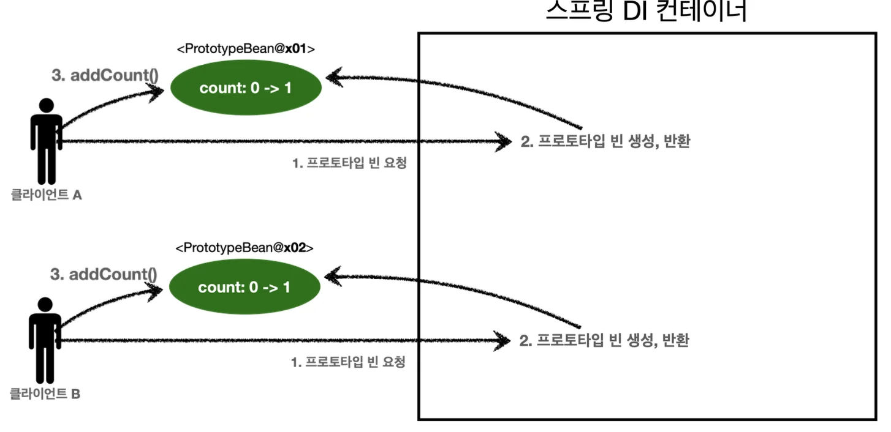
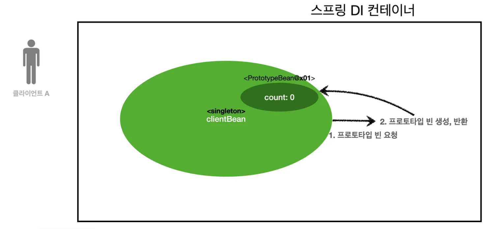
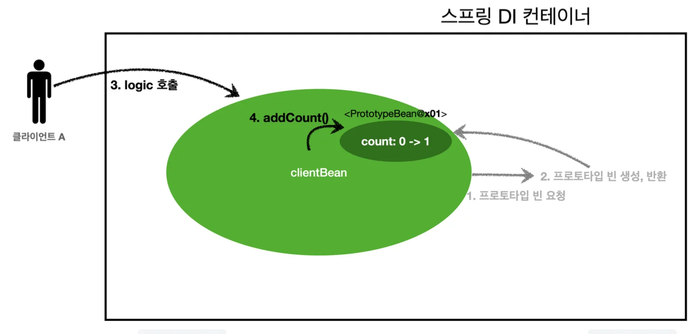
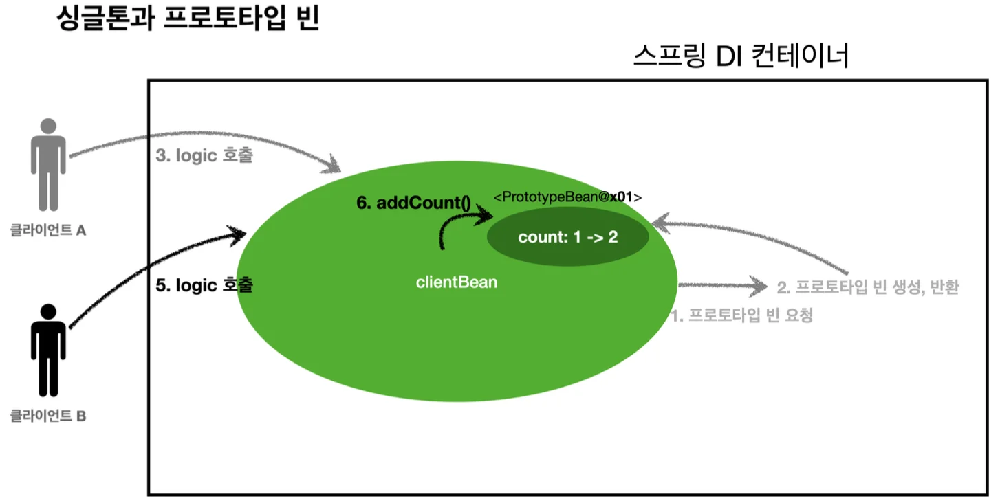

> 스프링 컨테이너에 프로토타입 스코프의 빈을 요청하면  항상 새로운 인스턴스 객체를 생성해서 반환하지만, <br>싱글톤 빈과 함께 사용 시에는 의도한 대로 동작이 발생되지 않을 수있다&#46;

<details>
<summary>🧐 의도한 동작의 정의?</summary>


</details>

<a id="1c3eda9b0fe181b5b763f55abd125245"></a>

### 프로토타입 빈 직접 요청



> 요청 시마다 새로운 인스턴스를 생성하여 반환한다&#46;<br>아래의 테스트를 통해 다른 인스턴스들이 생성되어 동일한 값의 증가(0→1)를 보이는 것을 알수 있다&#46;

<a id="1c3eda9b0fe181b6b2e0f5ff77aaa895"></a>

```java
public class SingletonWithPrototypeTest1 {

    @Test
    void prototypeFind() {
        AnnotationConfigApplicationContext ac = new AnnotationConfigApplicationContext(PrototypeBean.class);
        PrototypeBean prototypeBean1 = ac.getBean(PrototypeBean.class);
        prototypeBean1.addtCount();
        assertThat(prototypeBean1.getCount()).isEqualTo(1);

        PrototypeBean prototypeBean2 = ac.getBean(PrototypeBean.class);
        prototypeBean2.addtCount();
        assertThat(prototypeBean2.getCount()).isEqualTo(1);
    }

    @Scope("prototype")
    static class PrototypeBean{
        private  int count;

        public int getCount() {
            return count;
        }

        public void addtCount() {
            count++;
        }
    }
}
```

> Scope의 default 값이 singleton 임<br>따라서 생성을 

<a id="1c3eda9b0fe181a3a62dc6d9e5c34ad2"></a>

## 싱글톤 빈에서의 프로토타입 빈 사용

---



<a id="1c3eda9b0fe18181bad2d33dc3916ea0"></a>

clientBean 은 싱글톤으로, 스프링 컨테이너 생성 시점에 생성 및 의존관계 주입이 발생된다&#46;<br>이 의존관계 주입 시점에서, 프로토타입의 빈을 요청하고 반환 받아  clientBean 내부 필드에 보관된다&#46; 

<details>
<summary> 🧐<strong> 주입받은 프로토타입 빈</strong>은 <strong>싱글톤</strong>으로 관리되는가? </summary>

<a id="1c3eda9b0fe181628695d9959f896ce3"></a>

처음 생성자 주입을 통해서 프로토타입 빈을 반환받고 이후, 싱글톤 필드에서 저장되어 관리된다&#46;

<a id="1c3eda9b0fe181baa6a5f0f08b4d114a"></a>

따라서 아래의 테스트를 보면 알 수 있듯이 같은 인스턴스가 호출되어, 즉 싱글톤 처리되어? 값이 증가되는 것을 확인할 수 있다&#46; 

</details>

<details>
<summary> 🧐 정확히는 참조값을 필드에 보관한다고 하는데, 그럼 원본 데이터는 어디에 있으며, 어떻게 관리되는가?</summary>


</details>

<details>
<summary>🧐 요청을 통해 생성은 되지만, 주입이 되지 않아 사용되지 못하는 것인가?</summary>


</details>





<a id="1c3eda9b0fe181b28620e40fc3a80a5a"></a>

```java
package hello.core.scope;

import jakarta.annotation.PostConstruct;
import jakarta.annotation.PreDestroy;
import org.junit.jupiter.api.Test;
import org.springframework.context.annotation.AnnotationConfigApplicationContext;
import org.springframework.context.annotation.Scope;

import static org.assertj.core.api.Assertions.assertThat;

public class SingletonWithPrototypeTest1 {

    @Test
    void prototypeFind() {
        AnnotationConfigApplicationContext ac = new AnnotationConfigApplicationContext(ClientBean.class, PrototypeBean.class);
        ClientBean clientBean1 = ac.getBean(ClientBean.class);
        int count1 = clientBean1.logic();
        assertThat(count1).isEqualTo(1);

        ClientBean clientBean2 = ac.getBean(ClientBean.class);
        int count2 = clientBean1.logic();
        assertThat(count2).isEqualTo(2);
    }

    static class ClientBean {
        private final PrototypeBean prototypeBean;
				
				// @Autowired 
        public ClientBean(PrototypeBean prototypeBean) {
            this.prototypeBean = prototypeBean;
        }

        public int logic() {
            prototypeBean.addCount();
            return prototypeBean.getCount();
        }
    }

    @Scope("prototype")
    static class PrototypeBean{
        private  int count = 0;

        public int getCount() {
            return count;
        }

        public void addCount() {
            count++;
        }

        @PostConstruct
        public void init(){
            System.out.println("PrototypeBean.init" + this);
        }

        @PreDestroy
        public void destroy() {
            System.out.println("PrototypeBean.destroy");
        }
    }
}
```

<a id="1c3eda9b0fe18117a1e8fb91c640e39e"></a>

## 문제점

---

<a id="1c3eda9b0fe181efb3e5fde38cbf1a1a"></a>

스프링 빈은 일반적으로 싱글톤 빈을 사용하므로, 싱글톤 빈이 프로타입 빈을 사용하게 된다&#46;

<a id="1c3eda9b0fe1815db273f3697081023b"></a>

그런데 <strong>싱글톤 빈은 생성 시점에만 의존관계 주입 </strong>을 받기 때문에, <strong>프로토타입 빈이 새로 생성되지만 싱글톤 빈과 함께 유지된다&#46; </strong>

<a id="1c3eda9b0fe181bf85e8f3c5d71d3c5d"></a>

따라서 프로토타입 빈 목적을 잃어버린다&#46; (싱글톤 빈과 다르지 않다&#46;)<br>프로토타입 빈을  주입 시점에만 새로 생성하는게 아니라, 사용할 때 마다 새로생성해서 사용하는 것이 설계의 의도였을 것이다&#46;

> ⚠️ <strong>참고<br></strong>여러 빈에서 같은 프로토타입 빈을 주입 받으면, <strong>주입 받는 시점에 각각 새로운 프로토타입 빈이 생성</strong>된다&#46;
> 
> > ex)<br>clientA, clientB에 같은 타입의 프로토타입 빈 주입
> > 
> > <a id="1c3eda9b0fe181ee899fcc59bffec153"></a>
> > 
> > • clientA → prototypeBean&#64;x01
> > 
> > <a id="1c3eda9b0fe181288c71d800c37ff016"></a>
> > 
> > • clientB → prototypeBean&#64;x02
> 
> <a id="1c3eda9b0fe181e68fdcc839cca50e28"></a>
> 
> (의존관계 시에만 생성, 사용할 때는 싱글톤으로 처리?됨)
