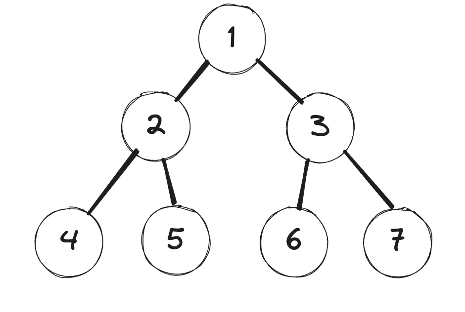
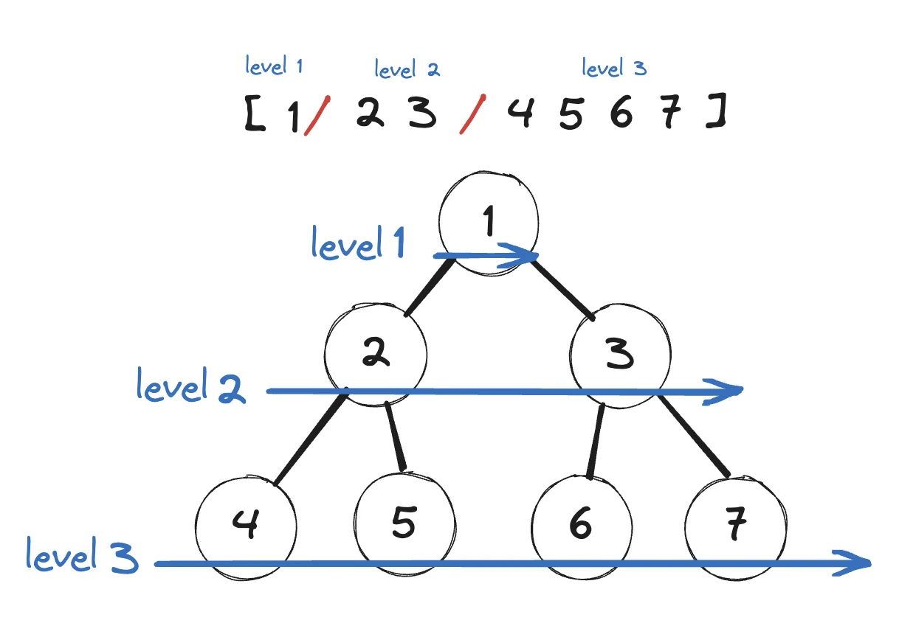

<a id="1c3eda9b0fe181b793c1f708c84580cf"></a>

# 문제

<a id="1c3eda9b0fe181a4b4a5c6f8dd02ad70"></a>

## 7&#46; 이진트리 순회(BFS)

<a id="1c3eda9b0fe181678d4aed937e2014b7"></a>

### 설명

<a id="1c3eda9b0fe181cab727c4f33c64ec4e"></a>

아래 그림과 같은 이진트리를 레벨 탐색(BFS, 넓이 탐색) 연습하세요&#46;



<a id="1c3eda9b0fe18115a006e70b7a54152d"></a>

### 레벨 탐색 순회 출력&#58; 1 2 3 4 5 6 7

<a id="1c3eda9b0fe181848fa4e66d79cfdc80"></a>

# 풀이



<a id="1c3eda9b0fe1819ea8ebe5d7f8dbc3c9"></a>

## 풀이1) 큐를 이용한 구현

<a id="1c3eda9b0fe1813a8fbad1cf695f5d54"></a>

```java
import java.util.*;

class Node{
    int data;
    Node lt, rt;
    Node(int val){  // public 기본값, 생략 가능
        data=val;
        lt=rt=null;
    }
}
public class Main {
    Node root;
    public void BFS(Node root) {
        Queue<Node> q = new LinkedList<>();
        q.offer(root);
        while(!q.isEmpty()){
            Node cur=q.poll();
            System.out.print(cur.data+" ");
            if(cur.lt!=null) q.offer(cur.lt);
            if(cur.rt!=null) q.offer(cur.rt);
        }

    }

    public static void main(String args[]) {
        Main tree = new Main();
        tree.root=new Node(1);
        tree.root.lt=new Node(2);
        tree.root.rt=new Node(3);
        tree.root.lt.lt=new Node(4);
        tree.root.lt.rt=new Node(5);
        tree.root.rt.lt=new Node(6);
        tree.root.rt.rt=new Node(7);
        tree.BFS(tree.root);
    }
}
```

<a id="1c3eda9b0fe18110a6c5deb2ecf4a4cb"></a>

## 풀이2) 레벨에 따른 값 출력

<details>
<summary>출력 값</summary>

<a id="1c3eda9b0fe18160bb4af6c1df3f77b7"></a>

```plaintext
0 : 1 
1 : 2 3 
2 : 4 5 6 7
```

</details>

<a id="1c3eda9b0fe181798566da924e789b04"></a>

```java
import java.util.*;

class Node{
    int data;
    Node lt, rt;
    Node(int val){  // public 기본값, 생략 가능
        data=val;
        lt=rt=null;
    }
}
public class Main {
    Node root;
    public void BFS(Node root) {
        Queue<Node> Q = new LinkedList<>();
        Q.offer(root);
        int L=0;
        while(!Q.isEmpty()){
            int len=Q.size();
            System.out.print(L+" : ");
            for(int i=0; i<len; i++){
                Node cur=Q.poll();
                System.out.print(cur.data+" ");
                if(cur.lt!=null) Q.offer(cur.lt);
                if(cur.rt!=null) Q.offer(cur.rt);
            }
            L++;
            System.out.println();
        }

    }

    public static void main(String args[]) {
        Main tree = new Main();
        tree.root=new Node(1);
        tree.root.lt=new Node(2);
        tree.root.rt=new Node(3);
        tree.root.lt.lt=new Node(4);
        tree.root.lt.rt=new Node(5);
        tree.root.rt.lt=new Node(6);
        tree.root.rt.rt=new Node(7);
        tree.BFS(tree.root);
    }
}
```
