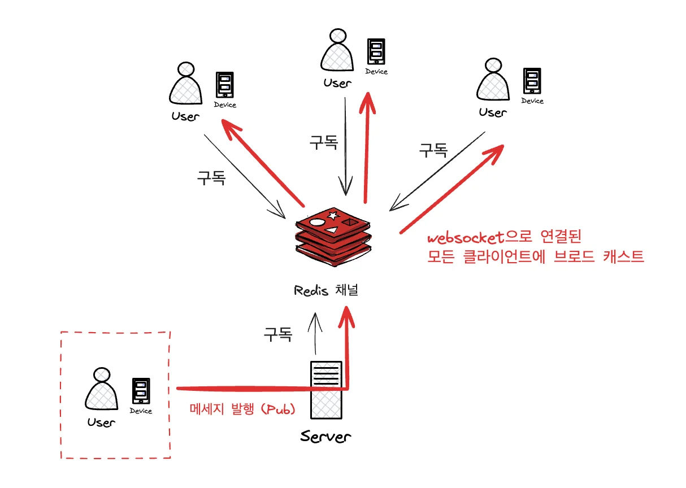
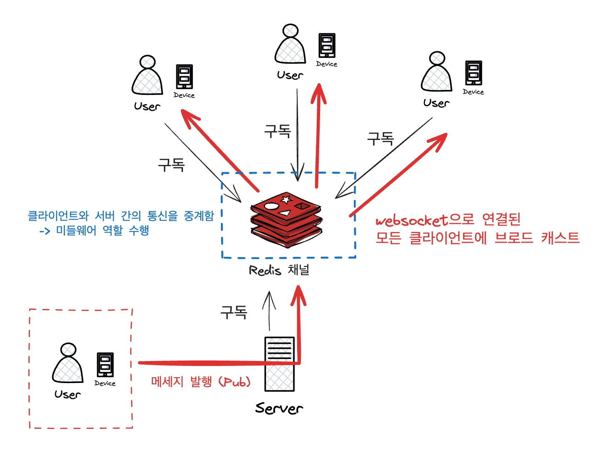

<details>
<summary>참고 자료</summary>

[gs-messaging-redis](https://github.com/spring-guides/gs-messaging-redis)

[Getting Started &#124; Messaging with Redis]()

[Redis Streams]()

[Spring Boot Redis Pub/Sub]()

</details>

<a id="1c3eda9b0fe18135a8a3f02ea0acafee"></a>

## Redis  Pub / Sub

---

> ✏️ 

<details>
<summary>🧐 AtomicInteger</summary>

<a id="1c3eda9b0fe181c08d52e3c887932744"></a>

<a href="#/post/1c3eda9b-0fe1-81ad-92c8-f9f6bfe07cae">페이지</a> 

</details>

<details>
<summary>동작 </summary>



1. <strong>클라이언트 &#45;&#62; 서버</strong>
    - 클라이언트가 /app/chat로 메시지 전송

    - 메시지가 ChatController로 전달되어 ChatService에서 Redis 채널로 발행

1. <strong>Redis Pub/Sub</strong>
    - Redis가 발행된 메시지를 모든 구독자에게 전달
        - 여기서는 RedisMessageListenerContainer &#45; 채널

1. <strong>Redis &#45;&#62; WebSocket</strong>
    - ChatMessageListener가 메시지를 수신하여 WebSocket으로 연결된 모든 클라이언트에 브로드캐스트

</details>

<details>
<summary>코드</summary>

<details>
<summary>1&#46; WebSocketConfig &#45; 소캣 연결 엔드포인트 설정 </summary>

<a id="1c3eda9b0fe181cfb13dcf387a5b1cd4"></a>

```java
import org.springframework.context.annotation.Configuration;
import org.springframework.web.socket.config.annotation.EnableWebSocketMessageBroker;
import org.springframework.web.socket.config.annotation.StompEndpointRegistry;
import org.springframework.web.socket.config.annotation.WebSocketMessageBrokerConfigurer;
import org.springframework.messaging.simp.config.MessageBrokerRegistry;

@Configuration
@EnableWebSocketMessageBroker // 메시지 브로커 활성화
public class WebSocketConfig implements WebSocketMessageBrokerConfigurer {

    @Override
    public void registerStompEndpoints(StompEndpointRegistry registry) {
        // WebSocket 연결 엔드포인트 등록
        registry.addEndpoint("/ws") // 클라이언트가 연결할 엔드포인트
                .setAllowedOrigins("*") // 모든 출처 허용 (CORS)
                .withSockJS(); // SockJS를 사용하여 WebSocket 지원
    }

    @Override
    public void configureMessageBroker(MessageBrokerRegistry registry) {
        // 클라이언트로 보낼 메시지를 라우팅하는 브로커 설정
        registry.setApplicationDestinationPrefixes("/app"); // 메시지 목적지 프리픽스
        registry.enableSimpleBroker("/topic"); // 클라이언트 구독 채널
    }
}
```

</details>

<details>
<summary>2&#46; Redis 설정 &#45; Redis Pub/Sub  ( 서버 간 메시지를 전달, 브로드캐스트용 ) </summary>

<a id="1c3eda9b0fe1810cb088d97ac5e439f3"></a>

```java
import org.springframework.context.annotation.Bean;
import org.springframework.context.annotation.Configuration;
import org.springframework.data.redis.connection.RedisConnectionFactory;
import org.springframework.data.redis.listener.RedisMessageListenerContainer;
import org.springframework.data.redis.listener.adapter.MessageListenerAdapter;
import org.springframework.data.redis.core.RedisTemplate;
import org.springframework.data.redis.listener.ChannelTopic;

@Configuration
public class RedisConfig {

    @Bean
    public RedisMessageListenerContainer container(RedisConnectionFactory connectionFactory, MessageListenerAdapter listenerAdapter) {
        RedisMessageListenerContainer container = new RedisMessageListenerContainer();
        container.setConnectionFactory(connectionFactory);
        container.addMessageListener(listenerAdapter, new ChannelTopic("chat"));
        return container;
    }

    @Bean
    public MessageListenerAdapter listenerAdapter(ChatMessageListener listener) {
        return new MessageListenerAdapter(listener, "onMessage"); // Redis 메시지 수신 처리
    }

    @Bean
    public RedisTemplate<String, Object> redisTemplate(RedisConnectionFactory connectionFactory) {
        RedisTemplate<String, Object> template = new RedisTemplate<>();
        template.setConnectionFactory(connectionFactory);
        return template;
    }
}
```

- RedisConnectionFactory
    - 

- <code>RedisMessageListenerContainer</code>
    - 메시지를 구독하기 위한 컨테이너

    - Redis 서버와 연결을 설정하고 특정 채널 구독 
        - 위 예시는 chat 채널 구독

- <code>MessageListenerAdapter</code>
    - Redis 메시지를 수신하고 특정 메서드(onMessage)로 전달

- <code>RedisTemplate</code>
    - Redis와의 상호작용을 위해 제공되는 템플릿

    - 메세지 발행 시, 사용

</details>

<details>
<summary>3&#46; Redis 메시지 리스너</summary>

<a id="1c3eda9b0fe181748f7ef35b244a7437"></a>

```java
import org.springframework.messaging.simp.SimpMessagingTemplate;
import org.springframework.stereotype.Service;

@Service
@RequiredArgsConstructor
public class ChatMessageListener {

    private final SimpMessagingTemplate messagingTemplate;

    public void onMessage(String message) {
        // 수신한 Redis 메시지를 WebSocket으로 브로드캐스트
        messagingTemplate.convertAndSend("/topic/messages", message);
    }
}
```

- <code>onMessage</code>
    - Redis 채널로 부터 메세지 수신

    - WebSocket의 /topic/messages로 메시지를 브로드캐스트

- <code>SimpMessagingTemplate</code>
    - Spring에서 제공하는 메세지 전송 도구, WebSocket을 통해 메세지 전송

</details>

<details>
<summary>4&#46; 메시지 처리 Controller</summary>

<a id="1c3eda9b0fe1810086a6ea95941485a3"></a>

```java
import org.springframework.messaging.handler.annotation.MessageMapping;
import org.springframework.stereotype.Controller;

@Controller
@RequiredArgsConstructor
public class ChatController {

    private final ChatService chatService;
    
    @MessageMapping("/chat")
    public void sendMessage(ChatMessage message) {
        // 클라이언트로부터 받은 메시지를 서비스로 전달
        chatService.sendMessage(message);
    }
}
```

- <code>&#64;MessageMapping(&#34;/chat&#34;)</code>
    - WebSocket으로 /app/chat 경로에 메시지가 들어오면 해당 메서드 호출

- <code>sendMessage</code>
    - 받은 메시지를 Redis 채널로 전달

</details>

<details>
<summary><strong>5&#46; 메시지 처리 서비스</strong></summary>

<a id="1c3eda9b0fe181a9befbecd14c0385a8"></a>

```java
import org.springframework.data.redis.core.RedisTemplate;
import org.springframework.stereotype.Service;

@Service
@RequiredArgsConstructor
public class ChatService {

    private final RedisTemplate<String, Object> redisTemplate;

    public void sendMessage(ChatMessage message) {
        // Redis의 "chat" 채널로 메시지 발행
        redisTemplate.convertAndSend("chat", message.getContent());
    }
}
```

- <code>RedisTemplate&#46;convertAndSend</code>
    - Redis Pub/Sub의 chat 채널로 메시지 발행

    - 다른 서버에서도 <strong><u>동일한 채널을 구독</u></strong>하면 <strong><u>메시지 수신 가능</u></strong>

</details>

<details>
<summary><strong>6&#46; 메시지 DTO</strong></summary>

<a id="1c3eda9b0fe18156ad22e3e23d98e5fd"></a>

```java
@Getter
public class ChatMessage {
    private String sender;  // 메시지를 보낸 사람
    private String content; // 메시지 내용

    protected ChatMessage() {}

    public ChatMessage(String sender, String content) {
        this.sender = sender;
        this.content = content;
    }
}
```

</details>

</details>

<details>
<summary>Redis Pub/sub  설정</summary>

<details>
<summary>1&#46; RedisMessageListenerContainer</summary>

- Redis Pub/Sub에서 메시지를 수신하기 위한 리스너 컨테이너

- 지정된 채널(chat)을 구독하여 메세지 처리

- 차이점 비교
    <a id="1c3eda9b0fe18194aa62c3808858e980"></a>

    ```java
    // GPT
    RedisMessageListenerContainer container = new RedisMessageListenerContainer();
    container.setConnectionFactory(connectionFactory);
    container.addMessageListener(listenerAdapter, new org.springframework.data.redis.listener.ChannelTopic("chat"));
    ```

    <a id="1c3eda9b0fe18143adcbdd0e5e4999eb"></a>

    ```java
    // docs
    @Bean
    RedisMessageListenerContainer container(RedisConnectionFactory connectionFactory, MessageListenerAdapter listenerAdapter) {

    	RedisMessageListenerContainer container = new RedisMessageListenerContainer();
    	container.setConnectionFactory(connectionFactory);
    	container.addMessageListener(listenerAdapter, new PatternTopic("chat"));

    	return container;
    }
    ```

</details>

<details>
<summary>2&#46; <strong>MessageListenerAdapter</strong></summary>

- Redis 메시지를 처리할 메서드를 어댑터로 등록


</details>

</details>

<details>
<summary>질문</summary>

<details>
<summary>질문) Spring STOMP(<code>WebSocketMessageBrokerConfigurer</code>)를 사용하면 스프링 내부에서 pub/sub 구현이 가능한데, 왜 레디스를 사용해야 하는가?</summary>

1. 확장성
    - Redis를 사용하면 <strong><u>여러 서버(멀티 노드) 간에 메시지를 공유</u></strong>할 수 있다&#46; 
        - WebSocket만으로 구현하면 단일 서버에서만 동작하며,<br>서버가 여러 대일 경우 세션 동기화 문제가 발생된다&#46; 

1. 중앙화된 메세지 관리
    - Redis를 미들웨어로 사용하면 모든 서버가 Redis를 통해 메시지를 주고 받아, 중앙에서 메세지 흐름을 관리할 수 있다&#46; 

1. <strong>오프라인 메시지 관리</strong>
    - Redis Streams를 사용하면 클라이언트가 연결되지 않았을 때 메시지를 보관할 수 있다&#46;
        - [ ] 이 부분은 DB를 통해서 WebSocket에서도 구현이 가능하다&#46; <br>그렇다면, Redis Streams을 사용하는 것이 어떠한 장점이 있는가?
            - 아래 참조 <br>

</details>

<details>
<summary>질문) 레디스 서버를 미들웨어인 채널로 사용해서 pub/sub 패턴을 구현하는가?</summary>



<a id="1c3eda9b0fe1818b941de3ad032970b9"></a>

그렇다&#46; Redis는 Pub/Sub 패턴에서 <strong><u>미들웨어 역할</u></strong>을 수행한다&#46;

<details>
<summary>ex)</summary>

>  서버 A가 발행하면 Redis가 이를 구독 중인 서버 B에 전달한다&#46;

- 발행
    <a id="1c3eda9b0fe181a0839ed1cfce4832b4"></a>

    ```java
    // 발행 코드
    redisTemplate.convertAndSend("chatChannel", "Hello, Redis!");
    ```

- 구독
    <a id="1c3eda9b0fe1810da7d8cd364668b705"></a>

    ```java
    // 구독 코드
    @Bean
    public RedisMessageListenerContainer container(RedisConnectionFactory connectionFactory, MessageListenerAdapter listenerAdapter) {
        RedisMessageListenerContainer container = new RedisMessageListenerContainer();
        container.setConnectionFactory(connectionFactory);
        container.addMessageListener(listenerAdapter, new ChannelTopic("chatChannel"));
        return container;
    }
    ```

</details>

</details>

<details>
<summary>질문) 왜 어댑터 등록이 필요한가?</summary>

- Redis는 메세지를 처리하기 위해 MessageListenerAdapter를 사용한다&#46; <br>이 어댑터는 Redis 메세지를 특정 메서드에 매핑하는 역할을 한다&#46; 

- 어댑터를 사용하면 메세지를 처리할 클래스와 메서드를 명확하게 분리하고, 재사용성을 높일 수 있다&#46; 

---

<details>
<summary>ex) <strong>어댑터 없이 직접 처리</strong></summary>

<a id="1c3eda9b0fe1816ea495cf953075b214"></a>

```java
container.addMessageListener((message, pattern) -> {
    System.out.println("Received message: " + message.toString());
}, new ChannelTopic("chatChannel"));
```

</details>

<details>
<summary>ex) <strong>어댑터 사용</strong></summary>

<a id="1c3eda9b0fe1810aa73fd6df654e4358"></a>

```java
@Bean
public MessageListenerAdapter listenerAdapter(ChatMessageListener listener) {
    return new MessageListenerAdapter(listener, "onMessage");
}
```

</details>

</details>

<details>
<summary>질문) pub/sub 패턴은 내부적으로 메세지큐를 구현 해야만 사용 가능한 것인가? 그렇다면 pub/sub 패턴을 제공하는 기술들은 내부적으로 메세지 큐가 다 구현되어 있는가?</summary>

- <u>Pub/Sub 패턴</u>은 메세지<strong> 큐 없이도 구현 가능</strong>하다&#46; <br>그러나 <strong><u>대부분의 Pub/Sub 구현</u></strong>은 <strong>메세지 큐(Message Queue)를 기반으로 동작</strong>한다&#46; 
    - 메세지를 발행자와 구독자 간에 효율적으로 전달하려면 큐 구조가 유리하다&#46; 

- 기술 예시
    - <strong><code>Redis Pub/Sub</code></strong>&#58; 메시지 큐 없이 동작 (실시간 전달)

    - <strong><code>Redis Streams / Kafka</code></strong>&#58; 메시지 큐 기반 (메시지 저장 및 처리 관리)

    - <strong><code>RabbitMQ, ActiveMQ</code></strong>&#58; 메시지 큐를 통해 Pub/Sub 지원

</details>

<details>
<summary>질문) 브로드캐스트가 연결된 모든 앱에 통신을 한번에 다 보내는 것으로 알고 있는데, 이때 발생될 수 있는 성능 저하 문제를 어떻게 해결해야 하는지 알려줘</summary>

> 브로드캐스트는  <strong><u>연결된 모든 클라이언트에 메세지를 전달</u></strong>한다&#46;<br>따라서 <strong><u>클라이언트가 많</u></strong>아질수록 <strong>성능 저하가 발생</strong>될 수 있다&#46; 

- 해결방안
    - <strong>Redis Streams 활용</strong>
        - 메시지를 보관하여 연결된 클라이언트만 처리

        - 소비자 그룹을 사용해 부하 분산

    - <strong>WebSocket Load Balancer</strong>
        - WebSocket 서버를 클러스터링하고, 부하 분산 장치를 추가

    - <strong>멀티채널 구독</strong>
        - 클라이언트를 특정 채널로 분산하여 메시지 트래픽 분리

</details>

<details>
<summary>질문) 유저가 채팅방을 입장해야만, 웹소캣 연결이 되고 구독 설정이 된다고 한다면 어떻게 코드로 구현하지? 예시 좀 보여줘</summary>

<details>
<summary>웹소캣 연결 설정</summary>

<a id="1c3eda9b0fe181e9ba61fad42ac66e32"></a>

```java
@Configuration
@EnableWebSocketMessageBroker // 메시지 브로커 활성화
public class WebSocketConfig implements WebSocketMessageBrokerConfigurer {

    @Override
    public void registerStompEndpoints(StompEndpointRegistry registry) {
        // WebSocket 연결 엔드포인트 등록
        registry.addEndpoint("/ws") // 클라이언트가 연결할 엔드포인트
                .setAllowedOrigins("*") // 모든 출처 허용 (CORS)
                .withSockJS(); // SockJS를 사용하여 WebSocket 지원
    }
    
    @Override
		public void configureMessageBroker(org.springframework.messaging.simp.config.MessageBrokerRegistry registry) {
		    // 클라이언트로 보낼 메시지를 라우팅하는 브로커 설정
		    registry.setApplicationDestinationPrefixes("/app"); // 메시지 목적지 프리픽스
		    registry.enableSimpleBroker("/topic"); // 클라이언트 구독 채널
		}
}
```

</details>

<details>
<summary><strong>WebSocket 구독 컨트롤러</strong></summary>

<a id="1c3eda9b0fe181ca945effb03ff874f9"></a>

```java
@Controller
public class ChatRoomController {

    @MessageMapping("/join/{roomId}")
    public void joinRoom(@DestinationVariable String roomId, ChatMessage message) {
        message.setContent(message.getSender() + " joined the room!");
        redisTemplate.convertAndSend("room-" + roomId, message);
    }
}
```

</details>

<details>
<summary><strong>Redis 리스너에 동적으로 채널 추가</strong></summary>

<a id="1c3eda9b0fe18115a311f414334d9e10"></a>

```java
public void subscribeToRoom(String roomId) {
    container.addMessageListener(listenerAdapter, new ChannelTopic("room-" + roomId));
}
```

</details>

---

<details>
<summary><strong>추가) 채팅방 입장 시 WebSocket 연결 및 구독</strong></summary>

> <strong>WebSocket 연결 및 구독 동작</strong>

1. 클라이언트가 채팅방에 입장할 때 WebSocket 연결을 설정합니다&#46;

1. 서버는 클라이언트 요청에 따라 특정 채팅방 채널에 대한 Redis Pub/Sub 구독을 설정합니다&#46;

1. WebSocket을 통해 메시지를 클라이언트로 전달합니다&#46;

---

<details>
<summary>ex) <strong>WebSocket 연결 &#43; Redis 구독</strong></summary>

<details>
<summary>1&#46; <strong>WebSocket 설정</strong></summary>

<a id="1c3eda9b0fe181d8a9e7cde4dc4ae70b"></a>

```java
@Configuration
@EnableWebSocketMessageBroker
public class WebSocketConfig implements WebSocketMessageBrokerConfigurer {

    @Override
    public void registerStompEndpoints(StompEndpointRegistry registry) {
        registry.addEndpoint("/ws") // 클라이언트 연결 엔드포인트
                .setAllowedOrigins("*") // CORS 설정
                .withSockJS(); // SockJS 폴백
    }

    @Override
    public void configureMessageBroker(MessageBrokerRegistry registry) {
        registry.enableSimpleBroker("/topic"); // 클라이언트 구독 채널
        registry.setApplicationDestinationPrefixes("/app"); // 메시지 송신 경로
    }
}
```

</details>

<details>
<summary>2&#46; <strong>클라이언트에서 WebSocket 연결 (JavaScript)</strong></summary>

<a id="1c3eda9b0fe181afa2b2fbaaef84307c"></a>

```javascript
const socket = new SockJS('/ws');
const stompClient = Stomp.over(socket);

// 연결
stompClient.connect({}, function () {
    console.log('Connected');
    // 특정 채팅방 구독
    stompClient.subscribe('/topic/room/123', function (message) {
        console.log('Received: ', JSON.parse(message.body));
    });
});

// 메시지 보내기
function sendMessage() {
    stompClient.send('/app/chat/123', {}, JSON.stringify({
        sender: 'UserA',
        content: 'Hello, Room 123!'
    }));
}
```

</details>

<details>
<summary>3&#46; <strong>서버에서 메시지 처리</strong> </summary>

<a id="1c3eda9b0fe181eebc02ddc4a3bbda9a"></a>

```java
@Controller
public class ChatController {

    @MessageMapping("/chat/{roomId}")
    public void sendMessage(@DestinationVariable String roomId, ChatMessage message) {
        // Redis로 메시지 발행
        redisTemplate.convertAndSend("room-" + roomId, message.getContent());
    }
}
```

</details>

<details>
<summary>4&#46; <strong>Redis에서 구독 및 WebSocket으로 메시지 전송</strong></summary>

<a id="1c3eda9b0fe181219a81f99e0a24db4e"></a>

```java
@Service
public class ChatMessageListener {

    private final SimpMessagingTemplate messagingTemplate;

    public ChatMessageListener(SimpMessagingTemplate messagingTemplate) {
        this.messagingTemplate = messagingTemplate;
    }

    public void onMessage(String message, String roomId) {
        // WebSocket으로 클라이언트에 메시지 전달
        messagingTemplate.convertAndSend("/topic/room/" + roomId, message);
    }
}
```

</details>

</details>

</details>

</details>

<details>
<summary>질문) 메시지를 데이터베이스에 저장하거나, 메시지 형식을 확장하려면 어떻게 설계하지?  형식에 확장에 대한 개념도 잘 이해가 안되는데, 이부분도 추가로 설명해줘</summary>

<details>
<summary><strong>메시지 저장</strong></summary>

<details>
<summary><strong>1&#46; DTO 설계</strong></summary>

<a id="1c3eda9b0fe181bc8080f83d3d7d022e"></a>

```java
public class ChatMessage {
    private String sender;
    private String content;
    private String roomId;
    private LocalDateTime timestamp;
}
```

</details>

<details>
<summary>2&#46; DB 저장</summary>

<a id="1c3eda9b0fe181ecaa83f897cf16efa7"></a>

```java
@Service
public class ChatMessageService {
    @Autowired
    private ChatMessageRepository repository;

    public void saveMessage(ChatMessage message) {
        repository.save(message);
    }
}
```

</details>

</details>

<details>
<summary><strong>형식 확장</strong></summary>

<details>
<summary><strong>기본 메시지 구조</strong></summary>

<a id="1c3eda9b0fe181d786f8ea0dca07d6ff"></a>

```java
public class BaseMessage {
    private String type; // "text", "image", "file"
}
```

</details>

<details>
<summary>텍스트 메세지</summary>

<a id="1c3eda9b0fe181d3a76fc37f299d1129"></a>

```java
public class TextMessage extends BaseMessage {
    private String content;
}
```

</details>

<details>
<summary>파일 메세지</summary>

<a id="1c3eda9b0fe181e2aff1f91284136352"></a>

```java
public class FileMessage extends BaseMessage {
    private String fileName;
    private String fileUrl;
}
```

</details>

</details>

</details>

<details>
<summary><strong>질문) 오프라인 메시지 관리 &#45; DB로 구현 가능한데 왜 Redis Streams을 사용해야 하는가?</strong></summary>

> Redis Streams와 DB 기반의 오프라인 메시지 관리 방식에는 각각 장단점이 있으며, 선택은 시스템 요구사항에 따라 달라질 수 있다&#46;

| <strong>특징</strong> | <strong>Redis Streams</strong> | <strong>DB 기반 메시지 관리</strong> |
| --- | --- | --- |
| <strong>성능</strong> | 메모리 기반으로 매우 빠름&#46; | 디스크 IO로 인해 상대적으로 느림&#46; |
| <strong>실시간 처리</strong> | Pub/Sub와 통합되어 실시간 처리에 적합&#46; | 추가 로직이 필요 (예&#58; 폴링, 이벤트 알림)&#46; |
| <strong>복잡성</strong> | 메시지 보관과 소비자 관리가 Streams 내에서 처리 가능&#46; | 직접 구현 필요 (예&#58; 상태 관리, 메시지 큐 로직 등)&#46; |
| <strong>지속성</strong> | 데이터를 메모리 및 디스크에 저장 가능 (RDB, AOF 옵션)&#46; | 기본적으로 디스크에 저장&#46; |
| <strong>사용 사례</strong> | 고성능 실시간 메시징&#46; | 메시지 영구 보관 및 복잡한 쿼리 처리&#46; |

> <strong>Redis Streams를 사용하는 이유</strong>

- 고성능
    - 메모리 기반으로 메세지를 즉시 처리하고 전달할 수 있어 실시간 채팅과 같은 응답 속도가 중요한 애플리케이션에 적합하다&#46; 

- 소비자 그룹
    - Streams는 소비자 그룹을 지원하여, 여러 클라이언트가 동시에 메세지를 처리할 수 있도록 부하를 분산 시킬 수 있다&#46; 

- 간단한 설정
    - 메세지 큐와 같은 추가 미들웨어를 도입하지 않고, Redis 내 메세지 큐 기능을 바로 사용할 수 있다&#46; 

- 오프라인 메세지 지원
    - Streams는 클라이언트가 다시 연결될 때 특정 시점 이후의 메시지만 가져오는 기능(Read Offset)을 제공한다&#46;

> 추가)<strong> Redis Streams와 DB의 조합</strong>

- Redis Streams는 실시간 메시지 전달에 사용하고, 중요한 메시지는 DB에 영구 저장하는 하이브리드 방식을 사용할 수도 있다&#46;

- Redis Streams로 메시지를 전송한 뒤, 별도의 서비스가 메시지를 DB에 저장

- 결론
    - Redis Streams는 실시간 성능과 메시지 관리가 더 용이

    - DB는 영구 저장과 쿼리 작업에 유리

</details>

<details>
<summary>질문) <strong>Redis Pub/Sub만으로 WebSocket 없이 실시간 채팅 구현이 가능한가?</strong></summary>

<a id="1c3eda9b0fe1817aa279ed65ebbcadb8"></a>

Redis Pub/Sub만으로도 WebSocket 없이 실시간 채팅을 구현할 수 있다&#46;

<a id="1c3eda9b0fe18121a81dd303a7a32b75"></a>

이 경우, 클라이언트와 서버 간 통신에 Redis Pub/Sub만 사용한다&#46;

<a id="1c3eda9b0fe181068947e5de3315835c"></a>

따라서 아래와 같은 한계점이 있다&#46;

> <strong>Websock 없이 Redis Pub/Sub만으로 실시간 채팅 기능 구현 시, 단점</strong>

- Pub/Sub은 브라우저 클라이언트와 직접 연결할 수 없음

- 클라이언트가 연결 상태를 유지하거나 다시 연결할 경우의 처리가 복잡함

- 프라인 메시지 관리 기능이 부족 (Streams 또는 DB 필요)

<a id="1c3eda9b0fe181cfb748d63a3dfee02f"></a>

<code>WebSocket</code>은 <strong><u>브라우저 클라이언트와 서버 간의 실시간 양방향 통신</u></strong><u>을 지원</u>하기 때문에, 브라우저 클라이언트를 대상으로 하는 실시간 채팅에서는 <strong><u>WebSocket이 Redis와 함께 사용</u></strong>하여 구현한다&#46;

- 결론
    <a id="1c3eda9b0fe181b5809ad1e658c62e25"></a>

    능하지만 WebSocket이 없으면 브라우저 클라이언트와의 통신이 어렵고, 기능이 제한적이다&#46;

</details>

<details>
<summary>질문) Redis Streams를 사용하면 메시지를 보관하고, 클라이언트가 다시 연결될 때 이전 메시지를 처리하는 예시 코드</summary>

<details>
<summary>메세지 발행</summary>

<a id="1c3eda9b0fe181a5b683c6431a39aaf5"></a>

```java
public RecordId publishMessage(String stream, Map<String, String> message) {
    return redisTemplate.opsForStream().add(stream, message);
}
```

</details>

<details>
<summary>메세지 소비</summary>

<a id="1c3eda9b0fe1816a9d5cd779c69caf1d"></a>

```java
public void consumeMessages(String streamKey) {
    redisTemplate.opsForStream().read(StreamReadOptions.empty().block(Duration.ofSeconds(2)),
            StreamOffset.fromStart(streamKey)).forEach(record -> {
        System.out.println("Message: " + record.getValue());
    });
}
```

</details>

<details>
<summary>소비자 그룹 처리 </summary>

<a id="1c3eda9b0fe181adbdd9f9f1fe843e4c"></a>

```java
public void createConsumerGroup(String streamKey, String groupName) {
    redisTemplate.opsForStream().createGroup(streamKey, groupName);
}

public void consumeFromGroup(String streamKey, String groupName, String consumerName) {
    redisTemplate.opsForStream().read(StreamReadOptions.empty(),
            StreamOffset.create(streamKey, ReadOffset.lastConsumed()), Consumer.from(groupName, consumerName))
            .forEach(record -> {
                System.out.println("Consumer: " + consumerName + " Message: " + record.getValue());
            });
}
```

</details>

</details>

</details>

<a id="1c3eda9b0fe1818ab979d6202dd072af"></a>

### 

<a id="1c3eda9b0fe1810a9af1ddda7218727c"></a>

어떤 역활을 하는 엔드포인트 인지 구분 필요 

- /app &#45; 발행 

- /topic &#45; 채널 → 클라 

- /chat &#45; 채널 구독 엔드포인트
