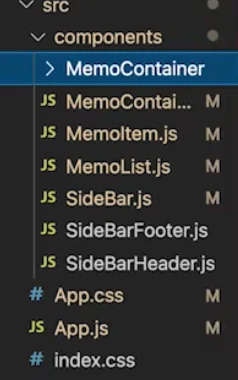
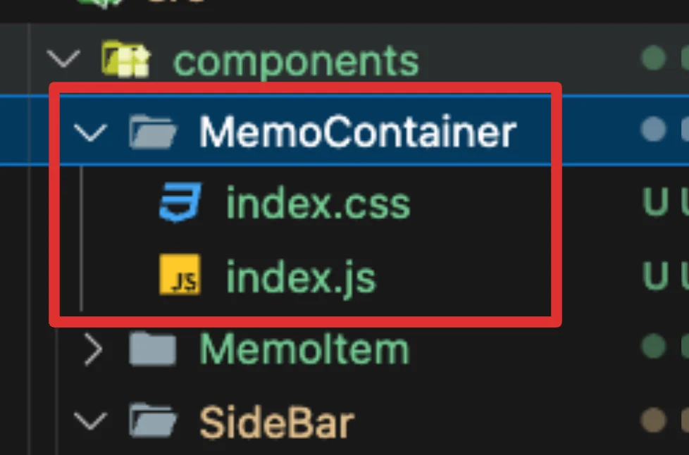

<a id="1c3eda9b0fe18109be68fe7df0cb9106"></a>

## 코드

---

[project 1: memo - 폴더 구조 리펙토링 및 vite.config 설정 추가](https://github.com/gyungsubLee/inflearn_react_prac/commit/5d8cd4c1c3988c8d0aa31d452e0bb36262392106)

<a id="1c3eda9b0fe181bcbb93f3cec245832f"></a>

## 폴더 구조 리펙토링

---



<a id="1c3eda9b0fe1819eb131ea20285fe8b5"></a>

지금까지의 프로젝트 코드는 하나의 css파일(<code>App&#46;css</code>)에서 style 코드를 통합해서 관리하며, <code>components</code> 폴더에서 모든 컴포넌트들을 담아 관리했다&#46;

<a id="1c3eda9b0fe181e992c2f0db0d3531b7"></a>

이를 조금 더 컴포넌트 단위로 관리를 하기위해서는 구조를 변경해야 한다&#46; 

- 핵심 컴포넌트 마다, <strong><u>폴더를 만</u></strong>들고, 컴포넌트 파일 명을 해당 컴포넌트의 이름에서 <u><code>index&#46;js</code></u><u> 로 변경</u>한다&#46;이를 리액트에서 자동으로 , <u>해당 컴포넌트 폴더의 </u><u><code>index&#46;js</code></u><u>를 찾</u>아서 <u>매핑 </u>해준다&#46; 



<a id="1c3eda9b0fe181bf897cf7b9c172f1b6"></a>

위와 같이 핵심 컴포넌트에 대한 정보를 폴더 단위로 관리할 수 있으며, 핵심적인 라이브러리 및 함수가 될 수 있는 구현체는 <code>index&#46;js</code>로 관리할 수 있다&#46;

<a id="1c3eda9b0fe18160a5fece0434723657"></a>

또한 위와 같이 index&#46;css로 해당 컴포넌트의 css 정보도 컴포넌트 단위로 분리하여 관리할 수 있다 &#46;

- css는 자동 import가 되는 것이 아니기 때문에, <code>index&#46;js</code>에 import 해야 한다&#46; 

<a id="1c3eda9b0fe181aa9161ddf9ab486e9c"></a>

이렇게 핵심 컴포넌트들을 폴더 단위로 묶어서 관리하여 관심사를 명확하게 하고, 유지보수 하기에도 용이해진다&#46; 

<a id="1c3eda9b0fe181c3a6f8ce43de885f26"></a>

## 오류 &#45; Vite로 프로젝트 생성한 경우, 자동으로 index&#46;js를 인식하지 못한다&#46; 

---

- 해결 1 &#45; 확장자 명 변경&#58; <code>&#46;js</code> → <code>&#46;jsx</code>

- 해결 2 &#45; vite&#46;config에 설정 추가 
    <a id="1c3eda9b0fe181c2ab1ee57b99f3a13a"></a>

    ```
    import { defineConfig } from "vite";
    import react from "@vitejs/plugin-react";

    // https://vite.dev/config/
    export default defineConfig({
      plugins: [react()],
      resolve: {
        extensions: [".js", ".jsx", ".ts", ".tsx", ".json"], // .jsx 포함
      },
    });

    ```
