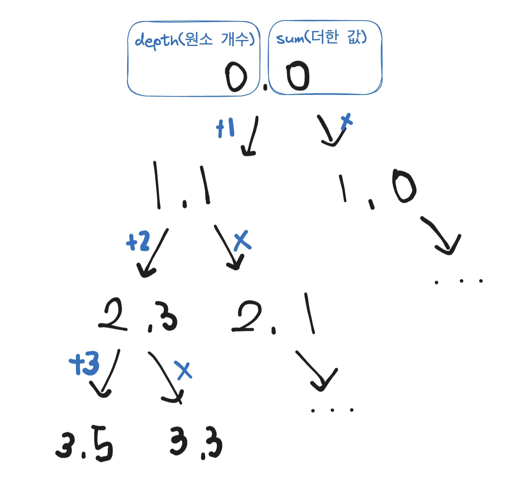

<a id="1c3eda9b0fe181b5b030fb102f563b9e"></a>

# 문제

<a id="1c3eda9b0fe18111a25cd10eaafe9030"></a>

## <strong>1&#46; 합이 같은 부분집합(DFS &#58; 아마존 인터뷰)</strong>

---

<a id="1c3eda9b0fe1810ca8b9e92a10dc10e8"></a>

### 설명

<a id="1c3eda9b0fe1814886cbc008b3e72ee1"></a>

N개의 원소로 구성된 자연수 집합이 주어지면, 이 집합을 두 개의 부분집합으로 나누었을 때

<a id="1c3eda9b0fe181eda9fbec6287da27a4"></a>

두 부분집합의 원소의 합이 서로 같은 경우가 존재하면 “YES&#34;를 출력하고, 그렇지 않으면 ”NO&#34;를 출력하는 프로그램을 작성하세요&#46;

<a id="1c3eda9b0fe181a0bcaac3b474178707"></a>

둘로 나뉘는 두 부분집합은 서로소 집합이며, 두 부분집합을 합하면 입력으로 주어진 원래의 집합이 되어 합니다&#46;

<a id="1c3eda9b0fe1812495fcc2c9a3ab544d"></a>

예를 들어 {1, 3, 5, 6, 7, 10}이 입력되면 {1, 3, 5, 7} = {6, 10} 으로 두 부분집합의 합이 16으로 같은 경우가 존재하는 것을 알 수 있다&#46;

<a id="1c3eda9b0fe1814c8453d43adeffad7a"></a>

### 입력

<a id="1c3eda9b0fe18161a1ccc343ce300edb"></a>

첫 번째 줄에 자연수 N(1&#60;=N&#60;=10)이 주어집니다&#46;

<a id="1c3eda9b0fe181618d65d3d4400eba87"></a>

두 번째 줄에 집합의 원소 N개가 주어진다&#46; 각 원소는 중복되지 않는다&#46;

<a id="1c3eda9b0fe181ffba1afb18230dbb25"></a>

### 출력

<a id="1c3eda9b0fe181bd929bfedcc1585ddc"></a>

첫 번째 줄에 “YES&#34; 또는 ”NO&#34;를 출력한다&#46;

---

<a id="1c3eda9b0fe18154aa0acf1701d733aa"></a>

### 예시 입력 1

<a id="1c3eda9b0fe181d48f4ecd234335ddaa"></a>

```plaintext
6
1 3 5 6 7 10
```

<a id="1c3eda9b0fe18127a789cc13c13ca87d"></a>

### 예시 출력 1

<a id="1c3eda9b0fe1810a92ffd0543afcebdd"></a>

```plaintext
YES
```

<a id="1c3eda9b0fe18166b852d2b1ad378aa1"></a>

## <code>&#43;</code> 문제 변형 ( 집합 출력 )

<a id="1c3eda9b0fe181e38a9ee574fd6ace36"></a>

### 설명

<a id="1c3eda9b0fe18168bc06d82c73750d65"></a>

###  합이 같은  두 개의 <u>집합 값 출력</u>하기

<a id="1c3eda9b0fe18199817bcbe58c201d05"></a>

### 입력

<a id="1c3eda9b0fe1818788dfe956a5360cf2"></a>

```java
6
1 3 5 6 7 10
```

<a id="1c3eda9b0fe18161bf72cd0bf41e9bcc"></a>

### 출력

<a id="1c3eda9b0fe18112af63f3c6a6829039"></a>

```java
A [ 1 3 5 7 ]
B [ 6 10 ]
```

<a id="1c3eda9b0fe181faa462d73c19d3187c"></a>

### 풀이1) 체크 배열(<code>ch&#91;&#93;</code>)

<a id="1c3eda9b0fe1819c9ebec24b9cbc2050"></a>

```java
import java.util.*;

public class Main {
    static boolean flag=false;
    static int n, total=0, target;
    static int[] arr, ch;

    public void DFS(int L, int sum) {
        if(flag) return;
        if(sum>target) return;
        if(L==n){
            if(sum==target) {
                String a="", b="";
                for(int i=0; i<n; i++){
                    if(ch[i]==1) a+=(arr[i]+" ");
                    else b+=(arr[i]+" ");
                }
                System.out.println("A [ "+a+"]");
                System.out.println("B [ "+b+"]");
                flag=true;
            }
        }
        else {
            ch[L]=1;
            DFS(L+1, sum+arr[L]);
            ch[L]=0;
            DFS(L+1, sum);
        }
    }


    public static void main(String args[]) {
        Main T=new Main();
        Scanner sc=new Scanner(System.in);
        n=sc.nextInt();
        arr=new int[n];
        ch=new int[n];  // 1<=N<=10;
        for(int i=0; i<n; i++){
            arr[i]=sc.nextInt();
            total+=arr[i];
        }
        target=total/2;
//        System.out.println(arr+" "+total);
        if(total%2==0)T.DFS(0, 0);
    }
}
```

<a id="1c3eda9b0fe1815f8219ec67b7d4fa84"></a>

# 풀이

<a id="1c3eda9b0fe181919337da467f3c72cc"></a>

## 풀이1)



<a id="1c3eda9b0fe1817fb15aec16898fe0dd"></a>

<code>total/2</code> 연산 시 <strong>나머지 값(</strong><strong><code>total%2</code></strong><strong>)이 0</strong>일때, 정답처리

<a id="1c3eda9b0fe181f9a07feeb8bfc3bcaa"></a>

```java
import java.util.*;

public class Main {
    static String answer="NO";
    static int n, total=0;
    boolean flag=false;

    public void DFS(int L, int sum, int[] arr){
        if(flag) return;         // 답 구했을 시, 다음 연산 처리 생략
        if(sum>total/2) return;  // 에외처리
        if(L==n){
						// total-sum==sum
            if((total/2==sum && total%2==0)){
                answer="YES";
                flag=true;
            }
        }
        else {
            DFS(L+1, sum+arr[L], arr);
            DFS(L+1, sum, arr);
        }
    }

    public static void main(String args[]) {
        Main T=new Main();
        Scanner sc=new Scanner(System.in);
        n=sc.nextInt();
        int [] arr=new int[n];
        for(int i=0; i<n; i++){
            arr[i]=sc.nextInt();
            total+=arr[i];
        }
        T.DFS(0, 0, arr);
        System.out.print(answer);
    }
}
```

<a id="1c3eda9b0fe18186aedef638c833753b"></a>

## 풀이2) <code>2차풀이</code>  

<a id="1c3eda9b0fe18103b835ee4862f39e99"></a>

### Error) &#91;case 4&#93; 문제 조건 자체가 부터 성립이 안됨

<a id="1c3eda9b0fe1815fbb56e925cc83fe12"></a>

```java
9
3 6 13 11 7 16 34 23 12
```

<a id="1c3eda9b0fe181039d57e0b60bc55c52"></a>

total = 125,  따라서 두개의 집합 자체가 같을 수 없음

<a id="1c3eda9b0fe1815c8c8df3c79f3b4812"></a>

처음 로직을 <code>target=total/2;</code>  값을 찾는 것으로 설계했더니, 나머지 값을 무시하고 <strong>‘YES’</strong>가 표시됨

<a id="1c3eda9b0fe18153979ad60b4aecd0a8"></a>

따라서 <code>if(total%2==0)</code> 해당 로직을 넣어 해결함

<a id="1c3eda9b0fe1816f821ef77fd192b639"></a>

```java
import java.util.*;

public class Main {
    static boolean flag=false;
    static String answer="NO";
    static int n, total=0, target;
    static int[] arr;

    public void DFS(int L, int sum) {
        if(flag) return;
        if(L >= n ||sum>target) return;
        if(sum==target) {
            answer="YES";
            flag=true;
        }
        else {
            DFS(L+1, sum+arr[L]);
            DFS(L+1, sum);
        }
    }


    public static void main(String args[]) {
        Main T=new Main();
        Scanner sc=new Scanner(System.in);
        n=sc.nextInt();
        arr=new int[n];
        for(int i=0; i<n; i++){
            arr[i]=sc.nextInt();
            total+=arr[i];
        }
        target=total/2;
//        System.out.println(arr+" "+total);
        if(total%2==0)T.DFS(0, 0);
        System.out.println(answer);
    }
}
```

<a id="1c3eda9b0fe181bdb689db635004c3c1"></a>

## 풀이3) <code>3차 풀이</code>

<a id="1c3eda9b0fe1819c99c1f7a10f4f075b"></a>

### 1차 시도 (순열) → runtimeError &#91;4(error) /5&#93;

<a id="1c3eda9b0fe1811b830cd518ef7d1062"></a>

시간복잡도&#58; O(n&#33;/2)

<a id="1c3eda9b0fe181a58144d3f503ed4230"></a>

```javascript
import java.util.*;

public class Main {
    static boolean flag=false;
    static int[] arr, ch;
    static int n, target=0;
    static String answer="NO";

    public void DFS(int sum){
        if(flag) return;
        if(sum > target/2) return;
        if(target-sum==sum) {
            answer="YES";
            flag=true;
        }
        else {
            for(int i=0; i<n; i++){
                if(ch[arr[i]]==0){
                    ch[arr[i]]=1;
                    DFS(sum+=arr[i]);
                    ch[arr[i]]=0;
                }
            }
        }
    }

    public static void main(String args[]) {
        Main T=new Main();
        Scanner sc = new Scanner(System.in);
        n=sc.nextInt();
        arr = new int[n];
        for(int i=0; i<n; i++){
            arr[i]=sc.nextInt();
            target+=arr[i];
        }
        ch= new int[11];
        T.DFS(0);
        System.out.println(answer);
    }
}
```

<a id="1c3eda9b0fe181a3b760c154425da1e8"></a>

### 2차 시도 ( 조합? ) → success

<a id="1c3eda9b0fe181ae865eda58c9755a52"></a>

시간복잡도&#58; O(n^2)

<a id="1c3eda9b0fe1815c943cc25b556aa885"></a>

```javascript
import java.util.*;

public class Main {
    static boolean flag=false;
    static int[] arr, ch;
    static int n, target=0;
    static String answer="NO";

    public void DFS( int L, int sum){
        if(flag) return;
        if(sum > target/2) return;
        if(L==n){
            if(target-sum==sum) {
                answer="YES";
                flag=true;
            }
        }
        else {
            DFS(L+1, sum+arr[L]);
            DFS(L+1, sum);
        }
    }

    public static void main(String args[]) {
        Main T=new Main();
        Scanner sc = new Scanner(System.in);
        n=sc.nextInt();
        arr = new int[n];
        for(int i=0; i<n; i++){
            arr[i]=sc.nextInt();
            target+=arr[i];
        }
        ch= new int[11];
        T.DFS(0, 0);
        System.out.println(answer);
    }
}
```
