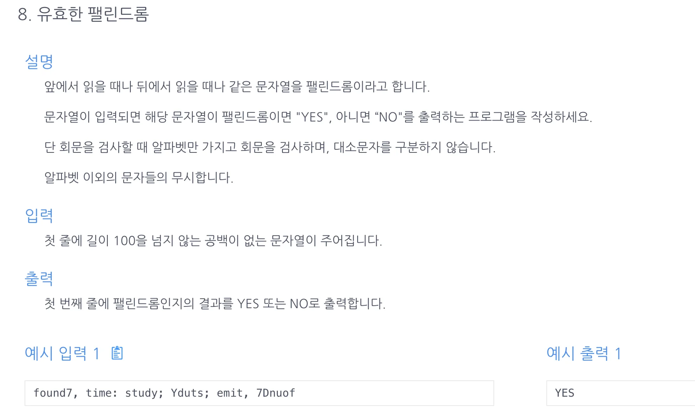

<a id="1c3eda9b0fe18190a420c45eb680351c"></a>

## 문제)



<a id="1c3eda9b0fe18126a39ffa89d5576615"></a>

```java
found7, timk: study; Yduts; emit, 7Dnuof
```

<a id="1c3eda9b0fe181099af3d87800bd6730"></a>

```java
found7, time: study; Yduts; emit, 7Dnuof
```

<a id="1c3eda9b0fe1810ca3ebdf6b440c9f7f"></a>

## 풀이)

- <a href="https://djusti.tistory.com/8"><code>replace</code></a><a href="https://djusti.tistory.com/8"> vs </a><a href="https://djusti.tistory.com/8"><code>replaceAll</code></a>

<a id="1c3eda9b0fe181058d3cc7f75486dd1d"></a>

### 풀이1) 정규식&#43;replaceAll(), 투포인터

<a id="1c3eda9b0fe1816b81def6a3799bf83e"></a>

```java
import java.util.Scanner;

public class Main {
    public String solution(String s){
        s= s.toUpperCase().replaceAll("[^A-Z]", "");
        int len = s.length()-1;
        for(int i=0; i<=len/2; i++){
            if (s.charAt(i)!=s.charAt(len-i)){
                return "NO";
            }
        }
        return "YES";
    }
    public static void main(String[] args){
        Main m = new Main();
        Scanner in=new Scanner(System.in);
        String str = in.nextLine();
        System.out.println(m.solution(str));
    }
}
```

<a id="1c3eda9b0fe1814bbc59d802306de93e"></a>

### 풀이2) ‘’ , StringBuilder &#43; equals()

<a id="1c3eda9b0fe1815dbdbbed51fd7a94de"></a>

```java
import java.util.Scanner;

public class Main {
    public String solution(String s){
        s= s.toUpperCase().replaceAll("[^A-Z]", "");
        String rs= new StringBuilder(s).reverse().toString();
        if (!s.equals(rs)) return "NO";
        return "YES";
    }
    public static void main(String[] args){
        Main m = new Main();
        Scanner in=new Scanner(System.in);
        String str = in.nextLine();
        System.out.println(m.solution(str));
    }
}
```

<a id="1c3eda9b0fe181809a63f5bd16526755"></a>

### 2차 풀이) 

<a id="1c3eda9b0fe18109ae0afd755b924876"></a>

```java
import java.util.Scanner;

public class Main {

    public String solution(String s){
        char[] sList = s.toLowerCase().replaceAll("[^a-z]", "").toCharArray();
        int l=0, r=sList.length-1;
        while (l<r){
            if (sList[l] != sList[r]) return "NO";
            l++; r--;
        }
        return "YES";
    }
    public static void main(String[] args){
        Main m = new Main();
        Scanner sc=new Scanner(System.in);
        String str = sc.nextLine();
        System.out.print(m.solution(str));
    }
}
```

<a id="1c3eda9b0fe181ad8b52d881b68dafd5"></a>

### 3차 풀이) 

<a id="1c3eda9b0fe18195932dd2b70034d6ca"></a>

```java
import java.util.Scanner;

public class Main {
    public String solution(String s) {
        String s1 = s.toLowerCase().replaceAll("[^a-z]", "");
        int len = s1.length()-1;
        for(int i=0; i<len/2; i++) {
            if(s1.charAt(i)!=s1.charAt(len-i)) return "NO";
        }
        return "YES";
    }

    public static void main(String[] args) {
        Main m = new Main();
        Scanner sc = new Scanner(System.in);
        String s = sc.nextLine();
        System.out.println(m.solution(s.toLowerCase()));
    }
};
```
