- [01. RDS 구매하고 MySQL 세팅하기 ](#1c3eda9b0fe1813f904ef5538fe6c9d6)
- [02. EC2 구매하기](#1c3eda9b0fe18103a253c1e4b065fc25)
- [03. EC2 준비하고 배포하기](#1c3eda9b0fe181eb9868f6cd0a41998f)
- [04. 포트포워딩 & nohup 적용하기](#1c3eda9b0fe18102821acf45127debf7)

<details>
<summary>1&#46; <strong>AWS 가입하기 (승인까지 최대 24시간이 걸리니, 미리 해주세요&#33;)</strong></summary>

- 가입&#58; <a href="https://portal.aws.amazon.com/billing/signup#/start">https&#58;//portal&#46;aws&#46;amazon&#46;com/billing/signup&#35;/start</a>

- 해외결제가 가능한 유효한 결제 수단을 넣어야 가입이 정상적으로 이루어집니다&#46; Visa 또는 Master 겸용의 신용카드를 추천드립니다&#46; 

- AWS는 개인에게 클라우드 환경의 가상서버를 제공합니다&#46; 기본 사양의 서버(EC2)를 1년 동안 무료로 사용할 수 있습니다&#46;

- 가입 시 결제된 금액은 다시 반환됩니다&#46; (일종의 결제 테스트 목적)

<details>
<summary>(←펼쳐보기&#33;) 가입 후 아래와 같은 화면에 접속 하면 성공&#33;</summary>

- <a href="https://ap-northeast-2.console.aws.amazon.com/ec2/v2/home?region=ap-northeast-2#Instances:sort=instanceId">https&#58;//ap&#45;northeast&#45;2&#46;console&#46;aws&#46;amazon&#46;com/ec2/v2/home?region=ap&#45;northeast&#45;2</a>

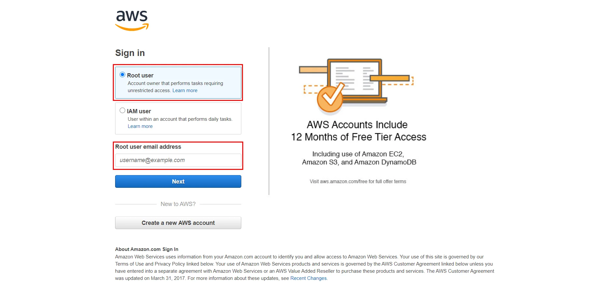

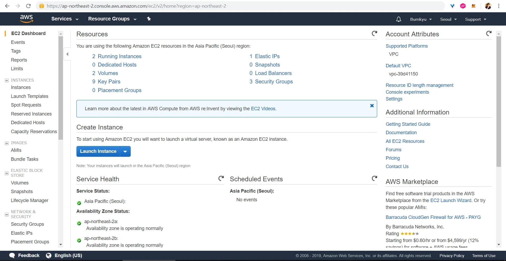

</details>

</details>

<details>
<summary>2&#46; <strong>Filezilla 설치하기</strong></summary>

- 다운로드&#58; <a href="https://filezilla-project.org/download.php">https&#58;//filezilla&#45;project&#46;org/download&#46;php</a>

- 다운로드 클릭 후 가장 기본 버전 (스크린샷 기준 왼쪽) 다운로드&#33;
    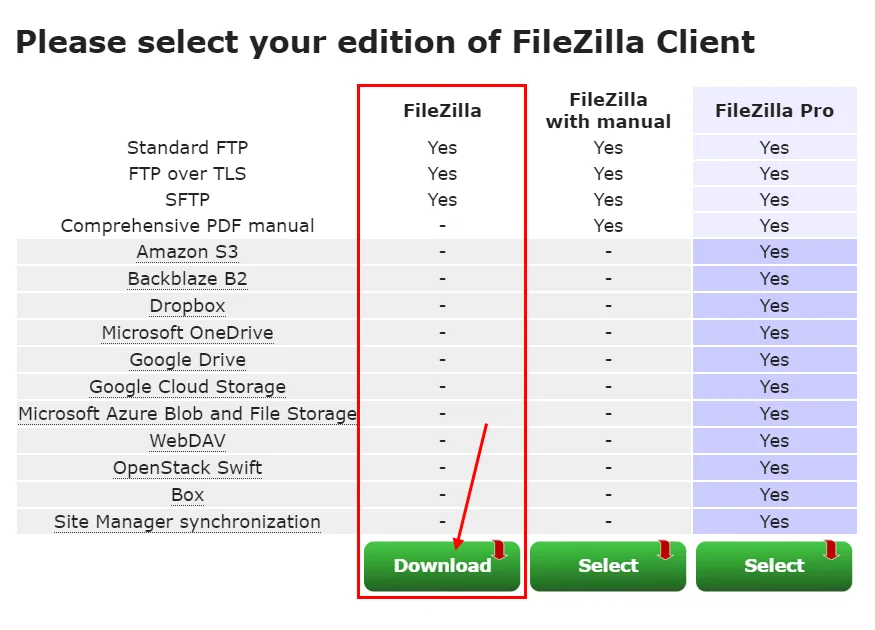

</details>

<details>
<summary>3<strong>&#46; (윈도우만) Git Bash</strong></summary>

- Git bash 라는 프로그램이 필요합니다&#46;

- 설치하기&#58; (<a href="https://gabii.tistory.com/entry/Git-Git-Bash-219-%EC%84%A4%EC%B9%98%ED%95%98%EA%B8%B0">링크</a>)

</details>

---

<a id="1c3eda9b0fe1813f904ef5538fe6c9d6"></a>

## <strong>01&#46; </strong>RDS 구매하고 MySQL 세팅하기 

<details>
<summary>RDS 구매하기</summary>

1. 미리 가입한 AWS에 로그인합니다&#46;

1. (<a href="https://ap-northeast-2.console.aws.amazon.com/console/home?region=ap-northeast-2#">링크</a>)에 접속합니다&#46;
    <details>
    <summary><strong>&#91;코드스니펫&#93; AWS 대시보드 링크</strong></summary>

    <a id="1c3eda9b0fe1814fa98cdce66afff3d1"></a>

    ```java
    https://ap-northeast-2.console.aws.amazon.com/console/home?region=ap-northeast-2#
    ```

    </details>

1. RDS를 검색하고 결과를 클릭합니다&#46;
    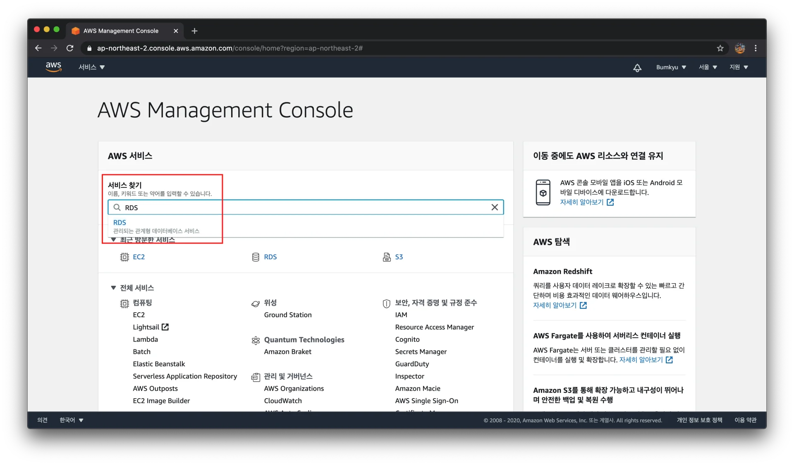

1. &#34;데이터베이스 생성&#34;을 클릭합니다&#46;
    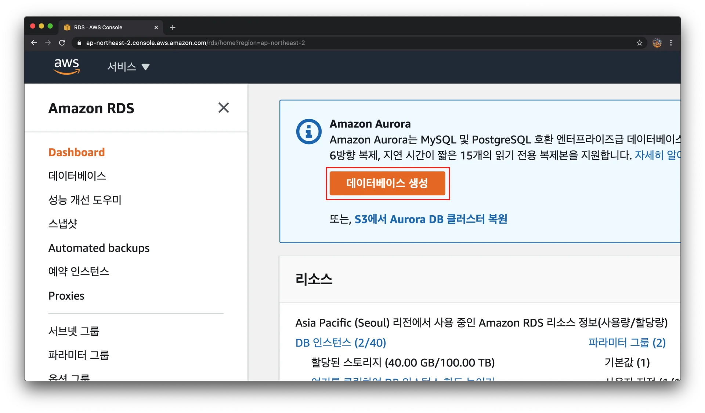

1. &#34;표준생성&#34; 과 &#34;MySQL&#34;을 클릭합니다&#46;
    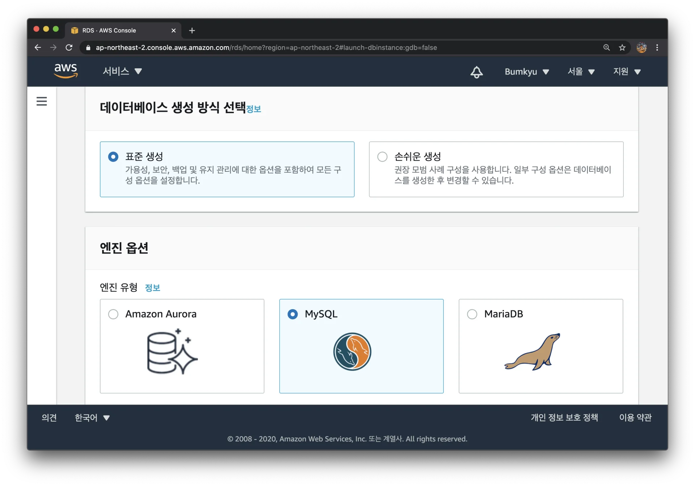

1. &#34;프리 티어&#34;를 선택합니다&#46;<br>(요금부과를 방지하기 위해 꼭 확인해주세요&#33; → <a href="https://aws.amazon.com/ko/free/faqs/">https&#58;//aws&#46;amazon&#46;com/ko/free/faqs/</a>)
    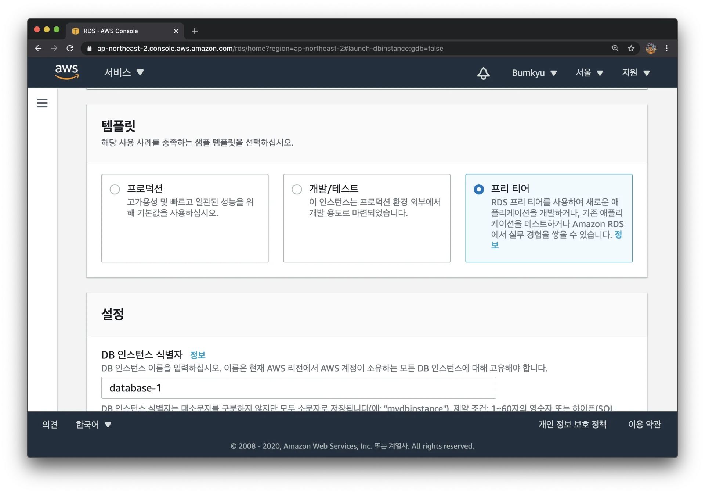

1. 다음과 같이 입력합니다&#46;
    - DB 인스턴스 식별자에 &#34;springboot&#45;database&#34; 라고 입력합니다&#46; (원하는 이름으로 바꾸셔도 돼요&#33;)

    - 마스터 사용자 이름과 암호에 만들고 싶은 계정의 아이디, 비밀번호를 입력합니다&#46; DB 접속용으로 사용해야 하니 꼭 기억해주세요&#33;

    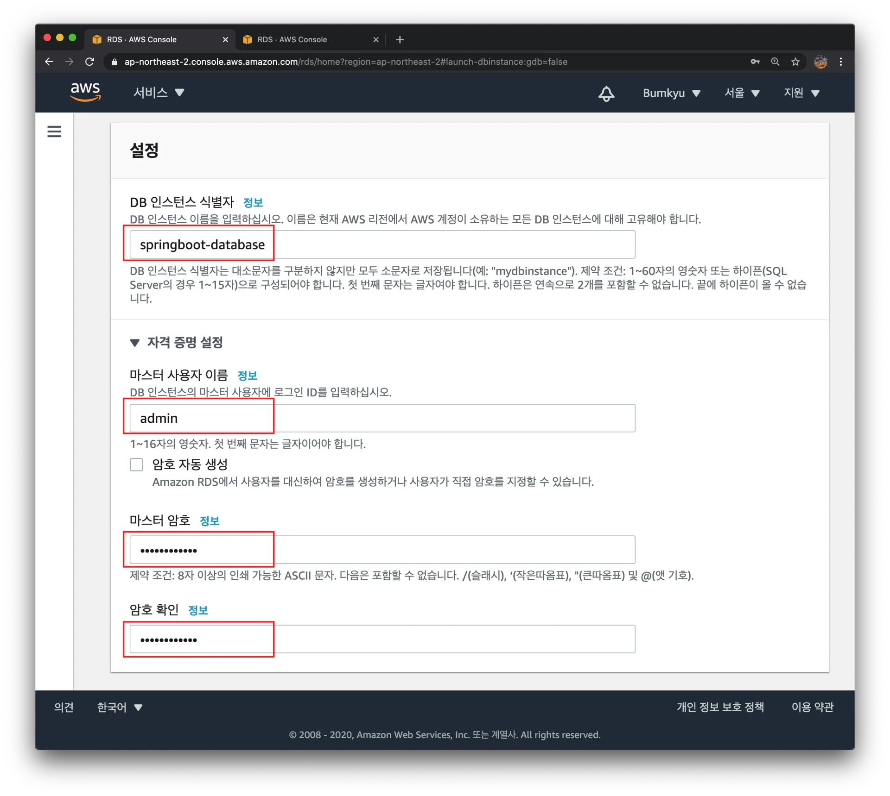

1. DB 인스턴스 크기와 스토리지는 설정 그대로 두고 넘어갑니다&#46;
    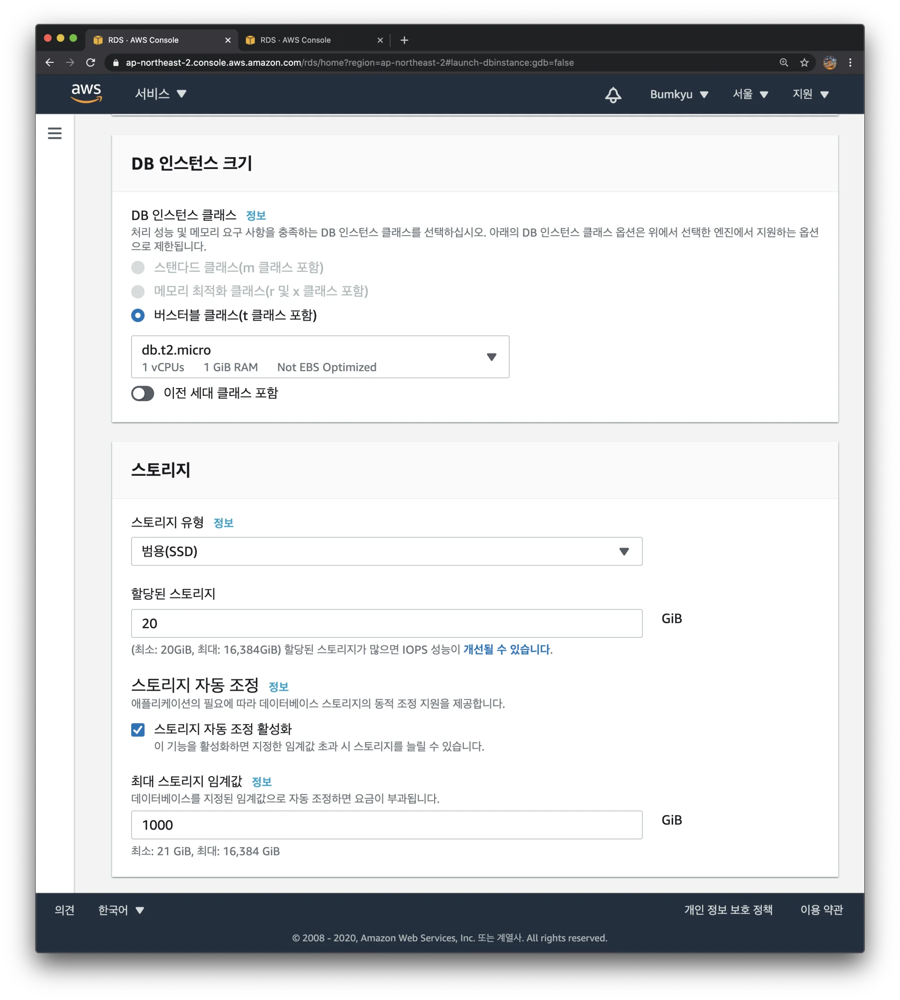

1. &#91;중요&#93; 연걸 &#62; 추가 연결 구성 탭을 클릭합니다&#46;
    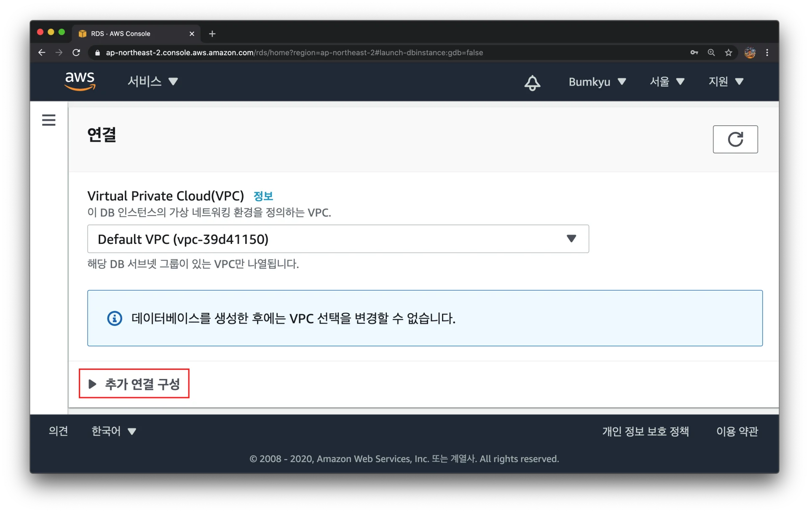

1. 다음과 같이 설정합니다&#46;
    - 퍼블릭 액세스 기능&#58; &#34;예&#34; 선택 
        <a id="1c3eda9b0fe181a1856afb274b609336"></a>

        → 이 설정이 되어있어야 우리 컴퓨터에서 AWS RDS 의 MySQL과 연결이 가능합니다&#46; 꼭 퍼블릭 액세스 설정을 확인해주세요&#33;

        <a id="1c3eda9b0fe1810cb5c3ec39c65610c3"></a>

        → 정책 업데이트로 IPv4의 경우 실행 중인 EC2 인스턴스에 연결되지 않은 유휴 상태의 탄력적 IP 주소와 같은 경우는 요금이 발생하는 점도 참고해 주세요&#46; 

        <a id="1c3eda9b0fe181ab8a01d1b75ad7dd2f"></a>

        RDS DB 인스턴스 생성 시 퍼블릭 액세스를 허용하시는 경우 퍼블릭 IPv4가 할당됩니다&#46;

        <a id="1c3eda9b0fe181f28273cbb6ad8c101e"></a>

        프라이빗으로 사용하시는 경우에는 퍼블릭 IPv4가 사용되지 않기 때문에 이로 인한 비용은 발생하지 않습니다&#46; 

    - VPC 보안 그룹&#58; &#34;새로 생성&#34; 선택

    - 새 VPC 보안 그룹 이름&#58; springboot&#45;db&#45;security

    - 가용 영역&#58; 옵션 중 아무거나 선택하셔도 괜찮아요&#46;

    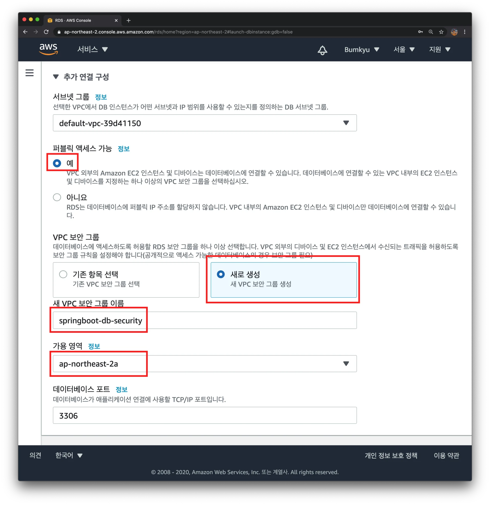

1. 추가 구성 &#62; 초기 데이터베이스 이름 에 &#34;shop&#34; 을 입력한다&#46;
    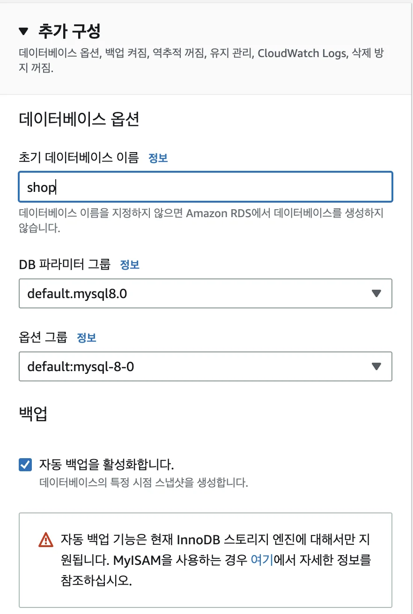

1. 데이터베이스 생성 클릭 
    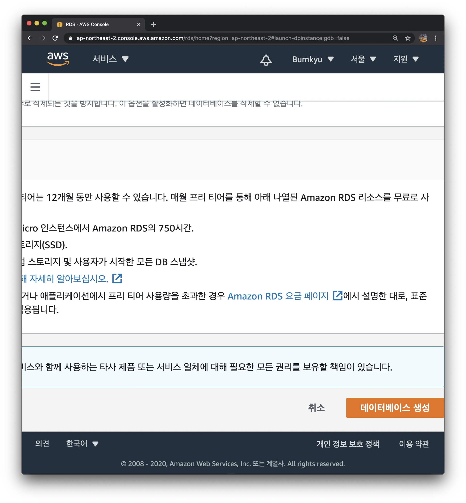

</details>

<details>
<summary>RDS 포트 열어주기</summary>

1. springboot&#45;database 클릭
    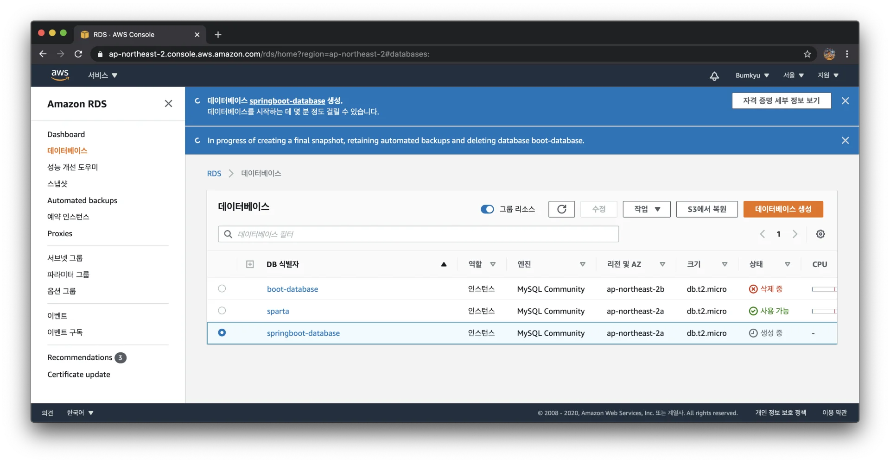

1. 연결 &#38; 보안 &#62; 보안 &#62; VPC 보안 그룹 의 springboot&#45;db&#45;security 클릭
    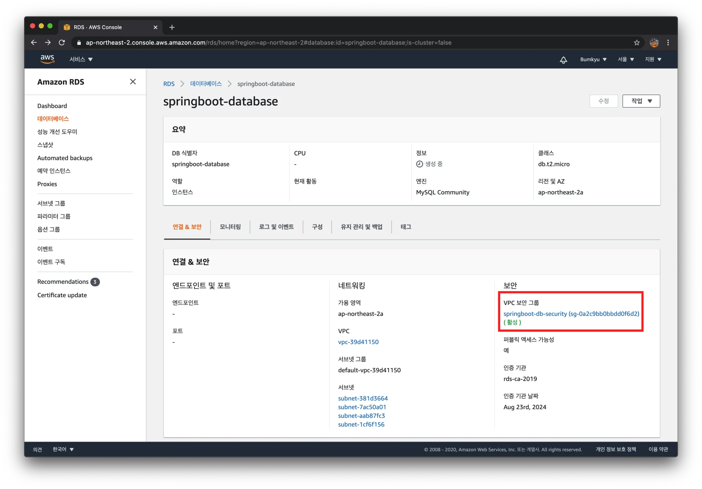

1. 보안 그룹 ID 클릭
    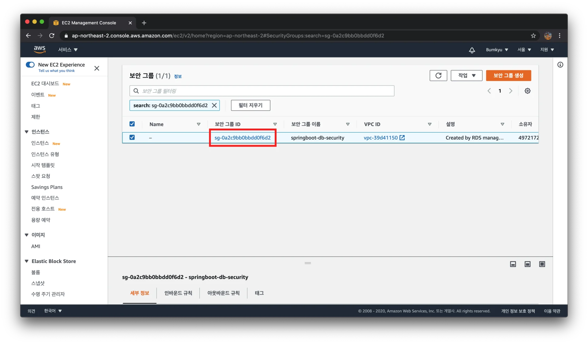

1. 인바운드 규칙 편집 클릭
    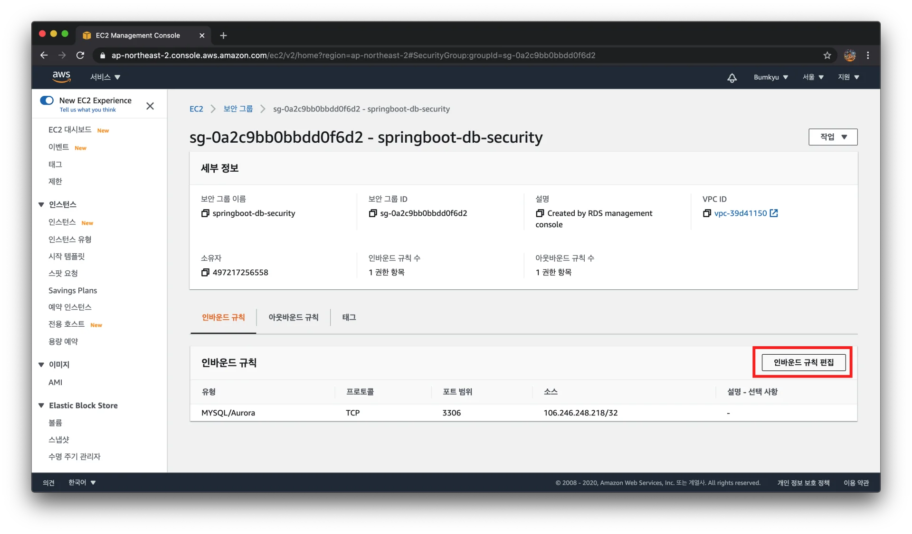

1. 소스 &#62; 위치 무관 클릭해서 0&#46;0&#46;0&#46;0/0, &#58;&#58;/0 생성 확인 후 &#34;규칙 저장&#34; 클릭
    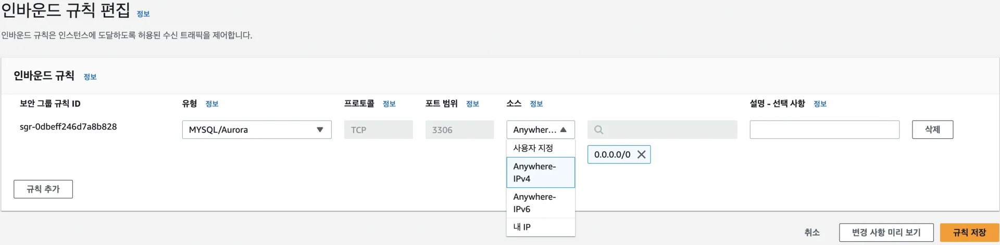

</details>

<details>
<summary>IntelliJ에서 확인하기</summary>

1. (<a href="https://ap-northeast-2.console.aws.amazon.com/rds/home?region=ap-northeast-2#databases:">링크</a>) 이동 후 springboot&#45;database 클릭
    <details>
    <summary><strong>&#91;코드스니펫&#93; RDS 대시보드 링크</strong></summary>

    <a id="1c3eda9b0fe18168b885f7770997b16c"></a>

    ```java
    https://ap-northeast-2.console.aws.amazon.com/rds/home?region=ap-northeast-2#databases:
    ```

    </details>

1. 엔드포인트 확인 후 드래그하여 복사
    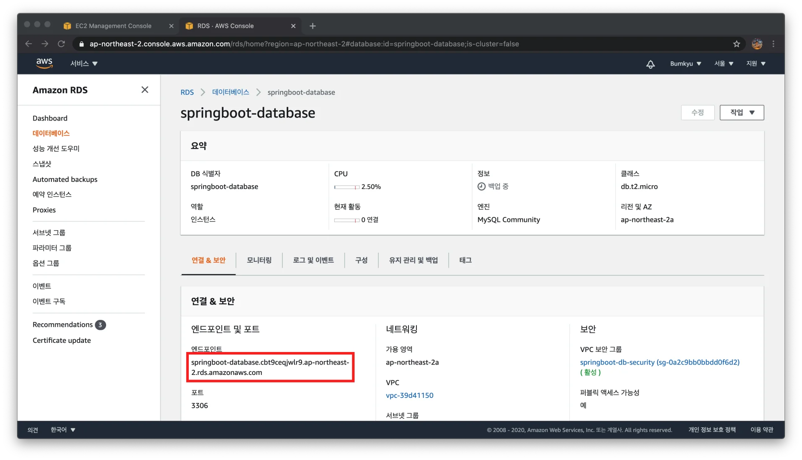

1. myselectshop 프로젝트를 IntelliJ에서 열기

1. 우측 Database 탭을 클릭합니다&#46;

1. Data Source &#62; MySQL 을 클릭합니다&#46; (제일 상단이 아니라면 중간 즈음 있을 거에요&#33;)
    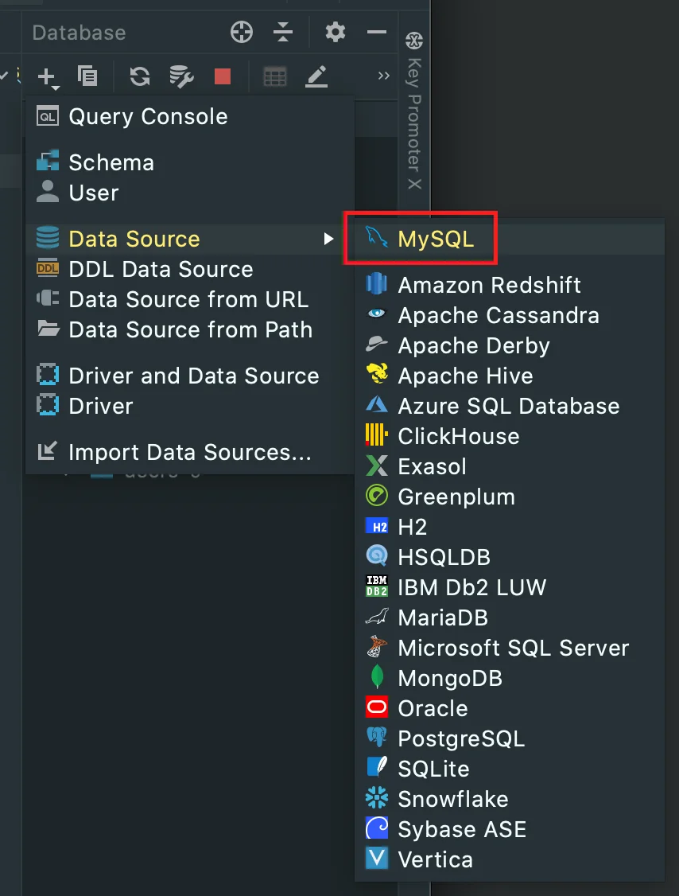

1. 다음과 같이 입력합니다&#46;
    - Name&#58; springboot&#45;database

    - Host&#58; 나의 엔드포인트

    - User&#58; 나의 Username

    - Password&#58; 나의 비밀번호

    - Database&#58; shop 

    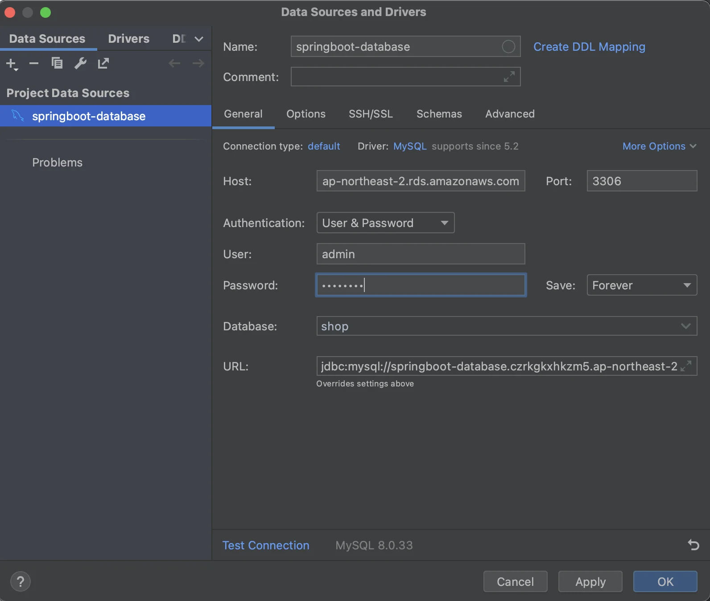

1. Test Connection 을 클릭하고, 아래와 같이 성공적으로 연결되면 OK 를 클릭합니다&#46;
    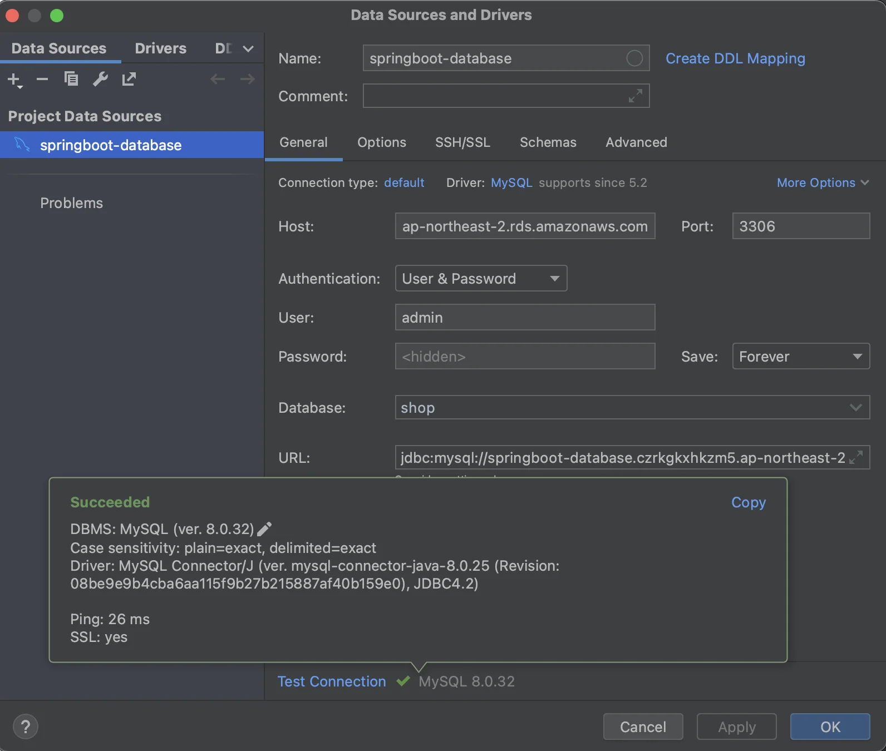

</details>

<details>
<summary>스프링 부트를 MySQL과 연결하기</summary>

- 스프링 부트 설정의 대부분은 application&#46;properties 에서 관리합니다&#46;

<details>
<summary>&#91;<strong>코드스니펫&#93; MySQL 연결하기</strong></summary>

<a id="1c3eda9b0fe181909d37fc7f55d0d54d"></a>

```java
spring.datasource.url=jdbc:mysql://나의엔드포인트:3306/shop
spring.datasource.username=나의USERNAME
spring.datasource.password=나의패스워드
spring.jpa.hibernate.ddl-auto=update
```

</details>

</details>

<details>
<summary>연결 확인하기</summary>

- 프로젝트를 작동시키고, 관심 상품 등록 후, 서버를 내린 다음에 다시 작동시켰을 때 관심 상품 목록이 잘 나타남을 확인합니다&#46;

- 쿼리 콘솔에서 아래 내용을 입력해서 product 테이블에 내용이 잘 들어가있음을 확인합니다&#46;
    <a id="1c3eda9b0fe1818681ecfd4530df14ab"></a>

    ```shell
    select * from product;
    ```

</details>

---

<a id="1c3eda9b0fe18103a253c1e4b065fc25"></a>

## <strong>02&#46; </strong>EC2 구매하기

<details>
<summary>1) EC2 서버 구매하기</summary>

<details>
<summary>AWS EC2 서버 사기 (준비 상식 편)</summary>

- 클릭 만으로 내가 원하는 서버(컴퓨터)의 설정을 정하고, 거기에 컴퓨터를 실행시키기 위한 운영체제(OS)를 설치할 거에요&#46;

- 우리는 OS로 리눅스의 Ubuntu를 설치합니다&#46; 윈도우와 같이, OS가 여러개 존재합니다&#46; 리눅스도 그 중의 하나이며, 오픈소스로 발전되는 OS입니다&#46;

</details>

<details>
<summary>AWS EC2 서버 사기</summary>

<details>
<summary><strong>&#91;코드스니펫&#93; EC2 콘솔페이지</strong></summary>

<a id="1c3eda9b0fe18176876bef68fe7ee25a"></a>

```shell
https://ap-northeast-2.console.aws.amazon.com/ec2/v2/home?region=ap-northeast-2
```

</details>

</details>

</details>

<details>
<summary>구매 화면들 따라하기</summary>

> 👉 Ubuntu Server 20&#46;04 또는 22&#46;04 버전을 구매합니다&#46;

1. Name은 <code>sparta&#95;web</code>으로 해주세요&#46;(선택)

1. Ubuntu로 20&#46;04 or 22&#46;04를 선택해주세요&#33; (ubuntu 선택 중요&#33;)

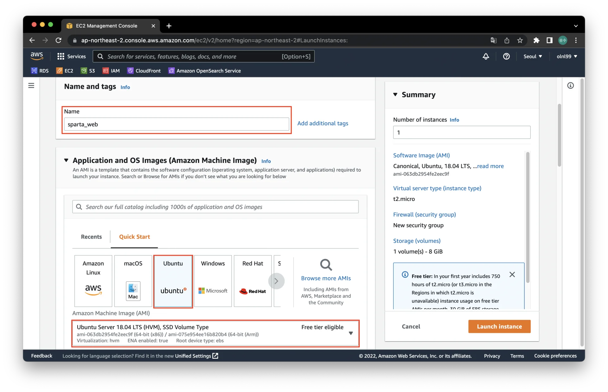

1. t2&#46;micro가 <code>무료 서비스</code>랍니다&#33;(1년 기한)

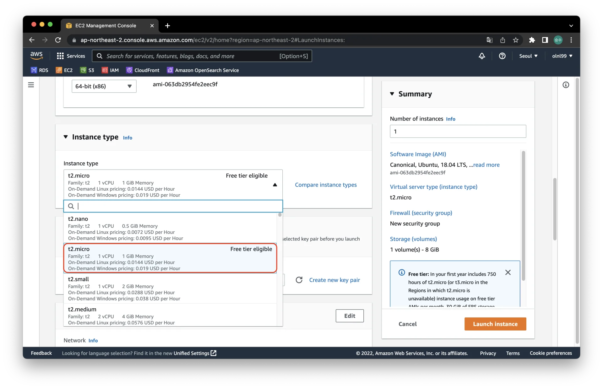

1. KEY 생성하기를 클릭 후, key를 발급 받아요(서버 접속 시, 매우 중요&#33;&#33;&#33;)

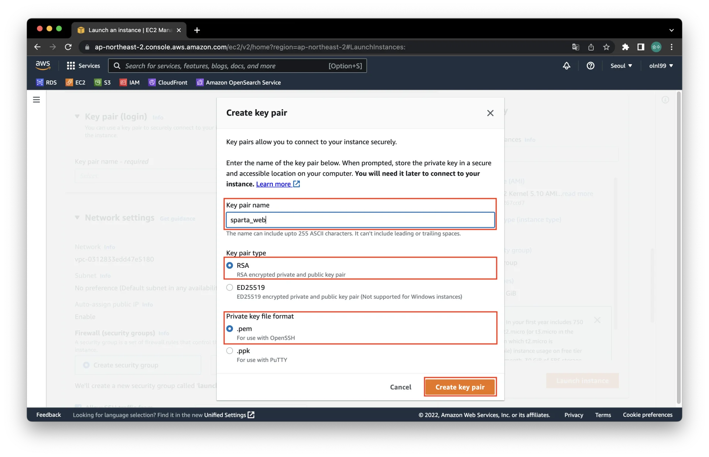

1. 나머지 체크리스트들을 체크 후, Launch instance를 클릭해주세요&#33;

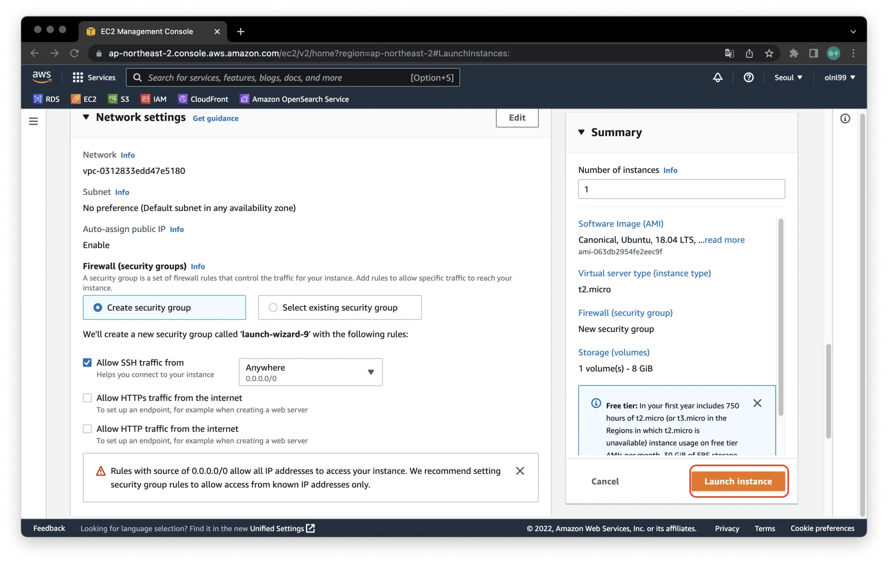

[동기화 원본](https://beautiful-college-c84.notion.site/e868108161da4c46a90ccb2a6253247d)

</details>

<details>
<summary>2) EC2 서버 종료하는 방법 </summary>

> 💡 <strong>중지 또는 종료하는 법&#46; 무료 기간(1년) 후 결제가 되기 전에, 이렇게 종료하세요&#33;</strong>

<a id="1c3eda9b0fe1818ea1ecd5e8b1ca1f2d"></a>

대상 인스턴스에 마우스 우클릭 &#62; &#39;인스턴스 상태&#39; 를 클릭합니다&#46; 중지 또는 종료 중 하나를 클릭하면 명령을 실행합니다&#46;

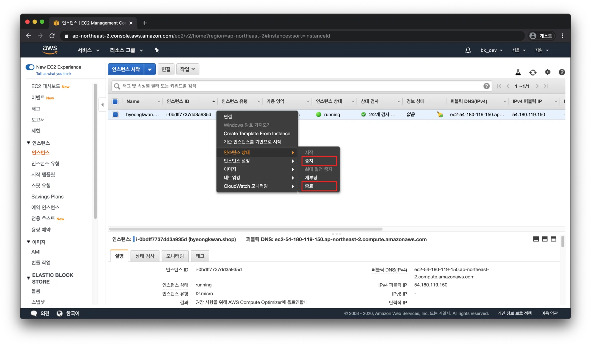

</details>

<details>
<summary>3) EC2에 접속하기</summary>

<details>
<summary>AWS EC2에 접속하기 (준비 상식 편)</summary>

- SSH(Secure Shell Protocol)
    - 다른 컴퓨터에 접속할 때 쓰는 프로그램입니다&#46; 다른 것들 보다 보안이 상대적으로 뛰어납니다&#46; 

    - 접속할 컴퓨터가 22번 포트가 열려있어야 접속 가능합니다&#46; AWS EC2의 경우, 이미 22번 포트가 열려있습니다&#46; 확인해볼까요?

    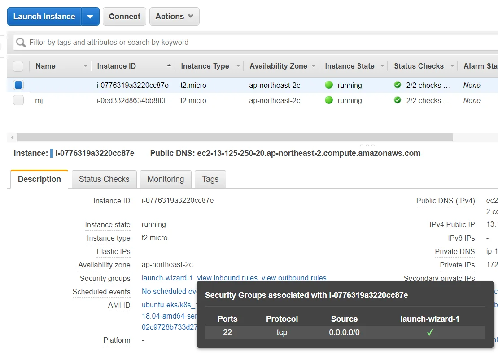

</details>

<details>
<summary>AWS EC2에 접속하기</summary>


</details>

<details>
<summary>Mac OS&#58; Mac은 ssh가 있어서, 명령어로 바로 접근 가능&#33;</summary>

- 터미널을 열기 (spotlight에 terminal 입력)

- 방금 받은 내 Keypair의 접근 권한을 바꿔주기
    <a id="1c3eda9b0fe181059edadd5891d3c5a9"></a>

    ```shell
    sudo chmod 400 받은키페어를끌어다놓기 
    ```

- SSH로 접속하기
    <a id="1c3eda9b0fe18119a350f234d35f18de"></a>

    ```shell
    ssh -i 받은키페어를끌어다놓기 ubuntu@AWS에적힌내아이피
    ```

    <a id="1c3eda9b0fe18139943ffb7cb234869a"></a>

    예) 아래와 비슷한 생김새&#33;

    <a id="1c3eda9b0fe1814ea951d842aacf57c5"></a>

    ```shell
    ssh -i /path/my-key-pair.pem ubuntu@13.125.250.20
    ```

<details>
<summary>Window&#58; ssh가 없으므로, git bash라는 프로그램을 이용&#33;</summary>

- gitbash를 실행하고, 아래를 입력&#33;
    <a id="1c3eda9b0fe181b89bbacd2f76315cd4"></a>

    ```shell
    ssh -i 받은키페어를끌어다놓기 ubuntu@AWS에적힌내아이피
    ```

    <a id="1c3eda9b0fe18137a050ceecb7cdc723"></a>

    예) 아래와 비슷한 생김새&#33;

    <a id="1c3eda9b0fe181ad8f7cde4153aa7180"></a>

    ```shell
    ssh -i /path/my-key-pair.pem ubuntu@13.125.250.20
    ```

- Key fingerprint 관련 메시지가 나올 경우 Yes를 입력해주세요&#33;

- git bash를 종료할 때는 exit 명령어를 입력하여 ssh 접속을 먼저 끊어주세요&#46;

</details>

</details>

</details>

<details>
<summary>4) 간단한 리눅스 명령어 연습하기</summary>

- 리눅스는 윈도우 같지 않아서, &#39;쉘 명령어&#39;를 통해 OS를 조작한다&#46; (일종의 마우스 역할)

<a id="1c3eda9b0fe181ce9adffc53eabff8cd"></a>

&#91;가장 많이 쓰는 몇 가지 명령어&#93;

- 팁&#33; 리눅스 커널에서 윗화살표를 누르면 바로 전에 썼던 명령어가 나옵니다&#46;

<a id="1c3eda9b0fe181b28cf0dee1faf88e48"></a>

```shell
ls: 내 위치의 모든 파일을 보여준다.

pwd: 내 위치(폴더의 경로)를 알려준다.

mkdir: 내 위치 아래에 폴더를 하나 만든다.

cd [갈 곳]: 나를 [갈 곳] 폴더로 이동시킨다.

cd .. : 나를 상위 폴더로 이동시킨다.

cp -r [복사할 것] [붙여넣기 할 것]: 복사 붙여넣기

rm -rf [지울 것]: 지우기

sudo [실행 할 명령어]: 명령어를 관리자 권한으로 실행한다.
sudo su: 관리가 권한으로 들어간다. (나올때는 exit으로 나옴)
```

</details>

---

<a id="1c3eda9b0fe181eb9868f6cd0a41998f"></a>

## <strong>03&#46; </strong>EC2 준비하고 배포하기

<details>
<summary>배포 파일 빌드하기</summary>

- 우측 탭 중에서 Gradle 을 선택합니다&#46;

- Tasks &#62; build &#62; build 를 더블 클릭합니다&#46;
    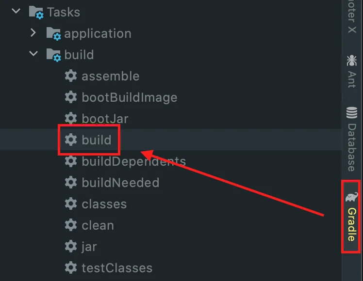

- 좌측 build 폴더 &#62; libs 아래에 &#46;jar 확장자로 끝나는 파일이 생겼을 거에요&#33; 빌드에 성공하였습니다&#46;
    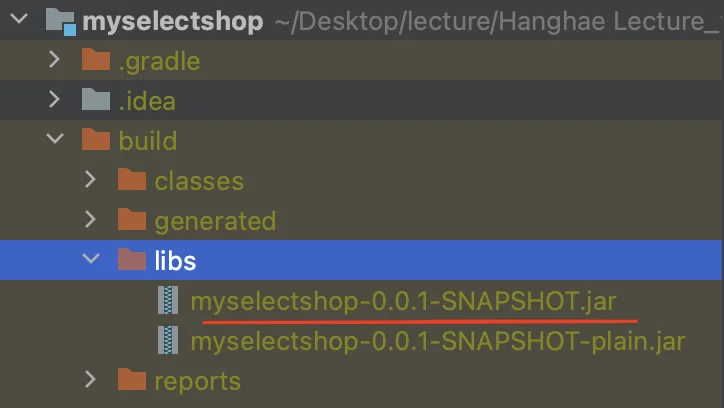

</details>

<details>
<summary>(ssh로 접속한)Ubuntu에서 OpenJDK 설치하기(반드시 17v)</summary>

<a id="1c3eda9b0fe181c1845af73114ce07c5"></a>

```shell
sudo apt-get update
sudo apt-get install openjdk-17-jdk
java -version
```

</details>

<details>
<summary>Filezilla를 이용해서 배포 파일을 업로드하기</summary>

- 파일질라 실행, 다음과 같이 설정
    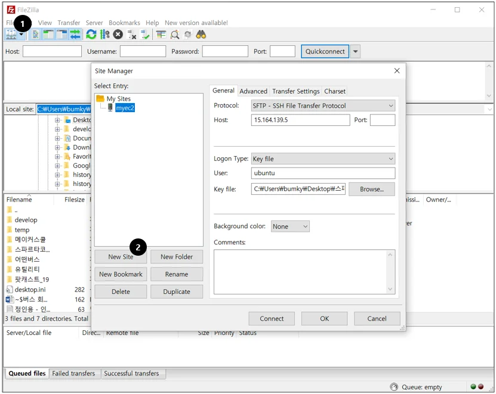

- 정보들을 입력하고, ok 누르면 서버의 파일들을 볼 수 있음<br>(Host&#58; 내 EC2서버의 ip // User&#58; ubuntu 로 입력)
    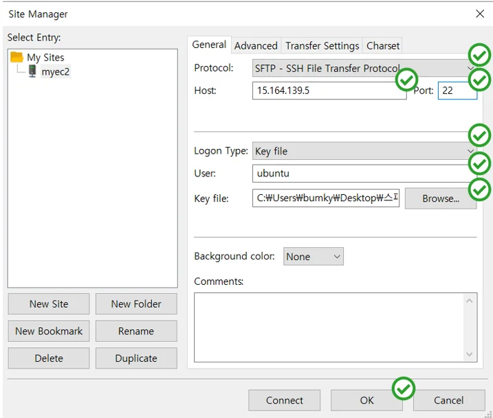

- 마우스로 드래그 해서 파일을 업로드/다운로드하면 됩니다&#33;
    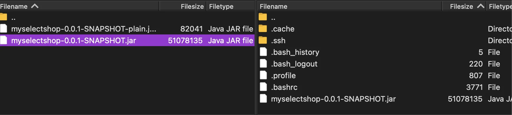

    - 왼쪽(본인 컴퓨터)에서 개발 완료된 myselectshop 프로젝트 폴더의 build &#62; libs로 이동합니다&#46;

    - 오른쪽(EC2)으로 드래그합니다&#46;

    <a id="1c3eda9b0fe18106b44eef5f3a45b3a1"></a>

    예시)

    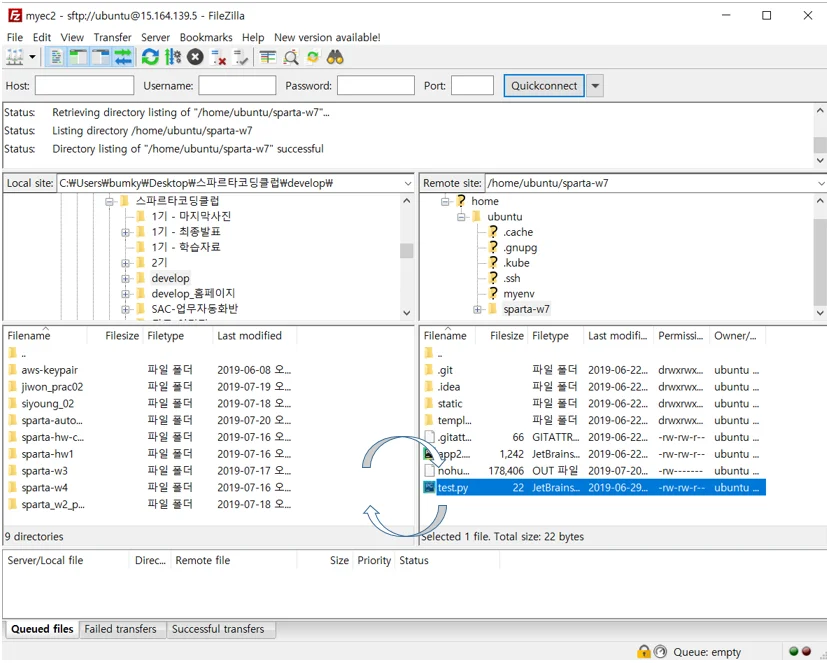

</details>

<details>
<summary>스프링 부트 작동시키기</summary>

<a id="1c3eda9b0fe1817a9bdffa1acaffed40"></a>

```shell
java -jar JAR파일명.jar
```

</details>

<details>
<summary>AWS에서 80, 8080 포트를 열어주기</summary>

- EC2 서버(=가상의 내 컴퓨터)에서 포트를 따로 설정하는 것 외에도,<br>AWS EC2에서도 자체적으로 포트를 열고/닫을 수 있게 관리를 하고 있습니다&#46;
    <a id="1c3eda9b0fe1814f8262d750a1b32cb1"></a>

    → 그래서 AWS EC2 Security Group에서 인바운드 요청 포트를 열어줘야 합니다&#46;

    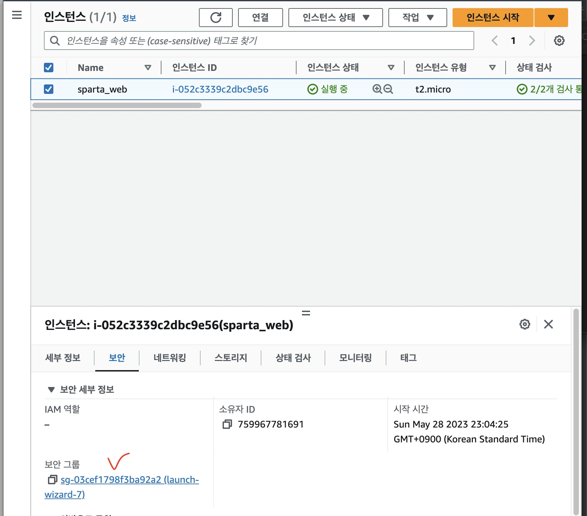

- 해당 보안그룹을 클릭합니다&#46;

- Edit inbound rules를 선택합니다&#46;
    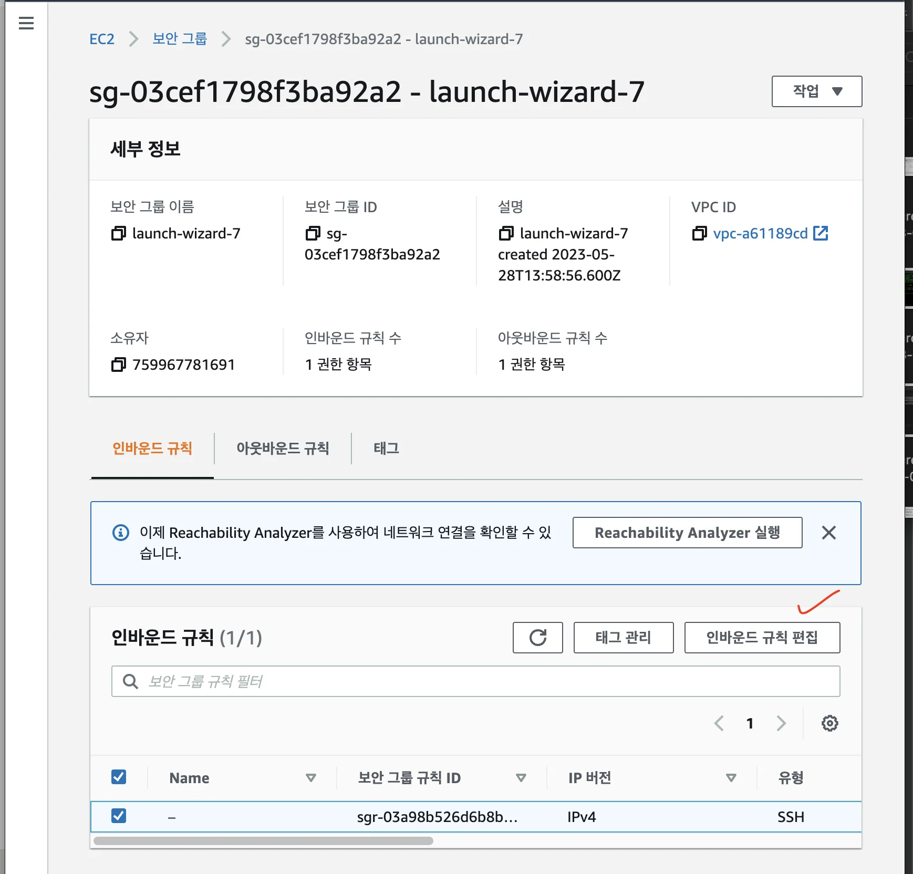

- 두 가지 포트를 추가해봅니다&#46; (8080포트는 범위가 2가지 입니다&#46;)
    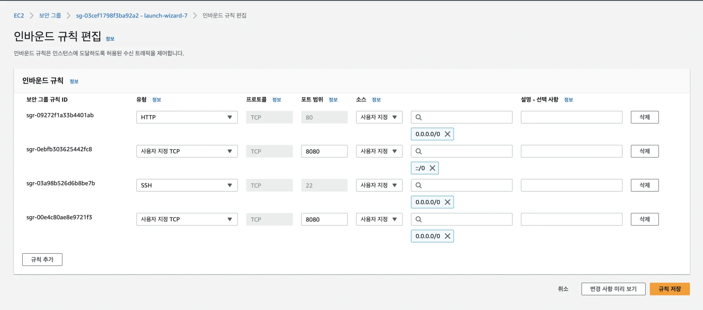

    <a id="1c3eda9b0fe18128a1c9f240e5e1b224"></a>

    → 80포트&#58; HTTP 접속을 위한 기본포트

    <a id="1c3eda9b0fe181a3aaf0d6ef76d3ffe3"></a>

    → 8080포트&#58; 스프링 부트 기본포트

</details>

<details>
<summary>접속해보기</summary>

<a id="1c3eda9b0fe181de8b7acd4b2a8d1c3c"></a>

```shell
http://내 public 아이피:8080
```

</details>

---

<a id="1c3eda9b0fe18102821acf45127debf7"></a>

## <strong>04&#46; </strong>포트포워딩 &#38; nohup 적용하기

<details>
<summary>포트 번호 없애기 &#45; 기본 개념</summary>

- 지금은 8080 포트에서 웹 서비스가 실행되고 있습니다&#46; 그래서 매번 &#58;8080 이라고 뒤에 붙여줘야 하죠&#46; 뒤에 붙는 포트 번호를 없애려면 어떻게 해야할까요?

- HTTP 요청에서는 80포트가 기본이기 때문에, 굳이 &#58;80을 붙이지 않아도 자동으로 연결이 됩니다&#46;

- 포트 번호를 입력하지 않아도 자동으로 접속되기 위해, 우리는 80포트로 오는 요청을 8080 포트로  전달하게 하는 포트포워딩(port forwarding) 을 사용하겠습니다&#46;

</details>

<details>
<summary>포트 번호 없애기 &#45; 리눅스 자체 포트포워딩을 작동시키기</summary>

- 띄워둔 터미널에서 새롭게 설정을 적용하기 전에 돌아가고 있던 서비스는 일단 끄고&#33; (터미널에서 ctrl &#43; c)

- 포트포워딩 룰을 입력합니다&#46;
    <details>
    <summary><strong>&#91;코드스니펫&#93; 포트포워딩</strong></summary>

    <a id="1c3eda9b0fe181daa616d654e443373e"></a>

    ```shell
    sudo iptables -t nat -A PREROUTING -i eth0 -p tcp --dport 80 -j REDIRECT --to-port 8080
    ```

    </details>

- 다시 서비스 시작
    <a id="1c3eda9b0fe181e3836ecf09379b6dd5"></a>

    ```bash
    java -jar JAR파일명.jar
    ```

</details>

<details>
<summary>포트 번호를 떼고 접속해봅니다&#46;</summary>

- 웹 브라우저에서 접속하기
    <a id="1c3eda9b0fe18152b128d9f25ecad134"></a>

    ```shell
    http://내AWS아이피/
    ```

</details>

<details>
<summary>SSH 접속을 끊어도 서버가 계속 돌게 하기</summary>

- 현재 상황
    <a id="1c3eda9b0fe1812a801fe064a726973f"></a>

    Git bash 또는 맥의 터미널을 종료하면 (=즉, SSH 접속을 끊으면) 프로세스가 종료되면서, 서버가 돌아가지 않고 있습니다&#46; 그러나 우리가 원격접속을 끊어도, 서버는 계속 동작해야겠죠?

- 원격 접속을 종료하더라도 서버가 계속 돌아가게 하기
    <a id="1c3eda9b0fe1815aa4dfc780cf0032fa"></a>

    ```shell
    # 아래의 명령어로 실행하면 된다
    nohup java -jar JAR파일명.jar &
    ```

- 서버 종료하기 &#45; 강제종료하는 방법
    <a id="1c3eda9b0fe181359f68c1ecbe89c91f"></a>

    ```shell
    # 아래 명령어로 미리 pid 값(프로세스 번호)을 본다
    ps -ef | grep java

    # 아래 명령어로 특정 프로세스를 죽인다
    kill -9 [pid값]
    ```

- 다시 켜기
    <a id="1c3eda9b0fe181a0bbfbd088b7486b5d"></a>

    ```shell
    # 아래의 명령어로 실행하면 된다
    nohup java -jar JAR파일명.jar &
    ```

</details>

<details>
<summary>SSH 접속을 종료한 뒤, 접속해봅니다&#33;</summary>

- 브라우저에서 접속하기
    <a id="1c3eda9b0fe18175bbfcd5c96143ae29"></a>

    ```shell
    http://내AWS아이피/
    ```

</details>

---
