<a id="1c3eda9b0fe181aeb8fec46b8e014cef"></a>

# HTTP 헤더 개요

<details>
<summary><strong>복습 </strong></summary>

> 📌 Header&#45;Field
> 
> > <strong>field&#45;name &#58;</strong> OWS <strong>field&#45;value </strong>OWS ( OWS&#58; 띄어쓰기 허용) 
> 
> <a id="1c3eda9b0fe18133b4cce8513920a6a0"></a>
> 
> ex) Host&#58; www&#46;google&#46;com<br>ex) Content&#45;Type&#58; text/html;charset=UTF&#45;8<br>ex) Content&#45;Length&#58; 3423 
> 
> 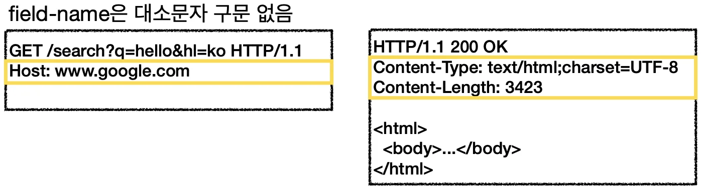

<a id="1c3eda9b0fe181e58c4ae4ea12a4b2cf"></a>

HTTP 전송에 필요한 모든 부가 정보

<a id="1c3eda9b0fe181d6b0a2e78504bfe07f"></a>

ex) 메세지 바디 내용, 메세지 바디 바디 크기, 압축, 인증, 요청 클라이언트, 서버 정보, 캐시 관리 정보 등

<a id="1c3eda9b0fe181faba76d49da5b617c7"></a>

## 일반적으로 사용하는  header

</details>

> ⚠️ 과거 RFC2616 ( 1999년 )  폐기 ❌<br>현재는 <code>RFC7230 &#126; 7235</code> ( 2014년 )  사용함

<details>
<summary>과거 HTTP header ( 분류 &#45; RFC2616 )</summary>

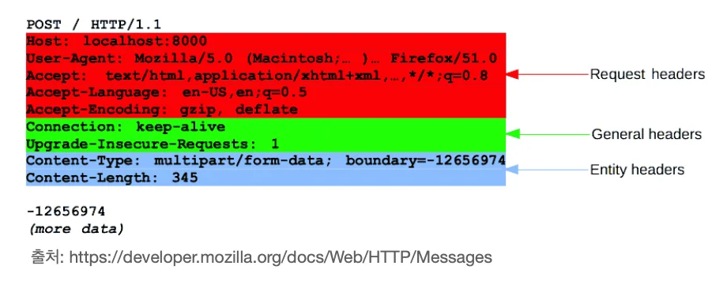

- General 헤더&#58; 메세지 전체에 적용되는 정보  ex) Connection&#58; close

- Request 헤더&#58; 요청 정보    ex) User&#45;Agent&#58;  Mozilla/5&#46;0 (Macintosh; &#46;&#46;)

- <strong>Response 헤더</strong>&#58; 응답 정보, 예) Server&#58; Apache

- <strong>Entity 헤더</strong>&#58; 엔티티 바디 정보, 예) Content&#45;Type&#58; text/html, Content&#45;Length&#58; 3423

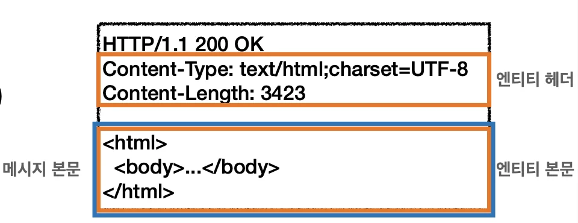

- 메시지 본문(message body)은 엔티티 본문(entity body)을 전달하는데 사용

- 엔티티 본문은 요청이나 응답에서 전달할 실제 데이터

- <strong>엔티티 헤더</strong>는 <strong>엔티티 본문</strong>의 데이터를 해석할 수 있는 정보 제공 <br>→ 데이터 유형(html, json), 데이터 길이, 압축 정보 등

</details>

<a id="1c3eda9b0fe181678aaac27a1629edca"></a>

## 최신 RFC723x 

<a id="1c3eda9b0fe18171a769d12924d1fc27"></a>

과거 엔티티(Entity) 라는 명칭이  표현 (Representation)으로 변화됨

> 📌 표현(Representation) = 표현 메타데이터(representation Metadata)&#43; 표현 데이터(Representation Data)

<a id="1c3eda9b0fe18118897ddce2e9be5bab"></a>

### <strong>message body &#45; RFC7230(최신)</strong>

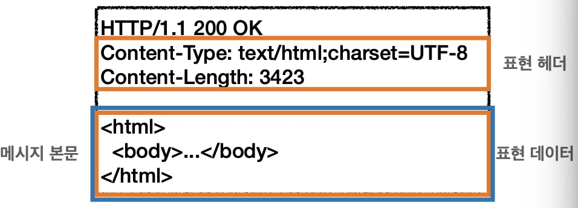

> 📌 정<strong>리</strong>
> 
> <a id="1c3eda9b0fe1810fbc82e59a82b4db48"></a>
> 
> 메시지 본문(message body)을 통해 표현 데이터 전달
> 
> > 메시지 본문 = 페이로드(payload)
> 
> <a id="1c3eda9b0fe181f5b348ec835f720fb7"></a>
> 
> <strong>표현</strong>은 요청이나 응답에서 전달할 실제 데이터를 말하며
> 
> <a id="1c3eda9b0fe181709062de6e49dd14bb"></a>
> 
> <strong>표현 헤더</strong><strong>는</strong> <strong>표현 데이터</strong>를<strong> </strong>해석할 수 있는 정보 제공한다&#46;
> 
> > 해석 정보&#58; 데이터 유형(html, json), 데이터 길이, 압축 정보 등등

> ⚠️ 표현 헤더는 표현 메타데이터와, 페이로드 메시지를 구분해야 하지만, 여기서는 생략한다고 함

<a id="1c3eda9b0fe18137b214e14204d92e2f"></a>

# 표현

> 예) 회원 리소스<br> HTML 형식으로 전송할 것인지, JSON 형식으로 전송할 것인지 <br>→ HTML 표현으로 전달할 것인지, JSON 표현을로 전달할 것인지  

> 📌 <strong>표현 헤더 ( 전송, 응답 둘다에 사용됨)</strong>
> 
> - <strong>Content&#45;Type</strong>&#58; 표현 데이터의 형식
> 
> - Content&#45;Encoding&#58; 표현 데이터의 압축 방식
> 
> - Content&#45;Language&#58; 표현 데이터의 자연 언어
> 
> - Content&#45;Length&#58; 표현 데이터 길이 

<a id="1c3eda9b0fe1817dbd95f38b7800b423"></a>

### Content&#45;Type ( 표현 데이터 형식) 

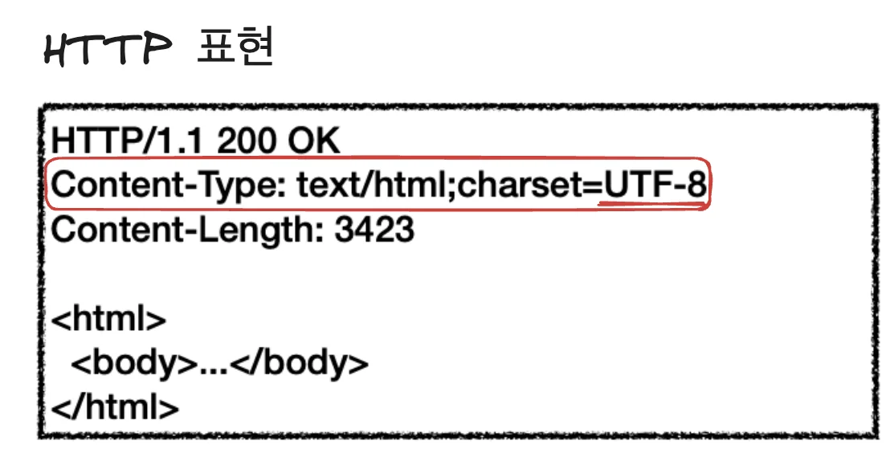

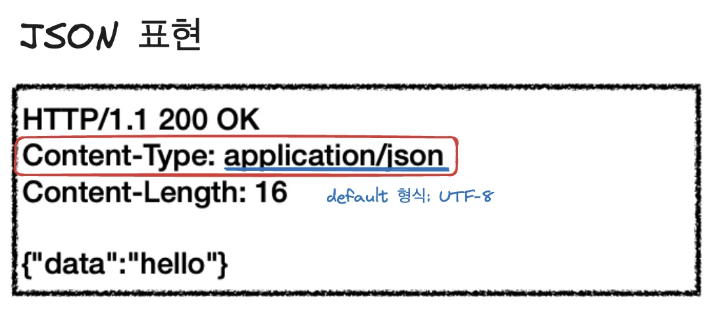

> 📌 미디어 타입, 문자 인코딩 형식을 설명함
> 
> <a id="1c3eda9b0fe1818aa624ca1216c3ff29"></a>
> 
> ex) 
> 
> - text/html; charset=utf&#45;8
> 
> - application/jspn
> 
> - image/png

<a id="1c3eda9b0fe181779d92c59a99c8adbd"></a>

### Content&#45;Encoding ( 표현 데이터 인코딩 )

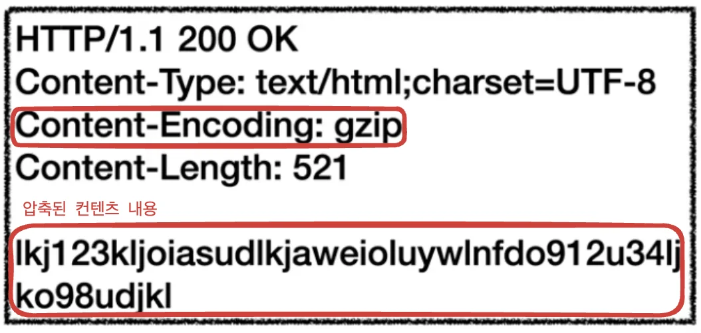

> 📌 표현 데이터를 압축하기 위해 사용한다&#46;<br>데이터를 전달하는 곳에서 압축 후 압축된 형태를 인코딩 헤더 추가하여 데이터를 읽는 쪽에서 인코딩 헤더(Content&#45;Encoding)의 정보로 압축 해제하여 사용한다&#46;<br>→ gzip, deflate, identity

<a id="1c3eda9b0fe181a4b80dedb1a6161025"></a>

### Content&#45;Language ( 표현 데이터의 자연 언어 )

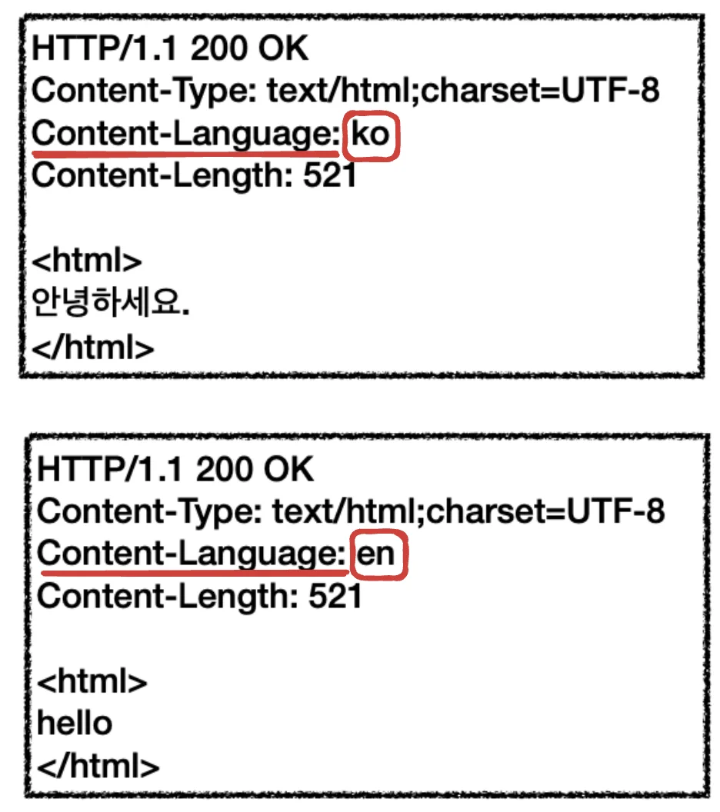

> 📌 표현 데이터의 자연 언어 표기<br>→ ko, en, en&#45;US

<a id="1c3eda9b0fe181539b19e33f514d1331"></a>

### Content&#45;Length ( 표현 데이터의 길이 )

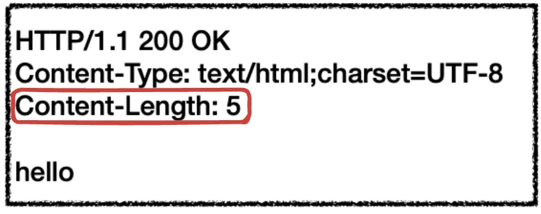

> 📌 바이트 단위

> ⚠️ Transfer&#45;Encoding(전송 코딩) 사용 시, Content&#45;Length를 사용하면 안됨

<a id="1c3eda9b0fe18172a810db7d6117d048"></a>

# 협상 ( content negotiation )

> 📌 <strong>협상 헤더 (요청만)</strong>
> 
> > 클라이언트가 선호하는 표현 요청<br>→ Accept&#58; 클라이언트가 선호하는 미디어 타입 전달
> 
> <a id="1c3eda9b0fe181c5b7adf6c753563651"></a>
> 
> ex) 
> 
> - Accept&#45;Charset&#58; 클라이언트가 선호하는 문자 인코딩
> 
> - Accept&#45;Encoding&#58; 클라이언트가 선호하는 압축 인코딩
> 
> - Accept&#45;Language&#58; 클라이언트가 선호하는 자연 언어

<a id="1c3eda9b0fe181bcaf4af6bfd17d4120"></a>

### Accept&#45;Language 적용

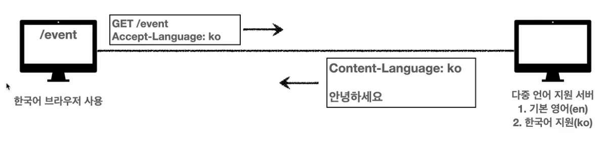

<a id="1c3eda9b0fe1818fa7abcdf955546466"></a>

아래와 같이 요청한 형식이 없는 경우, 다음 순서로 선호하는 형식으로 받는 것이 좋다&#46; 이럴때 필요한 것이 <code>우선순위</code> 설정이다&#46;

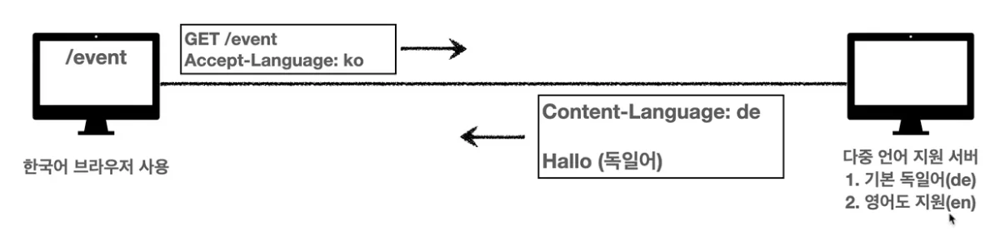

<a id="1c3eda9b0fe181c29b6ee6a5798f0823"></a>

## 협상, 우선순위 ( Quality Values(q) )

<a id="1c3eda9b0fe181859bf1c219ec832a2f"></a>

### 우선순위 1) Quality Value 값

> 📌 <code>Quality Values(q)</code> 를 사용하여 우선순위를 설정할 수 있다&#46; 
> 
> > 0 &#126; 1 &#58; 클수록 우선순위가 높다;  (1은 생략됨)

<details>
<summary> 예시)  Accept&#45;Language&#58; ko&#45;KR,ko;q=0&#46;9,en&#45;US;q=0&#46;8,en;q=0&#46;7</summary>

> 👉🏻 <strong>Quality Value(q) 값을 통한 우선순위적용</strong>
> 
> > <strong>&#42; 우선순위 &#42;<br></strong>1&#46; ko&#45;KR;q=1 (q생략)<br>2&#46; ko;q=0&#46;9<br>3&#46; en&#45;US;q=0&#46;8<br>4&#46; en;q=0&#46;7
> 
> <a id="1c3eda9b0fe18162b841fce011683a72"></a>
> 
> ⇒ 우선적으로 위치해 있는 en 으로 잘 받아옴

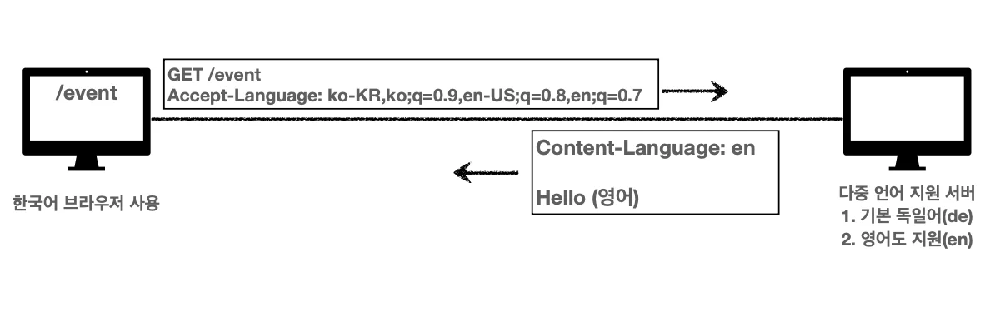

</details>

<a id="1c3eda9b0fe1813a9e0cc74b63a8e741"></a>

### 우선순위 2) 구체적인 것이 우선된다&#46;

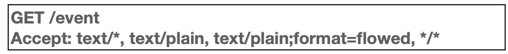

<a id="1c3eda9b0fe18135a62ec32bc0066dfe"></a>

ex) Accept&#58; <strong>text/&#42;</strong>, <strong>text/plain</strong>, <strong>text/plain;format=flowed</strong>, <strong>&#42;/&#42;</strong>

> 👉🏻 <strong>우선 순위</strong>
> 
> 1. text/plain;format=flowed
> 
> 1. text/plain
> 
> 1. text/&#42;
> 
> 1. <em>&#42;/&#42;</em>

<a id="1c3eda9b0fe181a0ac95ffd280ff0649"></a>

### 우선순위 3) 구체적인 것을 기준으로 미디어 타입을 맞춘다&#46; 

> 3번째까지 디테일하게 설정하는 경우는 거의 없다&#46; 

> 👉🏻 <strong>우선순위</strong><br>Accept&#58; <strong>text/&#42;</strong>;q=0&#46;3, <strong>text/html</strong>;q=0&#46;7, <strong>text/html;level=1</strong>,
> 
> <a id="1c3eda9b0fe18174af69e5dd5e3c1efb"></a>
> 
> <strong>text/html;level=2</strong>;q=0&#46;4, <strong>&#42;/&#42;</strong>;q=0&#46;5
> 
> 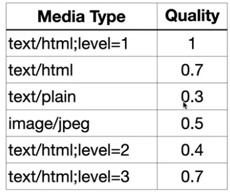

<a id="1c3eda9b0fe18189b8e4d66496d9d810"></a>

# 전송 방식

<a id="1c3eda9b0fe181119012f93131aa245d"></a>

### 단순 전송

> 👉🏻 한번에 요청한하고 한번에 받음, Content&#45;Length 가 주어져야함

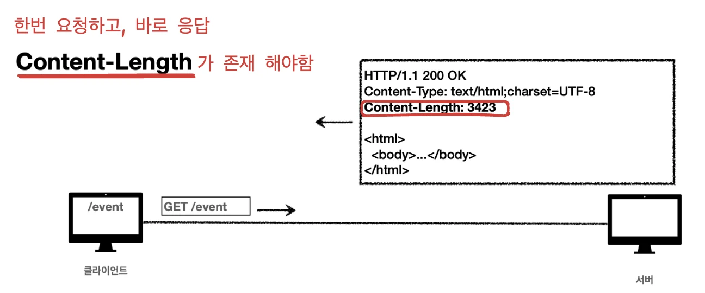

<a id="1c3eda9b0fe1818fb413c6ff0acf626c"></a>

### 압축전송

> 👉🏻 압축하여 전송, Content&#45;Encoding에 압축 형식 같이 전달함<br>실제로 굉장히 많이 줄어듬 (절반 이상 줄어드는 경우 많음)

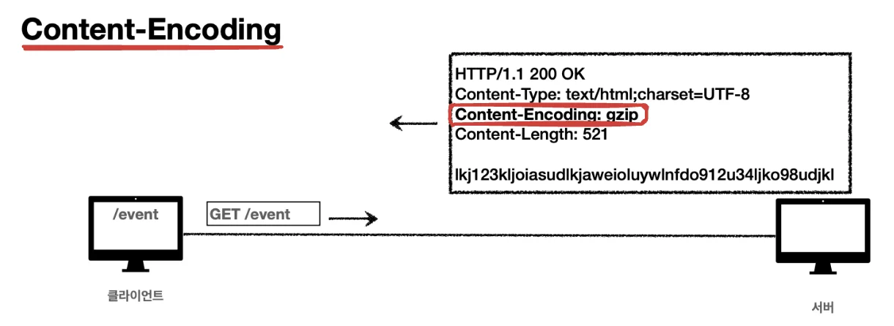

<a id="1c3eda9b0fe1816cad26cc320b1c3b4f"></a>

### 분할 전송

> ⚠️ Content&#45;Length가 존재하면 안됨<br>→ 분할된 바이트 정보를 보냄

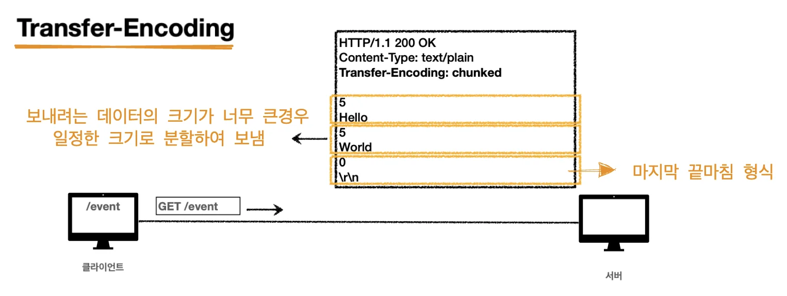

<a id="1c3eda9b0fe181d0a238d5114a077cc4"></a>

### 범위 전송

> 👉🏻 데이터를 받다가 끊기는 경우, 중간부터 다시 범위 지정하여 요청하는 방법

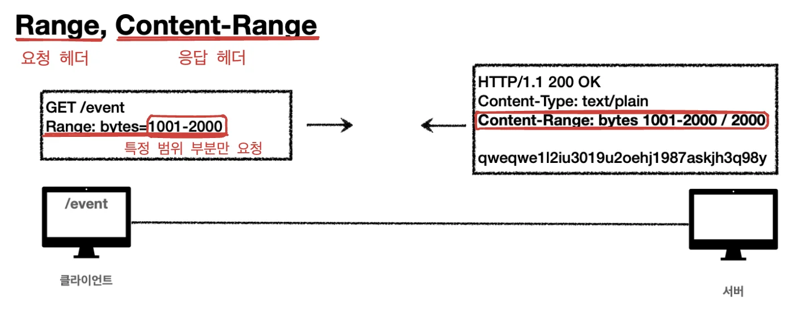

<a id="1c3eda9b0fe181e0acabfe444556cd62"></a>

# 일반 정보

> 📌 <strong>일반 정보<br>From&#58; 유저 에이전트의 이메일 정보<br>Referer&#58; 이전 웹 페이지 주소<br>User&#45;Agent&#58; 유저 에이전트 애플리케이션 정보<br>Server&#58; 요청을 처리하는 오리진 서버의 소프트웨어 정보<br>Date&#58; 메세지가 생성된 날짜</strong>

<a id="1c3eda9b0fe18172baaece55f967d88f"></a>

### From  &#45; <strong>유저 에이전트의 이메일 정보</strong>

> 👉🏻 일반적으로 잘 사용되지 않으며 요청에서 사용함<br>→ 검색 엔진 같은 곳에 서 주로 사용

<a id="1c3eda9b0fe181438952d45b1be58347"></a>

### Referer &#45; <strong>이전 웹 페이지 주소</strong>

<a id="1c3eda9b0fe18143884ae27fe2e106aa"></a>

타고 들어온 링크 (이전 웹페이지 주소)

>  A → B &#58; B 요청 시, 요청 헤더에 <code>Referer&#58; A</code> 가 포함됨

<a id="1c3eda9b0fe181eda357fb2297af2227"></a>

요청세서 사용되며, Referer를 통해 유입 경로를 분석 가능함

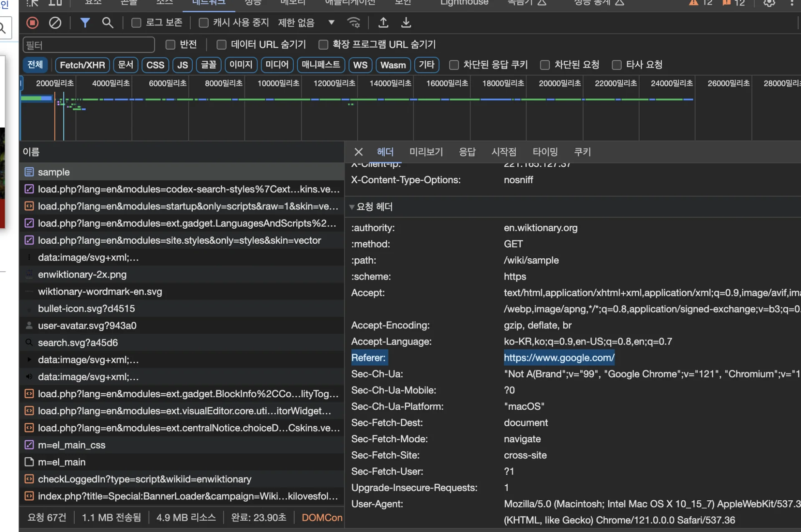

> ☝🏻 
> 
> <a id="1c3eda9b0fe1815eab13ef6dffdcc7e4"></a>
> 
> referer는 단어 referrer의 오타라고 함

<a id="1c3eda9b0fe18147a051f93cdc2025e0"></a>

### User&#45;Agent  &#45; 유저 에이전트 애플리케이션 정보 

>  Client Application = User Agent

<a id="1c3eda9b0fe18140a45cc03b46c71f00"></a>

클라이언트의 애플리케이션 정보 ( 웹 브라우저 정보 ) 요청 헤더 &#45; User Agent 안에 담아 서버에 넘김

<a id="1c3eda9b0fe18158b9e2f77ca654da01"></a>

특정 브라우저에서 버그가 발생되었을때, 로그들 파싱 및 비교를 통해  문제가 발생되는 로그(브라우저) 찾는데 사용한다&#46; 

<a id="1c3eda9b0fe181e98216cb26fe725f80"></a>

또 사용자들이 어떤 브라우저에서 많이 들어오는지 <strong>통계 정</strong>보를 구할 때도 사용된다&#46;

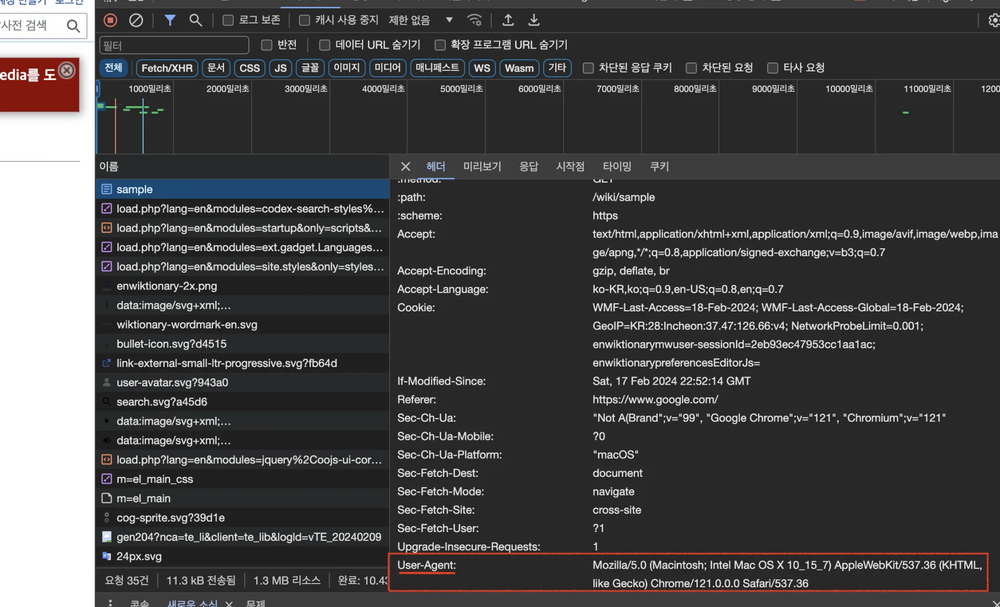

<a id="1c3eda9b0fe181238e04d1e1f8ce7724"></a>

### Server &#45; 요청을 처리하는 ORIGIN 서버의 소프트웨어 정보

<details>
<summary>🧐 ORIGIN 서버란?</summary>

<a id="1c3eda9b0fe181b393c1eb298946748a"></a>

HTTP 요청을 보내면, 중간 여러 프록시 서버를 거치게 된다&#46; 

<a id="1c3eda9b0fe181f68aa3c0e132872581"></a>

여러 프록시 서버를 거쳐 요청이 도착하는 마지막 , 응답을 보내주는 서버를 Origin 서버라고 한다&#46;

</details>

<a id="1c3eda9b0fe1813ca1e3c862e9f48f5c"></a>

ORIGIN 서버의 소프트웨어 정보

<a id="1c3eda9b0fe18187bd2fc503e8a2cd49"></a>

응답에서 사용 (응답 헤더에 포함됨)

<a id="1c3eda9b0fe181b48605d64af2a11223"></a>

ex) <br>Server&#58; Apache/2&#46;2&#46;22(Debian)<br>server&#58; nginx

<a id="1c3eda9b0fe181d2be18e4b140d4dbdb"></a>

### Date &#45; 메시지가 발생한 날짜와 시간

<a id="1c3eda9b0fe181208969dcc438601a64"></a>

응답에 사용 ( 과거에는 요청에도 사용되었으나 없어짐 )<br>ex) Date&#58; Tue, 15 Nov 1994 08&#58; 12&#58;31 GMT <br><br>

<a id="1c3eda9b0fe181568ecffc3583f8381b"></a>

# 특별한 정보

> 📌 <strong>특별한 정보가 담기는 HTTP 헤더들</strong>
> 
> <a id="1c3eda9b0fe1812aadb1f46cd7a263c5"></a>
> 
> Host&#58; 요청한 호스트 정보(도메인)<br>Location&#58; 페이지 리다이렉션<br>Allow&#58; 허용 가능한 HTTP 메서드<br>Retry&#45;After&#58; 유저 에이전트가 다음 요청을 하기까지 기다려야 하는 시간

<a id="1c3eda9b0fe1812eb5bfd7e335c96feb"></a>

### Host (필수 값) &#45; 요청한 호스트 정보 (도메인)

> 🫵🏻 중요&#33;

<a id="1c3eda9b0fe18158890feeef3f5dda54"></a>

필수 헤더가 거의 없는데, 그 거의 없는 헤더 중 하나 → 필수값

<a id="1c3eda9b0fe181ea9016dff7ba4d2381"></a>

하나의 IP 주소에 여러 도메인이 적용되어 있을 때(가상 호스트)가 있는데, 그때 구분 요소로 사용된다&#46; 

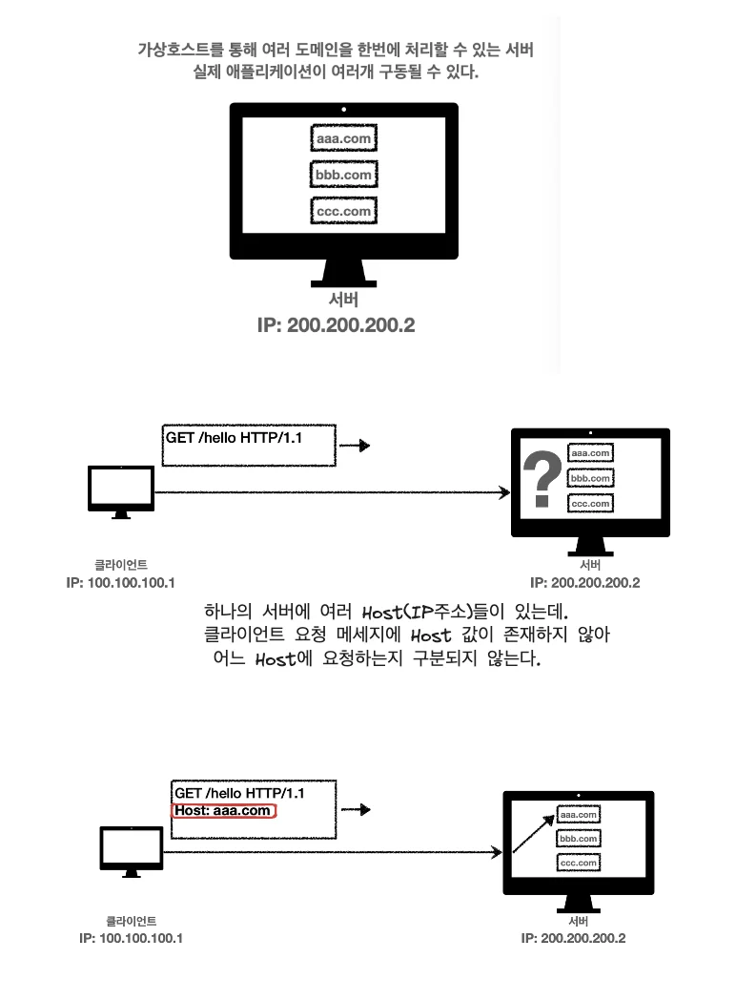

<a id="1c3eda9b0fe181fbb880c8a81cb96083"></a>

### Location &#45; 페이지 리다이렉션

> 👉🏻 웹 브라우저는 3xx 응답의 결과에 Location 헤더가 있으면, Location 위치로 자동 이동(리다이렉트)
> 
> > <a href="#/post/1c3eda9b-0fe1-810c-b142-f1639de54e14">페이지</a> &#45; 3xx
> 
> <a id="1c3eda9b0fe181e09e80f0fb867e6b75"></a>
> 
> Location 값은 요청에 의해 생성된 리소스 URI 이다&#46; ( 201 Created ) <br><br>3xx (Redirection)&#58; Location 값은 요청을 자동으로 리디렉션하기 위한 대상 리소스를 가리킨다&#46;

<a id="1c3eda9b0fe181a49ce6c05a34f2ed49"></a>

### Allow 

> 👉🏻 거의 구현되어 있지 않음, 그냥 참조 정도만 

<a id="1c3eda9b0fe181dcb6badaf394cb3237"></a>

POST 지원 X 시, 405(Method Not Allowed) 에서 응답에 포함해야함&#46;

> Allow&#58; GET, HEAD, PUT

<a id="1c3eda9b0fe18103a927d6a6ad203939"></a>

### Retry&#45;After &#45; 유저 에이전트가 다음 요청을 하기까지 기다려야 하는 시간

<a id="1c3eda9b0fe1810e9cb7d100cdd037ce"></a>

504 ( Service Unavailable) 서비스 이용 불가 시, 언제 까지 다시 가능한지를 알려주는 정보

> 실제로는 언제까지 해결되지는 알려주기가 쉽지 않음

1. 날짜 표기&#58;  Retry&#45;After&#58; Fri, 31 Dec 1999 23&#58;59&#58;59 GMT

1. 초단위 표기&#58; Retry&#45;After&#58; 120

<a id="1c3eda9b0fe1816ab38ecc83aad7191b"></a>

# 인증

<a id="1c3eda9b0fe181e0befcd67c487c6a7a"></a>

### Authorization &#45;  클라이언트 인증 정보를 서버에 전달함

> 인증 관련 여러 매커니즘 (OAuth 인증 … 등) 은 다루지 않음 → 따로 공부

<a id="1c3eda9b0fe181b6bc96f3ba2efd3d35"></a>

HTTP 에서 제공하는 Authorization 헤더는 그냥 헤더만 제공한다&#46;<br>해당하는 인증 메커니즘이 value 값으로 들어감

<a id="1c3eda9b0fe18116b285e24ea24eaced"></a>

ex) Authorization&#58; Basic xxxxxxxxx … 

<a id="1c3eda9b0fe181e286b7e6a30d5c40a9"></a>

### WWW&#45;Authenticate &#45;  리소스 접근 시 필요한 인증 방법 정의

<a id="1c3eda9b0fe1816ab8fdc36bdcfdcc42"></a>

리소스 접근 시 필요한 인증 방법 정의가 담겨 있는 헤더

<a id="1c3eda9b0fe18172b40ee356cee70b0c"></a>

리소스 접근 시, 인증이 제대로 안돼 문제가 발생되는 경우, <code>401 Unauthorized</code> 상태코드와 아래의  올바른 인증 형식이 담긴 응답을 서버에서 클라이언트에 반환 처리한다&#46;<br>

<a id="1c3eda9b0fe181f3b886c8e9cab8bb32"></a>

```java
WWW-Authenticate: Newauth realm="apps", type=1,
title="Login to \"apps\"", Basic realm="simple"

// reference) https://datatracker.ietf.org/doc/html/rfc7235
```

<a id="1c3eda9b0fe181cba900d469f1ac6332"></a>

# 쿠키

> ☝🏻 상당히 많이 사용, 중요&#33;&#33;

> 📌 <strong>Set&#45;Cookie</strong>&#58; <code>서버</code>에서 클라이언트로 쿠키 전달(응답)
> 
> <a id="1c3eda9b0fe18126a09ee99529eeff21"></a>
> 
> <strong>Cookie</strong>&#58; <code>클라이언트</code>가 서버에서 받는 쿠키를 저장하고, HTTP 요청 시 서버로 전달

<details>
<summary>쿠키 미사용 시,  로그인 및 welcome 페이지 접근</summary>

> ⚠️ <strong>HTTP&#58; Stateless (무상테)<br></strong>클라이언트와 서버가 요청을 주고 받으면 연결이 끊김<br>클라이언트에서 재요청 시, 무상태 설계이기 때문에 <strong><u>이전 요청을 기억하지 못</u></strong>한다&#46;

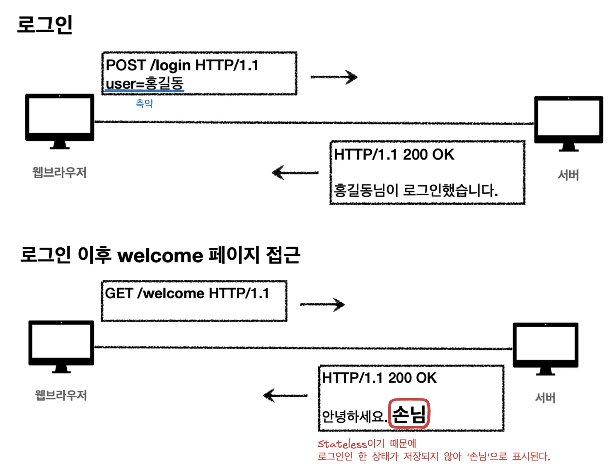

> HTTP는 무상태 프로토콜로서, 상태를 저장하지 않기 때문에<br>위와 같이 로그인을 해도 로그인된 회원 상태를 저장하지 않기 때문에 <br>회원 인식 오류가 발생한다&#46;

</details>

<details>
<summary> 모든 요청, 링크에 사용자 정보 포함?</summary>

<a id="1c3eda9b0fe18166999ad0c1d18cd18c"></a>

모든 요청에 사용자 정보가 포함되도록 개발해야 한다&#46; <br>굉장히 무겁고 비용이 큰, 비효율적인 처리이다&#46;<br>또한 보안상에 있어서도 문제가 크다&#46;

</details>

<a id="1c3eda9b0fe181f588b5f0fa6a628015"></a>

## 쿠키

> 👉🏻 HTTP의 Stateless 프로토콜의 한계점을 보안하기 위해 나온 개념 도입됐다&#46;

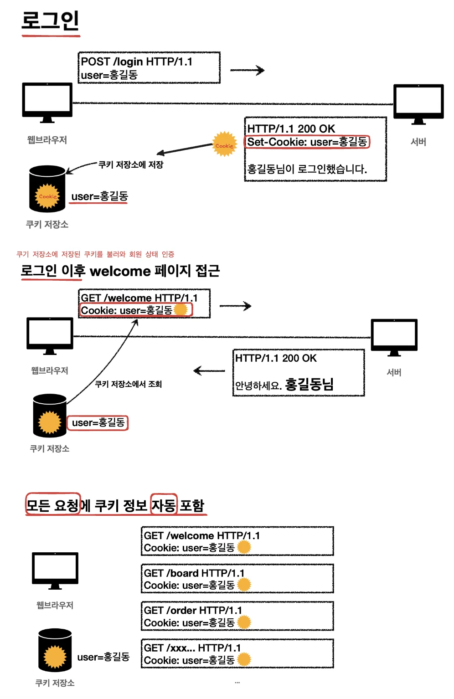

> ☝🏻 쿠기 정보는 항상 서버에 전송되기 때문에, 추가적으로 많은 네트워크 트래픽을 유발한다&#46; <br>따라서 최소한의 정보에만 사용해야한다&#46; ( 세션 id, 인증 토큰 등)
> 
> > ▶︎ <strong>사용<br></strong>사용자 로그인 세션 관리<br>광고 정보 트래킹

> 서버에 전송하지 않고, 웹 브라우저 내부에 데이터를 저장하여 사용하려면 웹 스토리지(localStorage, sessionStorage) 참고

> ⚠️ 보안에 민감한 데이터(주민번호, 신용카드 번호 등)는 저장하면 안된다&#46; 

<a id="1c3eda9b0fe1816fb4c8f7020a7e0b45"></a>

### Set&#45;Cookie

<a id="1c3eda9b0fe181c8a365daa4af2553c1"></a>

서버에서 클라이언트에 보내는 쿠키 값

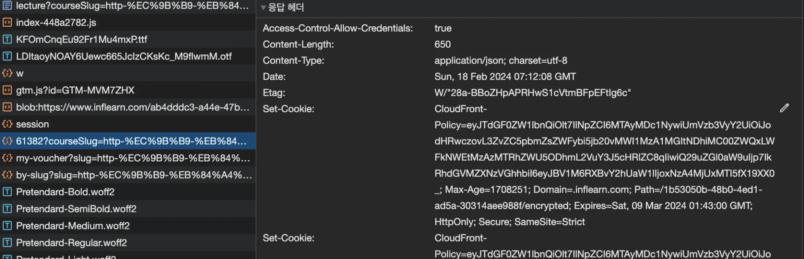

<a id="1c3eda9b0fe181bb9643cccf1eefb6a8"></a>

### Cookie

<a id="1c3eda9b0fe1818f98bbf867a141a681"></a>

서버에서 전달 받은 쿠기를 저장

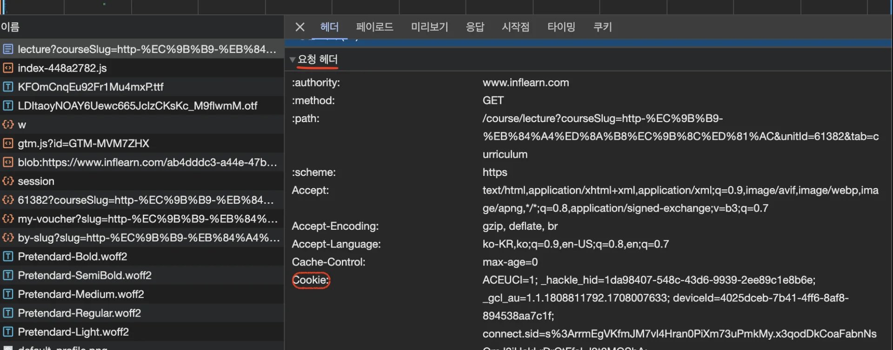

<a id="1c3eda9b0fe18108ae5adce082729946"></a>

### 쿠키  &#45; 생명주기 ( Expires, max&#45;age )

> 세션 쿠키&#58; <u>만료 날짜를 생략</u>하면 <strong><u>브라우저 종료 시 </u></strong>까지만 유지

> 영속 쿠키&#58; <u>만료 날짜를 입력</u>하면 <u>해당 날짜</u>까지 유지

- Set&#45;Cookie&#58; <strong>expires</strong>=Sat, 26&#45;Dec&#45;2020 04&#58;39&#58;21 GMT
    <a id="1c3eda9b0fe1819e8cf2dabe36cee0aa"></a>

      → <u>expires 헤더에 만료일 지정</u><strong>, </strong>만료일이 되면 쿠키 삭제

- Set&#45;Cookie&#58; <strong>max&#45;age</strong>=3600 (3600초)
    <a id="1c3eda9b0fe181828c31e70ce3f411a8"></a>

     → <u>max&#45;age 헤더에 0이나 음수를 지정</u>하면 쿠키 삭제

<a id="1c3eda9b0fe181adbf91ce45cbec722e"></a>

### 쿠키 &#45; 도메인 ( Domain ) 

> <strong>도메인 명시&#58; 명시한 문서 </strong><strong><u>기준 도메인</u></strong><strong> 및 </strong><strong><u>서브 도메인</u></strong><strong>에서 쿠키 접근 가능</strong>

<a id="1c3eda9b0fe1817ba432dcfb5f986109"></a>

ex) domain=example&#46;org에서 <strong>도메인 지정 </strong>및  쿠기 생성 

<a id="1c3eda9b0fe1811b9fdfc890f24b0fd2"></a>

    → 기존 도메인 (example&#46;org) 뿐만 아니라 <strong><u>서브 도메인 (dev&#46;example&#46;org)</u></strong><strong><u>도 </u></strong><strong><u>쿠키 접근 가능</u></strong>하다&#46;

> <strong>도메인 생략&#58; 현재 문서 기준 도메인만 적용</strong>

<a id="1c3eda9b0fe181c4a054f3043efd90bf"></a>

ex) example&#46;org 에서 쿠키를 생성하고 <strong><u>domain 지정을 생략</u></strong>

<a id="1c3eda9b0fe181bf86e1f565ef7640d5"></a>

 → 기존 도메인 ( example&#46;org )에서만 쿠키 접근 가능하다&#46; 

<a id="1c3eda9b0fe18110986cc5481b049155"></a>

 → <u>서브 도메인 (dev&#46;example&#46;org )</u><u> 는 </u><u>쿠키 접근 불가</u>하다&#46; 

<a id="1c3eda9b0fe181f2b60ff2706008b241"></a>

### 쿠키 &#45; 경로 ( Path )

> 👉🏻 <strong>상위 경로를 포함하는 하위 경로 페이지만 쿠키 접근 가능하다&#46;</strong>
> 
> <a id="1c3eda9b0fe181edb7eae3e22df9f7c0"></a>
> 
> <strong>일반적으로 path=/ 루트로 지정한다&#46;</strong>

<a id="1c3eda9b0fe1812aa502dd0a2a92438e"></a>

  예) <strong>path=/home</strong>

- /home &#45;&#62; 가능

- /home/level1 &#45;&#62; 가능

- /home/level1/level2 &#45;&#62; 가능

- /hello &#45;&#62; 불가능

<a id="1c3eda9b0fe1811f8ffbdc25d9302009"></a>

### 쿠키 &#45; 보안 ( Secure, HttpOnly, SameSite )

> 👉🏻 <strong>Secure<br></strong>기존 쿠기는 http, https를 구분하지 않고 전송하는데, <strong><u>Secure를 적용</u></strong>하면 <strong><u>https 인 경우에만 전송한</u></strong>다&#46;

- HttpOnly
    - XSS 공격 방지

    - 자바스크립트에서 접근 불가(document&#46;cookie)

    - HTTP 전송에만 사용

- SameSite
    - XSRF 공격 방지

    - 요청 도메인과 쿠기에 설정된 도메인이 같은 경우만 쿠키 전송
