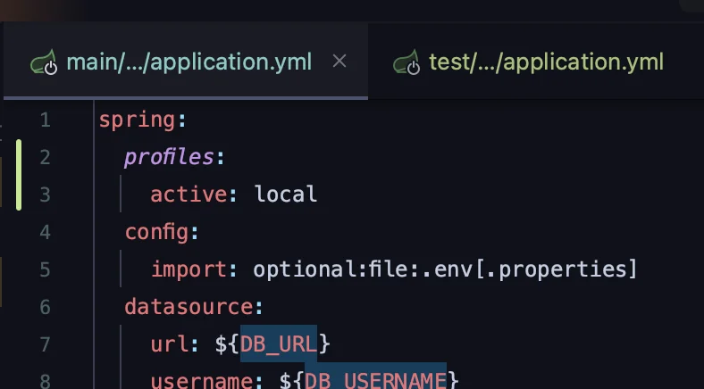
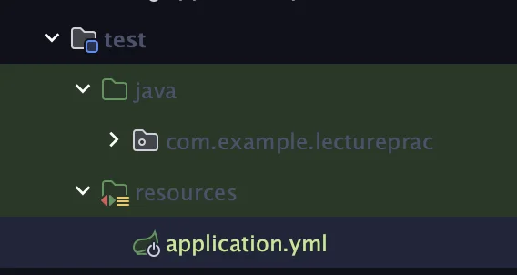
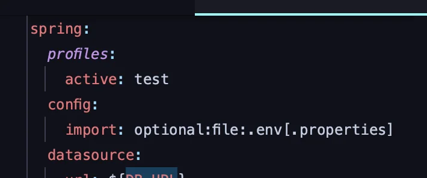
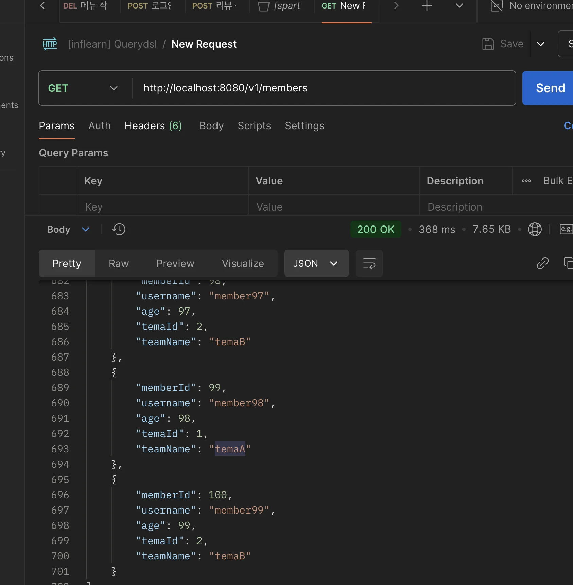
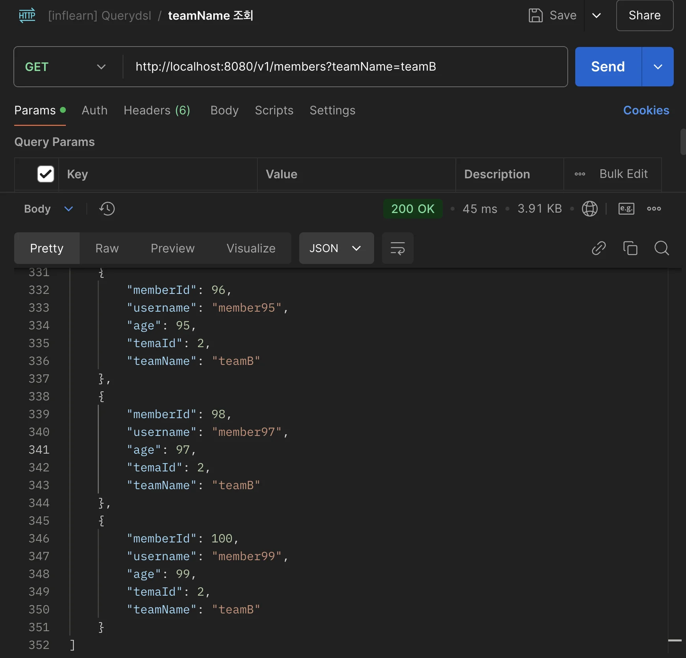
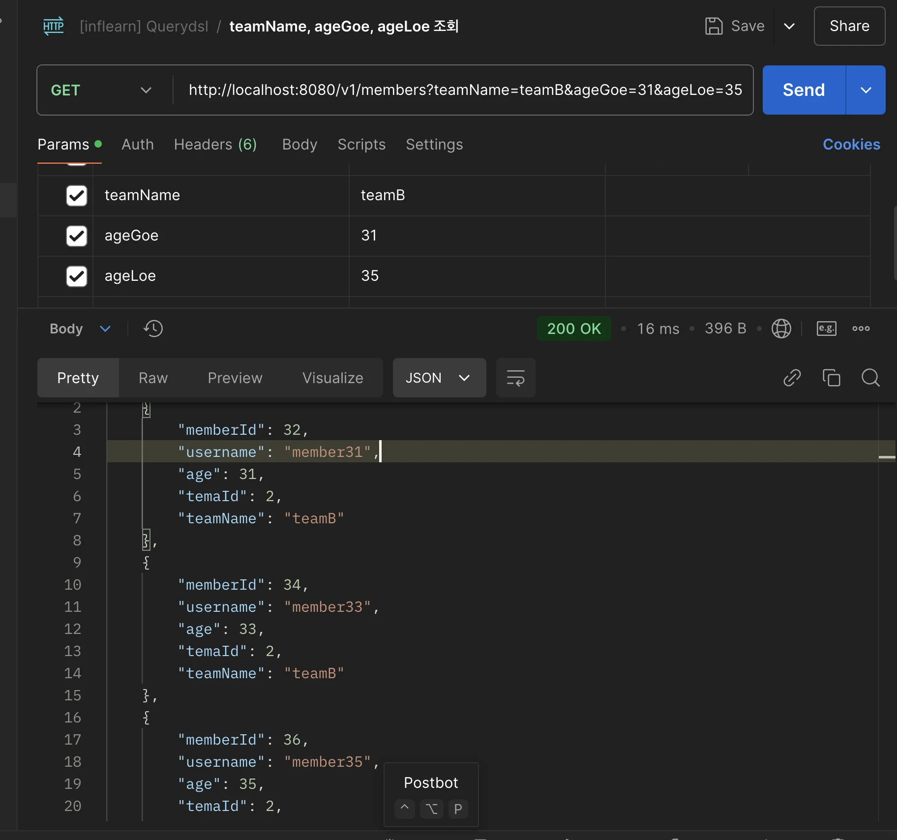
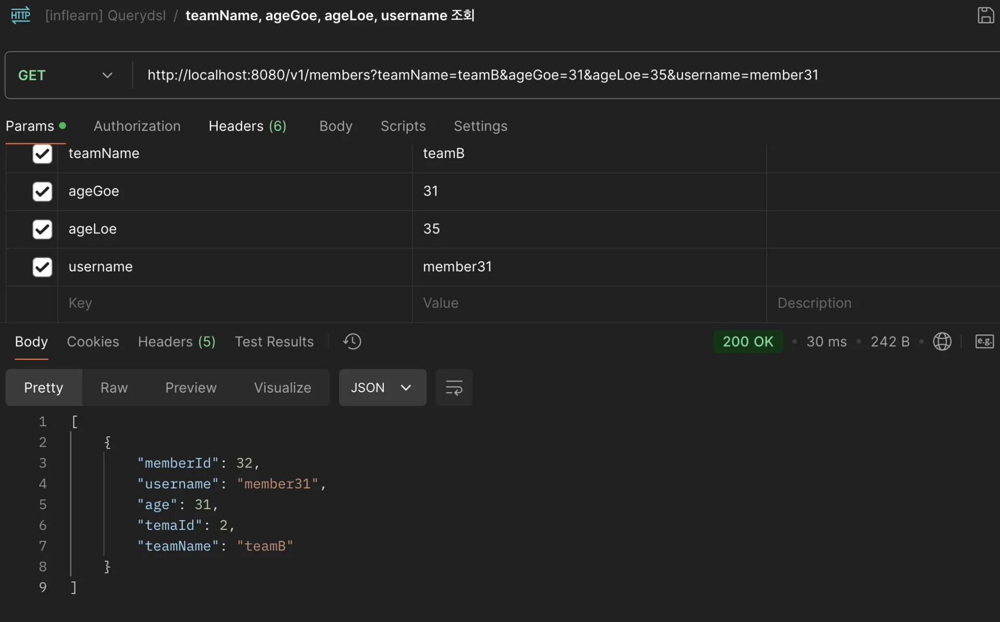

<a id="1c3eda9b0fe18180a5b4e82afc8a6536"></a>

## 조회 API 컨트롤러 개발

---

> 📖 
> 
> <a id="1c3eda9b0fe181c6a437da79ff9ed5fe"></a>
> 
> 이전 테스트코드에서의 확인에서 <u>API를 만</u>들고 실제 포스트맨을 통해 API 호출하여 반환 값을 확인한다&#46;

<details>
<summary>프로파일(<code>application&#46;yml</code>) 나누기</summary>

<details>
<summary>환경에 따라 프로파일 명시하는 팁</summary>

- 로컬&#58; <code>local</code>
    <a id="1c3eda9b0fe1816092e8dfeca12b11c2"></a>

    ```yaml
    Spring:
    	profiles:
    		active: local
    ```

- 로컬&#58; <code>dev</code> or <code>develop</code>
    <a id="1c3eda9b0fe1811f9b8be9b6b5a2e58c"></a>

    ```yaml
    Spring:
    	profiles:
    		active: dev
    ```

- 운영&#58; <code>real</code>
    <a id="1c3eda9b0fe181688830ebf2e0e74242"></a>

    ```yaml
    Spring:
    	profiles:
    		active: dev
    ```

</details>

<details>
<summary>1&#46; 기존 main의 yml 파일에 <code>profiles</code> 명시</summary>

<details>
<summary>spring&#46;profiles&#46;active&#58; <code>local</code></summary>

<a id="1c3eda9b0fe181568ef0d5a50936aa19"></a>

```yaml
spring:
  profiles:
    active: local
```

</details>



</details>

<details>
<summary>2&#46; test 시 사용할 yml 파일 생성 및 <code>profiles</code> 명시</summary>



1. test 폴더 내부에 resources 폴더를 생성

1. 기존 main에 있는 <code>application&#46;yml</code> 을 복사, 붙여넣기  

1. test 내부에 추가된 yml 파일에 profiles 명시 
    <details>
    <summary>spring&#46;profiles&#46;active&#58; <code>test</code></summary>

    <a id="1c3eda9b0fe181c0b007e26f67b3303f"></a>

    ```yaml
    spring:
      profiles:
        active: test
    ```

    </details>

    

</details>

</details>

<details>
<summary>로컬  샘플 데이터 설정</summary>

<details>
<summary>&#91; 코드  &#93;InitMember</summary>

- 스프링 라이프 사이클에 의해 &#64;PostConstructor와 &#64;Transactional을 같이 처리할 수 없다 &#46;
    - 따라서 아래와 같이 분리해서 처리

<a id="1c3eda9b0fe181988277c6bfb3ddf0a0"></a>

```java
package com.example.lectureprac.controller;

import com.example.lectureprac.entity.Member;
import com.example.lectureprac.entity.Team;
import jakarta.annotation.PostConstruct;
import jakarta.persistence.EntityManager;
import jakarta.persistence.PersistenceContext;
import lombok.RequiredArgsConstructor;
import org.springframework.context.annotation.Profile;
import org.springframework.stereotype.Component;
import org.springframework.transaction.annotation.Transactional;

@Profile("local")
@Component
@RequiredArgsConstructor
public class InitMember {

    private final InitMemberService initMemberService;

    @PostConstruct
    public void init() {
        initMemberService.init();
    }

    @Component
    static class InitMemberService() {

        @PersistenceContext
        EntityManager em;

        @Transactional
        public void init() {
            Team teamA = new Team("temaA");
            Team teamB = new Team("temaB");
            em.persist(teamA);
            em.persist(teamB);

            for (int i = 0; i < 100; i++) {
                Team selectedTeam = i % 2 == 0 ? teamA : teamB;
                em.persist(new Member("member" + i, i, selectedTeam));
            }
        }
    }
}

```

</details>

</details>

<details>
<summary>조회 API 개발</summary>

<details>
<summary>&#91; 코드 &#93; <code>controller</code>&#58; MemberController</summary>

<a id="1c3eda9b0fe1819c86cfd2449ac5dbc6"></a>

```java
package com.example.lectureprac.controller;


import com.example.lectureprac.dto.MemberSearchCondition;
import com.example.lectureprac.dto.MemberTeamDto;
import com.example.lectureprac.repository.MemberJpaRepository;
import lombok.RequiredArgsConstructor;
import org.springframework.web.bind.annotation.GetMapping;
import org.springframework.web.bind.annotation.RestController;

import java.util.List;

@RestController
@RequiredArgsConstructor
public class MemberController {

    private final MemberJpaRepository memberJpaRepository;

    @GetMapping("/v1/members")
    public List<MemberTeamDto> searchMemberV1(MemberSearchCondition condition){
        return memberJpaRepository.search(condition);
    }
}

```

</details>

<details>
<summary>테스트 &#45; 포스트맨 api 호출</summary>

<details>
<summary>기본 조회 &#45; 모든 데이터 다 조회함</summary>

- <code>url</code>&#58; http&#58;//localhost&#58;8080/v1/members



</details>

<details>
<summary><code>쿼리 파라미터</code>&#58; teamName</summary>

- <code>url</code>&#58; http&#58;//localhost&#58;8080/v1/members?teamName=teamB



</details>

<details>
<summary><code>쿼리 파라미터</code>&#58; teamName, ageGoe, ageLoe</summary>

- <code>url</code>&#58; http&#58;//localhost&#58;8080/v1/members?teamName=teamB&#38;ageGoe=31&#38;ageLoe=35



</details>

<details>
<summary><code>쿼리 파라미터</code>&#58; teamName, ageGoe, ageLoe, username</summary>

- <code>url</code>&#58; http&#58;//localhost&#58;8080/v1/members?teamName=teamB&#38;ageGoe=31&#38;ageLoe=35&#38;username=member31



<details>
<summary>쿼리 확인</summary>

<a id="1c3eda9b0fe181df995ee11c4caffd57"></a>

```sql
Hibernate: 
    /* select
        member1.id,
        member1.username,
        member1.age,
        team.id,
        team.name 
    from
        Member member1   
    left join
        member1.team as team 
    where
        member1.username = ?1 
        and team.name = ?2 
        and member1.age >= ?3 
        and member1.age <= ?4 */ select
            m1_0.id,
            m1_0.username,
            m1_0.age,
            m1_0.team_id,
            t1_0.name 
        from
            member m1_0 
        left join
            team t1_0 
                on t1_0.id=m1_0.team_id 
        where
            m1_0.username=? 
            and t1_0.name=? 
            and m1_0.age>=?
            and m1_0.age<=? 
```

</details>

</details>

</details>

</details>
