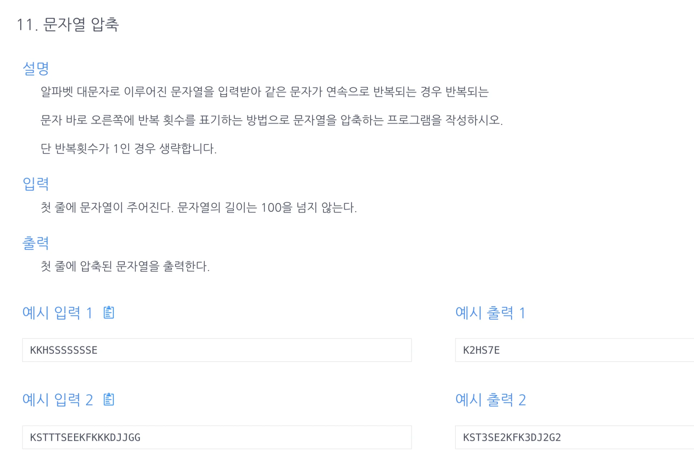

<a id="1c3eda9b0fe181d7afa1fa334437ab05"></a>

## 문제)



<a id="1c3eda9b0fe181d080a3cb77dc2b80ad"></a>

```java
KKHSSSSSSSE
```

<a id="1c3eda9b0fe181b8931ed3ffeecb6d58"></a>

## 풀이)

<a id="1c3eda9b0fe181cbbe25c613500db7c2"></a>

###  내 풀이1)

<a id="1c3eda9b0fe181e4ba7fd745e2a0c0c9"></a>

### 1) Runtime Error

<a id="1c3eda9b0fe181fbb4a6dd37f4919dd0"></a>

i의 마지막 인덱스에서  s&#91;i&#43;1&#93;는  i&#60;s&#46;length 범위를 초과하는 인덱스를 갖기 때문에 에러가 남&#46;

<a id="1c3eda9b0fe18140a045d3571b8a8989"></a>

```java
import java.util.Scanner;

public class Main {
    public String solution(char[] s){
        String answer = "";
        int cnt = 1;
        for(int i=0; i<s.length; i++) {
            if (s[i] == s[i+1]) {
                cnt++;
            } else if (cnt>1 && s[i] != s[i+1]) {
                answer += s[i];
                answer += cnt;
                cnt = 1;
            } else {
                answer += s[i];
            }
        }
        return answer;
    }
    public static void main(String[] args){
        Main m = new Main();
        Scanner sc=new Scanner(System.in);
        String str = sc.nextLine();
        System.out.print(m.solution(str.toCharArray()));
    }
}
```

<a id="1c3eda9b0fe1813e8aeadccbe05b2d9b"></a>

### 2 ) success

<a id="1c3eda9b0fe181d7aeb3e71361cd0372"></a>

String 데이터에 공백을 추가하여 범위 해결

<a id="1c3eda9b0fe1816a9e08ddc99f1f01f9"></a>

```java
import java.util.Scanner;

public class Main {
    public String solution(String x){
        String answer = "";
        x=x+" ";
        char[] s=x.toCharArray();
        int cnt = 1;
        for(int i=0; i<s.length-1; i++) {
            if (s[i] == s[i+1]) {
                cnt++;
            } else if (cnt>1 && s[i] != s[i+1]) {
                answer += s[i];
                answer += cnt;
                cnt = 1;
            } else {
                answer += s[i];
            }
        }
        return answer;
    }
    public static void main(String[] args){
        Main m = new Main();
        Scanner sc=new Scanner(System.in);
        String str = sc.nextLine();
        System.out.print(m.solution(str));
    }
}
```

<a id="1c3eda9b0fe181a89758c81a5ee33801"></a>

### 개선)

<a id="1c3eda9b0fe18180a161cd919d56d8ef"></a>

중복 로직 제거

<a id="1c3eda9b0fe18168a5bfc0ffcecdb9ca"></a>

```java
    } else if (cnt>1 && s[i] != s[i+1]) {
        answer += s[i];
        answer += cnt;
        cnt = 1;
    } else {
        answer += s[i];
    }
```

<a id="1c3eda9b0fe181379343cd2b398c9493"></a>

```java
else {
	answer += s[i];
	if(cnt>1){
		answer += cnt;
		cnt = 1;
	}
}
```

<a id="1c3eda9b0fe18119b2aad517c2cdd46f"></a>

### 풀이2) 공백 추가 후, 다음 인덱스 비교 ( i == i&#43;1) 

<a id="1c3eda9b0fe1811c9426f6ba99c3059c"></a>

```java
import java.util.Scanner;

public class Main {
    public String solution(String s){
        String answer = "";
        s=s+" ";
        int cnt = 1;
        for(int i=0; i<s.length()-1; i++) {
            if(s.charAt(i)==s.charAt(i+1)) cnt++;
            else{
                answer+=s.charAt(i);
                if(cnt>1) answer+= Integer.toString(cnt); // String.valueOf(cnt);
                cnt=1;
            }
        }
        return answer;
    }
    public static void main(String[] args){
        Main m = new Main();
        Scanner sc=new Scanner(System.in);
        String str = sc.nextLine();
        System.out.print(m.solution(str));
    }
}
```

<a id="1c3eda9b0fe181739ee8e87c9fdab6c5"></a>

3차 풀이)

<a id="1c3eda9b0fe18164a5fdd31d67c31439"></a>

```java
import java.util.Scanner;

public class Main {
    public String solution(String s) {
        String answer = "";
        int cnt = 1;
        for(int i=0; i<s.length()-1; i++) {
            if(cnt==1) answer+=s.charAt(i);
            if(s.charAt(i)==s.charAt(i+1)) cnt++;
            else {
                if(cnt != 1){
                    answer += cnt;
                    cnt = 1;
                }
            }
        }
        return answer;
    }
    public static void main(String[] args){
        Main m = new Main();
        Scanner sc = new Scanner(System.in);
        String s = sc.nextLine();
        s=s+" ";
        System.out.println(m.solution(s));
    }
};
```

<a id="1c3eda9b0fe18125a794cbb3149c6cae"></a>

### 풀이3) &#46;toCharArray()

<a id="1c3eda9b0fe18113906ff9cda5077bd7"></a>

```java
import java.util.Scanner;

public class Main {
    public String solution(String str){
        String answer = "";
        str = str+" ";   // str+=" ",  [ A += B ]는 A = A+ B의 축약형
        char[] sList = str.toCharArray();
        int cnt = 1, len=sList.length;

        for (int i=0; i<len-1; i++){
            if (sList[i]==sList[i+1]){
                cnt++;
            }  else{
                answer += sList[i];
                if (cnt >2){
                    answer+=Integer.toString(cnt);
                    cnt=1;
                }
            }
        }
        return answer;
    }
    public static void main(String[] args){
        Main m = new Main();
        Scanner sc=new Scanner(System.in);
        String str = sc.next();
        System.out.print(m.solution(str));
    }
}
```

<a id="1c3eda9b0fe18124995ae41a15aa3785"></a>

### 풀이4) ArrayList(), &#46;contains()

<a id="1c3eda9b0fe1810d81caf82058acad4e"></a>

문제의 조건에 ‘연속으로 반복’ 된다고 적혀있다&#46; 따라서 풀이 1,2(인덱스만 가지고 다음 value와 비교해서 cnt하는 것)가 더 적합하고 효율적인 이다&#46;

<a id="1c3eda9b0fe181e5a9bdcc09a2ce84a3"></a>

```java
import java.util.ArrayList;
import java.util.Scanner;

public class Main {
    public String solution(String s){
        s += " ";
        String answer = "";
        ArrayList<Character> includeCharList = new ArrayList<>();
        int cnt = 1;
        for (char x: s.toCharArray()){
            if (includeCharList.contains(x)) cnt++;
            else{
                if(cnt>1){
                    answer+=Integer.toString(cnt);
                    cnt=1;
                }
                answer+=x;
                includeCharList.add(x);
            }
        }
        return answer;
    }
    public static void main(String[] args) {
        Main m = new Main();
        Scanner sc = new Scanner(System.in);
        String str = sc.next();
        System.out.println(m.solution(str));
    }
}
```

<a id="1c3eda9b0fe181baa055cd601b681354"></a>

### 2차풀이) 

<a id="1c3eda9b0fe181a5a1dbd9234ac7688d"></a>

```java
import java.util.Scanner;

public class Main {
    public String solution(String s) {
        String answer = "";
        int cnt=1;
        for(int i=0; i<s.length()-1; i++) {
            if(s.charAt(i)==s.charAt(i+1)) {
                if(cnt==1) answer+= s.charAt(i);
                cnt++;
            }
            else {
                if(cnt>1) {
                 answer += cnt;
                 cnt=1;
                }
                else {  // if( cnt == 1 )
                    if(cnt==1) answer+= s.charAt(i);
                }
            }
        }
        return answer;
    }

    public static void main(String[] args) {
        Main m = new Main();
        Scanner sc = new Scanner(System.in);
        String s = sc.next();
        s=s+" ";
        System.out.print(m.solution(s));
    }
};
```

- 중복 코드 제거

> <code> if(cnt==1) answer&#43;= s&#46;charAt(i);</code>  

<a id="1c3eda9b0fe181e690accd4eac3df209"></a>

```java
import java.util.ArrayList;
import java.util.Scanner;

public class Main {
    public String solution(String s) {
        String answer = "";
        int cnt=1;
        for(int i=0; i<s.length()-1; i++) {
            if(cnt==1)answer+=s.charAt(i);
            if(s.charAt(i)==s.charAt(i+1)) cnt++;
            else {
                if(cnt>1) {
                    answer += cnt;
                    cnt = 1;
                }
            }
        }
        return answer;
    }

    public static void main(String[] args) {
        Main m = new Main();
        Scanner sc = new Scanner(System.in);
        String s = sc.next();
        s=s+" ";
        System.out.print(m.solution(s));
    }
};
```

- 풀이2 로 <code>최적화</code>

<a id="1c3eda9b0fe1810eb04bc21b3d75357e"></a>

문자와 횟수를 굳이 따로 더할 필요가 없었음… 

<a id="1c3eda9b0fe1812cbca2d9eb9e7da825"></a>

```java
import java.util.Scanner;

public class Main {
    public String solution(String s){
        String answer = "";
        int cnt = 1;
        for(int i=0; i<s.length()-1; i++) {
            if(s.charAt(i)==s.charAt(i+1)) cnt++;
            else{
                answer+=s.charAt(i);
                if(cnt>1) answer+= Integer.toString(cnt); // String.valueOf(cnt);
                cnt=1;
            }
        }
        return answer;
    }
    public static void main(String[] args){
        Main m = new Main();
        Scanner sc=new Scanner(System.in);
        String str = sc.nextLine();
				s=s+" ";
        System.out.print(m.solution(str));
    }
}
```
