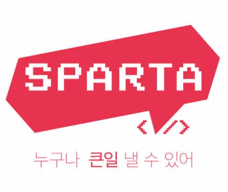

<strong>시작 전</strong>

[[ 기본 ] 자바 기초 문법](#/post/1c3eda9b-0fe1-81b3-b327-e79a892cbca9)

[[ 중급 1 ] 자바 기본 문법](#/post/1c3eda9b-0fe1-8198-afa7-e841487a4ddf)

[[ 고급 2편 ] I/O, 네트워크, 리플렉션 (정리 전)](#/post/1c3eda9b-0fe1-8124-b15a-c6b5d486472d)

[토비의 스프링 6](#/post/1c3eda9b-0fe1-81be-b971-d6b5dc75c03c)

[스프링 시큐리트 6.xx](#/post/1c3eda9b-0fe1-8106-98ca-d564a9e20194)

[스프링 데이터 JPA](#/post/1c3eda9b-0fe1-819d-8683-f2f55fe15fe9)

[스프링 부트, JPA 활용 2 - API 개발과 성능 최적화](#/post/1c3eda9b-0fe1-8168-90cf-e778d359e189)

[토비의 클린 스프링 - 도메인 모델 패턴과 헥사고날 아키텍처 Part 1](#/post/233eda9b-0fe1-80dc-8583-e8c967c2a3f2)

진행 중

[스프링 핵심 원리 - 고급편](#/post/1c3eda9b-0fe1-81a1-bc93-ff0b090a9a77)

[[ 고급 1편 ] 멀티스레드와 동시성](#/post/1c3eda9b-0fe1-817b-aba4-e002b0666e72)

[Part. 2 - OOP 와 JVM](#/post/1c6eda9b-0fe1-804e-8757-fcfb9f50a262)

<a href="https://beautiful-college-c84.notion.site/1deeda9b0fe180ae9b2ddb852ec7a2ab">페이지</a> 

[Spring Boot를 활용한 채팅 서비스 만들어보기](#/post/1c3eda9b-0fe1-812e-b8ac-c13c536efd00)

[Spring WebFlux + LLM 실전 구현](#/post/210eda9b-0fe1-8058-abd9-eceec7820379)

[오브젝트 - 기초편](#/post/282eda9b-0fe1-8072-8013-e363fae712e9)

> <strong> 김영한</strong>

> 자바 로드맵

[[ 중급 2 ] 제네릭, 기본 자료구조](#/post/1c3eda9b-0fe1-8100-9287-f0bfd6705276)

> <strong>스프링  로드맵</strong>

[스프링 입문 - 코드로 배우는 스프링 부트, 웹 MVC, DB 접근 기술](#/post/1c3eda9b-0fe1-8125-825d-ea3785de29e5)

[스프링 핵심 원리 - 기본편](#/post/1c3eda9b-0fe1-818e-9f6b-dc5ebf58a405)

[HTTP 웹 기본 지식](#/post/1c3eda9b-0fe1-81c8-b57f-fa069abfcbbf)

[스프링 MVC 1편 -백엔드 웹 개발 핵심 기술](#/post/1c3eda9b-0fe1-8199-9d02-eeae5b4b5588)

> <strong>스프링 부트,  JPA 실무  로드맵</strong>

[자바 ORM 표준 JPA 프로그래밍 - 기본](#/post/1c3eda9b-0fe1-8103-b16c-ff13884ad0ba)

[스프링 부트, JPA 활용 1 - 웹 애플리케이션 개발](#/post/1c3eda9b-0fe1-815b-82d2-f4632514eeb3)

[[ Inflearn ] Querydsl](#/post/1c3eda9b-0fe1-8156-b449-f8e742a95d76)

> 토비

> 널널한 개발자

> 조영호

[Template2 - page (2)](#/post/282eda9b-0fe1-80df-a7c9-c668fca91438)

> 동시성 제어

<a href="#/post/165eda9b-0fe1-8072-b168-fab7f9ef1bfa">페이지</a> 

> <strong>웹소캣</strong>

> <strong>리액티브 프로그래밍</strong>

> &#91; 스파르타 &#93; 강의 

[Java [ 문법, 자료구조 …] (중단)](#/post/1c3eda9b-0fe1-814c-8dc5-d29a6b4043e6)

[[sparta] Java 문법 종합반 (중단)](#/post/1c3eda9b-0fe1-818f-97a3-c9faaae63332)

[[sparta] Spring 강의 (중단)](#/post/1c3eda9b-0fe1-8116-aed4-eb44b8e8c618)

<a href="#/post/12eeda9b-0fe1-8050-a68b-f51dffb05df2">페이지</a> 

<a href="#/post/13ceda9b-0fe1-8067-9531-e4fdae3568a2">페이지</a> 

<a href="#/post/149eda9b-0fe1-8010-9b0f-dc35331888ed">페이지</a> 

<a href="#/post/158eda9b-0fe1-8083-a08b-e1249279d10f">페이지</a>
