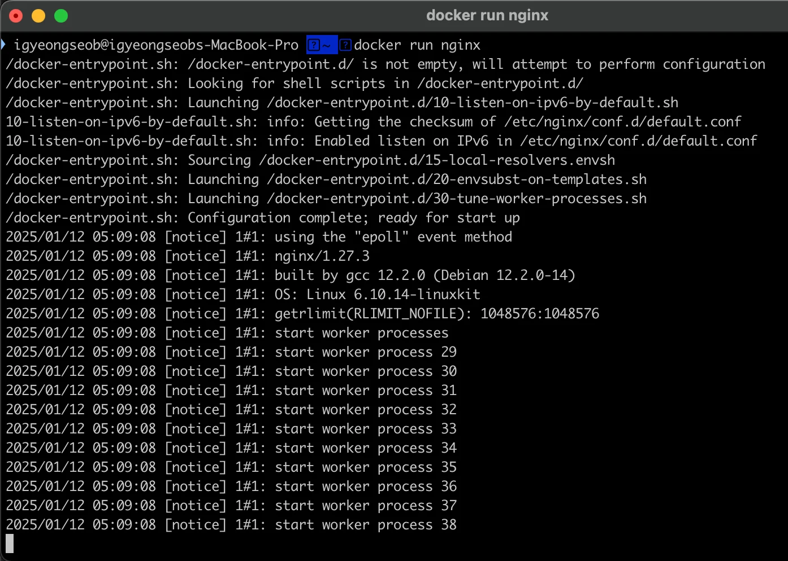
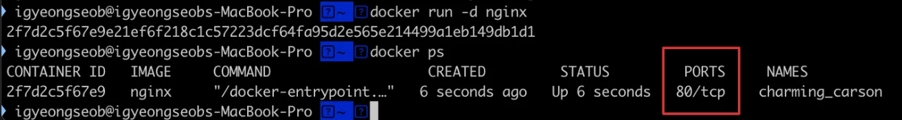
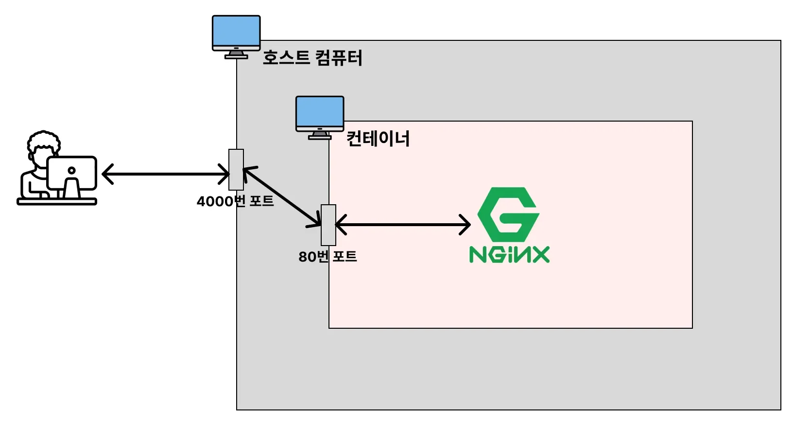

<a id="1c3eda9b0fe18149a19ff1a50ab9b14b"></a>

### 옵션 CLI

---

<details>
<summary>컨테이너 백그라운드에서 실행&#58; <code>&#45;d</code></summary>

<details>
<summary>🧐 <code>포그라운드(foreground)</code>, <code>백그라운드(background)</code></summary>

<details>
<summary>포그라운드(foreground)</summary>

> 내가 실행시킨 프로그램의 내용이 화면에서 실행되고 출력되는 상태 ( 기본값 )

- <code>장점</code>&#58; 실시간으로 어떻게 실행되고 어떤 로그들이 찍히는지 확인 가능 

- <code>단점</code>&#58; 다른 프로그램 조작 불가능
    

</details>

<details>
<summary>백그라운드(background)</summary>

> 내가 실행시킨 프로그램이 컴퓨터 내부적으로 샐행되는 상태

- <code>장점</code>&#58; 백그라운드로 프로그램을 실행시키기 때문에, 해당 터미널에서 추가적으로 다른 명령어를 입력할 수 있다&#46;

- <code>단점</code>&#58; 실시간으로 프로그램이 어떻게 실행되는지 확인하지 못한다&#46; 

</details>

</details>

<a id="1c3eda9b0fe181c5a3c9ca3311e229a9"></a>

```bash
# docker run 이미지명[:태그명]
$ docker run nginx # 포그라운드에서 실행 (추가적인 명령어 조작을 할 수가 없음)

# docker run -d 이미지명[:태그명]
$ docker run -d nginx  # 백그라운드 실행 
```

> ☝🏻 
> 
> <a id="1c3eda9b0fe181b9affbf74c58942336"></a>
> 
> 위치 중요&#33;, <code>run</code> 다음으로 명시해야 한다&#46; 
> 
> 

</details>

<details>
<summary>컨테이너에 <strong><u>이름을 붙</u></strong>여서 생성 및 실행하기&#58; <code>—name</code></summary>

<a id="1c3eda9b0fe1816d93fbe8ae572fed94"></a>

```docker
docker run -d  --name [컨테이너 이름] 이미지명[:태그명]
```

<details>
<summary>실습</summary>

<a id="1c3eda9b0fe181269db0f9de369c03a3"></a>

```bash
# docker run -d --name [컨테이너 이름] 이미지명[:태그명]
$ docker run -d --name my-web-server nginx

# Nginx 컨테이너 중단 후 삭제하기
$ docker ps # 실행 중인 컨테이너 조회
$ docker stop {nginx를 실행시킨 Contnainer ID} # 컨테이너 중단
$ docker rm {nginx를 실행시킨 Contnainer ID} # 컨테이너 삭제
$ docker image rm nginx # Nginx 이미지 삭제
```

</details>

</details>

<details>
<summary><strong><u>호스트의 포트</u></strong>와 <strong><u>컨테이너의 포트</u></strong> 연결하기&#58; <code>&#45;p &#91;호스트 포트&#93;&#58;&#91;컨테이너 포트&#93;</code></summary>

<details>
<summary>🤬 문제) 아래와 같이 컨테이너 실행 시, nginx의 기본 브라이저에 접속 불가</summary>

- nginx 컨테이너 실행

<a id="1c3eda9b0fe1819ba676edd4fc1d8d98"></a>

```docker
docker run -d nginx
```



<a id="1c3eda9b0fe18128a3fce05cf2435128"></a>

실행 중인 컨테이너가 80 포트에서 실행 중임을 확인할 수 있음 

<a id="1c3eda9b0fe18128b69ed2c94c973891"></a>

그러나 실제 <code>localhost&#58;80</code>을 접속 시, 아래와 같이 nginx의 기본 브라우저에 접속되지 않는다&#46; 


</details>

<a id="1c3eda9b0fe181a59fdbe4893b0ad688"></a>

컨테이너는 호스트 컴퓨터 내부에 <strong><u>독립적인 환경</u></strong>을 가진다&#46; 

<a id="1c3eda9b0fe1819e8d70eac7b6b3c682"></a>

즉, <strong><u>호스트 컴퓨터의 네트워크와 컨테이너 네트워크가 분리</u></strong> 되어 있기 때문에, <u>두 네트워크(포트)를 연결</u>해줘야한다&#46;



<a id="1c3eda9b0fe181949612e8f4aecb3b5c"></a>

```bash
# docker run -d -p [호스트 포트]:[컨테이너 포트] 이미지명[:태그명]
$ docker run -d -p 4000:80 nginx
```

-  도커를 실행하는 <strong><u>호스트 컴퓨터의 4000번 포트</u></strong>를 <strong><u>컨테이너의 80번 포트</u></strong>로 연결하도록 설정한다&#46;
    

</details>

<details>
<summary>컨터이너 실행 중 명령어 활성화&#58; <code>&#45;i</code> </summary>

- <strong>interactive 약자</strong>

- 컨테이너와 <strong><u>상호작용(interaction)</u></strong>할 수 있도록 <strong><u>표준 입력(stdin)</u></strong>을 활성화

- 해당 옵션이 없으면 컨테이너 실행 중 입력을 받을 수 없다&#46;

</details>

<details>
<summary>컨테이너 가상 터미널 활성화&#58; <code>&#45;t</code></summary>

- 컨테이너에서 <strong><u>가상 터미널(TTY)</u></strong> 활성화

-  터미널에서 작업하는 것처럼 <strong><u>컨테이너 안에서 작업</u></strong>할 수 있다&#46;

</details>

<details>
<summary>응용) <code>&#45;it</code></summary>

- 쉘 인터페이스를 제공하여 컨테이너 안에서 명령을 실행하고 결과를 확인할 수 있다&#46;
    - 컨테이너 안에서 직접 작업하거나 디버깅할 때 사용

<details>
<summary>ex) </summary>

<a id="1c3eda9b0fe181c3b3f5c42c4a984e76"></a>

```bash
docker run -it ubuntu /bin/bash
```

- ubuntu 컨테이너를 실행하고 <strong>터미널 세션을 활성화</strong>한 뒤 /bin/bash 쉘을 실행한다&#46;

</details>

</details>

<details>
<summary>컨테이너 종료 후 컨테이너 자동 제거&#58; <code>&#45;&#45;rm</code></summary>

- 컨테이너가 종료되면 해당 컨테이너를 <strong>자동으로 삭제한다&#46;</strong>
    - 컨테이너의 <strong>데이터</strong>와 <strong>컨테이너 정보</strong>가 남지 않음

    - 디스크를 청소하거나 테스트 환경에서 유용함

    - 임시 테스트나 디스크 사용량 관리가 중요할 때 사용

<details>
<summary>ex)</summary>

<a id="1c3eda9b0fe181f89151c4a1756e36a2"></a>

```bash
# ubuntu 컨테이너에서 echo 명령을 실행하고, 명령이 완료되면 컨테이너를 삭제한다.
docker run --rm ubuntu echo "Hello, Docker!"
```

</details>

</details>
