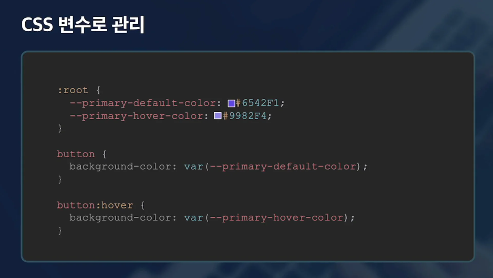
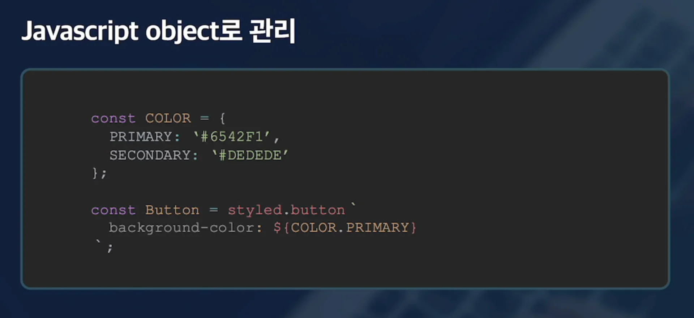

CSS 변수

- <code>&#58;root</code>
    - <code>—변수명</code>

    - 불러오기&#58; <code>var(—변수명)</code>

JS 변수

- 겍체로 선언

- 불러오기&#58; <code>&#36;{객체명&#46;변수명}</code>

둘 중 어느 것을 사용해도 상관없음

타입을 통해 동적으로 스타일 관리가 필요 → JS 사용
