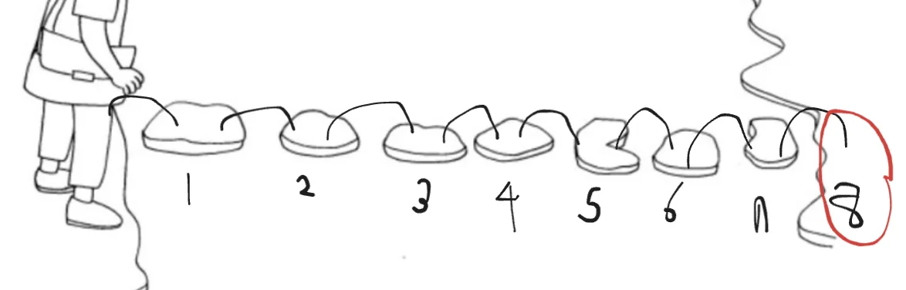

<a id="1c3eda9b0fe1819981d2f2c10f035149"></a>

# 문제

<a id="1c3eda9b0fe181fc8df9d8c4c86f807d"></a>

## <strong>2&#46; 돌다리 건너기</strong>

<a id="1c3eda9b0fe181439d68d3c60031c819"></a>

### 설명

<a id="1c3eda9b0fe181feb98df663ca74ab7a"></a>

철수는 학교에 가는데 개울을 만났습니다&#46; 개울은 N개의 돌로 다리를 만들어 놓았습니다&#46;

<a id="1c3eda9b0fe18159ac74d01d501efd24"></a>

철수는 돌 다리를 건널 때 한 번에 한 칸 또는 두 칸씩 건너뛰면서 돌다리를 건널 수 있습니다&#46;

<a id="1c3eda9b0fe181ab9e16dd22fc0f7b1c"></a>

철수가 개울을 건너는 방법은 몇 가지일까요?


<a id="1c3eda9b0fe18169a26eda908eb8a8b9"></a>

### 입력

<a id="1c3eda9b0fe181c4b6e9e616e794ab91"></a>

첫째 줄은 돌의 개수인 자연수 N(3≤N≤35)이 주어집니다&#46;

<a id="1c3eda9b0fe1810fb7efd11cb1fa56f2"></a>

### 출력

<a id="1c3eda9b0fe1811eb22bf4337b627b7f"></a>

첫 번째 줄에 개울을 건너는 방법의 수를 출력합니다&#46;

---

<a id="1c3eda9b0fe181e9952bda26e583f1aa"></a>

### 예시 입력 1

<a id="1c3eda9b0fe18127845ef84f44e8626a"></a>

```plaintext
7
```

<a id="1c3eda9b0fe1813e9fcec64b98b8f911"></a>

### 예시 출력 1

<a id="1c3eda9b0fe181bb83a5d31b6c63113a"></a>

```plaintext
34
```

<a id="1c3eda9b0fe181fc8e28e53c5979ab95"></a>

# 풀이

<a id="1c3eda9b0fe18146a278f1f24cb8a1d0"></a>

## 풀이1) <code>피보나치 수열</code>



<a id="1c3eda9b0fe1811f8796c33787942e4c"></a>

```java
import java.util.*;

public class Main {
    static int[] dy;
    public int solution(int n){
        dy[1]=1;
        dy[2]=2;
        for(int i=3; i<=n; i++){
            dy[i]=dy[i-1] + dy[i-2];
        }
        return dy[n];
    }

    public static void main(String[] args) {
        Main T = new Main();
        Scanner sc = new Scanner(System.in);
        int  n= sc.nextInt();
        dy = new int[n+2];
        System.out.println(T.solution(n+1));
    }
}
```
