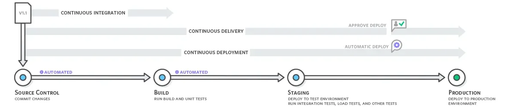
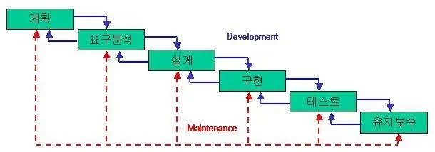
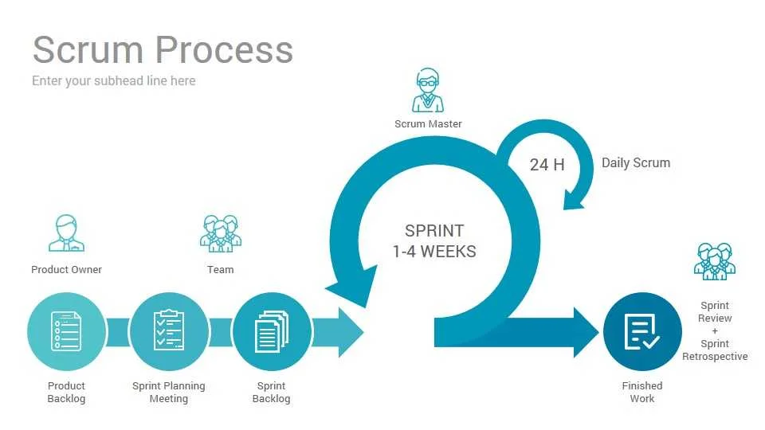
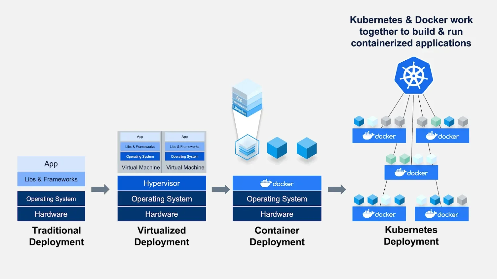

## CI/CD 

---

> 📖 
> 
> - <code>CI</code>&#58; <code>Continuous Integration</code>의 약자로 <strong><u>지속적인 통합</u></strong>을 의미한다&#46; 
> 
> - <code>CD</code>&#58;  <code>Continuous Deployment(Delivery)</code>의 약자로 <strong><u>지속적인 제공</u></strong>을 의미한다&#46; 

<strong>CI/CD</strong>

> ✏️ 
> 
> 
> 
> 기본 개념
> 
> - <strong>지속적인 통합 ( Continuous Integration )</strong>
> 
> - <strong>지속적인 베포 ( Continuous Deployment )</strong>
> 
> - <strong>지속적인 서비스 제공 ( Continuous Delivery )</strong>

<strong>지속적인 통합 ( CI, Continuous Integration )</strong>

코드의 지속적인 통합을 말한다&#46;

<strong><u>자동화된 빌</u></strong>드와 <strong><u>자동화된 테스트</u></strong>를 제공하며 <strong><u>안정적인 코드를 빠르게 제공</u></strong>할 수 있게 한다&#46; 

<strong>지속적인  베포 ( CD, Continuous Deployment )</strong>

<u>베포를 </u><strong><u>자동화</u></strong>하여 <strong><u>베포 시간을 단축</u></strong>하고 <strong><u>코드 결과물을 빠르게 지속적으로 제공</u></strong>한다&#46; 

단계 

1. 코드 작성
    

    소스 코드 작성 → 저장소(repository) 업로드

1. 빌드
    > <code>빌드</code>&#58; 소스코드 컴파일, 라이브러리 추가, 필요 파일 생성하는 과정

    

    저장소에서 최신 소스 코드를 가져와 빌드를 수행

1. 테스트
    

    빌드된 결과물 대상으로 테스트 수행

    

    이로 인해 수정된 버전의 빌드에서 버그를 빠르게  확인 및 수정 가능함

1. 베포
    

    테스트를 통과한 결과물을 베포 

과거의 베포

‘왜 CI/CD가 나오게 되었는가?’ 를 이해하기 위해서는 과거의 베포 과정을 살펴봐야 한다&#46;

과거 베포 시의 과정은 아래와 같다&#46; 

> 소프트웨어 개발주기 ( SDLC, Software Development Life Cycle ) 중 폭포수 개발 방식

과거 CI/CD가 적용되기 전에는 오랜 시간 동안 구현 및 테스트를 하고,  가끔 베포가 되었다&#46; 

과거 베포를 하기 위한 과정

1. 클러스터에서 서버 1을 분리

1. 서버 1에서 톰캣 종료

1. 기존 앱 버전(WAR 파일) 제거

1. 새 앱 버전(WAR 파일) 복사
    - ssh 접속 or scp 복사

1. 구성 파일의 속성 업데이트

1. 톰캣 시작

1. 클러스터에 서버 1을 다시 연결

위와 같은 과정이 서버가 많아질수록 상당 부분 반복해야 됐다&#46;

또한 출시 직후 진행된 프로덕션 테스트에서 이전 테스트 시 발견되지 못한 버그가 있는 경우, 

앱 버전을 되돌리거나(롤백) 빠르게 수정하고 테스트하여 다시 추가 베포를 진행해야 했다&#46; 

이때 또한, 다시 베포 과정을 반복하며, 서버가 많을 수록 더 많이 반복되어야 했다&#46; 

따라서 이러한 베포까지의 과정에서 너무 큰 비용이 소모되고 계속 동일한 과정들이 반복되었기 때문에, 이를 효율적으로 개선하기 위해서 CI/CD 기술이 나오게 되었다&#46; 

현대 개발(베포) 과정

🧐 애자일 개발 방식

reference 

‣

‣

애자일 개발 방식은 <strong><u>반복적이고 유연한 프로젝트 관리 및 소프트웨어 개발 방법론</u></strong>으로, 변화에 신속히 적응하고 고객과의 협업을 중시하는 접근법이다&#46;

이는 2001년 발표된 애자일 선언(Agile Manifesto)을 기반으로 하며, <strong><u>전</u></strong><strong><u>통적인 폭포수 모델의 한계를 극복</u></strong>하기 위해 고안되었다&#46; 

### 주요 특징

- 반복적 개발 
    - 프로젝트를 짧은 주기의 <strong>스프린트(보통 2&#126;4주)</strong>로 나누어 점진적으로 진행한다&#46; 각  스프린트 후에는 작동 가능한 소프트웨어를 제공하며, 이를 통해 지속적인 피드백을 반영한다&#46;

- 유연성 
    - 계획보다는 변화에 대응하는 것을 중시하며, 요구사항이 변경될 경우 이를 적극 수용한다&#46; 이는 불확실성이 높은 프로젝트에 특히 효과적이다&#46; 

- 고객 및 팀 협업
    - 고객과 개발팀 간의 긴밀한 협력을 통해 요구사항을 명확히 하고, 팀원 간 자율성을 강조한다&#46;

    - 정기적인 회의(예&#58; 스크럼)를 통해 진행 상황을 점검하고 조정한다&#46;

- 경량화된 문서화
    - 상세한 문서 작성보다는 실제 작동하는 소프트웨어와 코딩에 집중한다&#46;

### 방식(프레임워크)

- 스크럼(Scrum)
    - 고객의 요구사항을 충족시키는 데 초점을 맞추기 위해, 목표를 짧은 주기로 점진적이며 경험적으로 시스템을 지속해서 개발(전달)하는 관리 프레임워크(기법)이다&#46;

    - 일정 기간 동안 특정 목표를 달성하는 스프린트를 중심으로 작업하며, 매일 짧은 회의를 통해 진행 상황을 점검한다&#46;

- 칸반(Kanban)
    - 작업 흐름을 시작적으로 표현하여 팀의 작업 상태를 명확하고, 지속적으로 개선한다&#46; 

- 익스트림 프로그래밍(XP)
    - 테스트 중심 개발(TDD)과 같은 기술적 관행을 활용해 품질 높은 소프트웨어를 신속히 제공한다&#46; 

### 장단점

- 장점
    - 프로젝트 계획에 걸리는 시간을 최소화 가능

    - 점진적으로 테스트할 수 있어서 버그를 쉽고 빠르게 발견할 수 있음

    - 계획 혹은 기능에 대한 수정과 변경에 유연

    - 고객 요구사항에 대한 즉각적인 피드백에 유연하며 프로토타입 모델을 빠르게 출시할 수 있음
        - 변화에 빠르게 대응 가능

        - 고객 만족도 향상

- 단점
    - 확정되지 않은 계획 및 요구사항으로 인한 반복적인 유지보수 작업이 많음

    - 고객의 요구사항 및 계획이 크게 변경될 경우 모델이 무너질 수 있음

    - 개인이 아닌 팀이 중심이 되다 보니 공통으로 해야 할 작업들이 많을 수 있음 ( 회의, 로그 등)

    - 반복적인 업무로 속도는 빠를 수 있으나 미흡한 기능들에 대한 대처가 필요

    - 확정되지 않은 계획으로 개발 진행 시 이해하지 못하고 진행하는 부분이 많을 수 있음

> 애자일 개발 방식은 오늘날 소프트웨어 산업뿐 아니라 다양한 프로젝트 관리 분야에서도 널리 활용되고 있다&#46; 

> 대표되는 애자일 개발 방식 &#45; 스크럼

- 특정 주기마다 개발, 테스트 및 프로덕션에 통합된 기능을 출시 

<strong><u>Docker</u></strong>를 통해 <strong><u>서버를 표준화</u></strong>하고 <strong><u>같은 환경에서 테스트 및 배포 테스트를 진행</u></strong>하고 이 과정을 <u>자동화</u>한다&#46;  이로 인해<u> 테스트로 검증된 자동화 베포를 사용하</u>여 <strong><u>실패 확률을 저하</u></strong> 시킨다&#46; 

- 자동화된 과정으로 지속적으로 코드를 통합하여 지속적으로 자동 배포
    

- 컨테이너와 빌드/테스트 도구의 발전에 따라 Docker가 테스트 뿐만 아니라 <strong><u>실제 배포도 담당</u></strong>
    

따라서 왜 도커를 써야되는지에 대해 그 이유를 정리하자면 아래와 같다&#46; 

1. 앱의 <strong><u>개발과 베포를 자동화</u></strong>시켜 그 과정에 <u>비용 및 실패 가능성을 낮</u>춘다&#46; 
    - 사람이 수동으로 처리 시, 규모가 커질수록 실수 즉, 오류 발생 가능성이 높아진다&#46; 

    - 자동화를 통해 베포까지의 반복되고 번거로운 과정을 자동화하여 빠르게 처리 가능하다&#46; 즉, 해당 프로세스의 비용 낮춘다&#46;

1. Docker Container를 통해 <strong><u>독립적인 특정 환경</u></strong>을 설정할 수 있다&#46; 
    - Docker Container 내부에서 여러 소프트웨어를 설치해도 호스트 OS에는 영향이 없다&#46;

    - 어떤 서버에 올리더라도 같은 환경으로 구성된 컨테이너로 동작하기 때문에 표준화된 배포를 구성할 수 있다&#46;

    - 이로 인해, 여러 앱의 독립성과 확장성이 높아진다&#46;
