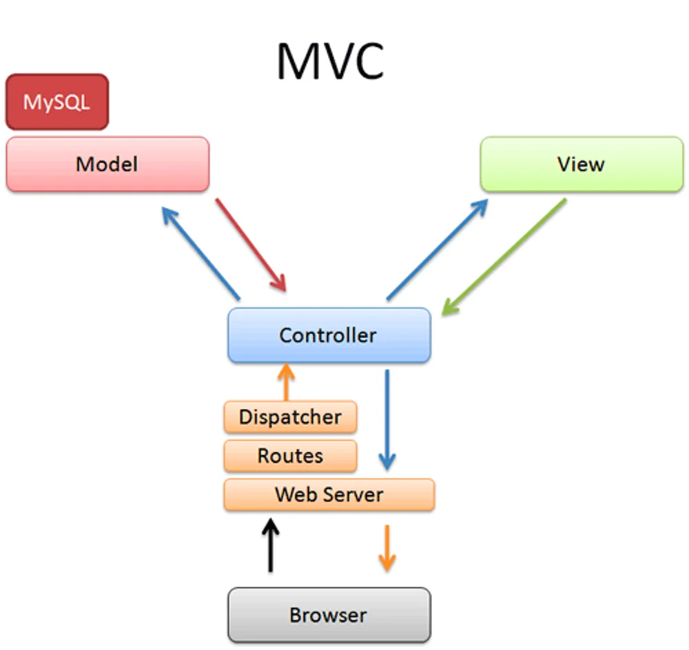

## MVC 디자인 패턴

<a href="#/post/1c3eda9b-0fe1-8138-a969-d611d55902cd">페이지</a> 

> 📌 <strong>M</strong>odel <strong>V</strong>iew <strong>C</strong>ontroller 약자로, 소프트웨어 디자인 패턴 중 하나로 소프트웨어를 <strong>구성하는 요소들을</strong> <strong><code>Model</code></strong><strong>, </strong><strong><code>View</code></strong><strong>, </strong><strong><code>Controller</code></strong><strong>로 구분</strong>하여 각각의 <strong><u>역할을 분리</u></strong>한다&#46;
> 
> 

- <strong><code>컨트롤러</code></strong>&#58; <strong><u>HTTP 요청을 받</u></strong>아서 <strong><u>파라미터를 검증</u></strong>하고, <strong><u>비즈니스 로직을 실행 </u></strong>및 <strong><u>뷰에 전달할 결과 데이터를 조회해서 모델에 담</u></strong>는다&#46; 

- <strong><code>모델</code></strong>&#58; <strong><u>뷰에 출력할 데이터를 담</u></strong>아둔다&#46; 뷰가 필요한 데이터를 모두 모델에 담아서 전달해주는 덕분에 뷰는 비즈니스 로직이나 데이터 접근을 몰라도 되고, 화면을 렌더링 하는 일에 집중할 수 있다&#46;

- <strong><code>뷰</code></strong>&#58; <strong><u>모델에 담겨있는 데이터를 사용해서 화면을 그리</u></strong>는 일에 집중한다&#46; 여기서는 <strong>HTML을 생성</strong>하는 부분을 말한다
    

    
