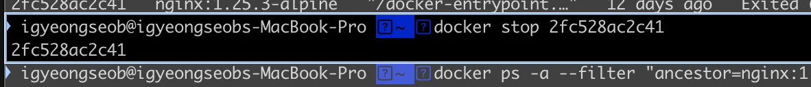

> ❗ 
> 
> <a id="28aeda9b0fe180b5865ef9cf4826726b"></a>
> 
> reference가 너무 오래 되어 해당 정리는 중단함

> 📌 
> 
> <a id="1c3eda9b0fe1818a8249f63af4a8761b"></a>
> 
> &#91;sparta&#93; Docker &#43; CI/CD 강의 정리  ( <strong>중단 </strong><strong>)</strong>
> 
> - <code>기간</code>&#58;  <code>24&#46;12&#46;25(수)</code>, <code>25&#46;1&#46;1(수)</code>, <code>25&#46;1&#46;9(목)</code>, <code>25&#46;1&#46;19(일)</code>  
> 
> - <code>강의</code>&#58; ‣

<details>
<summary>reference</summary>

<a id="1c3eda9b0fe181b9b78ffa9ba6c7012d"></a>

<a href="https://beautiful-college-c84.notion.site/fa7aca3d41b54468aab6720813aa6a48">페이지</a> 

</details>

<details>
<summary>template</summary>

<a id="1c3eda9b0fe18107ac88dc2dca84fcda"></a>

## Template

---

> 📖 

</details>

<details>
<summary>repository</summary>

- github actionS CI 실습
    <a id="1c3eda9b0fe181f3840fe21ec950e55a"></a>

    ‣

</details>

> ✏️ 
> 
> <a id="1c3eda9b0fe181499ccff554ec288703"></a>
> 
> 학습 목표
> 
> - CI/CD 이해
> 
> - Github Actions, cloudtype을 활용하여 CI/CD 파이프라인 구성 가능
> 
> - AWS 클라우드 내 CI/CD 파이프라인 구성 가능
> 
> - Docker Compose를 활용한 여러 앱 구성 가능
> 
> - Docker의 다양한 기능 이해

[CI/CD와 Docker의 이해](#/post/1c3eda9b-0fe1-81af-9b97-e4a2965bc8d7)

[도커 기본 세팅](#/post/1c3eda9b-0fe1-8128-843f-f5488ab2e169)

[Docker Image](#/post/1c3eda9b-0fe1-818a-b165-f8f228ea631a)

[Docker Container](#/post/1c3eda9b-0fe1-81c6-bbd1-ebfe14e2e698)

[Github actions 활용한 CI/CD 파이프라인](#/post/1c3eda9b-0fe1-8146-b5f8-df11e28f0735)

[Github Actions CI](#/post/1c3eda9b-0fe1-81cb-ad00-fbc1234f43e2)

[Github Actions CI/CD 실습](#/post/1c3eda9b-0fe1-8152-81ac-e1bd9a924a8b)

[Dockerfile](#/post/1c3eda9b-0fe1-81c0-8b41-ee9def003a0e)

[Docker Compose, 실습](#/post/1c3eda9b-0fe1-811d-bb3e-dec7600b321f)

[Docker 모니터링, 로깅, 실습](#/post/1c3eda9b-0fe1-81f9-8946-f9eb87c7b368)

[AWS 연동](#/post/1c3eda9b-0fe1-8178-a180-c6394c385a17)

[Docker Volume](#/post/1c3eda9b-0fe1-815f-9991-e6443258e539)

[Docker Network](#/post/1c3eda9b-0fe1-81d7-9cd0-ea973026c389)

[Docker Image 고급](#/post/1c3eda9b-0fe1-8197-8286-d9b1fb1bd52e)

[Container 가상화](#/post/1c3eda9b-0fe1-81e1-bc49-fa8eb84f5d2e)

[github token 발급](#/post/1c3eda9b-0fe1-8186-a036-d6c5af416fe1)

[github 환경변수설정](#/post/1c3eda9b-0fe1-8114-a6b3-c20271564094)

<a id="1c3eda9b0fe1815cabc7c0dbc9d58c46"></a>

##  CLI

---

<a id="1c3eda9b0fe1816e9e7bd42a3f25b16d"></a>

### 이미지

- 이미지 다운&#58; <code>docker pull &#91; 이미지 &#93;</code>

- 이미지 내부(JSON) 출력&#58; <code>docker image inspect &#91; 이미지 &#93;</code>

- 특정 Docker Image 내부 변수 출력&#58; <code>docker image inspect &#45;&#45;format=&#34;{{&#46;변수명}} &#91; 이미지 &#93;</code>

-  Dockerfile 구조 확인&#58; <code>docker image history &#91; 이미지 &#93;</code>
    <details>
    <summary>이미지 강제 삭제 &#45; <code>&#45;f</code></summary>

    - 의존성이 확인되지 않을 경우,  강제 삭제 사용
        - 신중하게 사용

    <a id="1c3eda9b0fe1816aa93ddd564684e4b6"></a>

    ```docker
    docker rmi -f <이미지명>
    ```

    <details>
    <summary>ex) </summary>

    <a id="1c3eda9b0fe181dbb4afdcee786c01a7"></a>

    ```docker
    docker rmi -f nginx:1.25.3-alpine
    ```

    </details>

    </details>

<a id="1c3eda9b0fe181aca434f0e9aa8f5e86"></a>

### 컨테이너

<details>
<summary>Docker 컨테이너 내부에서 특징 이미지(프로그램) 실행 &#45; <code>docker exec</code></summary>

- Docker 컨테이너 내부에서 명령어를 실행하는 Docker CLI 명령어

- 컨테이너가 이미 실행 중이어야 작동
    <a id="1c3eda9b0fe181ae8b2cf0dcd2d85f31"></a>

    ```docker
    docker exec [OPTIONS] [ CONTAINER ID ] [ COMMAND ] [ARG...]
    ```

    <details>
    <summary><strong><code>OPTIONS</code></strong>&#58; 추가 설정 옵션&#46; (&#45;it를 주로 사용)</summary>

    - <code>&#45;i</code>&#58; <strong>Interactive</strong>&#46; 표준 입력(STDIN)을 활성화하여 명령 실행 중 사용자 입력을 받을 수 있도록 함&#46;

    - <code>&#45;t</code>&#58; <strong>Pseudo&#45;TTY</strong>&#46; 터미널 세션을 활성화하여 명령 실행 결과를 보기 쉽게 출력&#46;

    - <code>&#45;it</code>&#58;터미널 세션과 유사한 환경을 제공하여 명령어 입력과 출력을 상호작용적으로 처리 가능

    </details>

    - <strong><code>CONTAINER</code></strong>&#58; 명령을 실행할 컨테이너 이름이나 ID

    - <strong><code>COMMAND</code></strong>&#58; 컨테이너 내부에서 실행할 명령어

</details>

<details>
<summary>이미지를 사용하는 컨테이너 확인 &#45; <code>docker ps …</code></summary>

<a id="1c3eda9b0fe181f0bb47f4a831691215"></a>

```docker
docker ps -a --filter "ancestor=[이미지 명]"
```

<details>
<summary>ex) </summary>

<a id="1c3eda9b0fe181d29769dd2b74005411"></a>

```docker
docker ps -a --filter "ancestor=nginx:1.25.3-alpine”
```

- 결과 확인
    <a id="1c3eda9b0fe1813c9364e1304b45fcb7"></a>

    ```docker
    igyeongseob@igyeongseobs-MacBook-Pro  ~  docker ps -a --filter "ancestor=nginx:1.25.3-alpine"
    CONTAINER ID   IMAGE                 COMMAND                   CREATED       STATUS                     PORTS                  NAMES
    2fc528ac2c41   nginx:1.25.3-alpine   "/docker-entrypoint.…"   12 days ago   Exited (255) 4 hours ago   0.0.0.0:8001->80/tcp   webserver01
    ```

</details>

</details>

<details>
<summary>컨테이너 중지 &#45; <code>docker stop</code></summary>

<a id="1c3eda9b0fe18191ade6e24f3535423e"></a>

```docker
docker stop <컨테이너 ID>
```

<details>
<summary>ex) 컨테이너 ID = abcd123</summary>

<a id="1c3eda9b0fe181e1bb3fe2e69bfdb512"></a>

```docker
docker stop abcd1234
```

- 실행 결과
    

</details>

</details>

<details>
<summary>컨테이너, 이미지  삭제<strong> &#45; </strong><code>docker rm, rmi</code></summary>

<a id="1c3eda9b0fe181dd812bdc8f1d60d2c1"></a>

```docker
## 컨테이너 삭제
docker rm <컨테이너 ID or 컨테이너명> 

## 이미지 삭제
docker rmi <이미지명>
```

<details>
<summary>ex) </summary>

- 컨테이너, 이미지 조회 &#45; 컨테이너 &#91; ID, 이름 &#93; , 이미지 확인
    <a id="1c3eda9b0fe1811e8b5fc21fa1fb28e9"></a>

    ```docker
    # 이미지 조회
    docker ps -a --filter "ancestor=nginx:1.25.3-alpine"

    # 결과 
    CONTAINER ID   IMAGE                 COMMAND                   CREATED       STATUS                     PORTS                  NAMES
    2fc528ac2c41   nginx:1.25.3-alpine   "/docker-entrypoint.…"   12 days ago   Exited (255) 4 hours ago   0.0.0.0:8001->80/tcp   webserver01
    ```

- 컨테이너 삭제 &#45; <code>docker rm</code>
    <a id="1c3eda9b0fe181418ce6c0ade407e5df"></a>

    ```docker
    # 컨테이너 ID or 이름으로 식별
    docker rm 2fc528ac2c41 ( or webserver01 ) 
    ```

- 이미지 삭제 &#45; <code>docker rmi</code>
    <a id="1c3eda9b0fe18149a184fa45e1d3751e"></a>

    ```docker
    docker rmi nginx:1.25.3-alpine
    ```

</details>

</details>

<details>
<summary>중지된 모든 컨테이너 삭제</summary>

- 한 번에 중지된 모든 컨테이너를 삭제

<a id="1c3eda9b0fe181a49387cec809c198a8"></a>

```docker
docker container prune
```

</details>

<details>
<summary>중지된 컨테이너 확인 및 실행 &#45; <code>ps … “status=exited”</code>, <code>docker start</code></summary>

- 중지된 컨테이너 확인
    <a id="1c3eda9b0fe181f4bd13c7aca3c6417d"></a>

    ```docker
    docker ps -a --filter "status=exited"
    ```

- 중지된 컨테이너 실행 &#45; <code>docker start</code>
    <a id="1c3eda9b0fe18108a189d68befed10c2"></a>

    ```docker
    docker start <컨테이너 이름 또는 ID>
    ```

</details>

<details>
<summary>포어그라운드 실행 시 ( &#45;d 옵션 생략 시)</summary>

- 종료&#58; <code>ctrl</code> &#43; <code>c</code>

</details>

<details>
<summary>Redis 실행</summary>

- <code>docker exec &#45;it redis redis&#45;cli </code>
    <details>
    <summary><strong>🧐 redis</strong></summary>

    - Redis 컨테이너의 이름

    - docker run &#45;&#45;name redis 명령어에서 지정한 이름

    - 해당 컨테이너 안에서 명령어를 실행하겠다는 의미

    </details>

    <details>
    <summary><strong>🧐  redis&#45;cli</strong></summary>

    - Redis의 CLI (Command Line Interface) 유틸리티

    - Redis 서버와 상호작용하기 위해 사용

    - 주로 다음과 같은 작업을 수행 가능
        - 데이터 추가&#58; SET key value

        - 데이터 조회&#58; GET key

        - 데이터 삭제&#58; DEL key

        - 기타 Redis 명령 실행

    </details>

    1. Docker CLI가 redis라는 이름의 실행 중인 컨테이너를 찾는다&#46;

    1. 컨테이너 내부에서 redis&#45;cli 명령어를 실행

    1. redis&#45;cli는 Redis 서버와 상호작용할 수 있는 CLI 환경 제공

    ---

    - 구체적인 실행 흐름
        1. 명령어 실행 
            <a id="1c3eda9b0fe1816c8368cd072bcd1149"></a>

            ```docker
            docker exec -it redis redis-cli
            ```

        1. Redis CLI 접속
            <a id="1c3eda9b0fe1814199a4c2aa9c115438"></a>

            ```docker
            127.0.0.1:6379>
            ```

        1. Redis 명령 실행
            <a id="1c3eda9b0fe181b888b2d79e0840d4d4"></a>

            ```docker
            127.0.0.1:6379> SET mykey "hello"
            OK
            127.0.0.1:6379> GET mykey
            "hello"
            ```

    - <strong>컨테이너 이름 확인</strong>
        - 컨테이너 이름이 다를 경우 docker ps로 컨테이너 이름을 확인

        <a id="1c3eda9b0fe18127b18dea9c82b06071"></a>

        ```docker
        docker ps
        ```

    - <strong>CLI 나가기</strong>
        -  Redis CLI를 종료, exit 명령어를 입력

        <a id="1c3eda9b0fe1816d9189d4560f49dafd"></a>

        ```docker
        127.0.0.1:6379> exit
        ```

</details>

<details>
<summary>Redis CLI에 접속</summary>

<a id="1c3eda9b0fe1811a8581ddece3ff2cb7"></a>

```docker
docker exec -it myredis redis-cli
```

</details>

<details>
<summary>컨테이너의 Bash 쉘에 접속</summary>

<a id="1c3eda9b0fe181dfa1c6e03a3a12f70c"></a>

```docker
docker exec -it myredis bash
```

</details>
