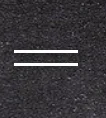
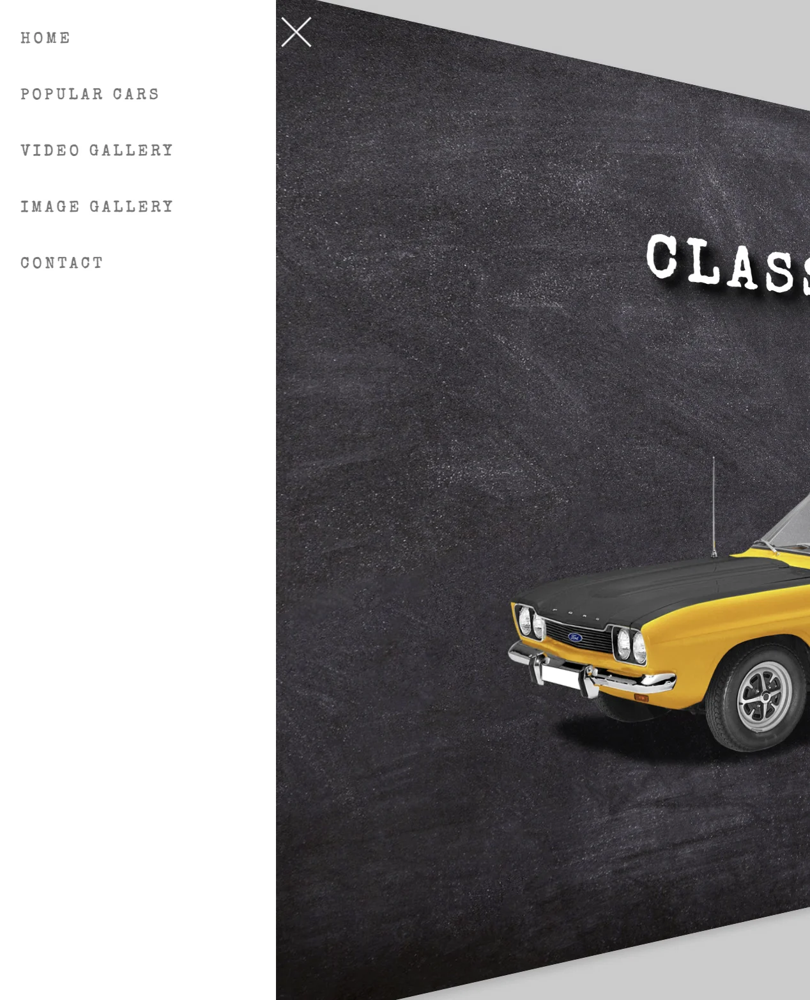
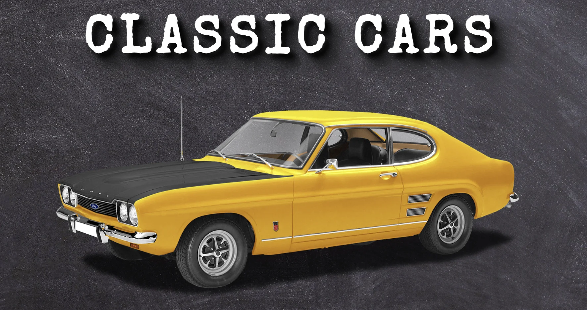
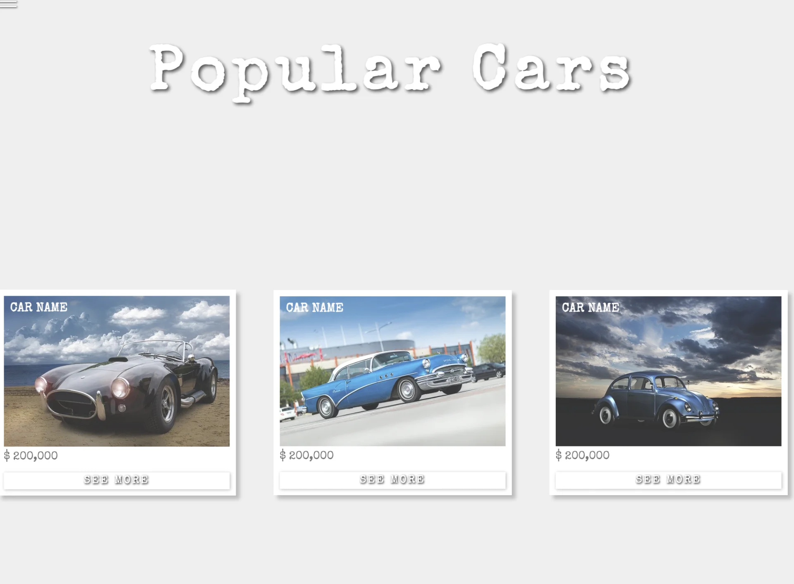
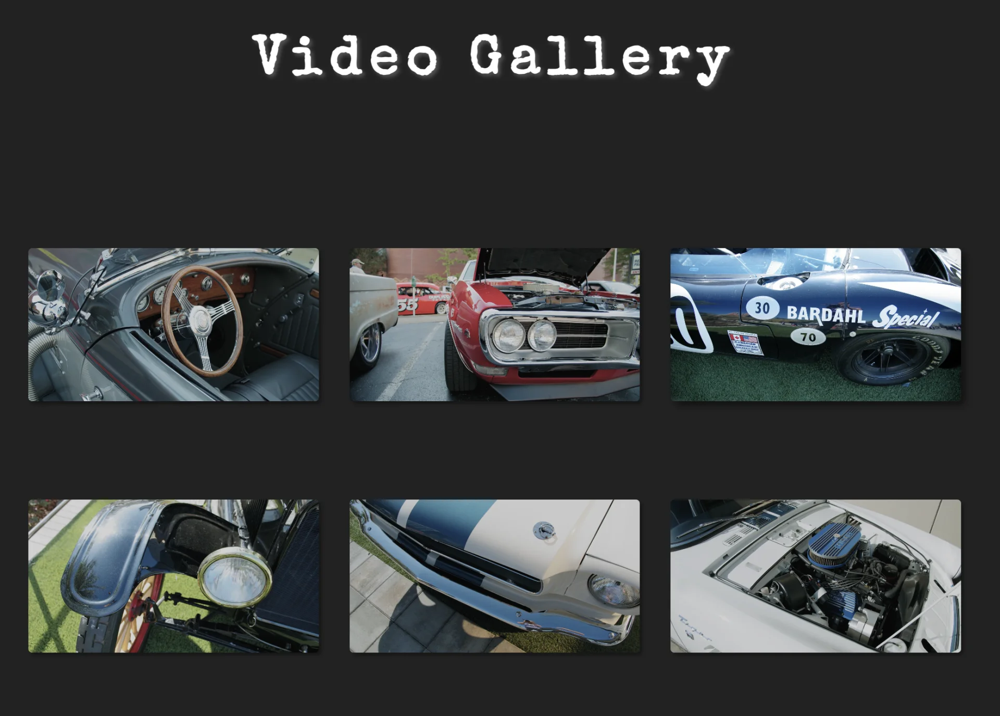
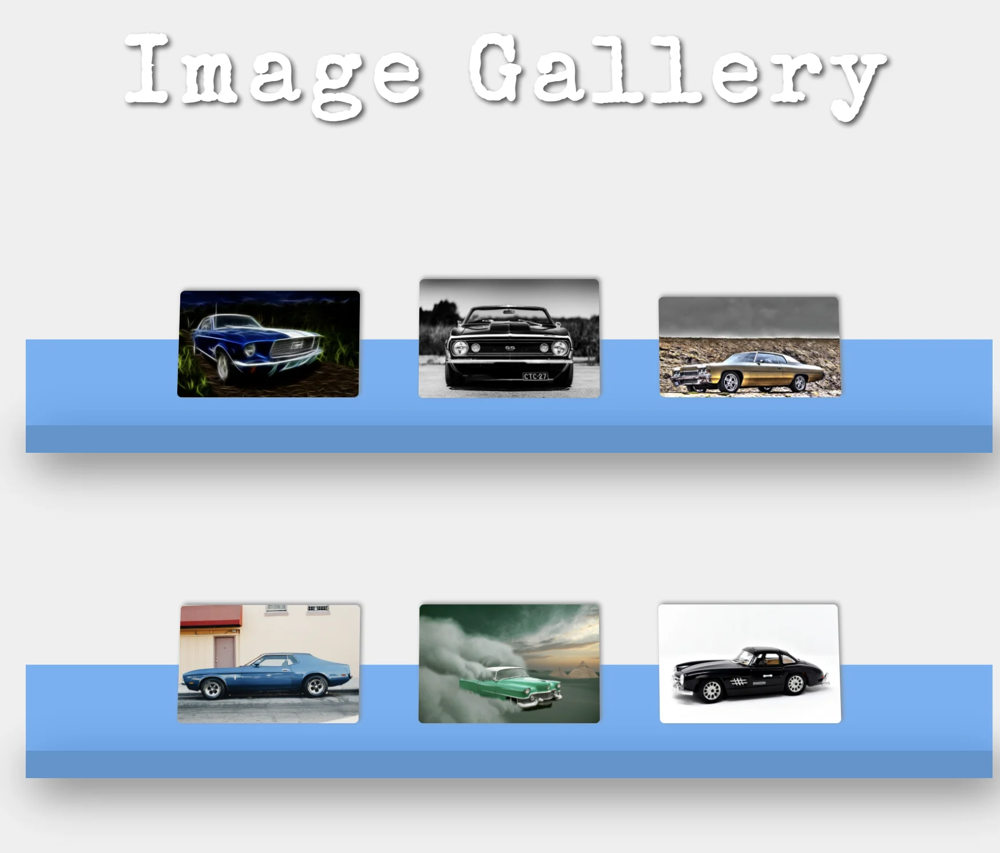

<a id="1c3eda9b0fe1815e98c5da2b4258e873"></a>

## Common Styles 

<a id="1c3eda9b0fe181d0a8c1d231678e6d98"></a>

```css
* {
  margin: 0;
  padding: 0;
  outline: none;
  box-sizing: border-box;
  text-decoration: none;
  list-style-type: none;
  font-weight: 400;
  font-family: "Special Elite", cursive;
  text-transform: capitalize;
}

html {
  font-size: 62.5%;
  scroll-behavior: smooth;
}

body {
  background-color: #ccc;
  padding-right: 3rem;
}

.center {
  display: flex;
  align-items: center;
  justify-content: center;
}
```

<a id="1c3eda9b0fe1816a82c1e51bf22b3b68"></a>

```css
/* Common Section Styles */
.wrapper {
  width: 100%;
  perspective: 50rem;
}

section {
  width: 100%;
  height: 100vh;
  background-color: #efefef;
  position: relative;
  left: 0;
  margin-bottom: 3rem;
  transform-origin: left;
  box-shadow: 0.5rem 0.5rem 1rem #aaa;
  padding: 5rem 0;
  transition: left 0.5s, transform 0.5s;
}

section.change {
  left: 15vw;
  transform: rotateY(10deg);
}

.section-heading {
  font-size: 10rem;
  font-weight: bolder;
  color: #fff;
  margin-bottom: 10rem;
  letter-spacing: 1rem;
  text-align: center;
  text-shadow: 0.3rem 0.3rem 0.5rem #555;
}
```

<a id="1c3eda9b0fe181d88df8ff8095dea561"></a>

## Section  &#45; menu

- 기본
    

- 클릭 시 
    

<a id="1c3eda9b0fe18170a208c37126f0457c"></a>

### html

<a id="1c3eda9b0fe1812f9deee8e53648e7d8"></a>

```html
<!-- Menu -->
    <div class="menu target center">
      <div class="menu-line menu-line-1"></div>
      <div class="menu-line menu-line-2"></div>
    </div>
    <!-- End of Menu -->
```

<a id="1c3eda9b0fe181eca1a4c4fa00c4ad1d"></a>

### css

<a id="1c3eda9b0fe181388aeeeee428254fb8"></a>

```css
.menu {
  width: 4rem;
  height: 4rem;
  position: fixed;
  top: 2rem;
  left: 2rem;
  z-index: 10;
  flex-direction: column;
  cursor: pointer;
  transition: all 0.5s;
}

.menu.change {
  transform: rotate(45deg);
  left: 15vw;
}

.menu-line {
  width: 100%;
  height: 0.2rem;
  background-color: #fff;
  margin: 0.3rem 0;
  box-shadow: 0.1rem 0.1rem 0.3rem #222;
  transition: transform 0.5s;
}

.change .menu-line-1 {
  transform: rotate(270deg) translateX(-0.4rem);
}

.change .menu-line-2 {
  transform: rotate(360deg) translateY(-0.4rem);
}
```

<a id="1c3eda9b0fe181779355cd96d7b19f5c"></a>

### js

<a id="1c3eda9b0fe18184aa34e6b8d4dc4405"></a>

```javascript
document.querySelector(".menu").addEventListener("click", () => {
  document.querySelectorAll(".target").forEach((item) => {
    item.classList.toggle("change");
  });
});
```

<a id="1c3eda9b0fe18159a358e28953a5cf07"></a>

## Section  &#45; navar



<a id="1c3eda9b0fe18176a429e0b13c6c94aa"></a>

### html

<a id="1c3eda9b0fe18191b792cffb89e4dac4"></a>

```html
<!-- Navbar -->
    <nav class="navbar target">
      <a href="#home" class="navbar-link">Home</a>
      <a href="#popular-cars" class="navbar-link">Popular Cars</a>
      <a href="#video-gallery" class="navbar-link">Video Gallery</a>
      <a href="#image-gallery" class="navbar-link">Image Gallery</a>
      <a href="#contact" class="navbar-link">Contact</a>
    </nav>
    <!-- End of Navbar -->
```

<a id="1c3eda9b0fe181ee862ef2a95da811c7"></a>

### css

<a id="1c3eda9b0fe181c9bd67e1f8ddec2138"></a>

```css
.navbar {
  width: 15vw;
  height: 100vh;
  background-color: #fff;
  position: fixed;
  top: 0;
  left: -15vw;
  display: flex;
  flex-direction: column;
  padding: 4rem 0 0 2rem;
  z-index: 10;
  transition: left 0.5s;
}

.navbar.change {
  left: 0;
}

.navbar-link {
  font-size: 1.5rem;
  font-weight: 600;
  margin: 2rem 0;
  color: #777;
  letter-spacing: 0.3rem;
  text-transform: uppercase;
  transition: color 0.3s;
}

.navbar-link:hover {
  color: #111;
}

.wrapper {
  width: 100%;
  perspective: 50rem;
}
```

<a id="1c3eda9b0fe18112afd2ffd58fb087e6"></a>

### js

<a id="1c3eda9b0fe1817fa45efa28f57d60f7"></a>

```javascript
// menu click 시 navbar 보여주기
document.querySelector(".menu").addEventListener("click", () => {
  document.querySelectorAll(".target").forEach((item) => {
    item.classList.toggle("change");
  });
});

// navbar 감추기
document.querySelectorAll(".wrapper").forEach((item) => {
  item.addEventListener("click", () => {
    document.querySelectorAll(".target").forEach((item) => {
      item.classList.remove("change");
    });
  });
});
```

<a id="1c3eda9b0fe181a0bc20c2fbe6654be8"></a>

## Section  &#45; header(classic car)



<a id="1c3eda9b0fe1811abde5e687e0b37115"></a>

### html

<a id="1c3eda9b0fe181d2ab52f00ffca83829"></a>

```html
<!-- Section 1 -->
    <div class="wrapper">
      <section class="section-1 target center" id="home">
        <h1 class="section-heading section-1-heading">Classic Cars</h1>
        
      </section>
    </div>
    <!-- End of Section 1 -->
```

<a id="1c3eda9b0fe181c792b8dd21cf794d1f"></a>

### css

<a id="1c3eda9b0fe1810290e5d2888ed49af5"></a>

```css
.section-1 {
  flex-direction: column;
  background: url(../images/bg-section1.jpg) center no-repeat;
  background-size: cover;
}

.section-1 .section-1-heading {
  margin-bottom: 3rem;
  text-transform: uppercase;
  text-shadow: 1rem 1rem 1rem #000, 2rem 2rem 2rem #111, 3rem 3rem 3rem #222;
}

.section-1-img {
  width: 70%;
}
```

<a id="1c3eda9b0fe181b0ba6beafb9259f31e"></a>

## Section  &#45;  main 1 (popular cars)



<a id="1c3eda9b0fe1817c8ac9c36504ac91ab"></a>

### html

<a id="1c3eda9b0fe18175814de4a622f3fc28"></a>

```html
<!-- Section 2 -->
    <div class="wrapper">
      <section class="section-2 target" id="popular-cars">
        <h1 class="section-heading">Popular Cars</h1>
        <div class="cards-wrapper center">
          <div class="card">
            <h2 class="car-name">Car Name</h2>
            
            <h3 class="car-price">$ 200,000</h3>
            <button type="button" class="card-btn">See More</button>
          </div>
          <div class="card">
            <h2 class="car-name">Car Name</h2>
            
            <h3 class="car-price">$ 100,000</h3>
            <button type="button" class="card-btn">See More</button>
          </div>
          <div class="card">
            <h2 class="car-name">Car Name</h2>
            
            <h3 class="car-price">$ 150,000</h3>
            <button type="button" class="card-btn">See More</button>
          </div>
        </div>
      </section>
    </div>
    <!-- End of Section 2 -->
```

<a id="1c3eda9b0fe181bbba24e6ad1721c647"></a>

### css

<a id="1c3eda9b0fe18171a826f6f8d2eaefbd"></a>

```css
.section-2 {
  display: flex;
  flex-direction: column;
  justify-content: space-around;
}

.card {
  width: 50rem;
  margin: 0 3rem;
  background-color: #fff;
  padding: 1rem;
  box-shadow: 0.6rem 0.6rem 0.6rem #bbb;
  position: relative;
  transition: box-shadow 0.5s;
}

.card:hover {
  box-shadow: 0.8rem 0.8rem 0.8rem #bbb;
}

.car-name {
  font-size: 2rem;
  font-weight: 600;
  text-transform: uppercase;
  color: #fff;
  position: absolute;
  top: 2rem;
  left: 2rem;
  z-index: 10;
}

.card-img {
  width: 100%;
  opacity: 0.8;
  transition: opacity 0.5s;
}

.card:hover .card-img {
  opacity: 1;
}

.car-price {
  font-size: 1.8rem;
  color: #777;
  margin: 0.5rem 0;
}

.card-btn {
  width: 100%;
  background-color: #fff;
  font-size: 1.7rem;
  letter-spacing: 0.3rem;
  text-transform: uppercase;
  border: none;
  margin-top: 1rem;
  padding: 0.5rem;
  color: #fff;
  text-shadow: 0.1rem 0.1rem 0.3rem #000;
  box-shadow: 0.1rem 0.1rem 0.5rem #bbb;
  cursor: pointer;
}
```

<a id="1c3eda9b0fe181398c52cb1a66a08115"></a>

## Section  &#45; main 2 (video gallery)



<a id="1c3eda9b0fe181c883dde9816282896c"></a>

### html

<a id="1c3eda9b0fe181028a7fe2d974787de8"></a>

```html
<div class="wrapper">
      <section class="section-3 target" id="video-gallery">
        <h1 class="section-heading">video gallery</h1>
        <div class="video-wrapper center">
          <video src="images/car-video-1.mp4" muted loop class="video"></video>
          <video src="images/car-video-2.mp4" muted loop class="video"></video>
          <video src="images/car-video-3.mp4" muted loop class="video"></video>
          <video src="images/car-video-4.mp4" muted loop class="video"></video>
          <video src="images/car-video-5.mp4" muted loop class="video"></video>
          <video src="images/car-video-6.mp4" muted loop class="video"></video>
        </div>
      </section>
    </div>
```

<a id="1c3eda9b0fe181d891e3dd107c421916"></a>

### css

<a id="1c3eda9b0fe181348506ed3b0a9f83a1"></a>

```css
.section-3 {
  background-color: #222;
  display: flex;
  flex-direction: column;
  justify-content: space-around;
}

.video-wrapper {
  display: flex;
  flex-wrap: wrap;
}

.video {
  width: 30%;
  margin: 7rem 1.5rem;
  border-radius: 0.5rem;
  opacity: 0.8;
  box-shadow: 0.3rem 0.3rem 0.5rem #111;
  transition: all 0.5s;
}

.video:hover {
  opacity: 1;
  box-shadow: 0.5rem 0.5rem 1rem #111;
}
```

<a id="1c3eda9b0fe18113a9bde0d1ce66ff11"></a>

### js

<a id="1c3eda9b0fe1813c80dbebf69fe78927"></a>

```javascript
// video gallery
const videos = document.querySelectorAll(".video");

videos.forEach((video) => {
  video.addEventListener("mouseover", () => {
    video.play();
  });
  video.addEventListener("mouseout", () => {
    video.pause();
  });
});
```

<a id="1c3eda9b0fe1811e9f92e53acb0756ec"></a>

## Section  &#45; main 3 (image gallery)



<a id="1c3eda9b0fe18123bc23f150d60fe63e"></a>

### html

<a id="1c3eda9b0fe181de8d34dc24a60d0520"></a>

```html
<!-- Section 4 -->
    <div class="wrapper">
      <section class="section-4 target" id="image-gallery">
        <h1 class="section-heading">Image Gallery</h1>
        <div class="gallery center">
          <div class="gallery-shelf"></div>
          
          
          
        </div>
        <div class="gallery center">
          <div class="gallery-shelf"></div>
          
          
          
        </div>
      </section>
    </div>
    <!-- End of Section 4 -->
```

<a id="1c3eda9b0fe181a997a2d7c494e2870a"></a>

### css

<a id="1c3eda9b0fe1810badafdebed84c4d64"></a>

```css
.section-4 {
  display: flex;
  flex-direction: column;
  justify-content: space-between;
}

.gallery {
  margin: 10rem 0;
  perspective: 10rem;
}

.gallery-shelf {
  width: 80%;
  height: 3rem;
  background-color: rgba(38, 126, 199, 0.8);
  margin: auto;
  position: relative;
  box-shadow: 1rem 1rem 5rem #444;
}

.gallery-shelf::before {
  content: "";
  position: absolute;
  width: 100%;
  height: 10rem;
  background-color: rgba(34, 152, 248, 0.7);
  top: -10rem;
  transform: rotateX(20deg);
  transform-origin: bottom;
}

.gallery img {
  width: 15%;
  position: absolute;
  bottom: 6rem;
  transform: translateX(-50%) rotateX(0.5deg);
  box-shadow: 0.2rem -0.2rem 0.5rem #888;
  border-radius: 0.5rem;
  transform-origin: bottom;
  transition: all 0.3s;
}

.gallery img:hover {
  transform: translateX(-50%) rotateX(0);
  box-shadow: 0 0.2rem 0.3rem #888;
}

.gallery-img-1 {
  left: 50%;
}

.gallery-img-2 {
  left: 30%;
}

.gallery-img-3 {
  left: 70%;
}
```

<a id="1c3eda9b0fe1813e9273dcaca7119275"></a>

## Section  &#45; footer (contact)


<a id="1c3eda9b0fe181bd9d26cfc3deb00a1c"></a>

### html

<a id="1c3eda9b0fe18123b08ade5b60792a43"></a>

```html
<!-- Section 5 -->
    <div class="wrapper">
      <section class="section-5 target" id="contact">
        <h1 class="section-heading">Contact Us</h1>
        <form class="contact-form">
          <input type="text" class="form-input" placeholder="Your Full Name" />
          <input type="email" class="form-input" placeholder="Your Email" />
          <textarea class="form-input" placeholder="Enter Message"></textarea>
          <input class="form-btn" type="submit" value="Submit" />
        </form>
        <p class="copyright">
          Copyright &copy; CodeAndCreate All Rights Reserved
        </p>
      </section>
    </div>
    <!-- End of Section 5 -->
```

<a id="1c3eda9b0fe1814f85f1c1fadd2e2cf4"></a>

### css

<a id="1c3eda9b0fe181ddae80eb517523d370"></a>

```css
.section-5 {
  background: linear-gradient(rgba(0, 0, 0, 0.6), rgba(0, 0, 0, 0.8)),
    url(images/bg-section5.jpg) center no-repeat;
  background-size: cover;
  display: flex;
  flex-direction: column;
  justify-content: space-around;
  align-items: center;
  margin-bottom: 0;
}

.contact-form {
  width: 60rem;
  height: 45rem;
  background-color: rgba(255, 255, 255, 0.2);
  border: 2rem solid rgba(255, 255, 255, 0.8);
  display: flex;
  flex-direction: column;
  justify-content: center;
  padding: 5rem;
}

.contact-form input,
.contact-form textarea {
  width: 100%;
  height: 4rem;
  margin: 2rem 0;
  background-color: transparent;
  padding: 0.5rem;
  border: 0.1rem solid #fff;
  font-size: 1.5rem;
  letter-spacing: 0.1rem;
  color: #fff;
  flex-shrink: 0;
  transition: background-color 0.5s;
}

.contact-form textarea {
  max-width: 100%;
  min-height: 8rem;
}

.form-input:focus {
  background-color: rgba(255, 255, 255, 0.5);
}

.contact-form .form-btn {
  background-color: rgba(255, 255, 255, 0.8);
  font-weight: 600;
  letter-spacing: 0.3rem;
  color: #444;
  cursor: pointer;
}

.copyright {
  font-size: 2rem;
  font-weight: 300;
  color: #fff;
  text-align: center;
}
```

<a id="1c3eda9b0fe181419140e3dd517d2490"></a>

## Section &#45; Responsive web

<details>
<summary>CSS</summary>

<a id="1c3eda9b0fe181b3a780dd538f0b9979"></a>

```css
/* Responsive */
@media (max-width: 1500px) {
  .navbar {
    width: 20vw;
    padding: 2rem 0 0 2rem;
    left: -20vw;
  }

  .menu.change {
    left: 20vw;
  }

  section.change {
    left: 20vw;
    transform: rotateY(15deg);
  }

  .section-heading {
    font-size: 7rem;
  }

  .section-1 {
    justify-content: space-evenly;
  }

  .section-2 {
    height: auto;
    padding: 5rem 0 10rem 0;
  }

  .cards-wrapper {
    flex-wrap: wrap;
  }

  .card {
    width: 40rem;
    margin: 3rem;
  }

  .section-3 {
    padding: 5rem 3rem;
  }

  .video {
    width: 30%;
    margin: 2rem;
  }

  .section-4 {
    height: auto;
  }

  .gallery {
    margin: 12rem 0;
  }

  .gallery-shelf {
    width: 90%;
  }

  .gallery img {
    width: 20%;
  }

  .gallery-img-2 {
    left: 25%;
  }

  .gallery-img-3 {
    left: 75%;
  }

  .section-5 {
    height: auto;
  }

  .contact-form {
    width: 55rem;
    height: 40rem;
    padding: 2rem;
  }

  .copyright {
    margin-top: 5rem;
  }
}

@media (max-width: 1000px) {
  body {
    padding-right: 0;
  }

  .navbar {
    width: 25vw;
    left: -25vw;
  }

  .menu.change {
    left: 25vw;
  }

  section.change {
    left: 25vw;
    transform: rotateY(20deg);
  }

  .section-1-img {
    width: 90%;
  }

  .section-3 {
    height: auto;
  }

  .videos-wrapper {
    flex-direction: column;
  }

  .video {
    width: 70%;
    margin: 3rem 0;
  }
}

@media (max-width: 750px) {
  .navbar {
    width: 30vw;
    left: -30vw;
  }

  .menu.change {
    left: 30vw;
  }

  section.change {
    left: 30vw;
    transform: rotateY(25deg);
  }

  .section-heading {
    font-size: 5.5rem;
  }

  .section-4 {
    padding: 6rem 0 1rem 0;
  }

  .gallery-shelf {
    height: 1.5rem;
    width: 95%;
  }

  .gallery-shelf::before {
    height: 5rem;
    top: -5rem;
  }

  .gallery img {
    width: 25%;
    bottom: 4rem;
  }

  .gallery-img-2 {
    left: 22%;
  }

  .gallery-img-3 {
    left: 78%;
  }
}

@media (max-width: 600px) {
  html {
    font-size: 55.5%;
  }

  .navbar {
    width: 40vw;
    left: -40vw;
  }

  .menu.change {
    left: 40vw;
  }

  section.change {
    left: 0;
    transform: rotateY(0);
  }

  .section-heading {
    font-size: 4.5rem;
  }

  .section-1-img {
    width: 100%;
  }

  .video {
    width: 100%;
    margin: 2rem 0;
  }

  .gallery {
    margin: 9rem 0;
  }

  .contact-form {
    width: 40rem;
    border: 1rem solid rgba(255, 255, 255, 0.8);
  }
}

@media (max-width: 400px) {
  html {
    font-size: 40%;
  }

  .copyright {
    width: 80%;
  }
}
/* End of Responsive */
```

</details>
