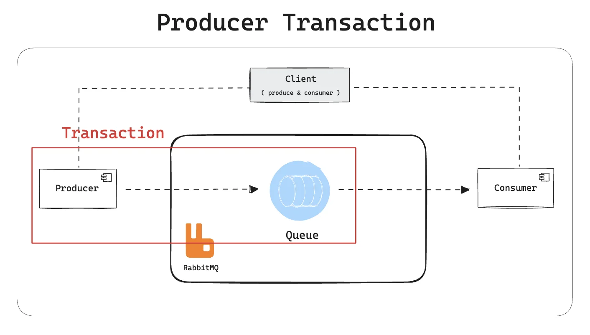
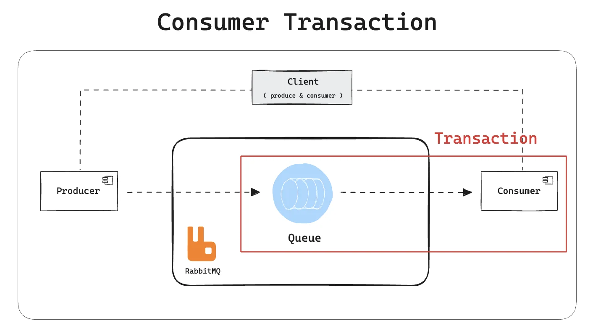

<a id="1c3eda9b0fe1811892dffcf655ad87e2"></a>

## 큐 ( RabbitMQ )의 트랜잭션 처리 

---

<a id="1c3eda9b0fe18169a0a2e40376d527eb"></a>

### 1&#46; DB 연동 메시지 큐의 Transaction  처리 

> ✏️ 
> 
> <a id="1c3eda9b0fe181f3b198e78984e977ff"></a>
> 
> <strong>트랜잭션 메세징</strong>
> 
> <a id="1c3eda9b0fe181bba8f4d3a4497cf1de"></a>
> 
> RabbitMQ에서의 트랜잭션 메세징은 <strong><u>DB에서의 트랜잭션 개념과 동일</u></strong>하다&#46; 
> 
> - <strong>메세지를 큐에 보내는 동안 </strong><strong><u>문제 발생</u></strong> →  <u><code>롤백</code></u>
> 
> - 메세지가 <strong><u>성공</u></strong>적으로 전송 →  <u><code>커밋</code></u> ( 메세지가 성공적으로 처리되었음을 보장 )
> 
> <a id="1c3eda9b0fe18141992be214886aa949"></a>
> 
> 이를 통해 <u>메세지 전송 중 </u><strong><u>데이터의 일관성을 보장</u></strong>하고,<strong> </strong><strong><u>실패 시 </u></strong><strong><u>메세지를 재전송</u></strong>하거나 <strong><u>복구</u></strong>할 수 있다&#46;

<details>
<summary>트랜잭션 종류</summary>

<details>
<summary>1&#46; 프로듀서 트랜재션</summary>



- 메세지를 MQ에 전송하기 전 트랜잭션 시작

- 메세지를 큐에 게시한 후 트랜잭션 커밋 or 롤백

- 실패 시 메세지가 큐로 producing 되지 않음

- <strong><u>동기</u></strong><u>적으로 동작</u>되는 것과 같기 때문에 <strong><u>속도 문제가 있</u></strong>다&#46; 
    - 비동기 특징에 부합하지 않는다&#46; 

</details>

<details>
<summary>2&#46; 컨슈머 트랜잭션</summary>



- 메세지를 수신한 후 트랜잭션 시작 &#45; RabbitMQ 브로커에 도달했음을 알림

- 메세지를 처리한 뒤 커밋

- 실패 시 메세지를 다시 처리하거나 DLQ로 이동

- <strong><u>대규모 메세지 처리 </u></strong>방식에 권장

</details>

</details>

<a id="1c3eda9b0fe18114a7f6c45e0d6b5151"></a>

### 실습)  &#91;<code>Producer Transaction</code>&#93; 명시적으로 큐의 트랜잭션 처리

<details>
<summary>트랜잭션 개발 플로우</summary>

<a id="1c3eda9b0fe181a58dd9ca4bf6f005a6"></a>

amqp&#45;client 의존성 ( <code>starter&#45;amqp</code>에 포함됨 )

1. <code>channel&#46;txSelect()</code>
    - 트랜잭션 시작, 이후 모든 메세지 전송 작업은 이 트랜잭션 내에서 실행

1. <code>channel&#46;txCommit()</code>
    - 트랜잭션 커밋, 모든 작업이 성공적으로 수행되었음을 RabbitMQ에 알림&#46;

<a id="1c3eda9b0fe181c0aa46fb43f7a78e4e"></a>

3&#46; <code>channel&#46;txRollback()</code>

- 트랜잭션 롤백, 트랜잭션 내 작업을 무효화하고 변경사항을 되돌림&#46;

<a id="1c3eda9b0fe181bd8c09f5403bc889a1"></a>

⇒ <code>setChannelTransacted(true)</code>, <code>&#64;Transactional</code>로 처리 가능 

</details>

<details>
<summary>Package Structure</summary>

<a id="1c3eda9b0fe1818da968cf8c5e59c765"></a>

```java
src/main/java/com/prac/hellomessagequeue
rabbitmq
 ├── RabbitmqApplication.java
 └── step9
	   ├── MessageConsumer.java
     ├── MessageProducer.java
	   ├── RabbitMQConfig.java
     ├── StockEntity.java
     ├── StockRepository.java     
     └── TransactionController.java
```

</details>

<details>
<summary>실습 </summary>

<a id="1c3eda9b0fe18173ad26eb391032239c"></a>

<a href="#/post/1c3eda9b-0fe1-810b-8930-d3bd4910e4b5">페이지</a> 

</details>

<details>
<summary><strong>트랜잭션 메시징의 한계</strong></summary>

1. <strong><code>성능 오버헤드</code></strong>
    - 트랜잭션은 추가적인 작업(예&#58; 디스크 동기화)을 요구하므로 성능이 떨어질수있음

    - <strong>대량 메시지 처리</strong>가 필요한 경우 부적합&#46;

1. <strong><code>복잡성</code></strong>
    - 트랜잭션 처리를 잘못 구성하면 메시지가 중복 처리되거나 손실될 가능성 증가&#46;

1. <code>분산 트랜잭션을 완벽하게 보장하지는 않음</code>
    - 데이터베이스 작업과 메시지 전송 사이의 완벽한 원자성을 위해서는 추가적인 메커니즘(예&#58; 2 Phase Commit 또는 보상 트랜잭션)이 필요함

> 👍🏻 
> 
> <a id="1c3eda9b0fe1811c9b69ff29ea48b03b"></a>
> 
> <strong> </strong><strong>AMQP Confirm Selec</strong><strong>t 추천</strong>
> 
> - RabbitMQ에서는 트랜잭션 대신 <strong><u>Publisher Confirms(AMQP Confirm Select) </u></strong>방식이 더 효율적
> 
> <a id="1c3eda9b0fe1817dac92ed3a9992ed74"></a>
> 
>        ( 자세한 내용은 아래 참조 )

</details>

<a id="1c3eda9b0fe1812fbee3d29d2dd1c274"></a>

### 2&#46; Publisher Confirm

> ✏️ 
> 
> <a id="1c3eda9b0fe18125b319c376231eac07"></a>
> 
> <strong>Publisher Confirms</strong>
> 
> <a id="1c3eda9b0fe181af95ebd10e9594bfe8"></a>
> 
> 메시지가 <strong>브로커의 Exchange에 도달했는지</strong> 확인하는 메커니즘
> 
> - 메시지가 RabbitMQ 브로커에 성공적으로 도달했는지 확인하기 위해 사용되는 경량화된 메커니즘
> 
> -  서로 다른 이기종간의 신뢰성 보정
> 
> - 대사 기법인 TCC와 비슷하다&#46;
> 
> <a id="1c3eda9b0fe181b382fbcd34002a2dfc"></a>
> 
> 이는 트랜잭션보다 성능이 뛰어나며, 메시지가 브로커에 안전하게 저장 되었는지 확인하는 데 적합하다&#46; 또한 동작이 가볍다&#46; 따라서 시스템 부담이 적고 빠르다&#46; 

<details>
<summary>특징 </summary>

1. 가볍고 빠름
    - 개별 메세지 단위로 전송 후 브로커로부터 확인(acknowledgment)을 받는다 

    - 트랜잭션처럼 모든 메시지 작업을 롤백하지 않고, 실패한 메시지만 다시 처리한다&#46;

1. <strong>응답 처리 방식</strong>
    - Ack &#58; 브로커가 메시지를 성공적으로 처리했음을 알림

    - Nack<strong> </strong>&#58; 브로커가 메시지 처리에 실패했음을 알림

1. <strong>활용 사례</strong>
    - 대규모 메시지 전송

    - 메시지 손실 방지가 중요한 시스템(예&#58; 결제 시스템, 알림 시스템)

</details>

<a id="1c3eda9b0fe18177bf92f602a8de3225"></a>

### 실습) 

<details>
<summary>테스트 시나리오</summary>

- 정상 케이스
    <a id="1c3eda9b0fe181a0ae23d2685cd09483"></a>

    ```java
    curl -X POST "http://localhost:8080/api/message?testCase=false" \
         -H "Content-Type: application/json" \
         -d '{"userId":"USER1","stock":10}'
    ```

- 실패 케이스 &#45; RabbitMQ 전송 실패
    <a id="1c3eda9b0fe1815e9622e9d4ba2e218d"></a>

    ```java
    curl -X POST "http://localhost:8080/api/message?testCase=true" \
         -H "Content-Type: application/json" \
         -d '{"userId":"USER1","stock":10}'
    ```

- 실패 케이스 &#45; DB 저장 실패 
    <a id="1c3eda9b0fe1815ab7f2c6302a20fbb9"></a>

    ```java
    curl -X POST "http://localhost:8080/api/message?testCase=false" \
         -H "Content-Type: application/json" \
         -d '{"userId":"","stock":10}'
    ```

</details>

<details>
<summary>실습</summary>

<a id="1c3eda9b0fe181c4b5a0dfaf3f168d9c"></a>

<a href="#/post/1c3eda9b-0fe1-81a9-9e3d-e4f60dd1e2f7">페이지</a> 

</details>

<a id="1c3eda9b0fe181889abef67e6f0be2d6"></a>

<code>correlationData</code>는 Publisher confirm 에서 주로 사용되는 객체이다 

<a id="1c3eda9b0fe1817aadc2fd8e895a33e3"></a>

메시지 전송 상태를 추적하기 위해 RabbitTemplate  과 같이 사용된다&#46; 

- 메세지 전송의 <strong><u>성공</u></strong> 과 <strong><u>실패 확인</u></strong> 및 <strong><u>추가 로직 작성</u></strong>을 위해 쓰인다&#46;

<a id="1c3eda9b0fe1817397aac1e442d2c3e4"></a>

<strong><u>메세지 추적을 위한 Id</u></strong>는 보통 <code>UUID</code>로 선언해 사용한다&#46;

- 해당 예시에서는 <strong><u>엔티티 식별자</u></strong> 사용

<a id="1c3eda9b0fe1819087c1c14a9b159e5a"></a>

### 3&#46; TCC

> ☝🏻 
> 
> <a id="1c3eda9b0fe181e0a690f0cb23136df2"></a>
> 
> TCC라고 해서 특별한 어떤 라이브러리나 아키텍처를 사용하는 방식이 아닌 코드 레벨에서 업무적으로 프로세싱을 어떻게 해야한다 라는 것을 설명하는 것이기 때문에, 이론 적인 부분만 설명을 진행한다&#46;
