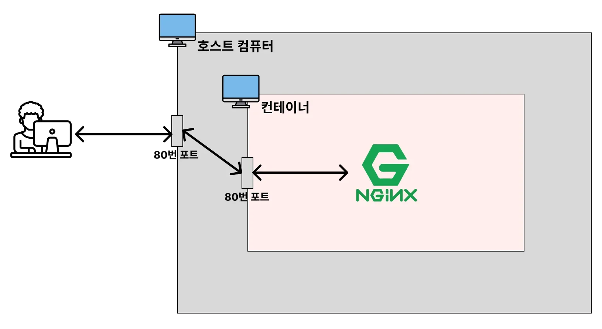
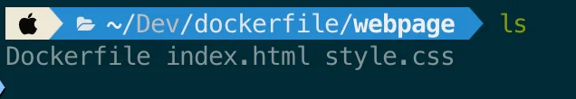
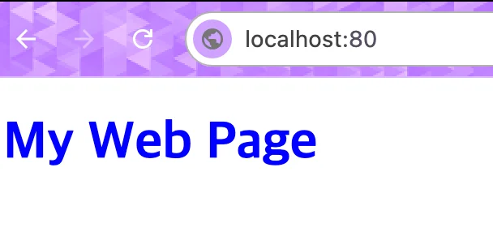
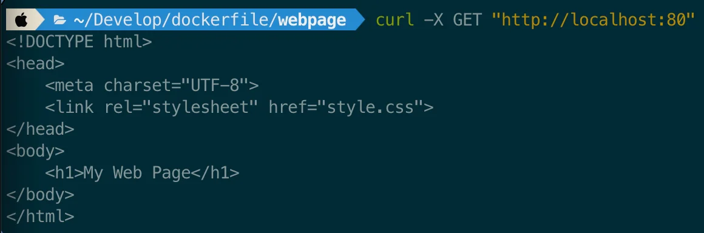

<a id="1c3eda9b0fe181799a68ddfe8c7838e9"></a>

## 웹 프론트엔드 프로젝트 ( HTML, CSS, Nginx ) Docker 베포

---



1. <strong>HTML, CSS 파일 생성 </strong>
    <details>
    <summary>index&#46;html</summary>

    <a id="1c3eda9b0fe1814ea115ff0bd3a826ee"></a>

    ```html
    <!DOCTYPE html>
    <head>
        <meta charset="UTF-8">
        <link rel="stylesheet" href="style.css">
    </head>
    <body>
        <h1>My Web Page</h1>
    </body>
    </html>
    ```

    </details>

    <details>
    <summary>style&#46;css</summary>

    <a id="1c3eda9b0fe181428ba6ff04a91a23e2"></a>

    ```css
    * {
      color: blue;
    }
    ```

    </details>

1. <strong><code>Dockerfile</code></strong> 작성
    

    <a id="1c3eda9b0fe18116997fd8f69b110519"></a>

    ```docker
    FROM node:20-alpine

    WORKDIR /app

    COPY . .

    RUN npm install

    RUN npm run build

    EXPOSE 3000

    ENTRYPOINT [ "npm", "run", "start" ]
    ```

    - <code>alpine</code> 
        - 불필요한 프로그램을 포함하지 않고 이미지 크기를 최소화한 버전

        - 실제 배포 할 때도 되도록이면 <code>alpine</code> 버전을 사용한다&#46; 

1. 이미지 빌드, 실행
    <a id="1c3eda9b0fe18123a417fe7a5d3a1854"></a>

    ```bash
    # 이미지 빌드 확인 
    docker build -t my-web-server .

    # 이미지 생성 확인
    docker image ls

    # 컨테이너 실행
    docker run -d -p 80:80 my-web-server

    # 컨테이너 실행 확인
    docker ps
    ```

1. <strong><a href="http://localhost:80">localhost&#58;80</a></strong><strong> 접속</strong>
    

    <a id="1c3eda9b0fe1818c9b27dfdd0bb97a32"></a>

    ```bash
     curl -X GET "http://localhost:80"
    ```

    

1. <strong>실행시킨 컨테이너 중지 / 삭제, 이미지 삭제</strong>
    <a id="1c3eda9b0fe1818d92c4f657fd843614"></a>

    ```bash
    docker stop {컨테이너 ID}
    docker rm {컨테이너 ID}
    docker image rm {이미지 ID}
    ```
