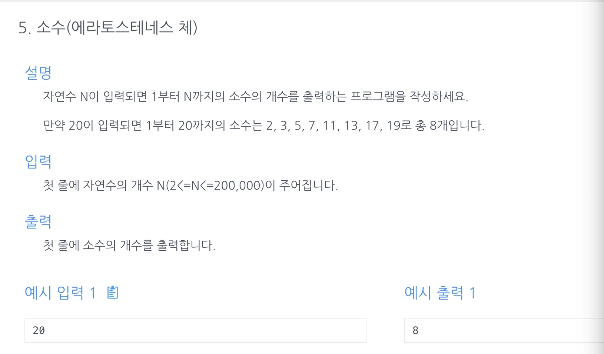

<a id="1c3eda9b0fe181048295e03dc2d03638"></a>

## 문제)



<a id="1c3eda9b0fe18171ab1ed89ccb51cf84"></a>

## 풀이

<a id="1c3eda9b0fe181b3bf6be76d2e84ecf6"></a>

### 소수를 판단할 알고리즘 작성이 관건&#46;&#46;

<a id="1c3eda9b0fe1811f8b89e3fd34d65849"></a>

### 내 풀이)

<a id="1c3eda9b0fe181eb91c1e090d33c7378"></a>

<a href="https://drexpp.tistory.com/entry/Java-%EC%9E%90%EB%B0%94-%EC%86%8C%EC%88%98-%ED%8C%90%EB%B3%84%ED%95%A8%EC%88%98-isPrime">자바 소수 판별 알고리즘</a> → 디버깅 해보면 쉽게 이해 가능, 

> <code>Math&#46;sqrt</code>&#58; 제곱근을 처리, <code>(int)</code>&#58; 정수형으로 형변환

<a id="1c3eda9b0fe18147af8cc1b745c83a2d"></a>

제곱근 처리 후 정수형으로 형변환 시, 해당 숫자의 약수가 됨&#46;

<a id="1c3eda9b0fe1811b8796d105763eae83"></a>

ex) 8 → 2&#46;xx → 2, 8(1, 2, 4, 8) 

<a id="1c3eda9b0fe181c3ab2fe37c1eed7595"></a>

따라서  숫자 2부터 해당하는 숫자 사이의 값으로 나누어 0의 값이 나오면 소수가 아닌 것을 판별 가능하다&#46; (이건 좀 흥미로웠음) 

<a id="1c3eda9b0fe1813f9169e4916e325682"></a>

```java
import java.util.Scanner;

public class Main {
		// 소수 판별
    public boolean isPrime(int n) {
        for (int i = 2; i<=(int)Math.sqrt(n); i++) {
            if (n % i == 0) {
                return false;
            }
        }
        return true;
    }
    public int solution(int n){
        int cnt = 0;
        for(int i=2; i<n+1; i++){
            if(isPrime(i)) cnt++;
        }
        return cnt;
    }
    public static void main(String[] args) {
        Main m = new Main();
        Scanner sc = new Scanner(System.in);
        int n = sc.nextInt();
        System.out.println(m.solution(n));
    }
}
```

<a id="1c3eda9b0fe181c8b2facfb8b3c8e516"></a>

### 강의 풀이)

> <strong><a href="https://ko.wikipedia.org/wiki/%EC%97%90%EB%9D%BC%ED%86%A0%EC%8A%A4%ED%85%8C%EB%84%A4%EC%8A%A4%EC%9D%98_%EC%B2%B4">에라토스테네스의 체</a></strong><strong>  ← </strong>요거 매우 신박함&#46; 아주 재밌는 풀이

<a id="1c3eda9b0fe181079664f985d10c2456"></a>

인덱스로 배수의 값을 체크하면서 카운팅하기 → 

<a id="1c3eda9b0fe18104bfb6d4d5a9349930"></a>

```java
import java.util.ArrayList;
import java.util.Scanner;

public class Main {
    public int solution(int n) {
        int answer = 0;
        int[] sc = new int[n+1];
        for(int i=2; i<n+1; i++){
            if(sc[i]==0){
                answer++;
                for(int j=i; j<n+1; j=j+i){
                    if(sc[j]==1) continue;  //중복 할당 제거
                    sc[j]=1;
                }
            }
        }
        return answer;
    }
    public static void main (String[]args){
        Main m = new Main();
        Scanner sc = new Scanner(System.in);
        int n = sc.nextInt();
        System.out.println(m.solution(n));
    }

}
```
